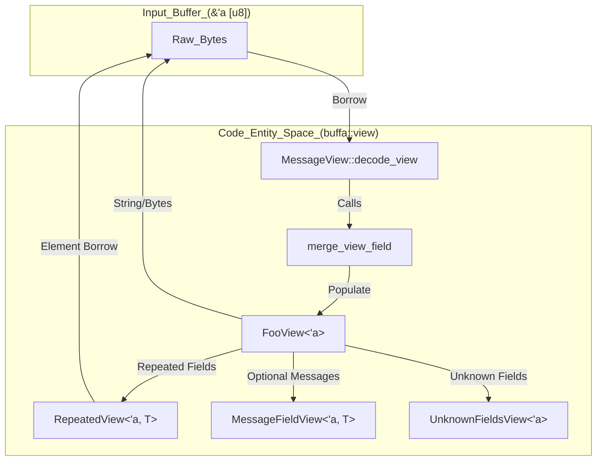
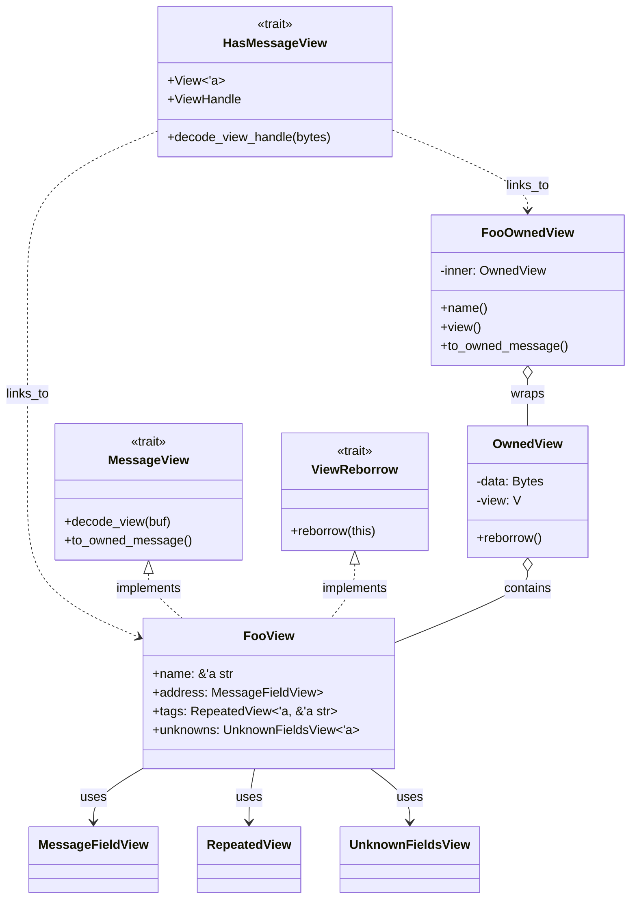

<!-- source: DeepWiki mcp.deepwiki.com · repo anthropics/buffa · page 2.2 Zero-Copy Views, OwnedView, and HasMessageView · fetched 2026-10-26 -->

# Zero-Copy Views, OwnedView, and HasMessageView

<details>
<summary>Relevant source files</summary>

The following files were used as context for generating this wiki page:

- [buffa-codegen/src/impl_message.rs](buffa-codegen/src/impl_message.rs)
- [buffa-codegen/src/impl_text.rs](buffa-codegen/src/impl_text.rs)
- [buffa-codegen/src/owned_view.rs](buffa-codegen/src/owned_view.rs)
- [buffa-codegen/src/view.rs](buffa-codegen/src/view.rs)
- [buffa-descriptor/src/reflect/containers.rs](buffa-descriptor/src/reflect/containers.rs)
- [buffa-test/src/tests/owned_view.rs](buffa-test/src/tests/owned_view.rs)
- [buffa-types/src/generated/google.protobuf.any.__view.rs](buffa-types/src/generated/google.protobuf.any.__view.rs)
- [buffa-types/src/generated/google.protobuf.duration.__view.rs](buffa-types/src/generated/google.protobuf.duration.__view.rs)
- [buffa-types/src/generated/google.protobuf.empty.__view.rs](buffa-types/src/generated/google.protobuf.empty.__view.rs)
- [buffa-types/src/generated/google.protobuf.field_mask.__view.rs](buffa-types/src/generated/google.protobuf.field_mask.__view.rs)
- [buffa-types/src/generated/google.protobuf.struct.__view.rs](buffa-types/src/generated/google.protobuf.struct.__view.rs)
- [buffa-types/src/generated/google.protobuf.timestamp.__view.rs](buffa-types/src/generated/google.protobuf.timestamp.__view.rs)
- [buffa-types/src/generated/google.protobuf.wrappers.__view.rs](buffa-types/src/generated/google.protobuf.wrappers.__view.rs)
- [buffa/src/lib.rs](buffa/src/lib.rs)
- [buffa/src/map_codec.rs](buffa/src/map_codec.rs)
- [buffa/src/message_field.rs](buffa/src/message_field.rs)
- [buffa/src/types.rs](buffa/src/types.rs)
- [buffa/src/view.rs](buffa/src/view.rs)

</details>


This page describes the `buffa` zero-copy view system. For every owned message type, `buffa` generates a corresponding "View" type that borrows data directly from the input buffer. This architecture eliminates allocations for `string` and `bytes` fields during decoding and provides a self-referential container, `OwnedView`, for safely moving these borrowed types across async boundaries or thread limits.

## The MessageView Trait

The `MessageView<'a>` trait is the counterpart to the `Message` trait for borrowed types [[buffa/src/view.rs:117-117]](). It defines the interface for zero-copy decoding and conversion back to owned types.

| Function | Description |
| :--- | :--- |
| `decode_view(buf: &'a [u8])` | The primary entry point for zero-copy decoding. It initializes a view and calls the internal recursive decoder [[buffa/src/view.rs:134-134]](). |
| `decode_view_with_ctx(buf, ctx)` | Decodes a view with custom decode limits (recursion, unknown fields), used by `DecodeOptions` [[buffa/src/view.rs:154-157]](). |
| `to_owned_message(&self)` | Deep-copies the borrowed data into a new instance of the owned message type [[buffa/src/view.rs:189-191]](). |
| `to_owned_from_source(source)` | Converts to owned, allowing zero-copy refcount bumps for `bytes::Bytes` fields if a source buffer is provided [[buffa/src/view.rs:215-218]](). |

### View Generation Logic
The `buffa-codegen` crate generates a `FooView<'a>` struct for every message `Foo` [[buffa-codegen/src/view.rs:99-99]]().
- **String/Bytes**: Represented as `&'a str` and `&'a [u8]` [[buffa-codegen/src/view.rs:5-6]]().
- **Oneofs**: Generated as a nested `FooKindView<'a>` enum mirroring the owned variants [[buffa-codegen/src/view.rs:7-8]]().
- **Field Representation**: String fields may be mapped to `&'a str` or `&'a [u8]` depending on `strict_utf8_mapping` and resolved features [[buffa-codegen/src/impl_message.rs:108-139]]().

**Sources:** [[buffa/src/view.rs:106-233]](), [[buffa-codegen/src/view.rs:1-110]](), [[buffa-codegen/src/impl_message.rs:108-139]]()

## Data Flow: From Buffer to View
The following diagram illustrates how the `decode_view` process maps wire format data to the generated `View` entities.

### Wire to View Mapping

**Sources:** [[buffa/src/view.rs:106-134]](), [[buffa-types/src/generated/google.protobuf.any.__view.rs:140-188]](), [[buffa-codegen/src/view.rs:5-10]]()

## ViewReborrow and OwnedView

### ViewReborrow Trait
The `ViewReborrow` trait is a safe trait that enables `OwnedView` to expose the real lifetime of its borrows [[buffa/src/view.rs:235-244]]().
- **Mechanism**: The `reborrow` method body is a covariance-checked subtype coercion [[buffa/src/view.rs:246-251]](). If a view type is invariant, the body fails to compile, ensuring safety without `unsafe` blocks.
- **Codegen**: `buffa-codegen` automatically emits `impl ViewReborrow` for every generated view type [[buffa-codegen/src/view.rs:175-175]]().

### OwnedView: Self-Referential Container
`OwnedView<V>` wraps a decoded view with the lifetime erased to `'static`, backed by a `bytes::Bytes` buffer [[buffa/src/view.rs:42-43]]().

- **Construction**: `OwnedView::decode(bytes)` decodes the view. It uses `unsafe` internally to extend the lifetime of the buffer to the view, as the view is guaranteed to be dropped before the buffer [[buffa/src/view.rs:291-307]]().
- **Reborrowing**: Use `owned.reborrow()` to get a view tied to the lifetime of the `OwnedView` container itself [[buffa/src/view.rs:328-330]]().
- **Safety**: It implements `Send` and `Sync` if the underlying view is `Send + Sync` [[buffa/src/view.rs:344-348]]().

**Sources:** [[buffa/src/view.rs:235-348]](), [[buffa/src/lib.rs:103-104]]()

## Generated FooOwnedView Wrappers

`buffa` generates a `FooOwnedView` wrapper for every message to provide ergonomic access [[buffa-codegen/src/owned_view.rs:3-10]]().

- **Field Accessors**: Each field gets a method (e.g., `owned.name()`) that returns data borrowed from `&self` [[buffa-codegen/src/owned_view.rs:141-143]]().
- **Safety**: Because accessors borrow from `&self`, field data cannot outlive the underlying buffer [[buffa/src/view.rs:61-64]]().
- **Reserved Methods**: If a field name collides with wrapper methods, the accessor is suppressed and a warning is issued [[buffa-codegen/src/owned_view.rs:31-41]]().

**Sources:** [[buffa-codegen/src/owned_view.rs:1-184]](), [[buffa/src/view.rs:57-64]]()

## HasMessageView Trait

The `HasMessageView` trait links an owned message type to its view family [[buffa/src/view.rs:408-417]]().

```rust
pub trait HasMessageView: Message {
    type View<'a>: MessageView<'a, Owned = Self>;
    type ViewHandle: From<OwnedView<Self::View<'static>>> + Into<OwnedView<Self::View<'static>>>;
    
    fn decode_view_handle(bytes: Bytes) -> Result<Self::ViewHandle, DecodeError>;
}
```

This trait allows writing generic code that can decode into a view handle and access the reborrowed view without naming concrete types [[buffa-test/src/tests/owned_view.rs:177-187]]().

**Sources:** [[buffa/src/view.rs:408-422]](), [[buffa-test/src/tests/owned_view.rs:170-197]]()

## Specialized View Types

### RepeatedView and MapView
- **`RepeatedView<'a, T>`**: Provides zero-copy access to repeated fields [[buffa/src/view.rs:96-96]](). It supports both packed and unpacked wire formats.
- **`MapView<'a, K, V>`**: A view over a map field, allowing iteration over key-value pairs without constructing a `HashMap` allocation [[buffa-types/src/generated/google.protobuf.struct.__view.rs:17-21]]().

### MessageFieldView
`MessageFieldView<V>` represents an optional sub-message view [[buffa/src/view.rs:97-97]](). It provides access to the nested view's fields if present and handles recursion limits during decoding [[buffa-types/src/generated/google.protobuf.struct.__view.rs:75-80]]().

### UnknownFieldsView
`UnknownFieldsView<'a>` preserves unrecognized fields by storing their raw byte spans from the input buffer [[buffa/src/view.rs:98-98]](). This allows for high-fidelity round-trips without allocating memory for the unknown data [[buffa-codegen/src/view.rs:36-45]]().

## View Architecture Overview

The following diagram bridges the natural language concepts of "Owned" and "Borrowed" to the specific code entities in the `buffa` runtime.

### Entity Relationship Diagram

**Sources:** [[buffa/src/view.rs:90-100]](), [[buffa/src/view.rs:235-244]](), [[buffa/src/view.rs:408-417]](), [[buffa-codegen/src/owned_view.rs:49-57]]()

### Conversion to Owned
The `to_owned_message` implementation in `FooView` performs the following mapping [[buffa/src/view.rs:189-191]]():
- `&'a str` $\rightarrow$ `String` (or configured `ProtoString` [[buffa/src/lib.rs:80-82]]())
- `&'a [u8]` $\rightarrow$ `Vec<u8>` or `bytes::Bytes` via `bytes_from_source` [[buffa-codegen/src/view.rs:57-74]]().
- `RepeatedView<'a, T>` $\rightarrow$ `Vec<T::Owned>`
- `MessageFieldView<T>` $\rightarrow$ `MessageField<T::Owned>`

**Sources:** [[buffa/src/view.rs:189-218]](), [[buffa-codegen/src/view.rs:57-74]](), [[buffa-types/src/generated/google.protobuf.any.__view.rs:189-205]]()

---

