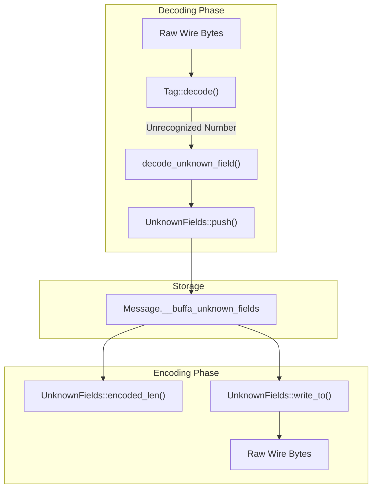
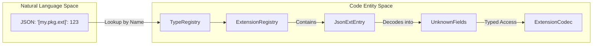

<!-- source: DeepWiki mcp.deepwiki.com · repo anthropics/buffa · page 2.4 Extensions and Unknown Fields · fetched 2026-10-26 -->

# Extensions and Unknown Fields

Relevant source files

The following files were used as context for generating this wiki page:

- [.changes/unreleased/changed-20260629-003205.yaml](.changes/unreleased/changed-20260629-003205.yaml)
- [.changes/unreleased/changed-20260629-051500.yaml](.changes/unreleased/changed-20260629-051500.yaml)
- [buffa-codegen/src/tests/view_codegen.rs](buffa-codegen/src/tests/view_codegen.rs)
- [buffa-descriptor/src/generated/google.protobuf.compiler.plugin.__view.rs](buffa-descriptor/src/generated/google.protobuf.compiler.plugin.__view.rs)
- [buffa-descriptor/src/generated/google.protobuf.descriptor.__view.rs](buffa-descriptor/src/generated/google.protobuf.descriptor.__view.rs)
- [buffa/src/encoding.rs](buffa/src/encoding.rs)
- [buffa/src/extension.rs](buffa/src/extension.rs)
- [buffa/src/extension_registry.rs](buffa/src/extension_registry.rs)
- [buffa/src/unknown_fields.rs](buffa/src/unknown_fields.rs)

In `buffa`, extensions and unknown fields are intrinsically linked. While Protobuf Editions has removed general-purpose message extensions, they remain the sanctioned mechanism for **Custom Options** (e.g., `(google.api.http)`). On the wire, extensions are ordinary fields; when a message is decoded without a compiled-in field for a specific number, the data is preserved in `UnknownFields`. `buffa` provides a typed API to lazily extract these values from unknown storage.

## Unknown Field Preservation

The `UnknownFields` struct is a collection of fields encountered during decoding that do not match the message's schema [buffa/src/unknown_fields.rs:11-14](). This ensures round-trip fidelity: data is not lost when a message passes through an intermediary with an older schema [buffa/src/unknown_fields.rs:8-10]().

### Data Representation

Unknown fields are stored as a `Vec<UnknownField>`, where each entry contains the field number and its raw wire data [buffa/src/unknown_fields.rs:12-14](). The data is categorized by its wire type [buffa/src/unknown_fields.rs:163-169]().

| Type | Wire Type | Representation |
| :--- | :--- | :--- |
| `Varint` | 0 | `u64` [buffa/src/unknown_fields.rs:164]() |
| `Fixed64` | 1 | `u64` [buffa/src/unknown_fields.rs:165]() |
| `LengthDelimited` | 2 | `Vec<u8>` [buffa/src/unknown_fields.rs:167]() |
| `Group` | 3 | `UnknownFields` (nested collection) [buffa/src/unknown_fields.rs:168]() |
| `Fixed32` | 5 | `u32` [buffa/src/unknown_fields.rs:166]() |

Sources: [buffa/src/unknown_fields.rs:11-14](), [buffa/src/unknown_fields.rs:126-129](), [buffa/src/unknown_fields.rs:163-169]()

### Lifecycle and Round-tripping

The following diagram illustrates how unknown fields are captured and re-emitted during a decode-encode cycle.

**Diagram: Unknown Field Data Flow**

Sources: [buffa/src/unknown_fields.rs:39-41](), [buffa/src/unknown_fields.rs:62-65](), [buffa/src/unknown_fields.rs:68-72](), [buffa/src/unknown_fields.rs:132-137](), [buffa/src/unknown_fields.rs:140-158]()

## Typed Extensions

Extensions provide a typed interface over `UnknownFields`. Codegen emits an `Extension<C>` descriptor for every `extend` declaration [buffa/src/extension.rs:17-23]().

### The Extension Descriptor

The `Extension<C>` struct identifies an extension by its field number and the Fully-Qualified Name (FQN) of the message it extends [buffa/src/extension.rs:88-100]().

*   **`Extension::new(number, extendee)`**: Creates a descriptor for a specific field on a specific message [buffa/src/extension.rs:115-122]().
*   **`Extension::with_default(number, extendee, default_fn)`**: Used for Proto2 extensions with `[default = ...]` values. The default is produced lazily via a function pointer [buffa/src/extension.rs:134-145]().

### ExtensionSet API

Messages that support extensions implement the `ExtensionSet` trait. This trait provides methods to interact with the underlying `UnknownFields` storage using a typed `Extension<C>` [buffa/src/extension.rs:25-32]().

| Method | Description |
| :--- | :--- |
| `extension(&ext)` | Lazily decodes the field from `UnknownFields`. Returns `Option<T>` [buffa/src/extension.rs:67](). |
| `extension_or_default(&ext)` | Returns the extension value or the Proto2 declared default [buffa/src/extension.rs:71](). |
| `set_extension(&ext, val)` | Encodes the value and replaces any existing records in `UnknownFields` [buffa/src/extension.rs:68](). |
| `has_extension(&ext)` | Checks for the presence of the field number in `UnknownFields` [buffa/src/extension.rs:70](). |
| `clear_extension(&ext)` | Removes all records for the field number from `UnknownFields` [buffa/src/extension.rs:69](). |

Sources: [buffa/src/extension.rs:67-71](), [buffa/src/extension.rs:88-100](), [buffa/src/extension.rs:115-122]()

### Safety and Panics

To prevent logic errors, `extension()`, `set_extension()`, and `clear_extension()` perform a runtime check [buffa/src/extension.rs:166-173](). They compare the `extendee` FQN in the `Extension` descriptor against the `PROTO_FQN` of the message [buffa/src/extension.rs:93-96](). If they do not match, the code panics [buffa/src/extension.rs:166-173](). `has_extension()` is the exception; it returns `false` gracefully on a mismatch [buffa/src/extension.rs:41-42]().

## Type and Extension Registries

Because `buffa` uses `serde` for JSON and unknown fields are typically opaque bytes, extensions require a registry to be visible in structured output [buffa/src/extension_registry.rs:4-7]().

### Unified TypeRegistry

The `TypeRegistry` acts as a unified install point for both JSON and text format support [buffa/src/extension_registry.rs:8-13](). It enables the serialization of extension fields as `"[pkg.ext]"` keys in proto3 JSON [buffa/src/extension_registry.rs:3-4](). Without a registry, extension bytes stay in `UnknownFields` and are omitted from JSON output [buffa/src/extension_registry.rs:5-7]().

**Diagram: Registry-Based Extension Resolution**

Sources: [buffa/src/extension_registry.rs:49-63](), [buffa/src/extension_registry.rs:75-78](), [buffa/src/extension.rs:51-58](), [buffa/src/extension.rs:79-82]()

## Unknown Fields in Views

Zero-copy view types also preserve unknown fields using `UnknownFieldsView<'a>` [buffa-descriptor/src/generated/google.protobuf.descriptor.__view.rs:13]().

### View Decoding
During view decoding, unrecognized tags are passed to `push_record` on the `UnknownFieldsView` [buffa-descriptor/src/generated/google.protobuf.descriptor.__view.rs:60](). This stores a reference to the original buffer span rather than allocating a new `Vec<u8>` for the field data [buffa-descriptor/src/generated/google.protobuf.descriptor.__view.rs:59-60]().

### Round-trip Fidelity
When a view is converted back to an owned message via `to_owned_message()`, the unknown fields are cloned into the owned `UnknownFields` storage [buffa-descriptor/src/generated/google.protobuf.descriptor.__view.rs:84]().

Sources: [buffa-descriptor/src/generated/google.protobuf.descriptor.__view.rs:13](), [buffa-descriptor/src/generated/google.protobuf.descriptor.__view.rs:57-61](), [buffa-descriptor/src/generated/google.protobuf.descriptor.__view.rs:84]()

---

