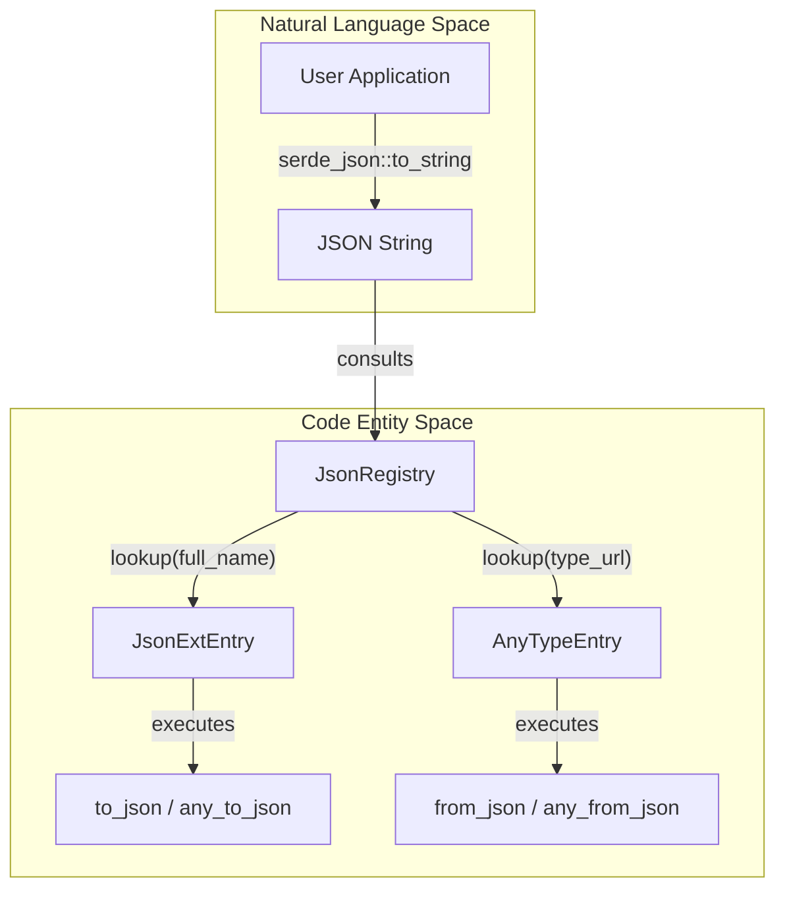
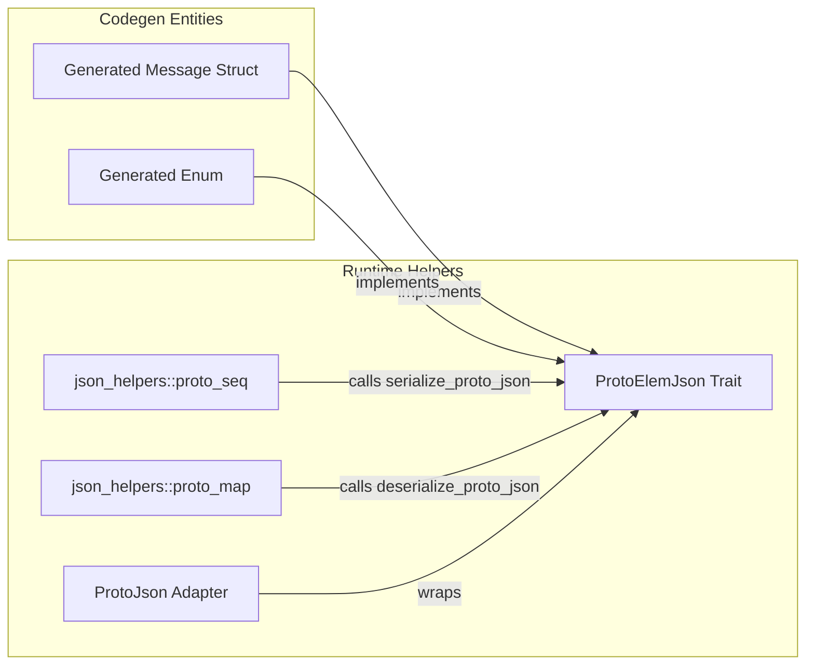

<!-- source: DeepWiki mcp.deepwiki.com · repo anthropics/buffa · page 2.5 JSON Serialization · fetched 2026-10-26 -->

# JSON Serialization

Relevant source files

The following files were used as context for generating this wiki page:

- [.changes/unreleased/fixed-20260628-211100.yaml](.changes/unreleased/fixed-20260628-211100.yaml)
- [CHANGELOG.md](CHANGELOG.md)
- [buffa/src/extension_registry.rs](buffa/src/extension_registry.rs)
- [buffa/src/json_helpers.rs](buffa/src/json_helpers.rs)
- [buffa/src/json_helpers/tests.rs](buffa/src/json_helpers/tests.rs)
- [docs/guide.md](docs/guide.md)
- [protoc-gen-buffa/src/main.rs](protoc-gen-buffa/src/main.rs)

The `buffa` runtime provides a high-fidelity implementation of the [Proto3 JSON Mapping](https://protobuf.dev/programming-guides/proto3#json) using `serde`. This implementation handles special encodings for 64-bit integers, floating-point special values, and Base64-encoded bytes, while providing a global type registry for `google.protobuf.Any` and extensions.

## Feature Flag and Serde Integration

JSON support is optional and gated behind the `json` feature flag [docs/guide.md:34-34](). When enabled, `buffa-codegen` emits `#[derive(::serde::Serialize, ::serde::Deserialize)]` for all message and enum types. For types requiring special mapping (like `int64` or `bytes`), it emits `#[serde(with = "...")]` attributes pointing to modules in `json_helpers` [buffa/src/json_helpers.rs:1-15]().

### Special Type Mapping Table
The following types are mapped according to the Proto3 spec:

| Proto Type | JSON Representation | Helper Module |
| :--- | :--- | :--- |
| `int64`, `sint64` | Decimal String (e.g. `"9223372036854775807"`) | `json_helpers::int64` |
| `uint64`, `fixed64`| Decimal String (e.g. `"18446744073709551615"`) | `json_helpers::uint64` |
| `float`, `double` | Number, or `"NaN"`, `"Infinity"`, `"-Infinity"` | `json_helpers::float` / `double` |
| `bytes` | Base64-encoded string (RFC 4648) | `json_helpers::bytes` |
| `EnumValue<T>` | Variant name string or integer | `json_helpers::proto_enum` |

Sources: [buffa/src/json_helpers.rs:6-15](), [docs/guide.md:34-43]()

## JSON Parse Options

Protobuf JSON parsing behavior can be tuned via `JsonParseOptions`. Because `serde`'s `Deserialize` trait does not support passing context parameters directly, `buffa` uses ambient state to manage these options.

### Scoped vs. Global API
The mechanism for passing options depends on whether the `std` feature is enabled [docs/guide.md:33-33]():

| Build | Mechanism | Scoping | Function |
| :--- | :--- | :--- | :--- |
| `std` | Thread-local | Per-closure (nestable) | `with_json_parse_options` |
| `no_std` | `AtomicPtr` | Process-wide (set-once) | `set_global_json_parse_options` |

Sources: [docs/guide.md:33-33](), [buffa/src/extension_registry.rs:115-132]()

### Numeric Precision Fix
A critical fix in the JSON parser ensures that quoted integer strings using decimal or exponent notation (e.g., `"9007199254740993.0"` or `"9.007199254740993e15"`) are parsed exactly into 64-bit integers. Previously, these routed through `f64`, which caused silent rounding for magnitudes above $2^{53}$ [.changes/unreleased/fixed-20260628-211100.yaml:1-4]().

## Type Registries

Proto3 JSON requires a registry to handle `google.protobuf.Any` (which embeds types by URL) and Extensions (which appear as `[path.to.ext]` keys).

### JsonRegistry and AnyRegistry
The `JsonRegistry` is a unified aggregate that manages both `AnyRegistry` and `ExtensionRegistry`. It is designed to be populated once at startup via generated `register_types` functions [buffa/src/extension_registry.rs:8-13]().

### ExtensionRegistry
`ExtensionRegistry` maps fully-qualified proto names to `JsonExtEntry` structures [buffa/src/extension_registry.rs:75-78](). Codegen emits a `#[serde(flatten)]` wrapper around `__buffa_unknown_fields` that uses `serialize_extensions` to emit bracketed keys for registered extensions [buffa/src/extension_registry.rs:17-25](), [buffa/src/extension_registry.rs:148-158]().

### Registry Data Flow
The following diagram illustrates how the global registry facilitates the conversion between binary wire format and JSON for `Any` and Extension fields.

**Type Registry Conversion Flow**

Sources: [buffa/src/extension_registry.rs:49-63](), [buffa/src/extension_registry.rs:75-107]()

## JSON Helpers and Container Dispatch

Because `serde`'s `#[serde(with = "...")]` attribute does not compose well with containers (e.g., `Vec<i64>`), `buffa` uses a dispatch trait `ProtoElemJson` [buffa/src/json_helpers.rs:90-95]().

### Container Modules
*   **`proto_seq`**: Handles `repeated` fields. It ensures that `null` elements are rejected as per the spec, whereas the container itself may be `null` (representing empty) [buffa/src/json_helpers.rs:145-152](), [buffa/src/json_helpers/tests.rs:56-62]().
*   **`proto_map`**: Handles `map<K, V>` fields. It applies special encoding to both keys and values, stringifying keys and applying `ProtoElemJson` to values [buffa/src/json_helpers.rs:135-143](), [buffa/src/json_helpers/tests.rs:65-69]().

### Component Interaction
This diagram shows how `ProtoElemJson` bridges generated types with the generic container helpers.

**JSON Helper Dispatch Architecture**

Sources: [buffa/src/json_helpers.rs:90-113](), [buffa/src/json_helpers/tests.rs:29-30]()

## Implementation Details

### Lenient Base64
The Base64 implementation for `bytes` fields uses a "lenient" configuration (`STANDARD_LENIENT` and `URL_SAFE_LENIENT`) [buffa/src/json_helpers.rs:50-51](). It tolerates trailing bits and is indifferent to padding (`DecodePaddingMode::Indifferent`), as required by the Protobuf JSON specification to support both standard and URL-safe variants [buffa/src/json_helpers.rs:34-49]().

### Pre-allocation Safety
When deserializing collections, `buffa` clamps the `size_hint` from the deserializer to `MAX_PREALLOC_HINT` (4096) via `clamp_size_hint` [buffa/src/json_helpers.rs:63-66](). This prevents OOM attacks where a hostile deserializer returns `usize::MAX` for a collection size [buffa/src/json_helpers.rs:53-61]().

### Well-Known Types (WKT) Support
The `json_helpers::wkt` submodule provides shared formatting and parsing primitives for types with specialized JSON forms, such as `Timestamp` (RFC 3339), `Duration` (decimal seconds), and `FieldMask` (camelCase) [buffa/src/json_helpers.rs:20-27]().

Sources: [buffa/src/json_helpers.rs:34-66](), [buffa/src/json_helpers/tests.rs:5-25](), [buffa/src/json_helpers.rs:20-30]()

---

