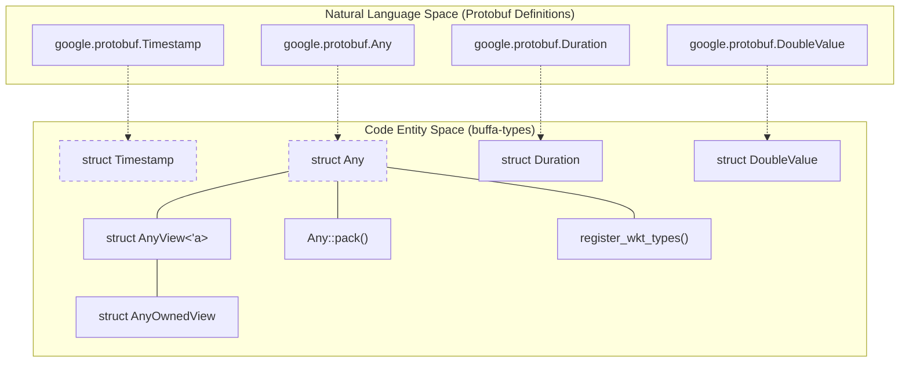
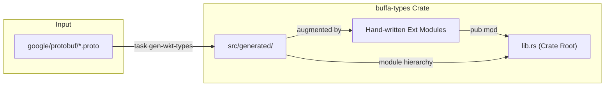

<!-- source: DeepWiki mcp.deepwiki.com · repo anthropics/buffa · page 3 Well-Known Types (`buffa-types`) · fetched 2026-10-26 -->

# Well-Known Types (`buffa-types`)

Relevant source files

The following files were used as context for generating this wiki page:

- [buffa-codegen/src/bin/gen_wkt_types.rs](buffa-codegen/src/bin/gen_wkt_types.rs)
- [buffa-types/Cargo.toml](buffa-types/Cargo.toml)
- [buffa-types/src/duration_chrono.rs](buffa-types/src/duration_chrono.rs)
- [buffa-types/src/generated/google.protobuf.any.__view.rs](buffa-types/src/generated/google.protobuf.any.__view.rs)
- [buffa-types/src/generated/google.protobuf.any.rs](buffa-types/src/generated/google.protobuf.any.rs)
- [buffa-types/src/generated/google.protobuf.duration.__view.rs](buffa-types/src/generated/google.protobuf.duration.__view.rs)
- [buffa-types/src/generated/google.protobuf.duration.rs](buffa-types/src/generated/google.protobuf.duration.rs)
- [buffa-types/src/generated/google.protobuf.empty.__view.rs](buffa-types/src/generated/google.protobuf.empty.__view.rs)
- [buffa-types/src/generated/google.protobuf.empty.rs](buffa-types/src/generated/google.protobuf.empty.rs)
- [buffa-types/src/generated/google.protobuf.field_mask.__view.rs](buffa-types/src/generated/google.protobuf.field_mask.__view.rs)
- [buffa-types/src/generated/google.protobuf.field_mask.rs](buffa-types/src/generated/google.protobuf.field_mask.rs)
- [buffa-types/src/generated/google.protobuf.struct.__view.rs](buffa-types/src/generated/google.protobuf.struct.__view.rs)
- [buffa-types/src/generated/google.protobuf.struct.rs](buffa-types/src/generated/google.protobuf.struct.rs)
- [buffa-types/src/generated/google.protobuf.timestamp.__view.rs](buffa-types/src/generated/google.protobuf.timestamp.__view.rs)
- [buffa-types/src/generated/google.protobuf.timestamp.rs](buffa-types/src/generated/google.protobuf.timestamp.rs)
- [buffa-types/src/generated/google.protobuf.wrappers.__view.rs](buffa-types/src/generated/google.protobuf.wrappers.__view.rs)
- [buffa-types/src/generated/google.protobuf.wrappers.rs](buffa-types/src/generated/google.protobuf.wrappers.rs)
- [buffa-types/src/lib.rs](buffa-types/src/lib.rs)
- [buffa-types/src/timestamp_ext.rs](buffa-types/src/timestamp_ext.rs)
- [buffa/src/view.rs](buffa/src/view.rs)

The `buffa-types` crate provides pre-generated Rust types for Google's **Well-Known Types (WKTs)**. These are a set of standard messages defined by the Protocol Buffers project that provide common functionality such as timestamps, durations, and dynamic typing (`Any`).

Rather than requiring every user to generate these types from scratch, `buffa` provides them as a standalone crate with hand-written extensions to make them feel like native Rust types.

### Architecture Overview

The crate follows a "hybrid" approach:
1.  **Generated Core**: The fundamental message structures, `Message` trait implementations, and zero-copy view types (e.g., `AnyView<'a>`) are generated by `protoc-gen-buffa` and checked into the repository under `src/generated/` [buffa-types/src/generated/google.protobuf.any.rs:1-2]().
2.  **Hand-written Extensions**: Additional functionality (e.g., converting a `Timestamp` to a `std::time::SystemTime` or packing `Any` values) is implemented in separate extension modules like `timestamp_ext.rs` [buffa-types/src/timestamp_ext.rs:1-1]().

The following diagram illustrates how the `buffa-types` crate bridges the gap between standard Protobuf definitions and ergonomic Rust code:

**WKT Entity Mapping**

Sources: [buffa-types/src/generated/google.protobuf.any.rs:103-145](), [buffa-types/src/generated/google.protobuf.any.__view.rs:102-139](), [buffa-types/src/generated/google.protobuf.timestamp.rs:107-123](), [buffa-types/src/generated/google.protobuf.duration.rs:4-9](), [buffa-types/src/generated/google.protobuf.wrappers.rs:4-10]()

---

### Generated WKT Types

The core of `buffa-types` consists of Rust structs that mirror the official Google Protobuf definitions. These files are located in the `src/generated/` directory and are marked with `@generated` headers. Each message generates an owned version (e.g., `Any`) and a zero-copy view version (e.g., `AnyView<'a>`) [buffa-types/src/generated/google.protobuf.any.__view.rs:102-139]().

Key types included:
*   **Time**: `Timestamp` [buffa-types/src/generated/google.protobuf.timestamp.rs:107-123]() and `Duration` [buffa-types/src/generated/google.protobuf.duration.rs:4-9]().
*   **Dynamic Typing**: `Any` [buffa-types/src/generated/google.protobuf.any.rs:103-145]().
*   **JSON/Dynamic Values**: `Struct` [buffa-types/src/generated/google.protobuf.struct.rs:60-67](), `Value`, `ListValue`, and `NullValue` [buffa-types/src/generated/google.protobuf.struct.rs:11-14]().
*   **Utility**: `FieldMask` [buffa-types/src/generated/google.protobuf.field_mask.rs:229-236](), `Empty` [buffa-types/src/generated/google.protobuf.empty.rs:4-10](), and the "Wrapper" types (e.g., `DoubleValue` [buffa-types/src/generated/google.protobuf.wrappers.rs:4-10]()).

These types are regenerated using the `task gen-wkt-types` command, which invokes the `gen_wkt_types` binary [buffa-codegen/src/bin/gen_wkt_types.rs:1-1](). The crate supports `no_std` environments unless features like `std` or `reflect` are enabled [buffa-types/Cargo.toml:17-25]().

For details on the specific fields and generation process, see [Generated WKT Types](#3.1).

**Sources:**
*   [buffa-types/src/generated/google.protobuf.any.rs:103-145]() (Any struct definition)
*   [buffa-types/src/generated/google.protobuf.any.__view.rs:102-139]() (AnyView struct definition)
*   [buffa-types/src/generated/google.protobuf.timestamp.rs:107-123]() (Timestamp struct definition)
*   [buffa-types/src/generated/google.protobuf.struct.rs:11-14]() (NullValue enum definition)

---

### Extension Modules and Ergonomics

Standard generated Protobuf types are often cumbersome to use in idiomatic Rust. To solve this, `buffa-types` includes hand-written extension modules that provide:

*   **Conversions**: `From`/`Into` implementations for standard library types, such as `std::time` or `chrono` conversions for `Timestamp` and `Duration` [buffa-types/src/duration_chrono.rs:1-1]().
*   **Logic**: Methods like `Any::pack` and `Any::unpack` for type-safe dynamic message handling.
*   **JSON Integration**: The `register_wkt_types` function, which populates a `TypeRegistry` so the `buffa` runtime knows how to handle the special JSON mapping rules for WKTs (like `Timestamp` encoding as RFC 3339 strings [buffa-types/src/generated/google.protobuf.timestamp.rs:81-93]()).
*   **Reflection Support**: If the `reflect` feature is enabled, WKTs implement `ReflectMessage` [buffa-types/src/generated/google.protobuf.any.rs:164-168](), allowing them to be used with the `buffa-descriptor` reflection system.

For details on these helpers, see [WKT Extension Modules and Ergonomic Helpers](#3.2).

**Sources:**
*   [buffa-types/src/generated/google.protobuf.any.rs:164-168]() (Any reflection implementation)
*   [buffa-types/src/timestamp_ext.rs:1-1]() (Timestamp extensions)
*   [buffa-types/src/duration_chrono.rs:1-1]() (Chrono integration)

---

### Data Flow: From Proto to Rust

The following diagram shows how a Well-Known Type moves from its raw Protobuf definition to a usable Rust entity within the workspace.

**WKT Pipeline**

Sources: [buffa-types/src/generated/google.protobuf.any.rs:1-2](), [buffa-codegen/src/bin/gen_wkt_types.rs:1-1]()

---

