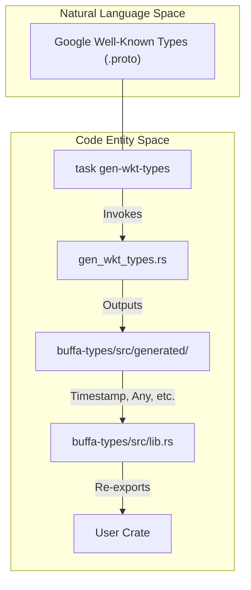
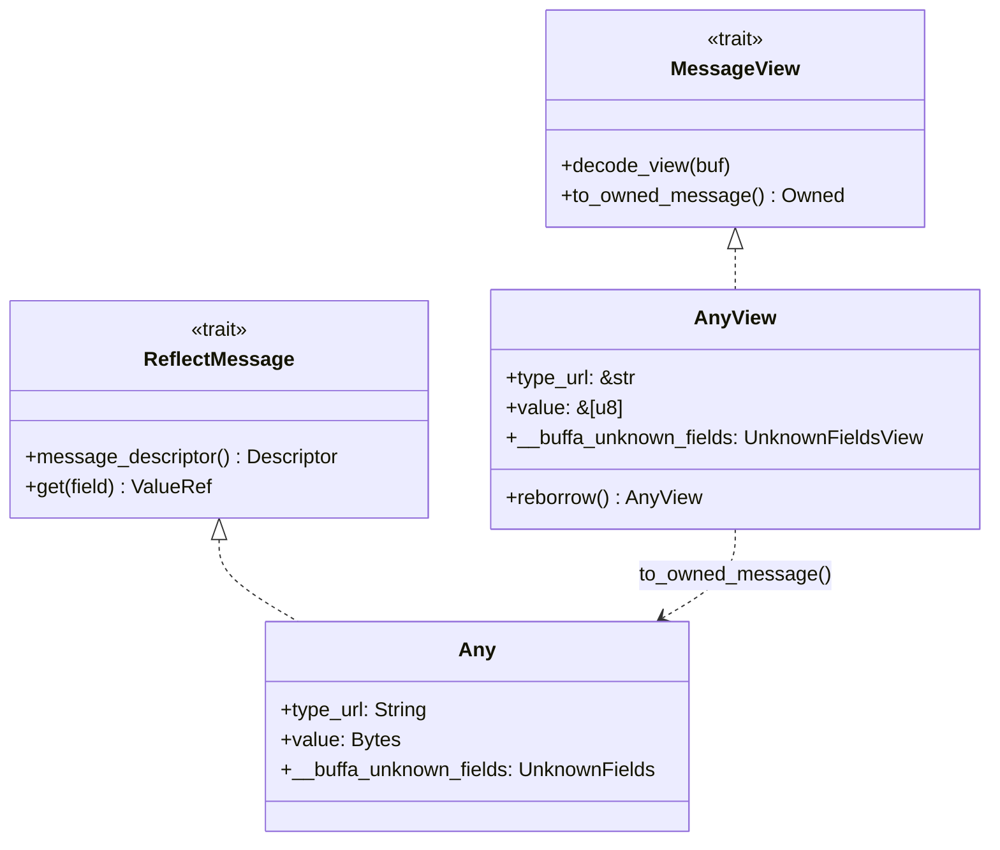

<!-- source: DeepWiki mcp.deepwiki.com · repo anthropics/buffa · page 3.1 Generated WKT Types · fetched 2026-10-26 -->

# Generated WKT Types

Relevant source files

The following files were used as context for generating this wiki page:

- [buffa-descriptor/src/generated/google.protobuf.compiler.mod.rs](buffa-descriptor/src/generated/google.protobuf.compiler.mod.rs)
- [buffa-descriptor/src/generated/google.protobuf.mod.rs](buffa-descriptor/src/generated/google.protobuf.mod.rs)
- [buffa-types/src/generated/google.protobuf.any.__view.rs](buffa-types/src/generated/google.protobuf.any.__view.rs)
- [buffa-types/src/generated/google.protobuf.any.rs](buffa-types/src/generated/google.protobuf.any.rs)
- [buffa-types/src/generated/google.protobuf.duration.__view.rs](buffa-types/src/generated/google.protobuf.duration.__view.rs)
- [buffa-types/src/generated/google.protobuf.duration.rs](buffa-types/src/generated/google.protobuf.duration.rs)
- [buffa-types/src/generated/google.protobuf.empty.__view.rs](buffa-types/src/generated/google.protobuf.empty.__view.rs)
- [buffa-types/src/generated/google.protobuf.empty.rs](buffa-types/src/generated/google.protobuf.empty.rs)
- [buffa-types/src/generated/google.protobuf.field_mask.__view.rs](buffa-types/src/generated/google.protobuf.field_mask.__view.rs)
- [buffa-types/src/generated/google.protobuf.field_mask.rs](buffa-types/src/generated/google.protobuf.field_mask.rs)
- [buffa-types/src/generated/google.protobuf.mod.rs](buffa-types/src/generated/google.protobuf.mod.rs)
- [buffa-types/src/generated/google.protobuf.struct.__view.rs](buffa-types/src/generated/google.protobuf.struct.__view.rs)
- [buffa-types/src/generated/google.protobuf.struct.rs](buffa-types/src/generated/google.protobuf.struct.rs)
- [buffa-types/src/generated/google.protobuf.timestamp.__view.rs](buffa-types/src/generated/google.protobuf.timestamp.__view.rs)
- [buffa-types/src/generated/google.protobuf.timestamp.rs](buffa-types/src/generated/google.protobuf.timestamp.rs)
- [buffa-types/src/generated/google.protobuf.wrappers.__view.rs](buffa-types/src/generated/google.protobuf.wrappers.__view.rs)
- [buffa-types/src/generated/google.protobuf.wrappers.rs](buffa-types/src/generated/google.protobuf.wrappers.rs)
- [buffa/src/view.rs](buffa/src/view.rs)

The `buffa-types` crate provides pre-generated Rust types for Google's **Well-Known Types (WKTs)**. These types are standard protobuf messages defined by Google that are frequently used across different APIs for common concepts like timestamps, durations, and dynamic data structures.

To ensure consistency and avoid requiring users to have `protoc` or `buf` installed just to use standard types, these are checked into the repository under `src/generated/` in the `buffa-types` crate.

## Core WKT Implementation

Each WKT is generated as a standard `buffa` message, including an owned struct (e.g., `Any`), a zero-copy view struct (e.g., `AnyView`), and an `OwnedView` handle (e.g., `EmptyOwnedView`).

### Timestamp and Duration
These types represent points in time and spans of time respectively.
*   **Timestamp**: Count of seconds and nanoseconds relative to the UTC Unix epoch [buffa-types/src/generated/google.protobuf.timestamp.rs:105-123]().
*   **Duration**: A signed span of time represented as seconds and nanoseconds [buffa-types/src/generated/google.protobuf.duration.__view.rs:69-86]().

### Dynamic Types (Struct, Value, Any)
These types allow for schema-less or polymorphic data within protobuf.
*   **Any**: Contains an arbitrary serialized message and a `type_url` string to identify it [buffa-types/src/generated/google.protobuf.any.rs:103-145]().
*   **Struct**: A JSON-like map of strings to `Value` types [buffa-types/src/generated/google.protobuf.struct.rs:60-67]().
*   **Value**: A union (oneof) representing a dynamically typed value (null, number, string, boolean, struct, or list).
*   **ListValue**: A repeated list of `Value` types.

### Utility Types
*   **FieldMask**: A set of symbolic field paths [buffa-types/src/generated/google.protobuf.field_mask.rs:229-236]().
*   **Empty**: A message with no fields, used for RPCs that return "nothing" [buffa-types/src/generated/google.protobuf.empty.__view.rs:14-16]().
*   **Wrappers**: Types like `DoubleValue`, `Int64Value`, etc., used to provide nullability for scalar types by wrapping them in a message [buffa-types/src/generated/google.protobuf.wrappers.__view.rs:8-14]().

## Data Flow: Generation to Runtime

The following diagram illustrates how Well-Known Types move from their original `.proto` definitions into the `buffa-types` crate and finally into user code.

**WKT Generation and Usage Pipeline**

Sources: [buffa-types/src/generated/google.protobuf.any.rs:1-2](), [buffa-types/src/generated/google.protobuf.mod.rs:1-9]()

## Implementation Details

Every generated WKT struct implements the core traits of the `buffa` runtime to support efficient serialization and reflection.

### Trait Implementations
*   **`ReflectMessage`**: If the `reflect` feature is enabled, types implement reflection accessors that point to the package's `descriptor_pool()` [buffa-types/src/generated/google.protobuf.any.rs:164-181]().
*   **`MessageView`**: Implemented by view types (e.g., `DurationView`) to support `decode_view` and conversion `to_owned_message` [buffa-types/src/generated/google.protobuf.duration.__view.rs:87-156]().
*   **`ViewReborrow`**: Allows creating a shorter-lived view from a longer-lived one (e.g., `EmptyView<'b>` from `EmptyView<'static>`) [buffa-types/src/generated/google.protobuf.empty.__view.rs:98-98]().
*   **`MessageName`**: Provides package and type metadata [buffa-types/src/generated/google.protobuf.timestamp.rs:178-183]().

### Internal Field Structure
All generated WKTs include hidden fields and internal methods to support `buffa`'s runtime features:
1.  **`__buffa_unknown_fields`**: Stores unrecognized fields for round-trip preservation. In views, this is an `UnknownFieldsView<'a>` [buffa-types/src/generated/google.protobuf.any.__view.rs:138-138]().
2.  **`merge_view_field`**: Performs the actual field-by-field decoding loop, handling wire type validation and unknown field collection [buffa-types/src/generated/google.protobuf.any.__view.rs:155-188]().
3.  **`decode_view_ctx`**: The provided decoder that honors the `DecodeContext` (recursion depth and unknown-field allowance) [buffa-types/src/generated/google.protobuf.any.__view.rs:144-148]().

**WKT Entity Relationship**

Sources: [buffa-types/src/generated/google.protobuf.any.rs:103-145](), [buffa-types/src/generated/google.protobuf.any.__view.rs:102-139](), [buffa-types/src/generated/google.protobuf.any.rs:164-181]()

## Module Structure and Re-exports

The `buffa-types` crate organizes generated code using an internal `__buffa` module to encapsulate view types and reflection metadata.

| Component | File / Module | Purpose |
| :--- | :--- | :--- |
| **Owned Types** | `google.protobuf.any.rs` | The standard owned Rust structs [buffa-types/src/generated/google.protobuf.any.rs:103-145]() |
| **View Types** | `google.protobuf.any.__view.rs` | Zero-copy views (e.g., `AnyView`) [buffa-types/src/generated/google.protobuf.any.__view.rs:102-139]() |
| **Owned Views** | `*OwnedView` | Self-contained `'static` handles (e.g., `EmptyOwnedView`) [buffa-types/src/generated/google.protobuf.empty.__view.rs:105-116]() |
| **Reflection** | `__buffa::reflect` | Contains the embedded `FILE_DESCRIPTOR_SET_BYTES` [buffa-types/src/generated/google.protobuf.any.rs:166-168]() |

## Maintenance and Regeneration

The types are checked into source control to simplify build dependencies for users. They are updated via the repository's task runner when the `buffa-codegen` logic or Google's source protos change.

*   **Task**: `task gen-wkt-types`
*   **Process**: This task runs a generation script that invokes the `buffa-codegen` engine against the standard Google `.proto` files located in the workspace.
*   **Output**: Files are written to `buffa-types/src/generated/`. These files are marked with a header: `// @generated by buffa-codegen. DO NOT EDIT.` [buffa-types/src/generated/google.protobuf.any.rs:1-1]().

Sources: [buffa-types/src/generated/google.protobuf.any.rs:1-2](), [buffa-types/src/generated/google.protobuf.mod.rs:1-1](), [buffa-types/src/generated/google.protobuf.timestamp.__view.rs:1-2]()

---

