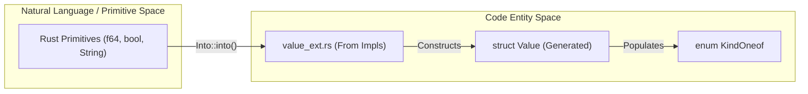
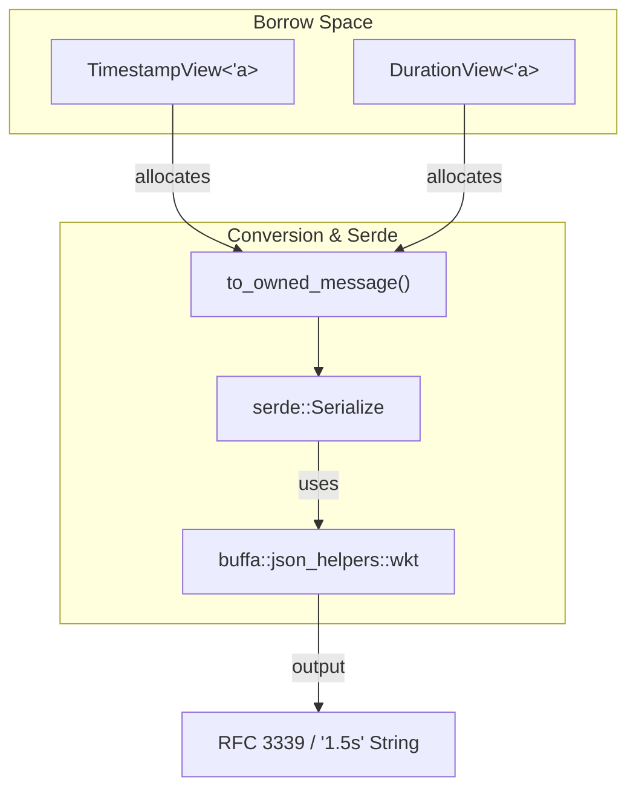

<!-- source: DeepWiki mcp.deepwiki.com · repo anthropics/buffa · page 3.2 WKT Extension Modules and Ergonomic Helpers · fetched 2026-10-26 -->

# WKT Extension Modules and Ergonomic Helpers

Relevant source files

The following files were used as context for generating this wiki page:

- [buffa-codegen/src/bin/gen_wkt_types.rs](buffa-codegen/src/bin/gen_wkt_types.rs)
- [buffa-types/Cargo.toml](buffa-types/Cargo.toml)
- [buffa-types/benches/any_clone.rs](buffa-types/benches/any_clone.rs)
- [buffa-types/src/any_ext.rs](buffa-types/src/any_ext.rs)
- [buffa-types/src/duration_chrono.rs](buffa-types/src/duration_chrono.rs)
- [buffa-types/src/duration_ext.rs](buffa-types/src/duration_ext.rs)
- [buffa-types/src/field_mask_ext.rs](buffa-types/src/field_mask_ext.rs)
- [buffa-types/src/lib.rs](buffa-types/src/lib.rs)
- [buffa-types/src/timestamp_ext.rs](buffa-types/src/timestamp_ext.rs)
- [buffa-types/tests/wkt_roundtrip.rs](buffa-types/tests/wkt_roundtrip.rs)
- [buffa/src/json_helpers/wkt.rs](buffa/src/json_helpers/wkt.rs)
- [buffa/src/message_set.rs](buffa/src/message_set.rs)

The `buffa-types` crate provides more than just raw generated structs for Google's Well-Known Types (WKTs). While the base types are generated automatically via `gen_wkt_types` [buffa-codegen/src/bin/gen_wkt_types.rs:1-131](), they are augmented by hand-written extension modules (identified by the `_ext.rs` suffix) that provide idiomatic Rust interfaces. These extensions handle complex conversions, such as mapping `Timestamp` and `Duration` to `std::time` types, implementing `Any` packing/unpacking logic, and providing ergonomic constructors for `Value`, `Struct`, and `FieldMask`.

## Architecture of WKT Extensions

The extension system relies on Rust's ability to implement traits and additional `impl` blocks for structs defined in the same crate. The generated files provide the data layout and `Message` trait implementations, while the `_ext.rs` files provide the "human-friendly" API [buffa-types/src/lib.rs:64-73]().

### Data Flow and Registry
A critical component of the WKT system is the `register_wkt_types` function. This function populates a `TypeRegistry` with the type information for all WKTs, enabling both proto3-compliant JSON serialization and textproto `[type_url] { fields }` Any-expansion [buffa-types/src/any_ext.rs:67-89]().

### WKT Extension Mapping
| WKT Type | Extension File | Key Ergonomic Features |
| :--- | :--- | :--- |
| `Any` | `any_ext.rs` | `pack`, `unpack_unchecked`, and `unpack_if` helpers; custom `TextFormat` [buffa-types/src/any_ext.rs:7-63](). |
| `Timestamp` | `timestamp_ext.rs` | `SystemTime` conversions, `now()` helper, and Unix epoch constructors [buffa-types/src/timestamp_ext.rs:28-84](). |
| `Duration` | `duration_ext.rs` | `std::time::Duration` conversions with saturation and range validation [buffa-types/src/duration_ext.rs:21-71](). |
| `FieldMask` | `field_mask_ext.rs` | Path iterators, `contains` check, and camelCase JSON path conversion [buffa-types/src/field_mask_ext.rs:7-50](). |
| `Value` / `Struct` | `value_ext.rs` | `From` impls for scalars, `ListValue` iterators, and mutation helpers [buffa-types/src/value_ext.rs:11-253](). |
| `Wrappers` | `wrapper_ext.rs` | `From<T>` and `Into<T>` for raw Rust scalars (e.g., `f64` ↔ `DoubleValue`) [buffa-types/src/wrapper_ext.rs:14-43](). |

**Sources:** [buffa-types/src/any_ext.rs:1-145](), [buffa-types/src/timestamp_ext.rs:1-176](), [buffa-types/src/duration_ext.rs:1-178](), [buffa-types/src/field_mask_ext.rs:1-141](), [buffa-types/src/value_ext.rs:1-253](), [buffa-types/src/wrapper_ext.rs:1-183]()

## Time and Duration Conversions

The `Timestamp` and `Duration` extensions bridge Protobuf's `(seconds, nanos)` model with Rust's `std::time` types. These implementations are designed to be safe, handling edge cases like negative durations and overflow.

### Timestamp ↔ SystemTime
*   **`from_unix(seconds, nanos)`**: Constructs a `Timestamp` with debug-mode validation of the `nanos` range [0, 999,999,999] [buffa-types/src/timestamp_ext.rs:40-50]().
*   **`TryFrom<Timestamp> for SystemTime`**: Handles pre-epoch times by moving backward from `UNIX_EPOCH` and then forward by `nanos`. It uses `unsigned_abs()` to avoid overflow on `i64::MIN` [buffa-types/src/timestamp_ext.rs:87-128]().
*   **`From<SystemTime> for Timestamp`**: Saturates at `i64::MAX` for times far in the future (~292 billion years) [buffa-types/src/timestamp_ext.rs:131-176]().

### Duration ↔ std::time::Duration
*   **Validation**: The conversion to `std::time::Duration` fails if the Protobuf `Duration` is negative, as Rust's standard duration is unsigned [buffa-types/src/duration_ext.rs:47-49]().
*   **Sign Consistency**: It enforces that `seconds` and `nanos` have the same sign per the Protobuf specification [buffa-types/src/duration_ext.rs:42-45]().

### Chrono Interop
When the `chrono` feature is enabled, additional conversions are provided for `chrono::DateTime<Utc>` and `chrono::TimeDelta` [buffa-types/src/lib.rs:49-51](). `chrono::TimeDelta` interop is safer for negative durations as it supports signed values [buffa-types/src/duration_chrono.rs:34-68]().

**Sources:** [buffa-types/src/timestamp_ext.rs:16-176](), [buffa-types/src/duration_ext.rs:21-71](), [buffa-types/src/duration_chrono.rs:1-141]()

## Any: Type Packing and Unpacking

The `Any` message type is a container for an arbitrary serialized message plus a `type_url` identifying it. The extension module implements logic for safe and unsafe unpacking.

### Core Functions
*   **`pack(msg: &impl Message, type_url: impl Into<String>)`**: Serializes the message into bytes and sets the provided `type_url` [buffa-types/src/any_ext.rs:13-19]().
*   **`unpack_unchecked<T: Message>(&self)`**: Attempts to decode the internal bytes as type `T` without verifying the `type_url` [buffa-types/src/any_ext.rs:31-33]().
*   **`unpack_if<T: Message>(&self, expected_type_url: &str)`**: Decodes only if the `type_url` matches the provided string, returning `Ok(None)` on a mismatch [buffa-types/src/any_ext.rs:44-52]().

### TextFormat Specialization
Unlike standard generated messages, `Any` has a hand-written `TextFormat` implementation [buffa-types/src/any_ext.rs:159-174](). This allows it to support the expanded textproto form `[type_url] { fields }` when a registry is available via `try_write_any_expanded` [buffa-types/src/any_ext.rs:161-163]().

**Sources:** [buffa-types/src/any_ext.rs:7-63](), [buffa-types/src/any_ext.rs:159-183]()

## Struct and Value Ergonomics

The `google.protobuf.Value` type is a complex `oneof` union representing JSON-like data. The extension module provides `From` implementations so that users can construct `Value` objects directly from Rust primitives.

### Value Conversion Logic
| Rust Type | Value Variant | Implementation Detail |
| :--- | :--- | :--- |
| `f64`, `f32`, `i32`, `u32`, `i64`, `u64` | `NumberValue` | `i64`/`u64` may lose precision outside 53-bit mantissa [buffa-types/src/value_ext.rs:148-170](). |
| `String`, `&str` | `StringValue` | `&str` allocates a new `String` [buffa-types/src/value_ext.rs:102-109](). |
| `bool` | `BoolValue` | Direct mapping [buffa-types/src/value_ext.rs:121-128](). |
| `Struct` | `StructValue` | Wraps in `Box` for the oneof [buffa-types/src/value_ext.rs:172-179](). |
| `ListValue` | `ListValue` | Wraps in `Box` for the oneof [buffa-types/src/value_ext.rs:181-188](). |

### Entity Relationship: Value Construction
"Ergonomic Value Construction Flow"

**Sources:** [buffa-types/src/value_ext.rs:84-188]()

## View Type Serialization

The `view_serde_ext.rs` module provides hand-written `serde::Serialize` implementations for WKT **view** types (e.g., `TimestampView<'_>`, `DurationView<'_>`). 

Because view types borrow from an input buffer, they cannot be easily constructed from arbitrary JSON, so `Deserialize` is not implemented [buffa-types/src/view_serde_ext.rs:27-28](). Serialization works by delegating to the owned type via `to_owned_message()`, ensuring parity with the Proto3 JSON specification at the cost of a temporary allocation [buffa-types/src/view_serde_ext.rs:12-15]().

### View Serialization Parity
"View to JSON Serialization Flow"

**Sources:** [buffa-types/src/view_serde_ext.rs:1-72](), [buffa/src/json_helpers/wkt.rs:1-176]()

## JSON Registry Integration

The `register_wkt_types` function is a vital utility for applications using JSON serialization or `Any` types. It ensures that the runtime knows how to handle the special JSON mappings of WKTs.

### Data Flow: Registry Registration
1.  The application calls `register_wkt_types(&mut registry)` [buffa-types/src/any_ext.rs:89]().
2.  The function uses a `register_type!` macro to handle both JSON and Text entries [buffa-types/src/any_ext.rs:93-123]().
3.  For JSON, it registers a `JsonAnyEntry` which includes a `to_json` closure that decodes the binary payload and serializes it to a `serde_json::Value` [buffa-types/src/any_ext.rs:100-104]().
4.  WKTs with special JSON mappings (like `Timestamp` or `Duration`) are registered with `is_wkt: true` to ensure they are wrapped in a `"value"` field when stored in an `Any` JSON object [buffa-types/src/any_ext.rs:125-141]().

**Sources:** [buffa-types/src/any_ext.rs:67-145]()

---

