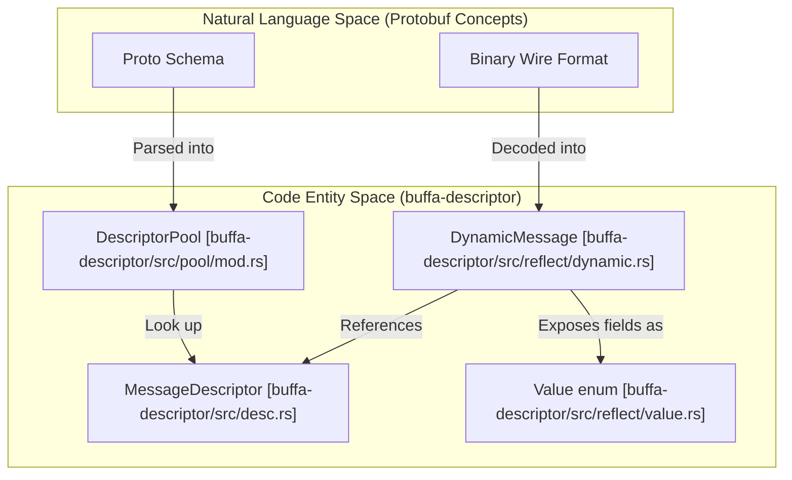
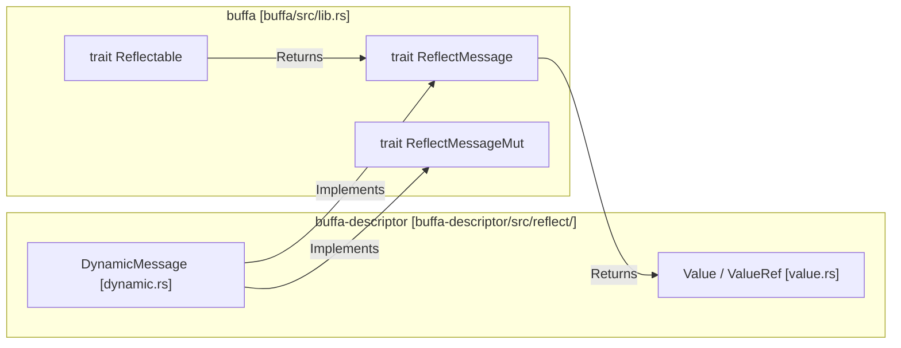

<!-- source: DeepWiki mcp.deepwiki.com · repo anthropics/buffa · page 4 Descriptor Types and Reflection Runtime (`buffa-descriptor`) · fetched 2026-10-26 -->

# Descriptor Types and Reflection Runtime (`buffa-descriptor`)

<details>
<summary>Relevant source files</summary>

The following files were used as context for generating this wiki page:

- [buffa-codegen/src/tests/generation.rs](buffa-codegen/src/tests/generation.rs)
- [buffa-descriptor/Cargo.toml](buffa-descriptor/Cargo.toml)
- [buffa-descriptor/src/generated/google.protobuf.compiler.plugin.rs](buffa-descriptor/src/generated/google.protobuf.compiler.plugin.rs)
- [buffa-descriptor/src/generated/google.protobuf.descriptor.rs](buffa-descriptor/src/generated/google.protobuf.descriptor.rs)
- [buffa-descriptor/src/lib.rs](buffa-descriptor/src/lib.rs)
- [buffa-descriptor/src/reflect/dynamic.rs](buffa-descriptor/src/reflect/dynamic.rs)
- [buffa-descriptor/src/reflect/mod.rs](buffa-descriptor/src/reflect/mod.rs)
- [buffa-descriptor/src/reflect/value.rs](buffa-descriptor/src/reflect/value.rs)
- [buffa-descriptor/tests/dynamic_e2e.rs](buffa-descriptor/tests/dynamic_e2e.rs)
- [conformance/Cargo.toml](conformance/Cargo.toml)

</details>


The `buffa-descriptor` crate provides self-hosted Rust types for the core Protobuf schema definitions: `descriptor.proto` and `plugin.proto`. It serves as the foundation for both compile-time code generation (`buffa-codegen`) and the runtime reflection system (`buffa-descriptor/src/pool` and `buffa-descriptor/src/reflect`) [buffa-descriptor/src/lib.rs:1-6]().

## Overview

The primary purpose of `buffa-descriptor` is to provide a Rust representation of the Protobuf type system that is compatible with the `buffa` runtime. This allows the code generator to use `buffa`'s own message traits and decoding logic to process incoming `CodeGeneratorRequest` payloads from `protoc` [buffa-descriptor/src/lib.rs:8-10]().

### The Bootstrapping Problem

Because `buffa-codegen` requires these descriptor types to function, but the types themselves must be generated by `buffa-codegen`, the project faces a "chicken-and-egg" bootstrapping problem. To resolve this, the generated code is checked into the repository under `src/generated/` [buffa-descriptor/src/lib.rs:20-23](). Changes to the generator are applied by running the bootstrap task:
```sh
task gen-bootstrap-types
```
[buffa-descriptor/src/lib.rs:26-27]()

### Reflection and Dynamic Messages

With the `reflect` feature enabled, the crate provides a full reflection runtime. This includes the `DescriptorPool` for managing linked descriptors and `DynamicMessage` for interacting with Protobuf data without generated Rust structs [buffa-descriptor/src/lib.rs:46-55](). The runtime uses a map-backed storage (`BTreeMap<u32, Value>`) where field values are keyed by their field number [buffa-descriptor/src/reflect/dynamic.rs:3-5]().

**Reflection Architecture**

Sources: [buffa-descriptor/src/lib.rs:33-55](), [buffa-descriptor/src/reflect/dynamic.rs:48-53](), [buffa-descriptor/src/reflect/value.rs:44-64]()

## Core Components

### Descriptor Proto Types
This module contains the Rust representation of the Protobuf language itself. It includes types for messages (`DescriptorProto`), fields (`FieldDescriptorProto`), and the Protobuf "Editions" features (`FeatureSet`, `Edition`) [buffa-descriptor/src/generated/google.protobuf.descriptor.rs:8-38](). These types allow `buffa-codegen` to traverse the AST of a `.proto` file and resolve features like field presence or enum closedness.

For details, see [Descriptor Proto Types](#4.1).

### Compiler Plugin Protocol Types
This module implements the protocol used by `protoc` to communicate with plugins. It defines the `CodeGeneratorRequest` containing the descriptors to be processed and the `CodeGeneratorResponse` which contains the generated file results [buffa-descriptor/src/lib.rs:17-18](). These types are essential for `protoc-gen-buffa` to read from `stdin` and write to `stdout` [buffa-descriptor/src/generated/google.protobuf.compiler.plugin.rs:4-9]().

For details, see [Compiler Plugin Protocol Types](#4.2).

### Reflection Runtime: DescriptorPool and DynamicMessage
The reflection runtime allows for dynamic inspection and manipulation of Protobuf data. The `DescriptorPool` performs a two-pass link of `FileDescriptorSet` data to provide feature-resolved descriptors [buffa-descriptor/src/lib.rs:46-47](). `DynamicMessage` provides a descriptor-driven codec and a generic field access API via `ReflectMessage` and `ReflectMessageMut` [buffa-descriptor/src/reflect/mod.rs:1-9]().

For details, see [Reflection Runtime: DescriptorPool and DynamicMessage](#4.3).

## Crate Configuration

The crate is `no_std` compatible and uses feature flags to gate reflection and serialization logic [buffa-descriptor/src/lib.rs:29-39]().

| Feature | Description |
| :--- | :--- |
| `std` | Enables standard library support (enabled by default) [buffa-descriptor/Cargo.toml:31-36](). |
| `reflect` | Enables `DescriptorPool`, `DynamicMessage`, and linked descriptors [buffa-descriptor/Cargo.toml:46](). |
| `json` | Enables JSON serialization for `DynamicMessage` via `serde` [buffa-descriptor/Cargo.toml:40](). |
| `views` | Enables zero-copy view types for descriptors [buffa-descriptor/Cargo.toml:38](). |

**Reflection Trait Relationships**

Sources: [buffa-descriptor/src/reflect/mod.rs:5-12](), [buffa-descriptor/src/reflect/dynamic.rs:48-53](), [buffa-descriptor/src/reflect/value.rs:75-101]()

---
Sources:
- [buffa-descriptor/src/lib.rs:1-56]()
- [buffa-descriptor/Cargo.toml:1-47]()
- [buffa-descriptor/src/reflect/mod.rs:1-56]()
- [buffa-descriptor/src/reflect/dynamic.rs:1-130]()
- [buffa-descriptor/src/reflect/value.rs:1-101]()
- [buffa-descriptor/src/generated/google.protobuf.descriptor.rs:1-84]()
- [buffa-descriptor/src/generated/google.protobuf.compiler.plugin.rs:1-109]()
- [buffa-codegen/src/tests/generation.rs:49-68]()

---

