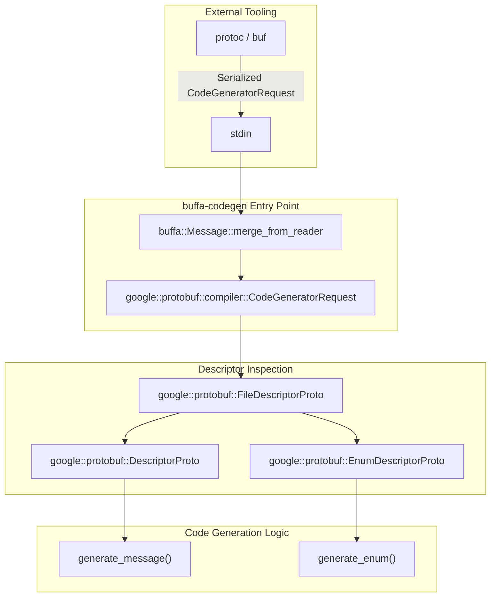
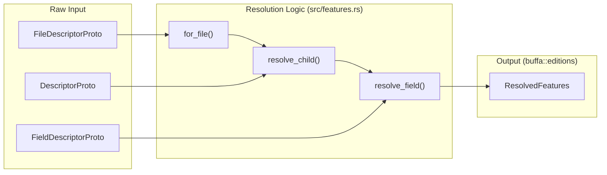
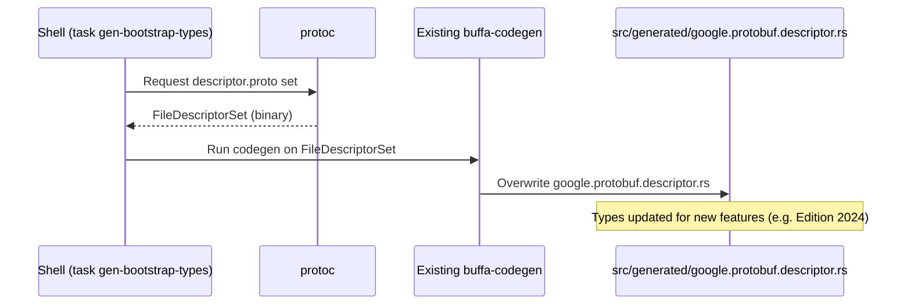

<!-- source: DeepWiki mcp.deepwiki.com · repo anthropics/buffa · page 4.1 Descriptor Proto Types · fetched 2026-10-26 -->

# Descriptor Proto Types

<details>
<summary>Relevant source files</summary>

The following files were used as context for generating this wiki page:

- [buffa-codegen/src/features.rs](buffa-codegen/src/features.rs)
- [buffa-codegen/src/tests/generation.rs](buffa-codegen/src/tests/generation.rs)
- [buffa-descriptor/src/desc.rs](buffa-descriptor/src/desc.rs)
- [buffa-descriptor/src/features.rs](buffa-descriptor/src/features.rs)
- [buffa-descriptor/src/generated/google.protobuf.compiler.plugin.rs](buffa-descriptor/src/generated/google.protobuf.compiler.plugin.rs)
- [buffa-descriptor/src/generated/google.protobuf.descriptor.rs](buffa-descriptor/src/generated/google.protobuf.descriptor.rs)
- [buffa-descriptor/tests/options_any_symbol_e2e.rs](buffa-descriptor/tests/options_any_symbol_e2e.rs)
- [buffa-descriptor/tests/protos/reflect_test_options.fds](buffa-descriptor/tests/protos/reflect_test_options.fds)
- [buffa-descriptor/tests/protos/reflect_test_options.proto](buffa-descriptor/tests/protos/reflect_test_options.proto)

</details>


The `buffa-descriptor` crate contains the self-hosted Rust types for `descriptor.proto`. These types are essential for the `buffa-codegen` pipeline, as they allow the compiler to decode the `CodeGeneratorRequest` and inspect the protobuf AST (Abstract Syntax Tree) provided by `protoc` or `buf`.

By using its own generated types for bootstrapping, `buffa` ensures it has direct access to modern features like Editions 2023/2024 and `FeatureSet` resolution without depending on external protobuf libraries [buffa-descriptor/src/generated/google.protobuf.descriptor.rs:1-2]().

## Overview of Descriptor Types

The primary purpose of these types is to represent the structure of `.proto` files in memory. The generated Rust structs correspond to the messages defined in `google/protobuf/descriptor.proto`.

### Key Message Types

| Message | Role in Codegen |
| :--- | :--- |
| `FileDescriptorProto` | Represents a single `.proto` file, including its package name, dependencies, and top-level definitions [buffa-descriptor/src/generated/google.protobuf.descriptor.rs:6-22](). |
| `DescriptorProto` | Represents a message definition, including fields, nested types, and oneofs [buffa-descriptor/src/generated/google.protobuf.descriptor.rs:23-43](). |
| `FieldDescriptorProto` | Represents an individual field, its type (e.g., `TYPE_INT32`), label (optional/repeated), and tag number [buffa-descriptor/src/generated/google.protobuf.descriptor.rs:60-102](). |
| `EnumDescriptorProto` | Represents an enumeration and its associated values [buffa-descriptor/src/generated/google.protobuf.descriptor.rs:106-114](). |
| `FeatureSet` | A message used in Protobuf Editions to control behavior (e.g., field presence, UTF-8 validation) [buffa-descriptor/src/features.rs:25-27](). |

### Editions and Features
With the introduction of Protobuf Editions, the `Edition` enum and `FeatureSet` message are critical for determining how code should be generated. `buffa` supports editions from `EDITION_PROTO2` through `EDITION_2024`, including legacy and test-only editions [buffa-descriptor/src/generated/google.protobuf.descriptor.rs:8-37]().

Sources: [buffa-descriptor/src/generated/google.protobuf.descriptor.rs:8-37](), [buffa-descriptor/src/generated/google.protobuf.descriptor.rs:60-102](), [buffa-descriptor/src/features.rs:24-27]()

## Data Flow: From Protoc to Codegen

The following diagram illustrates how the descriptor types act as the bridge between the raw bytes sent by the protobuf compiler and the high-level code generation logic.

### Descriptor Parsing Pipeline

Sources: [buffa-descriptor/src/generated/google.protobuf.compiler.plugin.rs:1-3](), [buffa-descriptor/src/generated/google.protobuf.descriptor.rs:1-3](), [buffa-descriptor/src/generated/google.protobuf.compiler.plugin.rs:110-162]()

## Implementation Details

The types are generated using `buffa-codegen` itself and are checked into the repository under `src/generated/` to solve the bootstrapping problem [buffa-descriptor/src/generated/google.protobuf.descriptor.rs:1-2]().

### Trait Implementations
Every generated descriptor type implements the `buffa::Message` trait, which provides the necessary methods for the codegen to decode the input stream:
*   `compute_size`: Calculates the total encoded size in bytes [buffa-descriptor/src/generated/google.protobuf.compiler.plugin.rs:117-135]().
*   `write_to`: Encodes the message to a buffer [buffa-descriptor/src/generated/google.protobuf.compiler.plugin.rs:136-156]().
*   `merge_field`: Handles the low-level wire format decoding for each descriptor field [buffa-descriptor/src/generated/google.protobuf.compiler.plugin.rs:157-200]().

### The Edition Enum
The `Edition` enum is a generated Rust `repr(i32)` enum that includes the full range of supported protobuf versions and implements the `buffa::Enumeration` trait [buffa-descriptor/src/generated/google.protobuf.descriptor.rs:8-38](). It also includes idiomatic aliases for each variant to match Rust naming conventions [buffa-descriptor/src/generated/google.protobuf.descriptor.rs:40-79]().

```rust
#[derive(Clone, Copy, PartialEq, Eq, Hash, Debug)]
#[repr(i32)]
pub enum Edition {
    EDITION_UNKNOWN = 0i32,
    EDITION_LEGACY = 900i32,
    EDITION_PROTO2 = 998i32,
    EDITION_PROTO3 = 999i32,
    EDITION_2023 = 1000i32,
    EDITION_2024 = 1001i32,
    // ...
}
```
Sources: [buffa-descriptor/src/generated/google.protobuf.descriptor.rs:8-38](), [buffa-descriptor/src/generated/google.protobuf.descriptor.rs:40-79]()

## Feature Resolution

While the generated types store the raw, unresolved features from `descriptor.proto`, the `buffa-descriptor` crate provides logic to resolve these into effective behaviors. This resolution logic is shared between the runtime `DescriptorPool` and `buffa-codegen` [buffa-codegen/src/features.rs:3-9]().

### Feature Resolution Pipeline

Sources: [buffa-descriptor/src/features.rs:32-49](), [buffa-descriptor/src/features.rs:56-61](), [buffa-codegen/src/features.rs:33-52]()

The `resolve_field` function in `buffa-codegen` extends the base resolution logic to handle enum closedness by looking up the referenced enum's type in the `CodeGenContext` [buffa-codegen/src/features.rs:33-52](). This ensures that `option features.enum_type = CLOSED` at the enum level is correctly propagated to fields [buffa-codegen/src/features.rs:21-28]().

## Bootstrapping Process

Because `buffa-codegen` requires these types to run, but these types are created by `buffa-codegen`, a bootstrapping cycle exists. This is managed via the `gen-bootstrap-types.sh` script.

### Bootstrapping Sequence

Sources: [buffa-descriptor/src/generated/google.protobuf.descriptor.rs:1-2](), [buffa-codegen/src/tests/generation.rs:118-125]()

### Runtime Descriptor Conversion
For runtime reflection, the raw `FileDescriptorProto` tree is processed into linked, feature-resolved types like `FieldDescriptor` [buffa-descriptor/src/desc.rs:1-8](). This conversion flattens orthogonal type/label/map axes into a `FieldKind` discriminant for efficient runtime access [buffa-descriptor/src/desc.rs:10-12]().

| Raw Type | Linked Runtime Type | Resolution Detail |
| :--- | :--- | :--- |
| `field_descriptor_proto::Type` | `ScalarType` | Filters out message/enum/group into dedicated kinds [buffa-descriptor/src/desc.rs:60-62](). |
| `FeatureSet` | `FieldPresence` | Resolves implicit vs explicit presence based on edition [buffa-descriptor/src/desc.rs:162](). |
| `FieldDescriptorProto` | `FieldKind` | Flattens singular, list, and map representations [buffa-descriptor/src/desc.rs:136-148](). |

Sources: [buffa-descriptor/src/desc.rs:37-42](), [buffa-descriptor/src/desc.rs:64-80](), [buffa-descriptor/src/desc.rs:136-148](), [buffa-descriptor/src/desc.rs:157-168]()

---

