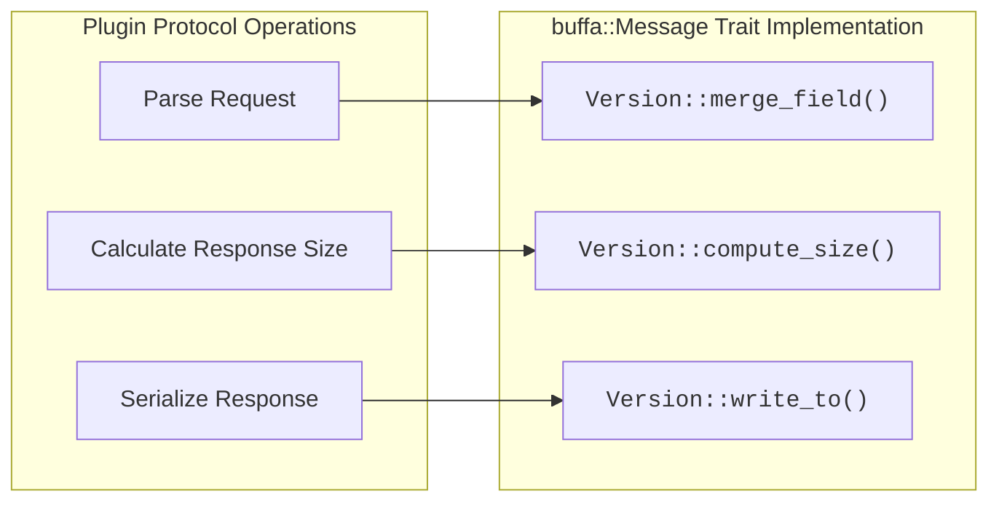

<!-- source: DeepWiki mcp.deepwiki.com · repo anthropics/buffa · page 4.2 Compiler Plugin Protocol Types · fetched 2026-10-26 -->

# Compiler Plugin Protocol Types

<details>
<summary>Relevant source files</summary>

The following files were used as context for generating this wiki page:

- [buffa-codegen/src/tests/generation.rs](buffa-codegen/src/tests/generation.rs)
- [buffa-descriptor/src/generated/google.protobuf.compiler.mod.rs](buffa-descriptor/src/generated/google.protobuf.compiler.mod.rs)
- [buffa-descriptor/src/generated/google.protobuf.compiler.plugin.rs](buffa-descriptor/src/generated/google.protobuf.compiler.plugin.rs)
- [buffa-descriptor/src/generated/google.protobuf.descriptor.rs](buffa-descriptor/src/generated/google.protobuf.descriptor.rs)
- [buffa-descriptor/src/generated/google.protobuf.mod.rs](buffa-descriptor/src/generated/google.protobuf.mod.rs)
- [buffa-types/src/generated/google.protobuf.mod.rs](buffa-types/src/generated/google.protobuf.mod.rs)

</details>


The `buffa-descriptor` crate contains the generated Rust types for the Protocol Buffer compiler plugin protocol. These types, defined in `google/protobuf/compiler/plugin.proto`, form the contract between the `protoc` compiler (or `buf`) and the `protoc-gen-buffa` plugin binary. The plugin reads a `CodeGeneratorRequest` from `stdin` and writes a `CodeGeneratorResponse` to `stdout`.

### Protocol Definition

The protocol is defined by two primary messages that facilitate the exchange of file descriptors and generated code content.

| Message | Role | Key Fields |
| :--- | :--- | :--- |
| `CodeGeneratorRequest` | Input | `file_to_generate`, `parameter`, `proto_file` |
| `CodeGeneratorResponse` | Output | `error`, `supported_features`, `file`, `minimum_edition`, `maximum_edition` |

The `CodeGeneratorRequest` contains `FileDescriptorProto` messages for all files involved in the generation process, including dependencies. The `CodeGeneratorResponse` contains a repeated `File` message, where each `File` represents a generated asset with a `name` and `content`.

**Sources:**
- [buffa-descriptor/src/generated/google.protobuf.compiler.plugin.rs:1-10]()
- [buffa-descriptor/src/generated/google.protobuf.compiler.plugin.rs:44-52]()

---

### Data Flow: Stdin to Stdout

The `protoc-gen-buffa` plugin follows the standard execution flow for `protoc` plugins. It utilizes the `buffa` runtime's `Message` trait to deserialize the request and serialize the response.

#### Plugin Execution Pipeline
This diagram illustrates the transition from the binary stream provided by `protoc` to the structured Rust entities used within the compiler plugin.

```mermaid
graph TD
    subgraph "Natural Language Space"
        STDIN["Standard Input (Binary Stream)"]
        STDOUT["Standard Output (Binary Stream)"]
        FS["File System (Generated .rs)"]
    end

    subgraph "Code Entity Space"
        Main["Main Binary"]
        Decode["CodeGeneratorRequest::decode()"]
        Gen["buffa_codegen::generate()"]
        Encode["CodeGeneratorResponse::write_to()"]
        Response["CodeGeneratorResponse"]
    end

    STDIN -->| "io::stdin().read_to_end" | Main
    Main --> Decode
    Decode -->| "request.proto_file" | Gen
    Gen -->| "Vec<GeneratedFile>" | Response
    Response --> Encode
    Encode -->| "io::stdout().write_all" | STDOUT
    STDOUT -.->| "protoc/buf write" | FS
```

**Sources:**
- [buffa-descriptor/src/generated/google.protobuf.compiler.plugin.rs:115-178]()
- [buffa-descriptor/src/generated/google.protobuf.compiler.plugin.rs:141-172]()

---

### Generated Rust Types

The Rust implementation of these protocol types is located in `buffa-descriptor/src/generated/google.protobuf.compiler.plugin.rs`. These types are "bootstrapped"—they are generated by `buffa-codegen` itself to ensure the compiler can describe its own input and output formats.

#### Version Information
The `Version` struct represents the version of the protocol compiler (e.g., `protoc`) making the request.

*   **`major`, `minor`, `patch`**: Integer fields representing the semantic version [buffa-descriptor/src/generated/google.protobuf.compiler.plugin.rs:9-39]().
*   **`suffix`**: An optional string for pre-release tags like "alpha-1" or "rc2" [buffa-descriptor/src/generated/google.protobuf.compiler.plugin.rs:48-48]().

#### CodeGeneratorRequest Implementation
The `CodeGeneratorRequest` struct holds the environment information and the descriptors for the files to be processed. It uses `Option<Version>` for the compiler version and `Vec<FileDescriptorProto>` for the schema data.

#### CodeGeneratorResponse Implementation
The `CodeGeneratorResponse` struct communicates the results back to the caller.

*   **`error`**: If generation fails, the plugin populates this field.
*   **`supported_features`**: A bitmask used to signal support for features such as `FEATURE_PROTO3_OPTIONAL`.
*   **`minimum_edition` / `maximum_edition`**: Informs the caller of the Protobuf editions range the plugin can handle. The `Edition` enum defines values like `EDITION_PROTO2` (998), `EDITION_PROTO3` (999), and `EDITION_2024` (1001) [buffa-descriptor/src/generated/google.protobuf.descriptor.rs:18-24]().

**Sources:**
- [buffa-descriptor/src/generated/google.protobuf.compiler.plugin.rs:9-52]()
- [buffa-descriptor/src/generated/google.protobuf.descriptor.rs:8-38]()

---

### Integration with buffa Runtime

The generated types implement the `buffa::Message` trait, providing the necessary methods for the plugin binary to interact with the wire format.

#### Message Trait Application
The following diagram maps the logical operations of the plugin protocol to the specific functions implemented in the generated code, using the `Version` message as a representative example.



In the generated `Version` message, the `merge_field` function handles specific tags such as `1u32` for `major` and `4u32` for `suffix` [buffa-descriptor/src/generated/google.protobuf.compiler.plugin.rs:168-196](). If an unknown tag is encountered, it is pushed to the `__buffa_unknown_fields` storage to ensure forward compatibility [buffa-descriptor/src/generated/google.protobuf.compiler.plugin.rs:51-51]().

#### Zero-Copy Views
For performance-critical sections of the compiler, `buffa` generates view types like `VersionView<'a>` in `google.protobuf.compiler.plugin.__view.rs`. These views allow the plugin to access the `CodeGeneratorRequest` without full deserialization of large descriptor sets. These types are exposed via the `__buffa::view` module in the generated code [buffa-descriptor/src/generated/google.protobuf.compiler.mod.rs:19-23]().

**Sources:**
- [buffa-descriptor/src/generated/google.protobuf.compiler.plugin.rs:115-183]()
- [buffa-descriptor/src/generated/google.protobuf.compiler.mod.rs:15-61]()
- [buffa-descriptor/src/generated/google.protobuf.compiler.plugin.rs:167-200]()

---

