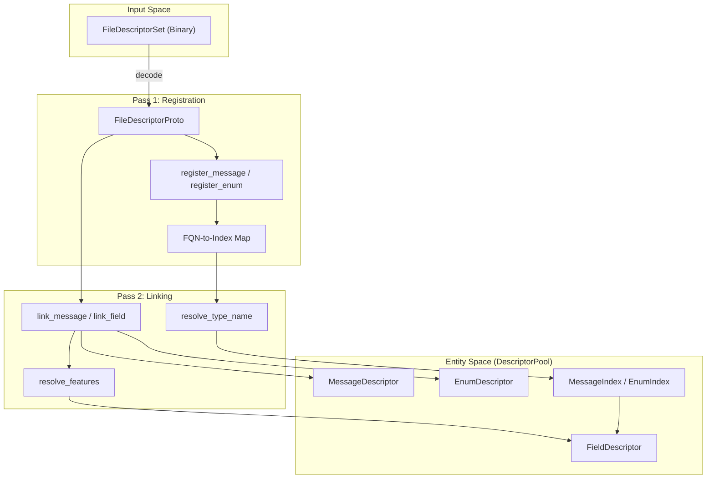
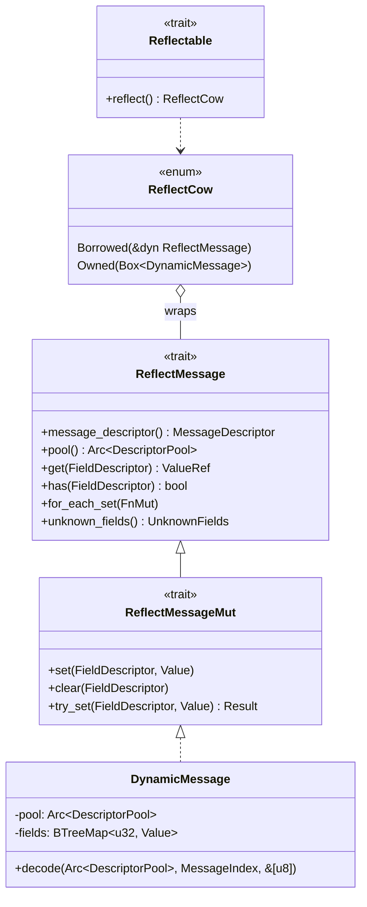

<!-- source: DeepWiki mcp.deepwiki.com · repo anthropics/buffa · page 4.3 Reflection Runtime: DescriptorPool and DynamicMessage · fetched 2026-10-26 -->

# Reflection Runtime: DescriptorPool and DynamicMessage

Relevant source files

The following files were used as context for generating this wiki page:

- [.changes/unreleased/added-20260628-210901.yaml](.changes/unreleased/added-20260628-210901.yaml)
- [.changes/unreleased/fixed-20260628-210900.yaml](.changes/unreleased/fixed-20260628-210900.yaml)
- [buffa-descriptor/Cargo.toml](buffa-descriptor/Cargo.toml)
- [buffa-descriptor/src/lib.rs](buffa-descriptor/src/lib.rs)
- [buffa-descriptor/src/pool.rs](buffa-descriptor/src/pool.rs)
- [buffa-descriptor/src/reflect/dynamic.rs](buffa-descriptor/src/reflect/dynamic.rs)
- [buffa-descriptor/src/reflect/json.rs](buffa-descriptor/src/reflect/json.rs)
- [buffa-descriptor/src/reflect/json_wkt.rs](buffa-descriptor/src/reflect/json_wkt.rs)
- [buffa-descriptor/src/reflect/message.rs](buffa-descriptor/src/reflect/message.rs)
- [buffa-descriptor/src/reflect/mod.rs](buffa-descriptor/src/reflect/mod.rs)
- [buffa-descriptor/src/reflect/value.rs](buffa-descriptor/src/reflect/value.rs)
- [buffa-descriptor/tests/dynamic_e2e.rs](buffa-descriptor/tests/dynamic_e2e.rs)
- [buffa-descriptor/tests/json_e2e.rs](buffa-descriptor/tests/json_e2e.rs)
- [buffa-descriptor/tests/pool_e2e.rs](buffa-descriptor/tests/pool_e2e.rs)
- [buffa-descriptor/tests/protos/reflect_test.proto](buffa-descriptor/tests/protos/reflect_test.proto)
- [conformance/Cargo.toml](conformance/Cargo.toml)

The `buffa-descriptor` crate provides a reflection runtime that enables interacting with Protobuf messages without generated code. It revolves around the `DescriptorPool`, which hosts linked and feature-resolved descriptors, and `DynamicMessage`, a map-backed message type that performs descriptor-driven encoding and decoding.

## DescriptorPool: Registration and Linking

The `DescriptorPool` is an immutable, thread-safe registry of Protobuf descriptors [buffa-descriptor/src/pool.rs:148-154](). It transforms raw `FileDescriptorProto` data into a flat, linked structure where cross-references (like field types) are resolved to internal indices [buffa-descriptor/src/pool.rs:3-9]().

### Two-Pass Construction

The pool is built in two distinct phases to handle forward references and cross-file dependencies [buffa-descriptor/src/pool.rs:11-21]():

1.  **Register Pass**: The pool walks every file to record the fully-qualified name (FQN) of every message, enum, and service, assigning each a `MessageIndex`, `EnumIndex`, or `ServiceIndex` [buffa-descriptor/src/pool.rs:13-16]().
2.  **Link Pass**: The pool walks the files again to build the linked descriptors. It resolves `type_name` strings to indices, classifies fields into `FieldKind` (Singular, List, or Map), and resolves Edition features [buffa-descriptor/src/pool.rs:17-20]().

### Transactional Updates

The pool supports transactional updates via `add_file_descriptor_set` [buffa-descriptor/src/pool.rs:154-155](). If an addition fails (e.g., due to an unresolved type name or duplicate name), the pool remains unchanged, preventing it from entering a corrupted state [buffa-descriptor/src/pool.rs:60-89](). This behavior is verified in end-to-end tests [buffa-descriptor/tests/pool_e2e.rs:210-213]().

### Feature Resolution

A key responsibility of the pool is resolving Protobuf Edition features (e.g., presence, packed encoding, enum openness) [buffa-descriptor/src/pool.rs:7-9](). These are resolved down the file → message → field chain at build time, ensuring that `FieldDescriptor` objects carry final, actionable values [buffa-descriptor/src/pool.rs:37-43](). For example, it correctly resolves `EnumType::Open` vs `EnumType::Closed` based on the Edition and features [buffa-descriptor/tests/pool_e2e.rs:188-191]().

### Pool Error Handling

The `PoolError` enum covers failures during the registration or linking process, such as `UnresolvedTypeName`, `DuplicateName`, `MalformedMapEntry`, or exceeding the 65,535 field-per-message limit (`TooManyFields`) [buffa-descriptor/src/pool.rs:60-89]().

**Descriptor Ingestion Pipeline**

Sources: [buffa-descriptor/src/pool.rs:1-43](), [buffa-descriptor/src/pool.rs:140-165]()

## DynamicMessage

`DynamicMessage` is a storage-agnostic Protobuf message implementation that stores field values in a `BTreeMap<u32, Value>` [buffa-descriptor/src/reflect/dynamic.rs:3-8](). It uses an `Arc<DescriptorPool>` and a `MessageIndex` to drive all operations [buffa-descriptor/src/reflect/dynamic.rs:42-53]().

### Field Access and Manipulation

`DynamicMessage` provides a descriptor-keyed API for manipulating fields:
*   **`get(&self, field: &FieldDescriptor) -> ValueRef`**: Returns the current value or the type's default [buffa-descriptor/src/reflect/message.rs:106-116]().
*   **`set(&mut self, field: &FieldDescriptor, value: Value)`**: Replaces the value of a singular field or an entire container [buffa-descriptor/src/reflect/message.rs:184-188]().
*   **`has(&self, field: &FieldDescriptor) -> bool`**: Checks for presence based on the field's semantics (explicit vs. implicit) [buffa-descriptor/src/reflect/message.rs:118-124]().
*   **`clear(&mut self, field: &FieldDescriptor)`**: Resets a field to its default/absent state [buffa-descriptor/src/reflect/message.rs:190-191]().

For safer mutation, `ReflectMessageMut` provides checked variants:
*   **`try_set` / `try_clear`**: These methods return a `ReflectError::FieldNotMember` if the provided descriptor does not belong to the message's pool or type [buffa-descriptor/src/reflect/message.rs:194-206]().

### Runtime Value Types

Reflection uses three primary types to represent data at runtime [buffa-descriptor/src/reflect/value.rs:1-8]():
*   **`Value`**: An owned enum representing any Protobuf value (scalars, messages, lists, or maps) [buffa-descriptor/src/reflect/value.rs:44-64]().
*   **`ValueRef<'a>`**: A borrowed, copy-on-write-friendly view of a `Value` [buffa-descriptor/src/reflect/value.rs:75-101]().
*   **`MapKey`**: A restricted subset of `Value` used for map keys (integers, strings, booleans) [buffa-descriptor/src/reflect/value.rs:205-215]().

### Binary Encode/Decode

Encoding and decoding are entirely descriptor-driven. The `decode` function iterates through the wire buffer, looks up `FieldDescriptor`s (or extensions) by number, and populates the internal map [buffa-descriptor/src/reflect/dynamic.rs:166-180](). Unknown fields are preserved in an `UnknownFields` container [buffa-descriptor/src/reflect/dynamic.rs:52-53](). Re-encoding is deterministic for known fields due to `BTreeMap` iteration [buffa-descriptor/src/reflect/dynamic.rs:10-12]().

Sources: [buffa-descriptor/src/reflect/dynamic.rs:1-53](), [buffa-descriptor/src/reflect/message.rs:34-206](), [buffa-descriptor/src/reflect/value.rs:1-101]()

## Reflection Traits: ReflectMessage and Reflectable

The reflection system is designed to be storage-agnostic and dyn-safe through traits [buffa-descriptor/src/reflect/message.rs:4-15]().

### ReflectMessage and ReflectMessageMut

`ReflectMessage` provides read-only access to a message's fields, descriptors, and unknown fields [buffa-descriptor/src/reflect/message.rs:95-171](). `ReflectMessageMut` extends this with mutation capabilities [buffa-descriptor/src/reflect/message.rs:182-206](). These traits allow generic logic to operate on both `DynamicMessage` and generated types.

### Reflectable and ReflectCow

`Reflectable` is the entry point emitted by the code generator [buffa-descriptor/src/reflect/message.rs:17-22](). It provides a `reflect()` method that returns a `ReflectCow` [buffa-descriptor/src/reflect/message.rs:215]().

`ReflectCow` is a handle that abstracts the reflection mode [buffa-descriptor/src/reflect/message.rs:225-230]():
*   **Bridge Mode**: `Reflectable::reflect` boxes a `DynamicMessage` produced from an encode/decode round-trip [buffa-descriptor/src/reflect/mod.rs:48-51]().
*   **VTable Mode**: `Reflectable::reflect` borrows the struct directly via a codegen-emitted vtable [buffa-descriptor/src/reflect/mod.rs:52-54]().

**Reflection Trait Hierarchy**

Sources: [buffa-descriptor/src/reflect/message.rs:1-230](), [buffa-descriptor/src/reflect/mod.rs:39-55]()

## JSON Serialization

`DynamicMessage` supports Proto3 canonical JSON through `serde` integration [buffa-descriptor/src/reflect/json.rs:1-7]().

*   **Serialization**: `impl Serialize for DynamicMessage` performs a mechanical walk over the descriptor's fields and registered extensions [buffa-descriptor/src/reflect/json.rs:42-71]().
*   **Deserialization**: Uses `DeserializeSeed` (via `DynamicMessageSeed`) because the descriptor is required as input [buffa-descriptor/src/reflect/json.rs:28-35]().
*   **WKT Specialization**: Well-known types (WKTs) are special-cased by `MessageDescriptor::full_name` and handled by the `reflect::json_wkt` module [buffa-descriptor/src/reflect/json.rs:9-15]().

### Well-Known Types (WKT) Codec

The `reflect::json_wkt` module provides reflective codecs for WKTs like `Timestamp`, `Duration`, `FieldMask`, and `Any` [buffa-descriptor/src/reflect/json_wkt.rs:1-6](). These codecs read/write `DynamicMessage` fields by number to avoid a dependency on the `buffa-types` crate [buffa-descriptor/src/reflect/json.rs:9-12]().

*   **Any**: Supports `pack` and `unpack` logic by expanding `@type` and resolving the inner type within the same `DescriptorPool` [buffa-descriptor/src/reflect/json.rs:17-20]().
*   **Custom Options**: Reflection allows access to custom options via the `options()` method on descriptors, which returns a `DynamicMessage` if the options are present [buffa-descriptor/src/pool.rs:46-55]().

Sources: [buffa-descriptor/src/reflect/json.rs:1-72](), [buffa-descriptor/src/reflect/json_wkt.rs:1-21]()

---

