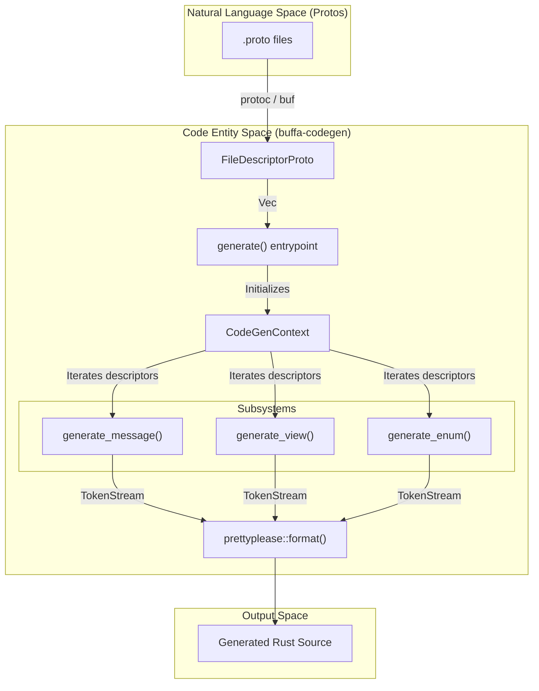
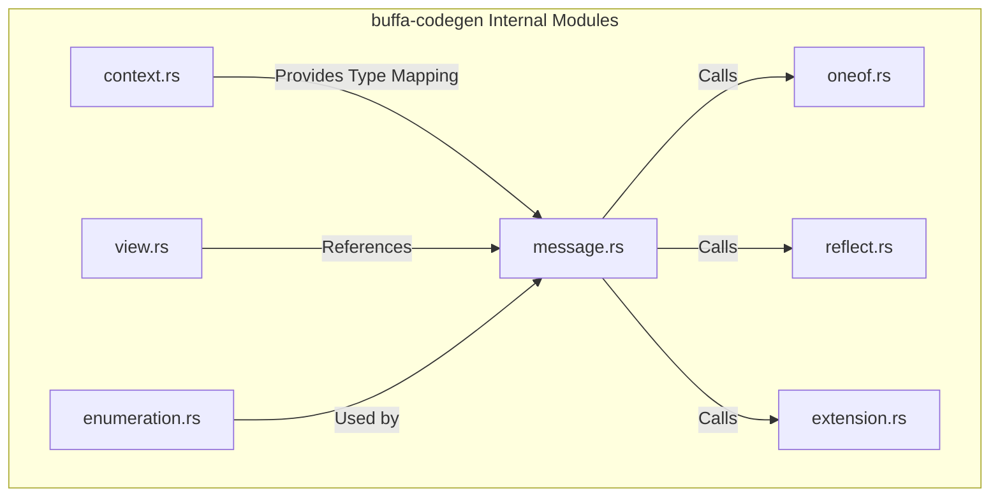

<!-- source: DeepWiki mcp.deepwiki.com · repo anthropics/buffa · page 5 Code Generation (`buffa-codegen`) · fetched 2026-10-26 -->

# Code Generation (`buffa-codegen`)

Relevant source files

The following files were used as context for generating this wiki page:

- [buffa-build/src/lib.rs](buffa-build/src/lib.rs)
- [buffa-codegen/src/context.rs](buffa-codegen/src/context.rs)
- [buffa-codegen/src/lib.rs](buffa-codegen/src/lib.rs)
- [buffa-codegen/src/message.rs](buffa-codegen/src/message.rs)
- [buffa-codegen/src/oneof.rs](buffa-codegen/src/oneof.rs)
- [buffa-codegen/src/tests/mod.rs](buffa-codegen/src/tests/mod.rs)
- [buffa-test/build.rs](buffa-test/build.rs)
- [buffa-test/src/lib.rs](buffa-test/src/lib.rs)
- [buffa-test/src/tests/mod.rs](buffa-test/src/tests/mod.rs)

The `buffa-codegen` library is the central engine for transforming Protobuf descriptors into Rust source code. It implements the logic required to map Protobuf messages, enums, and services into high-performance Rust types that leverage the `buffa` runtime.

## Role in the Compilation Pipeline

`buffa-codegen` is intentionally decoupled from the source of the descriptors. It does not parse `.proto` files or invoke `protoc` directly [buffa-codegen/src/lib.rs:13-21](). Instead, it operates on `FileDescriptorProto` objects [buffa-codegen/src/lib.rs:44-46](), typically provided by:
*   **`protoc-gen-buffa`**: A compiler plugin that receives descriptors via `stdin` from `protoc` or `buf`.
*   **`buffa-build`**: A build-script helper that manages descriptor generation via `DescriptorSource` (Protoc, Buf, or Precompiled) and passes them to the codegen library [buffa-build/src/lib.rs:44-54]().

### Data Flow Overview

The following diagram illustrates how the codegen library bridges the gap between Protobuf descriptors and the final Rust implementation.

**Codegen Pipeline Architecture**

Sources: [buffa-codegen/src/lib.rs:1-21](), [buffa-codegen/src/lib.rs:44-46]()

## The `generate()` Entrypoint

The primary entrypoint for the library is the `generate()` function. It accepts a slice of `FileDescriptorProto` and a `CodeGenConfig`, returning a vector of `GeneratedFile` structs containing the final Rust strings.

The generation process follows these high-level steps:
1.  **Context Initialization**: Creates a `CodeGenContext` to manage type mapping, name resolution, and comment extraction [buffa-codegen/src/lib.rs:24-24](), [buffa-codegen/src/context.rs:46-128]().
2.  **Validation**: Performs pre-generation checks for naming collisions or unsupported features like `message_set_wire_format` [buffa-codegen/src/message.rs:122-135]().
3.  **Module Tree Construction**: Determines the Rust module hierarchy based on proto packages, handling `SENTINEL_MOD` (`__buffa`) for ancillary types [buffa-codegen/src/context.rs:10-16]().
4.  **Emission**: Iteratively generates code for messages, enums, and views.
5.  **Formatting**: Uses the `prettyplease` crate to format the resulting `TokenStream` into readable Rust code.

### Generated Files and Companions
Each `.proto` produces up to five content files (`Owned`, `View`, `Oneof`, `ViewOneof`, and `Ext`) which are stitched together by a `PackageMod` file (`<dotted.pkg>.mod.rs`) [buffa-codegen/src/lib.rs:83-119](). 

`buffa-codegen` supports **Companion** files via `apply_companions`. These allow downstream generators to inject extra content, such as service stubs, into the package root [buffa-codegen/src/lib.rs:135-171](). Items declared `pub` in a companion file are visible at the package root alongside owned message types [buffa-codegen/src/lib.rs:163-171]().

Sources: [buffa-codegen/src/lib.rs:83-171](), [buffa-codegen/src/context.rs:10-16]()

## CodeGenConfig Options

The `CodeGenConfig` struct allows fine-grained control over the generated output.

| Option | Type | Description |
| :--- | :--- | :--- |
| `generate_views` | `bool` | Enables generation of zero-copy `*View<'a>` types [buffa-build/src/lib.rs:106-111](). |
| `lazy_views` | `bool` | Generates `*LazyView<'a>` types for deferred decoding [buffa-build/src/lib.rs:113-130](). |
| `generate_json` | `bool` | Derives `serde` traits and emits proto3-compliant JSON attributes [buffa-build/src/lib.rs:132-166](). |
| `string_type` | `StringRepr` | Configures the string representation (e.g., `String`, `SmolStr`, `EcoString`) [buffa-build/src/lib.rs:42-42](). |
| `reflect_mode` | `ReflectMode` | Configures reflection support (Off, Bridge, or VTable) [buffa-build/src/lib.rs:40-40](). |
| `idiomatic_enum_aliases` | `bool` | Generates UpperCamelCase aliases for enum variants. |

Sources: [buffa-build/src/lib.rs:35-190](), [buffa-codegen/src/lib.rs:142-162]()

## Internal Module Structure

The library is organized into specialized modules that handle specific parts of the Protobuf-to-Rust mapping:

**Internal Subsystems**

Sources: [buffa-codegen/src/lib.rs:23-44]()

## Detailed Subsystems (Child Pages)

For deep dives into specific generation logic, refer to the following child pages:

*   **[CodeGenContext and Type Resolution](#5.1)**: Details on the `CodeGenContext` state container, FQN-to-Rust-path resolution via `type_map`, `extern_path` mappings, and `SplitPath` logic [buffa-codegen/src/context.rs:23-56]().
*   **[Message Code Generation](#5.2)**: How `generate_message` handles field classification, `MessageField` wrappers, and `RegistryPaths` for JSON/Text formats [buffa-codegen/src/message.rs:18-71](), [buffa-codegen/src/message.rs:88-105]().
*   **[View Type Code Generation](#5.3)**: The logic behind zero-copy `View` structs and the new `LazyView` family for deferred access [buffa-codegen/src/lib.rs:148-150]().
*   **[Enum and Oneof Code Generation](#5.4)**: Generation of Rust enums for Protobuf enumerations and `resolve_unboxed_variants` for inlined oneof members [buffa-codegen/src/oneof.rs:79-98]().
*   **[Validation, Module Tree, and Bootstrapping](#5.5)**: Pre-generation validation, the `PackageMod` stitcher logic, and handling `ALLOW_LINTS` at module boundaries [buffa-codegen/src/lib.rs:55-72]().
*   **[Reflection Code Generation](#5.6)**: How the generator emits reflection support via `Reflectable` and `ReflectMessage` traits, including `OwnedView` wrappers [buffa-codegen/src/lib.rs:38-43]().

Sources: [buffa-codegen/src/lib.rs:23-44](), [buffa-codegen/src/context.rs:23-56](), [buffa-codegen/src/message.rs:18-105]()

---

