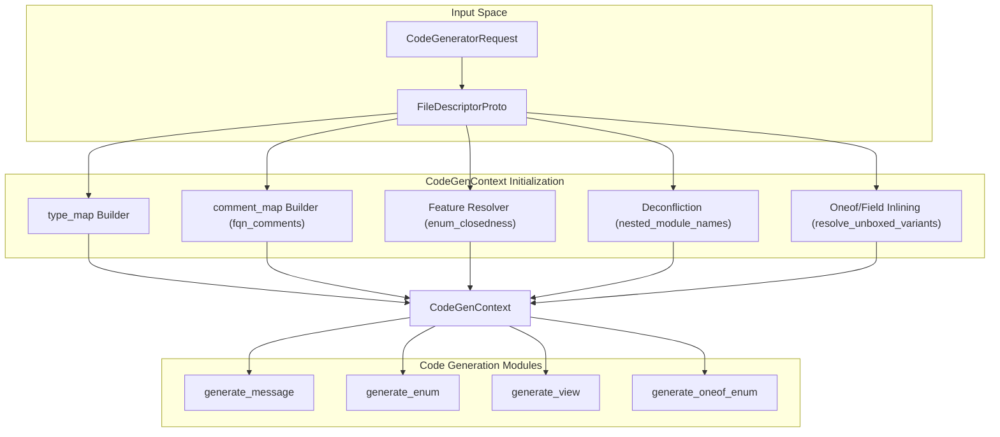
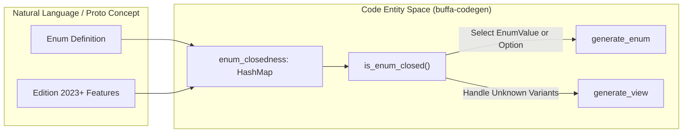

<!-- source: DeepWiki mcp.deepwiki.com · repo anthropics/buffa · page 5.1 CodeGenContext and Type Resolution · fetched 2026-10-26 -->

# CodeGenContext and Type Resolution

Relevant source files

The following files were used as context for generating this wiki page:

- [buffa-codegen/src/comments.rs](buffa-codegen/src/comments.rs)
- [buffa-codegen/src/context.rs](buffa-codegen/src/context.rs)
- [buffa-codegen/src/imports.rs](buffa-codegen/src/imports.rs)
- [buffa-codegen/src/oneof.rs](buffa-codegen/src/oneof.rs)
- [buffa-codegen/src/tests/comments.rs](buffa-codegen/src/tests/comments.rs)
- [buffa-codegen/src/tests/idiomatic_imports.rs](buffa-codegen/src/tests/idiomatic_imports.rs)
- [buffa-codegen/src/tests/mod.rs](buffa-codegen/src/tests/mod.rs)
- [buffa-test/protos/prelude_shadow.proto](buffa-test/protos/prelude_shadow.proto)
- [buffa-test/src/tests/mod.rs](buffa-test/src/tests/mod.rs)

The `CodeGenContext` is the central state container for the `buffa-codegen` pipeline. It manages the mapping between Protobuf's global namespace (Fully Qualified Names, or FQNs) and Rust's module/type system. This context ensures that cross-file references, nested types, and external crate dependencies are resolved consistently during code generation.

## Overview of CodeGenContext

The `CodeGenContext` struct is initialized once per generation run. It aggregates file descriptors, configuration options, and pre-computed metadata to provide a unified lookup interface for all generation functions.

| Field | Type | Description |
| :--- | :--- | :--- |
| `files` | `&'a [FileDescriptorProto]` | The full set of descriptors (requested + dependencies). [buffa-codegen/src/context.rs:48]() |
| `config` | `&'a CodeGenConfig` | User-provided generation settings. [buffa-codegen/src/context.rs:50]() |
| `type_map` | `HashMap<String, String>` | Maps Protobuf FQNs (e.g., `.pkg.Msg`) to Rust paths (e.g., `pkg::Msg`). [buffa-codegen/src/context.rs:56]() |
| `package_of` | `HashMap<String, String>` | Maps FQNs to their original proto package for relative path logic. [buffa-codegen/src/context.rs:61]() |
| `enum_closedness` | `HashMap<String, bool>` | Tracks if an enum is "closed" based on resolved features. [buffa-codegen/src/context.rs:69]() |
| `comment_map` | `HashMap<String, String>` | Maps FQNs to formatted source comments. [buffa-codegen/src/context.rs:82]() |
| `nested_module_names` | `HashMap<String, String>` | Deconflicted module names for nested types. [buffa-codegen/src/context.rs:92]() |
| `unboxed_oneof_variants` | `HashSet<String>` | Resolved set of variants stored inline rather than boxed. [buffa-codegen/src/context.rs:97]() |
| `inlined_message_fields` | `HashSet<String>` | Resolved set of singular fields stored inline. [buffa-codegen/src/context.rs:103]() |
| `warnings` | `RefCell<Vec<CodeGenWarning>>` | Interior-mutable sink for non-fatal diagnostics. [buffa-codegen/src/context.rs:115]() |
| `imports` | `RefCell<ImportsPhase>` | Two-pass state for idiomatic import shortening. [buffa-codegen/src/context.rs:127]() |

**Sources:** [buffa-codegen/src/context.rs:46-128]()

### Data Flow: Descriptor to Context

The following diagram illustrates how the `CodeGenContext` is populated from the `CodeGeneratorRequest` and how it serves as the "Source of Truth" for the generation modules.

**Context Initialization and Usage**

**Sources:** [buffa-codegen/src/context.rs:46-128](), [buffa-codegen/src/comments.rs:42-68](), [buffa-codegen/src/oneof.rs:79-130]()

## Type Resolution and Path Mapping

`buffa` uses a deterministic mapping from Protobuf FQNs to Rust paths. This allows fields in one file to reference types in another without knowing the file's physical location.

### FQN to Rust Path Rules
1.  **Top-level Types**: `.my.package.MyMessage` becomes `my::package::MyMessage`.
2.  **Nested Types**: Buffa uses module-qualified paths rather than flat names. `.pkg.Outer.Inner` maps to `pkg::outer::Inner`. [buffa-codegen/src/context.rs:54-55]()
3.  **Snake Case Modules**: Parent message names are converted to `snake_case` when used as module names for nested types. [buffa-codegen/src/context.rs:86-91]()
4.  **Deconfliction**: If a nested module name (e.g., `mod oof`) collides with a sub-package segment (e.g., `package foo.oof`), trailing underscores are appended until unique (e.g., `oof_`). [buffa-codegen/src/context.rs:83-92]()

### Extern Path Mappings
The `extern_path` configuration allows mapping specific Protobuf packages to existing Rust crates. A primary use case is the Well-Known Types (WKTs), which are mapped to the `buffa-types` crate.

*   If a package (e.g., `google.protobuf`) matches an `extern_path` entry, the `type_map` registers it with the provided Rust prefix (e.g., `::buffa_types`).
*   This mapping is applied during the initial walk of the descriptors to populate the `type_map`.

**Sources:** [buffa-codegen/src/context.rs:51-56](), [buffa-codegen/src/context.rs:86-92]()

## Relative Path Calculation

When generating code for a field, `buffa` must decide whether to use an absolute path or a relative path. This is handled by `rust_type_relative_split`, which returns a `SplitPath` struct.

| Component | Description |
| :--- | :--- |
| `to_package` | Path from current emission scope to the target package root (e.g., `super::super`). [buffa-codegen/src/context.rs:32]() |
| `within_package` | Path from the target package root to the type itself (e.g., `outer::Inner`). [buffa-codegen/src/context.rs:35]() |
| `is_extern` | `true` when `to_package` is an absolute extern path (e.g., `::buffa_types`). [buffa-codegen/src/context.rs:38]() |

**Sources:** [buffa-codegen/src/context.rs:23-39]()

## Comment Extraction (SourceCodeInfo)

Protobuf stores comments in `SourceCodeInfo` using integer-based paths (e.g., `[4, 0, 2, 1]` for "File 1, Message 0, Field 1"). To simplify codegen, `buffa` walks the entire descriptor tree upfront and converts these into an FQN-keyed `comment_map`.

### Translation Process
1.  **Walk**: The `fqn_comments` function iterates through `FileDescriptorProto.source_code_info`. [buffa-codegen/src/comments.rs:42-50]()
2.  **Map**: It correlates index paths to FQNs by following the descriptor hierarchy:
    *   `FILE_MESSAGE_TYPE (4)` -> Messages [buffa-codegen/src/comments.rs:24]()
    *   `FILE_ENUM_TYPE (5)` -> Enums [buffa-codegen/src/comments.rs:25]()
    *   `MSG_FIELD (2)` -> Fields [buffa-codegen/src/comments.rs:28]()
    *   `MSG_ONEOF_DECL (8)` -> Oneofs [buffa-codegen/src/comments.rs:31]()
3.  **AIP-192 Resolution**: `doc_attrs_resolved` transforms these comments into `#[doc = "..."]` attributes, resolving AIP-192 cross-references (e.g., `[MyMsg][pkg.MyMsg]`) into Rust intra-doc links. [buffa-codegen/src/comments.rs:181-190]()

**Sources:** [buffa-codegen/src/comments.rs:1-13](), [buffa-codegen/src/comments.rs:23-35](), [buffa-codegen/src/comments.rs:42-68](), [buffa-codegen/src/comments.rs:181-190]()

## Feature Resolution and Enum Closedness

The context tracks "closedness" for enums, which is critical for both the `Enumeration` trait implementation and the zero-copy `View` types.

*   **Closed Enums**: Only allow known variants. Unknown values are treated as unknown fields or errors.
*   **Open Enums**: Allow any `i32` value, with unknown values preserved in the `EnumValue<T>` wrapper.

The `enum_closedness` map is built by resolving the `enum_type` feature for every enum in the descriptor set. This resolution follows the Protobuf feature inheritance chain: File -> Message -> Enum. Note that `protoc` does not propagate enum-level `enum_type` into field options, so `buffa` must perform this lookup via the context. [buffa-codegen/src/context.rs:62-69]()

**Enum Feature Mapping**

**Sources:** [buffa-codegen/src/context.rs:62-69]()

## Idiomatic Imports and Two-Pass Resolution

When `CodeGenConfig::idiomatic_imports` is enabled (requiring `file_per_package`), `buffa` performs a two-pass generation to shorten type paths. [buffa-codegen/src/imports.rs:15-22]()

1.  **Collecting Phase**: Generation runs once with `ImportsPhase::Collecting`. Every path request (e.g., `Option`, `String`, or a cross-package message) is recorded. [buffa-codegen/src/imports.rs:24-29]()
2.  **Assignment**: The `RootImports::assign` method allocates short names, ensuring no collisions with proto-defined types or Rust keywords like `Result` or `bool`. [buffa-codegen/src/imports.rs:25-28](), [buffa-codegen/src/imports.rs:140-167]()
3.  **Resolving Phase**: Generation runs a second time with `ImportsPhase::Resolving`. The `ImportResolver` emits the assigned short names and includes `use` directives at the package root. [buffa-codegen/src/imports.rs:28-31]()

**Sources:** [buffa-codegen/src/imports.rs:1-31](), [buffa-codegen/src/imports.rs:140-167](), [buffa-codegen/src/tests/idiomatic_imports.rs:1-9]()

## Natural-Path Re-exports

`buffa` generates a "natural" module tree that mirrors the Protobuf package structure. However, it also uses a sentinel module (`__buffa`) to store ancillary types like views and oneof enums.

*   **SENTINEL_MOD**: The constant `__buffa` is used to prevent collisions between user-defined types and generated internal types. [buffa-codegen/src/context.rs:16]()
*   **Re-exports**: To maintain ergonomics, `buffa` emits `pub use` statements that bring types from the sentinel tree back into the natural package modules where appropriate. [buffa-codegen/src/context.rs:10-16]()

**Sources:** [buffa-codegen/src/context.rs:10-16]()

---

