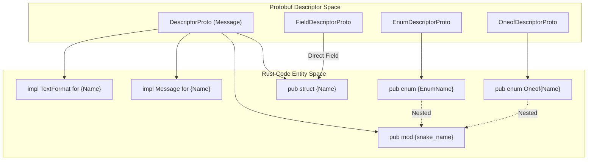
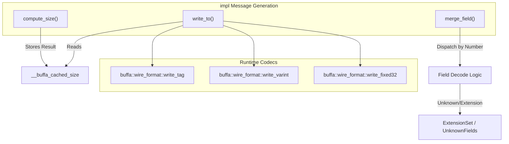

<!-- source: DeepWiki mcp.deepwiki.com · repo anthropics/buffa · page 5.2 Message Code Generation · fetched 2026-10-26 -->

# Message Code Generation

Relevant source files

The following files were used as context for generating this wiki page:

- [buffa-build/src/lib.rs](buffa-build/src/lib.rs)
- [buffa-codegen/src/defaults.rs](buffa-codegen/src/defaults.rs)
- [buffa-codegen/src/lib.rs](buffa-codegen/src/lib.rs)
- [buffa-codegen/src/message.rs](buffa-codegen/src/message.rs)
- [buffa-test/build.rs](buffa-test/build.rs)
- [buffa-test/src/lib.rs](buffa-test/src/lib.rs)

The `generate_message` function is the primary entry point for transforming a Protobuf message descriptor into Rust source code. It handles the structural generation of owned message types, including field classification, nested type recursion, trait implementations, and JSON serialization metadata.

## Overview of `generate_message`

The generation process follows a recursive pattern where a message's nested types (messages and enums) are emitted into a dedicated Rust module, while the message itself is emitted as a struct at the current scope. The function returns a `MessageOutput` struct containing separated token streams for owned types, views, and oneofs [buffa-codegen/src/message.rs:49-71]().

### Data Flow and Recursion
1.  **Nested Enums**: Iterates through `msg.enum_type` and calls `generate_enum` [buffa-codegen/src/message.rs:139-155]().
2.  **Nested Messages**: Iterates through `msg.nested_type`, filtering out synthetic map entries, and recursively calls `generate_message_with_nesting` with incremented nesting depth [buffa-codegen/src/message.rs:160-186]().
3.  **Field Generation**: Processes each field in the descriptor to determine its Rust type and presence semantics [buffa-codegen/src/message.rs:191-201]().
4.  **Oneof Handling**: Groups fields belonging to the same `oneof` into a single enum-typed field [buffa-codegen/src/message.rs:205-231]().
5.  **Trait Implementation**: Generates the `Message` trait via `generate_message_impl`, `DefaultInstance` via `generate_default_instance_impl`, and `TextFormat` via `generate_text_impl` [buffa-codegen/src/message.rs:356-364](), [buffa-codegen/src/impl_text.rs:55-66]().

### Code Entity Mapping
The following diagram illustrates how Protobuf descriptor entities map to generated Rust code entities.

**Protobuf to Rust Entity Mapping**

Sources: [buffa-codegen/src/message.rs:120-121](), [buffa-codegen/src/message.rs:139-155](), [buffa-codegen/src/message.rs:160-186](), [buffa-codegen/src/impl_text.rs:55-66]()

---

## Field Classification and Type Selection

Buffa selects Rust types based on a combination of the field's Protobuf type, label, and resolved features (such as Editions 2024 presence rules).

### Type Selection Logic
| Protobuf Category | Rust Type | Condition |
| :--- | :--- | :--- |
| **Singular Message** | `MessageField<T, P>` | Always used for sub-messages; `P` defaults to `Inline<T>` or `Box<T>` [buffa-codegen/src/message.rs:191-201](), [buffa-test/build.rs:25-29]() |
| **Repeated Field** | `ProtoList<T>` | `label == LABEL_REPEATED`. Defaults to `Vec<T>` [buffa-test/build.rs:141-144]() |
| **Map Field** | `MapStorage<K, V>` | Detected via `map_entry`. Defaults to `HashMap` or `BTreeMap` [buffa-test/build.rs:83-93]() |
| **Optional Scalar** | `Option<T>` | Explicit presence (Proto2 optional, Proto3 `optional`, or Editions `EXPLICIT`) [buffa-codegen/src/defaults.rs:38-40]() |
| **Required Scalar** | `T` (bare) | Proto2 `required` or Editions `LEGACY_REQUIRED` |
| **Open Enum** | `EnumValue<E>` | Default for Proto3 and Editions |
| **Closed Enum** | `E` (bare) | Proto2 or Editions with `enum_type = CLOSED` |

### Configurable Representations (Pluggable Types)
Buffa supports alternative representations for core types via `CodeGenConfig` [buffa-build/src/lib.rs:42]():
- **Strings**: Configurable via `StringRepr` (e.g., `SmolStr`, `EcoString`, `CompactString`) [buffa-build/src/lib.rs:42](). Custom strings must implement `ProtoString` [buffa-test/src/lib.rs:104-112]().
- **Bytes**: Configurable via `BytesRepr`. Custom types must implement `ProtoBytes` [buffa-test/src/lib.rs:150-156]().
- **Pointers**: `PointerRepr` controls whether singular messages use `Inline<T>` or `Box<T>` [buffa-test/build.rs:25-29]().
- **Collections**: `RepeatedRepr` and `MapRepr` allow switching between `Vec`/`SmallVec` and `HashMap`/`BTreeMap`/`IndexMap` [buffa-test/build.rs:83-116]().

### Special Field Handling
- **`MessageField<T>`**: Provides ergonomic `Deref` to the default instance, allowing `msg.field.subfield` access even if `field` is `None`.
- **`SizeCache`**: Every message struct is injected with a `__buffa_cached_size: ::buffa::SizeCache` field to store the result of `compute_size` [buffa-codegen/src/message.rs:271-272]().
- **Unknown Fields**: If the message has extension ranges or the config enables it, a `__buffa_unknown_fields: UnknownFields` field is added [buffa-codegen/src/message.rs:265-269]().
- **Default Values**: For fields with explicit presence, `parse_default_value` converts proto default strings into Rust literals or enum variant paths [buffa-codegen/src/defaults.rs:20-27]().

Sources: [buffa-codegen/src/message.rs:265-272](), [buffa-codegen/src/defaults.rs:20-40](), [buffa-test/build.rs:42-116](), [buffa-test/src/lib.rs:104-156]()

---

## Oneof Code Generation

Oneofs are handled by generating a separate enum within the message's nested module.

1.  **Field Emission**: The main struct contains a single field `pub <oneof_name>: Option<<mod>::Oneof<Name>>` [buffa-codegen/src/message.rs:224-227]().
2.  **Enum Generation**: The `generate_oneof_enum` function creates an enum where each variant corresponds to a oneof member.
3.  **Recursive Boxing**: Variants for message or group types are automatically wrapped in `Box<T>` (or a custom `ProtoBox`) to allow for recursive data structures [buffa-test/src/lib.rs:26-52]().
4.  **JSON Flattening**: If JSON support is enabled, the oneof field in the struct is marked with `#[serde(flatten)]` to ensure the variants appear at the top level of the JSON object [buffa-codegen/src/message.rs:205-212]().

Sources: [buffa-codegen/src/message.rs:224-227](), [buffa-test/src/lib.rs:26-52](), [buffa-codegen/src/message.rs:205-212]()

---

## Extension Range Wrappers

For messages that define `extensions` ranges (e.g., Proto2 `extendee` targets), Buffa generates specialized handling for the extension set.

- **`ExtensionSet`**: Messages with extension ranges include an `ExtensionSet` to store typed values at runtime [buffa-codegen/src/message.rs:265-269]().
- **Extension Range Consts**: The codegen emits `EXTENSION_RANGES` as a slice of `RangeInclusive<u32>` to facilitate unknown field routing [buffa-codegen/src/message.rs:320-326]().

Sources: [buffa-codegen/src/message.rs:265-269](), [buffa-codegen/src/message.rs:320-326]()

---

## JSON Serde Attribute Emission

Buffa uses `serde` for JSON serialization. The codegen emits specific attributes to match the Protobuf-to-JSON mapping specification.

- **Field Names**: Uses `#[serde(rename = "...")]` to map Rust snake_case identifiers to Proto `json_name` or camelCase names [buffa-codegen/src/message.rs:205-212]().
- **NullValue Handling**: Fields of type `google.protobuf.NullValue` or `google.protobuf.Value` receive special treatment to ensure JSON `null` is handled as a valid value rather than an absent variant.
- **Custom Deserialize**: A manual `Deserialize` implementation is generated for every message to handle complex Protobuf JSON rules, such as quoted integers or base64 bytes [buffa-codegen/src/message.rs:366-367]().

### Logic Flow for Message Implementation
The following diagram shows the internal logic of `impl Message` generation, specifically for the `merge` (decode) and `write_to` (encode) operations.

**Message Implementation Data Flow**

Sources: [buffa-codegen/src/impl_message.rs:1-17](), [buffa-codegen/src/message.rs:271-272]()

---

