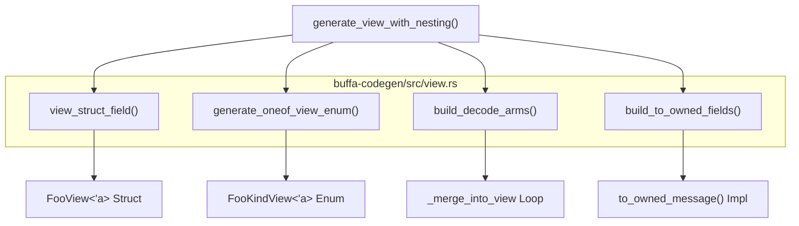
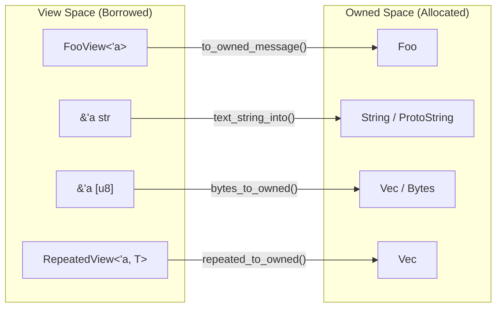

<!-- source: DeepWiki mcp.deepwiki.com · repo anthropics/buffa · page 5.3 View Type Code Generation · fetched 2026-10-26 -->

# View Type Code Generation

Relevant source files

The following files were used as context for generating this wiki page:

- [buffa-codegen/src/impl_message.rs](buffa-codegen/src/impl_message.rs)
- [buffa-codegen/src/impl_text.rs](buffa-codegen/src/impl_text.rs)
- [buffa-codegen/src/lazy_view.rs](buffa-codegen/src/lazy_view.rs)
- [buffa-codegen/src/view.rs](buffa-codegen/src/view.rs)
- [buffa/src/lib.rs](buffa/src/lib.rs)

The `buffa` code generator produces zero-copy "View" types alongside standard owned message structs. These views allow for extremely high-performance data access by borrowing `&str` and `&[u8]` fields directly from the input buffer, bypassing the allocation and copy overhead typically associated with protobuf decoding.

## Overview of View Types

For every message `Foo`, the generator creates a `FooView<'a>` struct. This struct implements the `MessageView<'a>` trait, providing a `decode_view` method that populates the view from a byte slice.

| Feature | Owned Message (`Foo`) | Message View (`FooView<'a>`) |
| :--- | :--- | :--- |
| **String Fields** | `String` (or custom `ProtoString`) | `&'a str` |
| **Bytes Fields** | `Vec<u8>` or `Bytes` | `&'a [u8]` |
| **Repeated Fields** | `Vec<T>` | `RepeatedView<'a, T>` |
| **Message Fields** | `MessageField<T>` | `MessageFieldView<'a, TView<'a>>` |
| **Oneofs** | `Option<FooKind>` | `Option<FooKindView<'a>>` |
| **Allocation** | High (recursive clones/allocs) | Minimal (mostly pointer/length pairs) |

Sources: [buffa-codegen/src/view.rs:1-10](), [buffa-codegen/src/view.rs:184-192](), [buffa/src/lib.rs:55-69]()

## The `generate_view` Function

The entry point for view generation is `generate_view_with_nesting` [buffa-codegen/src/view.rs:81](). It coordinates the creation of the view struct, its internal oneof enums, and the implementation of the decoding logic.

### Data Flow and Logic
1.  **Field Filtering**: It filters out unsupported types and identifies which fields are "direct" (scalars/repeated) vs "oneof" members [buffa-codegen/src/view.rs:121-129]().
2.  **Lifetime Management**: If a message contains only scalars and unknown field preservation is disabled, it injects a `#[doc(hidden)] pub __buffa_phantom: ::core::marker::PhantomData<&'a ()>` field to ensure the `'a` lifetime parameter is technically "used" by the struct [buffa-codegen/src/view.rs:185-192]().
3.  **Unknown Fields**: If `preserve_unknown_fields` is enabled, it adds a `pub __buffa_unknown_fields: ::buffa::UnknownFieldsView<'a>` field to store raw spans of unparsed data [buffa-codegen/src/view.rs:150-154]().

### View Generation Pipeline

Sources: [buffa-codegen/src/view.rs:81-174]()

## Decoding: `_merge_into_view`

Unlike owned messages which use a `merge_field` method, views use an internal `_merge_into_view` function generated as part of the `MessageView` implementation. This function contains the primary decode loop that iterates over the input buffer.

### Decode Loop Implementation
The loop captures the cursor position (`before_tag`) before reading a tag. This allows it to calculate the exact byte span of a field if it needs to be skipped or stored as an unknown field [buffa-codegen/src/view.rs:36-45]().

### Field Decode Arms
The `build_decode_arms` function generates match arms for the wire format tags:
*   **Scalars**: Decoded using `::buffa::decode::*` primitives.
*   **Repeated Fields**: Uses `view.field.push_view(cur)` for length-delimited data or `push_packed_view` to store the slice [buffa-codegen/src/view.rs:165-171]().
*   **Oneofs**: Transitions the `Option<KindView>` state, mirroring the owned variants but with borrowed types [buffa-codegen/src/view.rs:7-8]().
*   **Closed Enums**: If a value is outside the known range, the raw bytes of the tag and value are pushed to `__buffa_unknown_fields` using the `closed_enum_view_unknown_route` [buffa-codegen/src/view.rs:36-45]().

Sources: [buffa-codegen/src/view.rs:36-45](), [buffa-codegen/src/view.rs:165-171](), [buffa-codegen/src/impl_message.rs:1-16]()

## Conversion: `to_owned_message`

Every `FooView<'a>` provides a `to_owned_message` method. This is the "de-viewing" path, converting borrowed slices into owned allocations.

*   **Strings**: Converted via `.to_string()` or `.into()` depending on the `StringRepr`.
*   **Bytes**: Converted via `bytes_to_owned`, which emits either `.to_vec()` or `::buffa::view::bytes_from_source()` depending on the `BytesRepr` configuration [buffa-codegen/src/view.rs:57-74]().
*   **Messages**: Recursively calls `to_owned_message()` on sub-views.
*   **Repeated**: Iterates through the `RepeatedView` and collects into a `Vec`.

### Entity Mapping: View to Owned

Sources: [buffa-codegen/src/view.rs:57-74](), [buffa-codegen/src/view.rs:173-174](), [buffa-codegen/src/impl_text.rs:39-56]()

## Lazy Views

When the `lazy_views` option is enabled, `buffa-codegen` additionally generates `FooLazyView<'a>` [buffa-codegen/src/lazy_view.rs:1-8]().

*   **Deferred Decoding**: Singular and repeated message fields are stored as `LazyMessageFieldView` or `LazyRepeatedView`, which only record the byte range in the source buffer and decode on access [buffa-codegen/src/lazy_view.rs:5-8]().
*   **Eager Fallback**: Scalars, strings, bytes, and `DELIMITED` (groups) fields remain eager to reuse the existing view machinery [buffa-codegen/src/lazy_view.rs:10-15]().
*   **Extern Types**: Fields resolving to WKTs or `extern_path` types stay eager to ensure compatibility with crates that may not provide lazy view families [buffa-codegen/src/lazy_view.rs:41-43]().

Sources: [buffa-codegen/src/lazy_view.rs:1-15](), [buffa-codegen/src/lazy_view.rs:37-56]()

## Reborrowing and Default Instances

To support ergonomic usage, views implement the `ViewReborrow` trait and provide a `Default` implementation.

*   **`ViewReborrow`**: Generates a `reborrow()` method that allows creating a `FooView<'b>` from a `&'b FooView<'a>` where `'a: 'b` [buffa-codegen/src/view.rs:194-204]().
*   **`Default` Implementation**: Provides a view where all fields are empty/default. Since a default view doesn't borrow from any buffer, its fields are essentially empty slices or `None` [buffa-codegen/src/view.rs:206-212]().
*   **`DefaultViewInstance`**: A mechanism used to provide a static-like default instance for nested message views, allowing `Deref` to a default view when a field is not set.

Sources: [buffa-codegen/src/view.rs:194-212](), [buffa/src/lib.rs:102-105]()

## Summary of Key Functions

| Function | Responsibility |
| :--- | :--- |
| `generate_view_with_nesting` | Main driver for view type emission [buffa-codegen/src/view.rs:81](). |
| `closed_enum_view_unknown_route` | Generates logic to preserve unknown enum values as raw wire bytes [buffa-codegen/src/view.rs:36](). |
| `bytes_to_owned` | Handles the logic for converting `&[u8]` to `Vec<u8>` or `Bytes` [buffa-codegen/src/view.rs:57](). |
| `build_decode_arms` | Generates the `match` arms for the `_merge_into_view` decode loop [buffa-codegen/src/view.rs:165](). |
| `generate_lazy_view_with_nesting` | Driver for generating deferred-decode lazy view types [buffa-codegen/src/lazy_view.rs:63](). |

Sources: [buffa-codegen/src/view.rs:36-174](), [buffa-codegen/src/lazy_view.rs:63-184]()

---

