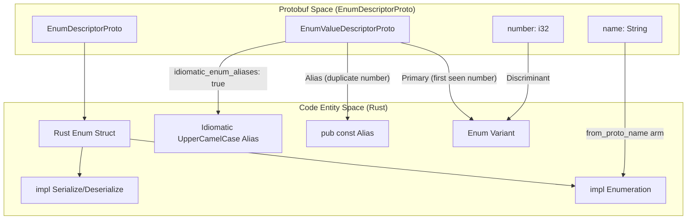
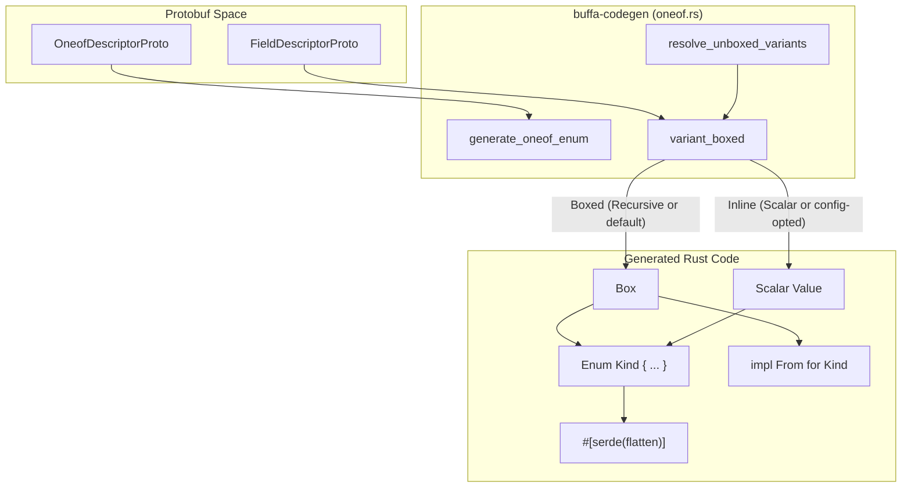

<!-- source: DeepWiki mcp.deepwiki.com · repo anthropics/buffa · page 5.4 Enum and Oneof Code Generation · fetched 2026-10-26 -->

# Enum and Oneof Code Generation

Relevant source files

The following files were used as context for generating this wiki page:

- [buffa-codegen/src/context.rs](buffa-codegen/src/context.rs)
- [buffa-codegen/src/enumeration.rs](buffa-codegen/src/enumeration.rs)
- [buffa-codegen/src/oneof.rs](buffa-codegen/src/oneof.rs)
- [buffa-codegen/src/tests/custom_attributes.rs](buffa-codegen/src/tests/custom_attributes.rs)
- [buffa-codegen/src/tests/mod.rs](buffa-codegen/src/tests/mod.rs)
- [buffa-codegen/src/tests/naming.rs](buffa-codegen/src/tests/naming.rs)
- [buffa-test/src/tests/mod.rs](buffa-test/src/tests/mod.rs)

This section covers the code generation logic for Protobuf enumerations and `oneof` unions within the `buffa-codegen` crate. The implementation focuses on mapping Protobuf semantics (such as open/closed enums and boxed recursive variants) to idiomatic and performant Rust structures.

## Overview of Enumerations

Protobuf enums are generated as Rust enums with a `#[repr(i32)]` representation [buffa-codegen/src/enumeration.rs:160-165](). The generation logic handles Protobuf features such as aliases (via `allow_alias`), custom JSON names, and the `Enumeration` trait implementation required by the `buffa` runtime.

### Key Components of Enum Generation

1.  **Variant Mapping**: Primary variants are emitted as standard Rust enum variants. If multiple names share the same numeric value (aliases), the first encountered name becomes the primary variant, and subsequent names are emitted as `pub const` items pointing to that primary variant [buffa-codegen/src/enumeration.rs:108-115]().
2.  **Trait Implementation**: Every generated enum implements the `buffa::Enumeration` trait, providing `from_i32`, `from_proto_name`, and `proto_name` methods [buffa-codegen/src/enumeration.rs:160-185]().
3.  **Default Value**: The generator prefers the variant with numeric value `0` as the `Default` implementation, falling back to the first defined variant if `0` is absent [buffa-codegen/src/enumeration.rs:119-122]().
4.  **JSON Serde**: Custom `Serialize` and `Deserialize` implementations are generated to support string-based names, integer values, and JSON `null` (which maps to the default value) [buffa-codegen/src/enumeration.rs:19-75]().
5.  **Custom Attributes**: Users can inject custom Rust attributes (e.g., `#[derive(Hash)]`) into generated enums via `CodeGenConfig::enum_attributes` [buffa-codegen/src/tests/custom_attributes.rs:35-38]().

### Idiomatic Enum Aliases

When `CodeGenConfig::idiomatic_enum_aliases` is enabled (on by default), `buffa` generates `UpperCamelCase` constants for each enum variant [buffa-codegen/src/tests/idiomatic_enums.rs:11-16]().

*   **Prefix Stripping**: The generator attempts to strip the enum name (in `SHOUTY_SNAKE_CASE`) from the variant names to produce cleaner aliases (e.g., `RULE_LEVEL_HIGH` becomes `High` in an enum named `RuleLevel`) [buffa-codegen/src/tests/idiomatic_enums.rs:72-81]().
*   **Collision Detection**: If the transformation results in a name collision (e.g., `FOO_BAR` and `FOO__BAR` both collapsing to `FooBar`), all idiomatic aliases for that specific enum are suppressed to avoid ambiguity [buffa-codegen/src/tests/idiomatic_enums.rs:121-130]().
*   **Diagnostics**: When aliases are suppressed, a `CodeGenWarning::IdiomaticAliasCollision` is recorded in the `CodeGenContext` [buffa-codegen/src/context.rs:104-115]().

### Data Flow: Enum Generation

The following diagram illustrates how a Protobuf `EnumDescriptorProto` is transformed into Rust code entities.

**Enum Entity Mapping**

Sources: [buffa-codegen/src/enumeration.rs:98-135](), [buffa-codegen/src/enumeration.rs:136-155](), [buffa-codegen/src/enumeration.rs:19-25](), [buffa-codegen/src/tests/idiomatic_enums.rs:29-46]()

## Oneof Code Generation

Protobuf `oneof` fields are generated as a nested Rust enum. Because `oneof` variants often contain messages that could be recursive (e.g., a tree structure), `buffa` automatically boxes message and group types to ensure the resulting Rust type has a known size at compile time [buffa-codegen/src/oneof.rs:42-51]().

### Oneof Implementation Details

*   **Boxing Strategy**: Only `TYPE_MESSAGE` and `TYPE_GROUP` variants are wrapped in `Box<T>` by default [buffa-codegen/src/oneof.rs:49-51](). A matching `config.unboxed_oneof_fields` rule can opt a variant out of boxing, storing it inline if it is not recursive [buffa-codegen/src/oneof.rs:53-64]().
*   **Recursion Detection**: The `resolve_unboxed_variants` function performs a DFS to ensure that inlining a variant does not create an unsized type through a cycle of inline edges [buffa-codegen/src/oneof.rs:79-98]().
*   **Ergonomic Conversions**: For boxed variants, `buffa` generates `From<T>` implementations. This allows users to set a oneof field using `Kind::from(msg)` rather than the more verbose `Kind::Variant(Box::new(msg))` [buffa-codegen/src/oneof.rs:170-173]().
*   **Serde Integration**: Oneof enums use `#[serde(flatten)]` in the parent message's struct definition to correctly map variants to top-level JSON fields [buffa-codegen/src/oneof.rs:124-127](). 

### Special Handling: NullValue

The `google.protobuf.NullValue` enum and `google.protobuf.Value` message require special treatment. In Protobuf JSON mapping, these types treat JSON `null` as a valid value rather than an "absent" field [buffa-codegen/src/oneof.rs:25-40](). The generator identifies these via `is_null_value_field` and `null_is_valid_value` to ensure deserialization does not intercept `null` as `None` [buffa-codegen/src/oneof.rs:21-35]().

**Oneof Generation Logic**

Sources: [buffa-codegen/src/oneof.rs:79-98](), [buffa-codegen/src/oneof.rs:153-164](), [buffa-codegen/src/oneof.rs:49-51](), [buffa-codegen/src/oneof.rs:62-64]()

## Summary of Key Functions

| Function | File | Description |
| :--- | :--- | :--- |
| `generate_enum` | [buffa-codegen/src/enumeration.rs:98]() | Main entry point for generating Rust enums, handling variants, aliases, and traits. |
| `generate_oneof_enum` | [buffa-codegen/src/oneof.rs:153]() | Generates the Rust enum for a `oneof` declaration, including boxing logic and trait impls. |
| `resolve_unboxed_variants` | [buffa-codegen/src/oneof.rs:79]() | Resolves which oneof variants can be safely stored inline without recursion. |
| `is_null_value_field` | [buffa-codegen/src/oneof.rs:21]() | Identifies fields requiring special JSON `null` handling. |
| `generate_enum_serde` | [buffa-codegen/src/enumeration.rs:19]() | Emits custom `Serialize` and `Deserialize` blocks for enums. |
| `variant_boxed` | [buffa-codegen/src/oneof.rs:62]() | Determines if a specific variant should be boxed based on type and config. |

Sources: [buffa-codegen/src/enumeration.rs:98-105](), [buffa-codegen/src/oneof.rs:153-164](), [buffa-codegen/src/oneof.rs:79-98](), [buffa-codegen/src/oneof.rs:21-23](), [buffa-codegen/src/enumeration.rs:19-25](), [buffa-codegen/src/oneof.rs:62-64]()

---

