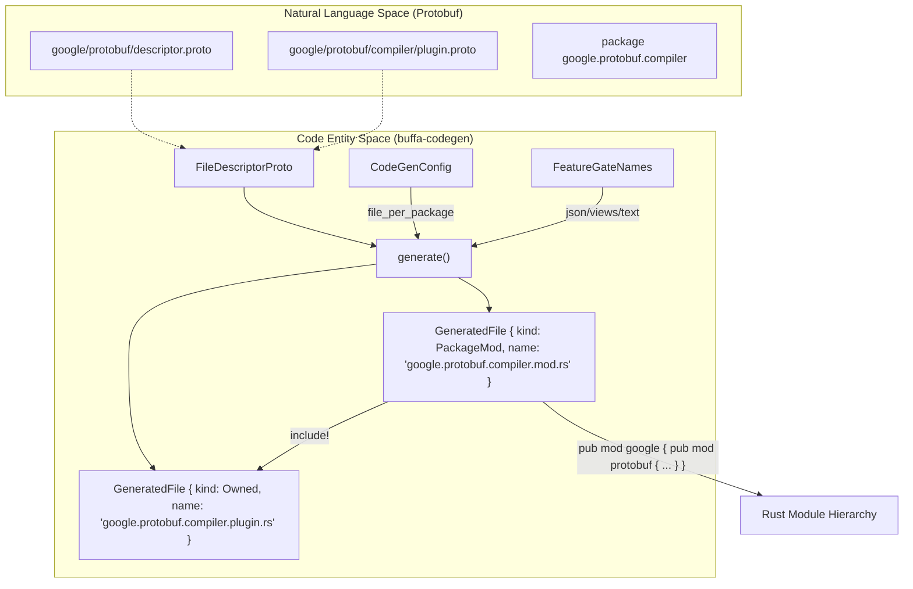
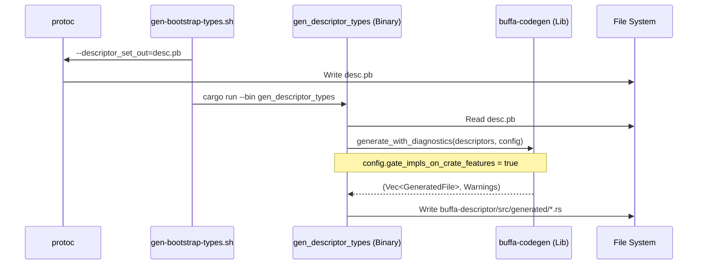

<!-- source: DeepWiki mcp.deepwiki.com · repo anthropics/buffa · page 5.5 Validation, Module Tree, and Bootstrapping · fetched 2026-10-26 -->

# Validation, Module Tree, and Bootstrapping

Relevant source files

The following files were used as context for generating this wiki page:

- [buffa-build/src/lib.rs](buffa-build/src/lib.rs)
- [buffa-codegen/src/bin/gen_descriptor_types.rs](buffa-codegen/src/bin/gen_descriptor_types.rs)
- [buffa-codegen/src/feature_gates.rs](buffa-codegen/src/feature_gates.rs)
- [buffa-codegen/src/lib.rs](buffa-codegen/src/lib.rs)
- [buffa-codegen/src/tests/feature_gating.rs](buffa-codegen/src/tests/feature_gating.rs)
- [buffa-descriptor/src/generated/mod.rs](buffa-descriptor/src/generated/mod.rs)

This section covers the final stages of the code generation pipeline in `buffa-codegen`: ensuring the input descriptors are valid for Rust emission, organizing the generated files into a hierarchical module structure, and the "chicken-and-egg" bootstrapping process used to generate the descriptor types themselves.

## Pre-generation Validation

Before emitting any Rust code, `buffa-codegen` performs several validation passes to ensure that the resulting code will compile and adhere to Rust's safety and naming constraints. These checks go beyond standard Protobuf validation.

### Reserved Field and Name Conflicts
The generator checks for field names that conflict with Rust keywords or internal `buffa` runtime methods.
*   **Keyword Escaping**: Fields named after Rust keywords (e.g., `type`, `match`, `mod`) are automatically escaped. Most use raw identifiers (e.g., `r#type`), while path-position keywords like `self` or `crate` are suffixed with `_` (e.g., `self_`) [buffa-codegen/src/idents.rs:62-77]().
*   **Internal Prefix Rejection**: `buffa` reserves the `__buffa_` prefix for internal runtime use. Any Protobuf field name starting with this prefix is rejected to prevent collisions with internal state.
*   **Method Collisions**: Validation ensures that message field names do not collide with methods on the `Message` trait or the `SizeCache` field.

### Type and View Name Conflicts
Because `buffa` generates both owned structs (`MyMessage`) and borrowed view structs (`MyMessageView`), the validator ensures that no nested types or oneofs within the Protobuf definition create naming collisions in the flat Rust namespace of a module.
*   **Module Inception**: A Protobuf message named `View` would normally generate a module `view`, which could collide with `buffa`'s internal `__buffa::view` hierarchy. The generator suppresses the `clippy::module_inception` lint to handle cases where a message named `View` contains nested types [buffa-codegen/src/lib.rs:67-71]().
*   **Idiomatic Enum Alias Collisions**: When `CodeGenConfig::idiomatic_enum_aliases` is enabled, `buffa` detects collisions where two different `SHOUTY_SNAKE_CASE` variants (like `FOO_BAR` and `FOO__BAR`) would collapse to the same `UpperCamelCase` name (`FooBar`). In such cases, the generator suppresses all aliases for that enum and issues a `CodeGenWarning::IdiomaticAliasCollision` [buffa-codegen/src/lib.rs:142-144]().

### Feature Gate Validation
When `gate_impls_on_crate_features` is enabled, `buffa` validates that the provided feature names are valid Cargo features (alphanumeric, `_`, `-`, `+`, `.`) [buffa-codegen/src/feature_gates.rs:92-106](). If an active gate name is invalid, `generate` returns a hard error to prevent silent failure where `#[cfg(feature = "")]` would permanently disable code [buffa-codegen/src/feature_gates.rs:145-153]().

| Validation Pass | Purpose | File Reference |
| :--- | :--- | :--- |
| **Reserved Keywords** | Escapes `type`, `pub`, etc. | [buffa-codegen/src/idents.rs:62-77]() |
| **Enum Alias Collision**| Detects `FOO_BAR` vs `FOO__BAR` conflicts. | [buffa-codegen/src/lib.rs:142-144]() |
| **Feature Name** | Ensures `json`/`views` gates are valid Cargo features. | [buffa-codegen/src/feature_gates.rs:92-106]() |
| **Lint Suppression** | Allows `non_camel_case_types`, `dead_code`, etc. | [buffa-codegen/src/lib.rs:55-72]() |

**Sources:** [buffa-codegen/src/idents.rs:1-175](), [buffa-codegen/src/lib.rs:50-145](), [buffa-codegen/src/feature_gates.rs:1-153]()

---

## Module Tree Generation

Protobuf packages are hierarchical (e.g., `google.protobuf.compiler`), while Rust modules can be organized either as a single flat file or a directory tree. `buffa` supports both via the `GeneratedFileKind` system.

### `GeneratedFileKind` and Stitchers
Each `.proto` file produces up to five content files (Owned, View, Oneof, ViewOneof, and Ext) [buffa-codegen/src/lib.rs:85-89]().
1.  **Stitcher Files**: Each package produces a `GeneratedFileKind::PackageMod` (e.g., `<dotted.pkg>.mod.rs`) that acts as a "stitcher" [buffa-codegen/src/lib.rs:121-127]().
2.  **Include Mechanism**: The stitcher uses `include!` to pull in the content files. This allows build systems to only "wire up" the `PackageMod` files while the content files travel alongside them on disk [buffa-codegen/src/lib.rs:98-102]().
3.  **File Per Package**: If `CodeGenConfig::file_per_package` is enabled, the per-proto content files are not emitted; instead, the `PackageMod` file inlines all content [buffa-codegen/src/lib.rs:103-106]().

### `proto_path_to_rust_module` and Extern Paths
The generator must decide whether to generate a type locally or reference it in another crate.
*   **WKT Auto-mapping**: `buffa-codegen` automatically injects `extern_paths` for Google Well-Known Types (e.g., `.google.protobuf` maps to `::buffa_types::google::protobuf`).
*   **Descriptor Auto-mapping**: References to `google.protobuf.descriptor.proto` types are automatically redirected to `::buffa_descriptor::generated::descriptor` [buffa-codegen/src/bin/gen_descriptor_types.rs:42-51]().
*   **Custom Externs**: Users can map specific proto packages or files to external Rust crates via `CodeGenConfig::extern_path` mappings [buffa-build/src/lib.rs:36-42]().

### Data Flow: Descriptor to Module Tree
The following diagram illustrates how raw descriptors are transformed into a structured Rust hierarchy.

**Module Tree Transformation**

**Sources:** [buffa-codegen/src/lib.rs:83-162](), [buffa-build/src/lib.rs:1-100](), [buffa-codegen/src/feature_gates.rs:29-63]()

---

## Bootstrapping

`buffa` faces a circular dependency: the code generator (`buffa-codegen`) needs Rust types for `FileDescriptorProto` to read descriptors, but those types are themselves generated from `descriptor.proto`.

### The Bootstrapping Cycle
1.  **Stage 0**: Use `protoc` to generate a binary `FileDescriptorSet` from the vendored `descriptor.proto` and `plugin.proto`.
2.  **Stage 1**: Run the `gen_descriptor_types` binary. This tool uses the `buffa` runtime to decode the `FileDescriptorSet` into the existing (previously generated) `FileDescriptorSet` Rust type [buffa-codegen/src/bin/gen_descriptor_types.rs:30-32]().
3.  **Stage 2**: `gen_descriptor_types` calls `buffa_codegen::generate_with_diagnostics()` with specific configuration, notably `gate_impls_on_crate_features = true` [buffa-codegen/src/bin/gen_descriptor_types.rs:52-66]().
4.  **Stage 3**: The output is written to `buffa-descriptor/src/generated/`. The `mod.rs` in that directory then `include!`s these files to recreate the nested package hierarchy (`google.protobuf` vs `google.protobuf.compiler`) [buffa-descriptor/src/generated/mod.rs:31-48]().

### Feature Gating in Bootstrap
The bootstrapped descriptor types enable `json`, `views`, `text`, and `arbitrary` generation, but wrap them in `#[cfg(feature = "...")]` [buffa-codegen/src/bin/gen_descriptor_types.rs:52-57](). This allows the codegen toolchain (`buffa-codegen`) to depend on `buffa-descriptor` with `default-features = false` to keep the build graph lean, while downstream users can opt into JSON support for descriptors if needed [buffa-codegen/src/bin/gen_descriptor_types.rs:42-51]().

### Tooling
*   **`gen-bootstrap-types.sh`**: A shell script (invoked via `task gen-bootstrap-types`) that automates the `protoc` invocation and the execution of the `gen_descriptor_types` binary [buffa-descriptor/src/generated/mod.rs:9-10]().
*   **`gen_descriptor_types`**: A one-shot binary that generates `descriptor.proto` and `plugin.proto` types [buffa-codegen/src/bin/gen_descriptor_types.rs:1-17]().

**Bootstrapping Sequence**

**Sources:** [buffa-codegen/src/bin/gen_descriptor_types.rs:1-81](), [buffa-descriptor/src/generated/mod.rs:1-62](), [buffa-codegen/src/feature_gates.rs:1-16]()

---

