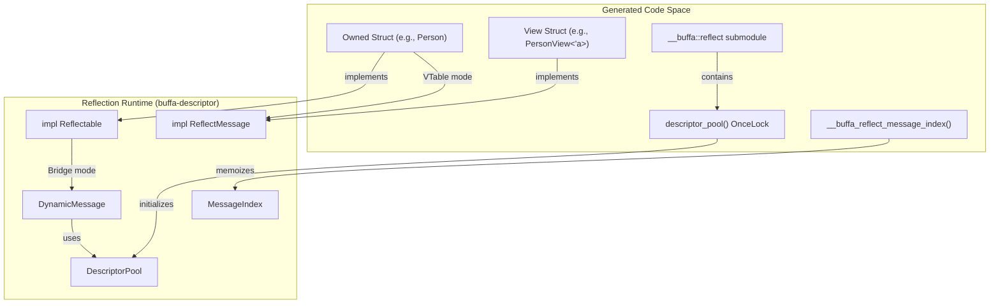

<!-- source: DeepWiki mcp.deepwiki.com · repo anthropics/buffa · page 5.6 Reflection Code Generation · fetched 2026-10-26 -->

# Reflection Code Generation

<details>
<summary>Relevant source files</summary>

The following files were used as context for generating this wiki page:

- [benchmarks/buffa/benches/reflect.rs](benchmarks/buffa/benches/reflect.rs)
- [buffa-codegen/src/reflect_view.rs](buffa-codegen/src/reflect_view.rs)
- [buffa-codegen/src/tests/reflect_view.rs](buffa-codegen/src/tests/reflect_view.rs)
- [buffa-test/protos/proto2_defaults.proto](buffa-test/protos/proto2_defaults.proto)
- [docs/investigations/reflection-vtable.md](docs/investigations/reflection-vtable.md)
- [docs/investigations/reflection.md](docs/investigations/reflection.md)

</details>


Reflection in `buffa` allows working with messages whose schema is only known at runtime or performing generic operations (like field-masking or transcoding) without knowing the concrete message type. The `buffa-codegen` crate emits reflection support by generating implementations of the `Reflectable` and `ReflectMessage` traits, along with embedded descriptor pools.

## Overview and Modes

The code generator supports two distinct reflection modes, configured via `ReflectMode` in `CodeGenConfig` [buffa-codegen/src/tests/reflect_view.rs:7-18]().

| Mode | Implementation | Data Flow | Performance |
| :--- | :--- | :--- | :--- |
| **Bridge** | `DynamicMessage` round-trip | `encode(self)` → `decode_dynamic(bytes)` | High overhead (allocates + re-parses) |
| **VTable** | Direct field access | `ReflectCow::Borrowed(self)` | Zero-copy (reads fields in place) |

The call-site contract is identical for both modes: `msg.reflect().get(field_descriptor)`. This allows users to switch modes in the build script without changing application code [docs/investigations/reflection-vtable.md:42-44]().

### System Architecture: Reflection Flow

The following diagram illustrates how codegen entities bridge the gap between generated types and the `buffa-descriptor` reflection runtime.

**Reflection Entity Bridge**

Sources: [buffa-codegen/src/reflect_view.rs:7-13](), [docs/investigations/reflection-vtable.md:48-62](), [docs/investigations/reflection.md:76-89]()

---

## The `Reflectable` Implementation

The `reflect.rs` module (and related logic) is responsible for generating the entry point for reflection: the `impl Reflectable` block.

### Bridge Mode
In Bridge mode, `reflect()` performs a full round-trip. It encodes the current message to a temporary buffer and decodes it into a `DynamicMessage` [docs/investigations/reflection-vtable.md:25-32](). This is the default mode when reflection is enabled but vtable mode is not [buffa-codegen/src/tests/reflect_view.rs:105-124]().

### VTable Mode
In VTable mode, `reflect()` simply returns a reference to itself [docs/investigations/reflection-vtable.md:39-44]().
- **Owned Types**: Emits `impl ReflectMessage for Foo` using direct field access [buffa-codegen/src/tests/reflect_view.rs:81-97]().
- **View Types**: Emits `impl ReflectMessage for FooView<'a>` [buffa-codegen/src/reflect_view.rs:7-9]().

### Descriptor Pool Embedding
Every package containing reflected messages includes a mechanism to access the pool [buffa-codegen/src/reflect_view.rs:78-80]().
1. **Lazy Accessor**: A `descriptor_pool()` function uses `std::sync::OnceLock` to lazily parse the bytes into a `DescriptorPool` on first use [docs/investigations/reflection-vtable.md:156-162]().
2. **Memoized Index**: Each message type includes a memoized `MessageIndex` accessor to avoid string-based descriptor lookups on every field access [buffa-codegen/src/reflect_view.rs:13-14]().

Sources: [buffa-codegen/src/reflect_view.rs:1-18](), [docs/investigations/reflection-vtable.md:25-44](), [docs/investigations/reflection-vtable.md:156-162]()

---

## VTable Reflection Implementations

When VTable mode is enabled, `buffa-codegen` generates direct field accessors for both owned and view types.

### View Types (`reflect_view.rs`)
View types implement `ReflectMessage` to allow reflection over zero-copy buffers.
- **`get` / `has`**: These methods match on `FieldDescriptor::number()` [buffa-codegen/src/reflect_view.rs:64-65]().
- **Zero-Copy Scalars**: Strings and bytes are returned as `ValueRef::String` or `ValueRef::Bytes` pointing directly into the view's fields [buffa-codegen/src/reflect_view.rs:123-131]().
- **Repeated/Map Fields**: These borrow the view container (e.g., `RepeatedView`) and leverage generic `ReflectList`/`ReflectMap` implementations [buffa-codegen/src/reflect_view.rs:109-118]().
- **Sub-messages**: Singular message fields use `MessageFieldView` to return either a borrow of the inner view or a static `DefaultViewInstance` if unset [buffa-codegen/src/reflect_view.rs:159-166]().

### Performance Characteristics
VTable reflection is dominated by the cost of `decode_view`, which is significantly faster than the bridge mode's encode-decode round-trip [benchmarks/buffa/benches/reflect.rs:21-28]().

Sources: [buffa-codegen/src/reflect_view.rs:74-166](), [benchmarks/buffa/benches/reflect.rs:1-28](), [docs/investigations/reflection-vtable.md:64-102]()

---

## OwnedView and Accessor Generation

`OwnedView<T>` is a self-referential container that pairs a `Bytes` buffer with a `View<'a>` pointing into it. For every message `Foo`, codegen produces a `FooOwnedView` wrapper.

### Accessor Generation
Codegen generates ergonomic accessor methods on the `FooOwnedView` struct that proxy to the underlying view.
- **Method Collisions**: If a protobuf field name conflicts with a reserved method (e.g., `as_ref`, `borrow`), the accessor is suppressed, and a `CodeGenWarning::OwnedViewAccessorSuppressed` is issued.
- **Trait Impls**: It emits `impl HasMessageView` to link the owned struct to its view family.

### Data Ownership Structure
**OwnedView Memory Layout**
```mermaid
classDiagram
    class FooOwnedView {
        -inner: OwnedView<FooViewFamily>
        +id() i32
        +name() &str
        +address() Option~AddressView~
    }
    class OwnedView {
        -data: Bytes
        -view: FooView<'static>
    }
    FooOwnedView *-- OwnedView : wraps
    OwnedView ..> "Wire Buffer" : view borrows from data
```
Sources: [docs/investigations/reflection-vtable.md:128-133](), [benchmarks/buffa/benches/reflect.rs:32-34]()

---

## Feature Gating and Warnings

### Feature Gating
To keep the core library lean, reflection-related code is wrapped in `#[cfg(feature = "reflect")]` when `CodeGenConfig::gate_impls_on_crate_features` is enabled. This ensures that reflection support does not bloat binaries for users who do not require it.

### Presence Handling in Reflection
The generator correctly handles different presence semantics:
- **Explicit Presence**: Stored as `Option<T>`; `has()` returns `is_some()` [buffa-codegen/src/reflect_view.rs:121-144]().
- **Implicit Presence**: `has()` checks if the value is non-default (e.g., `!is_empty()` for strings) [buffa-codegen/src/reflect_view.rs:150-158]().
- **Proto2 Required**: Always present; `has()` returns true (often consulting a "seen-bit" word for wire presence) [buffa-codegen/src/reflect_view.rs:145-149](), [buffa-test/protos/proto2_defaults.proto:178-182]().

Sources: [buffa-codegen/src/reflect_view.rs:120-166](), [buffa-test/protos/proto2_defaults.proto:175-190]()

---

