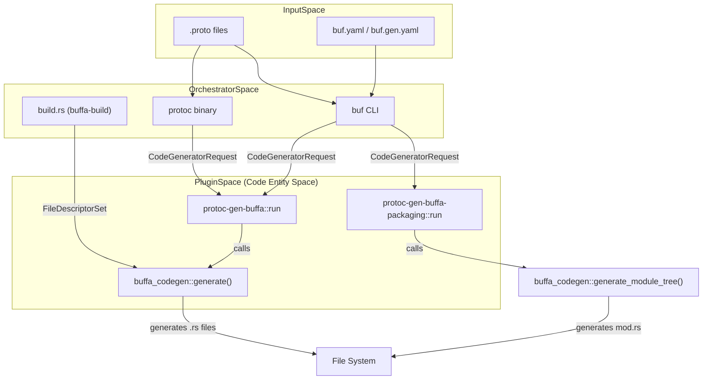
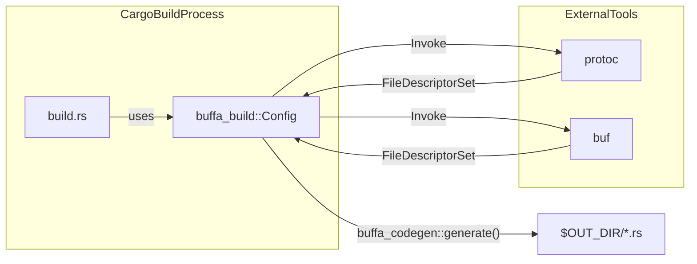

<!-- source: DeepWiki mcp.deepwiki.com · repo anthropics/buffa · page 6 Compiler Plugins and Build Integration · fetched 2026-10-26 -->

# Compiler Plugins and Build Integration

Relevant source files

The following files were used as context for generating this wiki page:

- [CHANGELOG.md](CHANGELOG.md)
- [buffa-build/Cargo.toml](buffa-build/Cargo.toml)
- [buffa-build/src/lib.rs](buffa-build/src/lib.rs)
- [buffa-codegen/Cargo.toml](buffa-codegen/Cargo.toml)
- [buffa-codegen/src/lib.rs](buffa-codegen/src/lib.rs)
- [docs/guide.md](docs/guide.md)
- [docs/migration-from-prost.md](docs/migration-from-prost.md)
- [docs/migration-from-protobuf.md](docs/migration-from-protobuf.md)
- [protoc-gen-buffa-packaging/Cargo.toml](protoc-gen-buffa-packaging/Cargo.toml)
- [protoc-gen-buffa/Cargo.toml](protoc-gen-buffa/Cargo.toml)
- [protoc-gen-buffa/src/main.rs](protoc-gen-buffa/src/main.rs)

This section covers the two primary integration paths for invoking the `buffa-codegen` engine to transform `.proto` files into Rust source code. Buffa provides a standard `protoc` plugin for CLI-driven workflows and a high-level build script helper for Cargo-native integration.

## Overview of Integration Paths

Buffa is designed to fit into existing Protobuf ecosystems by supporting both the standard Google `protoc` plugin protocol and modern alternatives like `buf`. Both integration paths ultimately call the `buffa_codegen::generate` function [protoc-gen-buffa/src/main.rs:107-111]().

| Path | Tooling | Best For |
| :--- | :--- | :--- |
| **`protoc-gen-buffa`** | `protoc` or `buf` | Pre-generating code checked into VCS, large polyglot monorepos, and `buf generate` workflows. |
| **`buffa-build`** | `cargo` / `build.rs` | Rapid development, small-to-medium Rust projects, and projects where `.proto` files change frequently. |

### System Integration Flow

The following diagram illustrates how the different components interact to produce Rust source code from Protobuf definitions.

**Buffa Codegen Pipeline**

Sources: [protoc-gen-buffa/src/main.rs:1-16](), [protoc-gen-buffa/src/main.rs:107-111](), [protoc-gen-buffa-packaging/Cargo.toml:1-15](), [buffa-build/Cargo.toml:1-10]()

---

## 6.1 `protoc-gen-buffa` Plugin {#6.1}

The `protoc-gen-buffa` binary is a standard Protobuf compiler plugin. It communicates via `stdin` and `stdout` using the `CodeGeneratorRequest` and `CodeGeneratorResponse` types [protoc-gen-buffa/src/main.rs:1-7]().

Key features include:
* **Editions Support**: Supports a range from `EDITION_PROTO2` up to `EDITION_2024` [protoc-gen-buffa/src/main.rs:131-132]().
* **Feature Flags**: Advertises support for `FEATURE_PROTO3_OPTIONAL` and `FEATURE_SUPPORTS_EDITIONS` [protoc-gen-buffa/src/main.rs:151-155]().
* **Parameter Parsing**: The `parse_config` function handles comma-separated options such as `views`, `lazy_views`, `json`, `text`, `arbitrary`, and `extern_path` [protoc-gen-buffa/src/main.rs:172-200]().
* **CLI UX**: Supports `--version` and `--help` flags for interactive discovery [protoc-gen-buffa/src/main.rs:54-63]().

For details on CLI usage and parameter configuration, see [`protoc-gen-buffa` Plugin](#6.1).

**Sources:** [protoc-gen-buffa/src/main.rs:1-155](), [protoc-gen-buffa/Cargo.toml:1-15]()

---

## 6.2 `protoc-gen-buffa-packaging` Plugin {#6.2}

When using `buf generate`, individual plugins often generate files in isolation. The `protoc-gen-buffa-packaging` plugin is a specialized helper that generates the `mod.rs` tree required to make the generated Rust files accessible as a coherent module structure [protoc-gen-buffa-packaging/Cargo.toml:1-15]().

This plugin:
* Complements `protoc-gen-buffa` by creating the necessary `pub mod` declarations via `buffa_codegen::generate_module_tree` [buffa-codegen/src/lib.rs:83-102]().
* **Integration**: It is designed to be used in `buf.gen.yaml` as a `local` plugin alongside the main `buffa` remote plugin to provide a clean module hierarchy for the output files [docs/guide.md:119-137]().

For details on the packaging strategy and `buf` integration, see [`protoc-gen-buffa-packaging` Plugin](#6.2).

**Sources:** [protoc-gen-buffa-packaging/Cargo.toml:1-15](), [docs/guide.md:119-137]()

---

## 6.3 `buffa-build` Build Script Helper {#6.3}

The `buffa-build` crate provides a programmatic API for Rust `build.rs` scripts. It encapsulates the complexity of managing the codegen engine and integrating with Cargo's build lifecycle [buffa-build/src/lib.rs:1-28]().

### Configuration API

The `buffa_build::Config` integration allows fine-grained control over the generation process:
* **Descriptor Sources**: Can resolve descriptors from `protoc` (default), `buf`, or precompiled `FileDescriptorSet` files [buffa-build/src/lib.rs:44-54]().
* **Module Tree**: Supports generating a single `include_file` (e.g., `_include.rs`) that sets up the package module tree and `buffa::include_proto!` calls [buffa-build/src/lib.rs:63-67](), [docs/guide.md:141-166]().
* **Pluggable Types**: Provides knobs for overriding default types for `string`, `bytes`, `repeated`, `map`, and `box` fields using traits like `ProtoString` and `ProtoBytes` [CHANGELOG.md:11-16](), [buffa-build/src/lib.rs:42]().
* **Optimization**: Uses `write_if_changed` logic to avoid unnecessary re-compilations if the generated content has not changed.

**Build Integration Flow**

Sources: [buffa-build/src/lib.rs:1-103](), [docs/guide.md:141-166](), [CHANGELOG.md:86-115]()

For details on the builder API and `Cargo` integration, see [`buffa-build` Build Script Helper](#6.3).

**Sources:** [buffa-build/src/lib.rs:1-185](), [docs/guide.md:141-178]()

---

