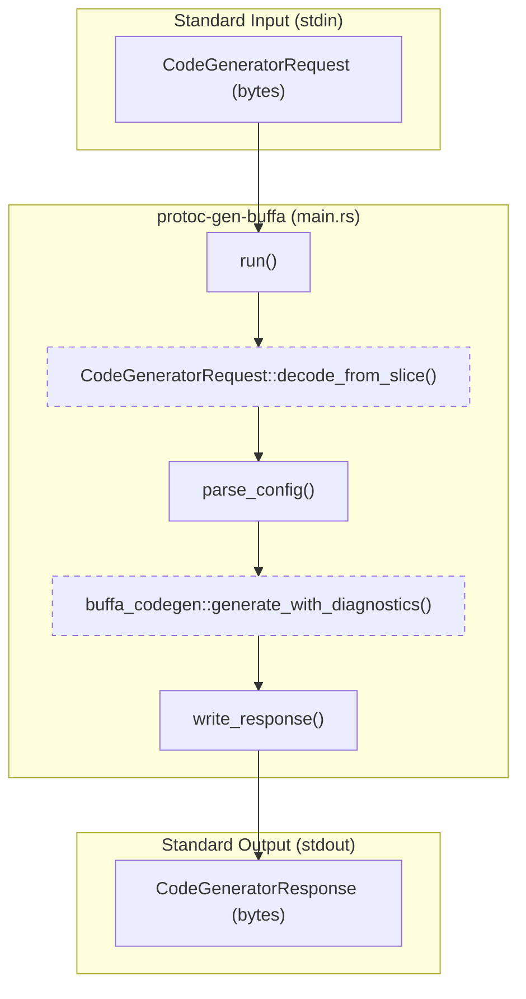
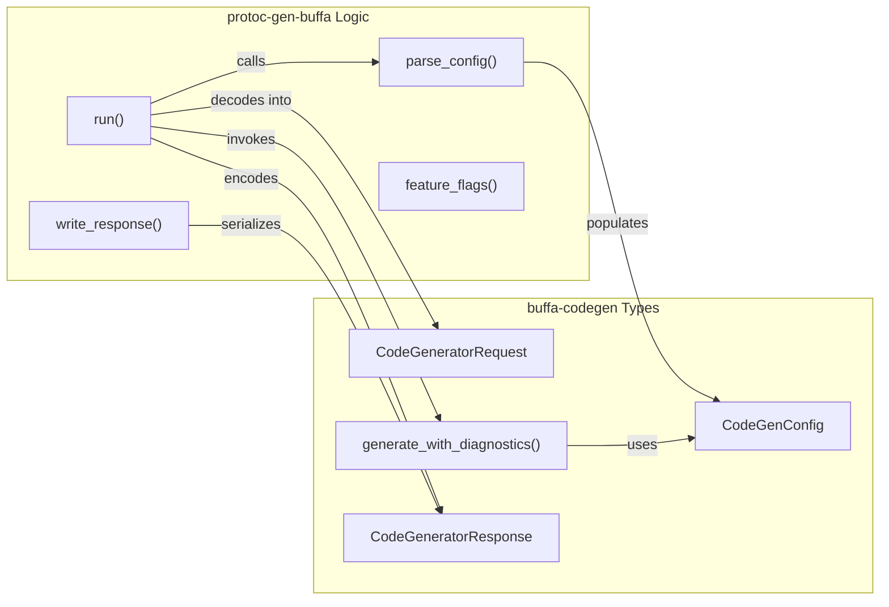

<!-- source: DeepWiki mcp.deepwiki.com · repo anthropics/buffa · page 6.1 `protoc-gen-buffa` Plugin · fetched 2026-10-26 -->

# `protoc-gen-buffa` Plugin

<details>
<summary>Relevant source files</summary>

The following files were used as context for generating this wiki page:

- [CHANGELOG.md](CHANGELOG.md)
- [docs/guide.md](docs/guide.md)
- [protoc-gen-buffa-packaging/src/main.rs](protoc-gen-buffa-packaging/src/main.rs)
- [protoc-gen-buffa-packaging/tests/cli.rs](protoc-gen-buffa-packaging/tests/cli.rs)
- [protoc-gen-buffa/src/main.rs](protoc-gen-buffa/src/main.rs)
- [protoc-gen-buffa/tests/cli.rs](protoc-gen-buffa/tests/cli.rs)

</details>


The `protoc-gen-buffa` binary is a standard Protobuf compiler plugin that implements the `protoc` plugin protocol. It acts as the bridge between the Protobuf compiler (`protoc` or `buf`) and the `buffa-codegen` library, facilitating the generation of Rust source code from `.proto` files.

## Overview and Purpose

The plugin's primary responsibility is to handle the I/O and serialization requirements of the `protoc` ecosystem. It reads a `CodeGeneratorRequest` from `stdin`, invokes the core generation logic via `buffa-codegen`, and writes a `CodeGeneratorResponse` to `stdout` [protoc-gen-buffa/src/main.rs:3-6]().

### Key Responsibilities
*   **Protocol Handling**: Implements the standard stdin/stdout communication loop required by `protoc` [protoc-gen-buffa/src/main.rs:26-51]().
*   **Parameter Parsing**: Translates comma-separated command-line strings (e.g., `--buffa_opt=views=true`) into `CodeGenConfig` structures [protoc-gen-buffa/src/main.rs:103-104]().
*   **Edition Support**: Declares support for Protobuf editions, ranging from `EDITION_PROTO2` to `EDITION_2024` [protoc-gen-buffa/src/main.rs:131-132]().
*   **Error Reporting**: Captures generation errors and returns them via the `CodeGeneratorResponse` error field rather than crashing, ensuring graceful failure within compiler pipelines [protoc-gen-buffa/src/main.rs:77-82]().

**Sources:** [protoc-gen-buffa/src/main.rs:1-135]()

## Data Flow and Implementation

The plugin operates as a stateless transformation pipeline. It uses types from `buffa-codegen` (which includes generated descriptor and compiler types) to decode the incoming request.

### Plugin Execution Flow
The following diagram illustrates the lifecycle of a plugin invocation, mapping the logical steps to the internal function calls and data types.

**Diagram: Plugin Execution Lifecycle**

**Sources:** [protoc-gen-buffa/src/main.rs:94-139]()

### Code Entity Mapping
This diagram maps the high-level plugin operations to the specific code entities in the `protoc-gen-buffa` and `buffa-codegen` crates.

**Diagram: System to Code Entity Mapping**

**Sources:** [protoc-gen-buffa/src/main.rs:94-155](), [protoc-gen-buffa/src/main.rs:20-24]()

### Implementation Details
*   **`run()`**: The main entry point that orchestrates reading from `io::stdin()`, decoding the request via `CodeGeneratorRequest::decode_from_slice`, and calling `buffa_codegen::generate_with_diagnostics` [protoc-gen-buffa/src/main.rs:94-112]().
*   **`feature_flags()`**: Returns a bitmask indicating support for `FEATURE_PROTO3_OPTIONAL` (bit 1) and `FEATURE_SUPPORTS_EDITIONS` (bit 2) [protoc-gen-buffa/src/main.rs:151-155]().
*   **`write_response()`**: Serializes the `CodeGeneratorResponse` using the `buffa` runtime's `encode` method and flushes it to `stdout` [protoc-gen-buffa/src/main.rs:142-148]().

**Sources:** [protoc-gen-buffa/src/main.rs:94-155]()

## Configuration Parameters

The plugin accepts a comma-separated string of parameters via the `--buffa_opt` (protoc) or `opt` (buf) flags. These are parsed by `parse_config` into a `CodeGenConfig` struct [protoc-gen-buffa/src/main.rs:172-174]().

### Supported Parameters

| Parameter | Type | Default | Description |
| :--- | :--- | :--- | :--- |
| `views` | bool | `false` | Generate zero-copy `*View` structs for messages [protoc-gen-buffa/src/main.rs:184-184](). |
| `lazy_views` | bool | `false` | Generate `*LazyView` for partial recursion-free decoding [protoc-gen-buffa/src/main.rs:185-185](). |
| `json` | bool | `false` | Generate `serde` attributes for JSON serialization [protoc-gen-buffa/src/main.rs:189-189](). |
| `unknown_fields`| bool | `true` | Preserve unknown fields during decoding [protoc-gen-buffa/src/main.rs:186-188](). |
| `strict_utf8` | bool | `false` | Enforce strict UTF-8 validation for string fields [protoc-gen-buffa/src/main.rs:214-216](). |
| `arbitrary` | bool | `false` | Generate `Arbitrary` trait implementations for fuzzing [protoc-gen-buffa/src/main.rs:191-191](). |
| `text` | bool | `false` | Generate support for Protobuf text format [protoc-gen-buffa/src/main.rs:190-190](). |
| `file_per_package`| bool | `false` | Emit one Rust file per Protobuf package [protoc-gen-buffa/src/main.rs:219-219](). |
| `register_types` | bool | `true` | Emit a registration function for JSON/Any registries [protoc-gen-buffa/src/main.rs:217-217](). |
| `reflect_mode` | string | `off` | Reflection emission mode: `off`, `bridge`, or `vtable` [protoc-gen-buffa/src/main.rs:220-224](). |
| `extern_path` | string| N/A | Map a proto package or type to an existing Rust path [protoc-gen-buffa/src/main.rs:226-236](). |

### `extern_path` Syntax
The `extern_path` parameter allows users to avoid generating code for specific proto packages and instead point to an existing crate or module. The format is `extern_path=<proto>=<rust>`, where `<proto>` is either a package or a single type FQN [protoc-gen-buffa/src/main.rs:168-171]().

The plugin normalizes the proto path to ensure it starts with a dot [protoc-gen-buffa/src/main.rs:231-233]().
Example: `extern_path=.my.common=::common_protos` [protoc-gen-buffa/src/main.rs:171-171]().

**Sources:** [protoc-gen-buffa/src/main.rs:158-236]()

## Usage Examples

The plugin can be invoked directly via `protoc` or integrated into a `buf` workflow.

### Using with `protoc`
```bash
protoc --plugin=protoc-gen-buffa=/path/to/binary \
       --buffa_out=./src/gen \
       --buffa_opt=views=true,json=true \
       my_service.proto
```
**Sources:** [protoc-gen-buffa/src/main.rs:34-42]()

### Using with `buf`
In a `buf.gen.yaml` file, the plugin is referenced by its local binary name.
```yaml
plugins:
  - local: protoc-gen-buffa
    out: src/gen
    opt:
      - views=true
      - json=true
```
**Sources:** [protoc-gen-buffa/src/main.rs:11-15](), [protoc-gen-buffa/src/main.rs:36-39]()

## Compatibility

### Supported Editions
The plugin explicitly declares its compatibility range to `protoc` to enable the use of modern Protobuf features:
*   **Minimum Edition**: `EDITION_PROTO2` [protoc-gen-buffa/src/main.rs:131-131]()
*   **Maximum Edition**: `EDITION_2024` [protoc-gen-buffa/src/main.rs:132-132]()

### CLI Flags
The binary supports standard version and help flags for manual inspection:
*   `--version` / `-V`: Prints crate name and version [protoc-gen-buffa/src/main.rs:56-59]().
*   `--help` / `-h`: Prints usage instructions and supported plugin protocol details [protoc-gen-buffa/src/main.rs:60-63]().

**Sources:** [protoc-gen-buffa/src/main.rs:53-83](), [protoc-gen-buffa/src/main.rs:128-135]()

---

