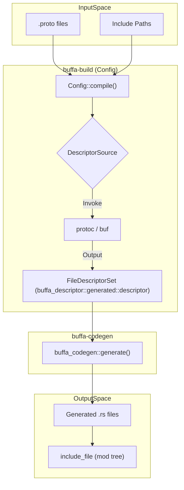
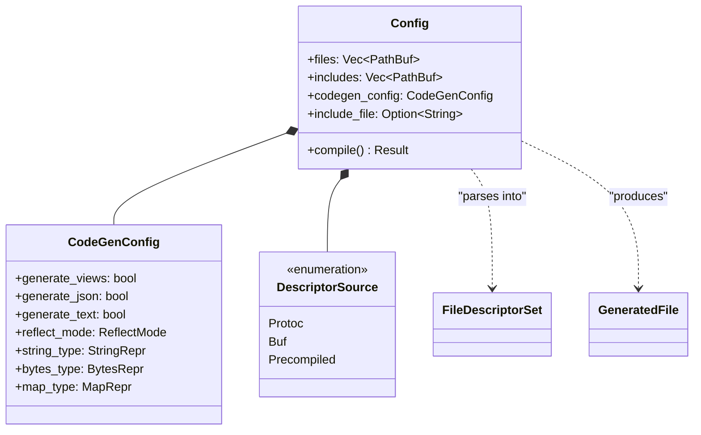

<!-- source: DeepWiki mcp.deepwiki.com · repo anthropics/buffa · page 6.3 `buffa-build` Build Script Helper · fetched 2026-10-26 -->

# `buffa-build` Build Script Helper

Relevant source files

The following files were used as context for generating this wiki page:

- [buffa-build/Cargo.toml](buffa-build/Cargo.toml)
- [buffa-build/src/lib.rs](buffa-build/src/lib.rs)
- [buffa-codegen/Cargo.toml](buffa-codegen/Cargo.toml)
- [buffa-codegen/src/lib.rs](buffa-codegen/src/lib.rs)
- [buffa-codegen/src/message.rs](buffa-codegen/src/message.rs)
- [buffa-test/build.rs](buffa-test/build.rs)
- [buffa-test/src/lib.rs](buffa-test/src/lib.rs)
- [docs/migration-from-prost.md](docs/migration-from-prost.md)
- [docs/migration-from-protobuf.md](docs/migration-from-protobuf.md)
- [protoc-gen-buffa-packaging/Cargo.toml](protoc-gen-buffa-packaging/Cargo.toml)
- [protoc-gen-buffa/Cargo.toml](protoc-gen-buffa/Cargo.toml)

The `buffa-build` crate provides the primary build-time integration for the `buffa` ecosystem. It is designed to be used within a Cargo `build.rs` script to automate the compilation of `.proto` files into Rust source code. It wraps `buffa-codegen` and handles the orchestration of descriptor generation (via `protoc` or `buf`), file system management, and Cargo integration.

## Overview and Purpose

`buffa-build` simplifies the process of generating Rust code from Protobuf definitions by providing a high-level `Config` builder API [buffa-build/src/lib.rs:55-65](). It manages the translation of Protobuf files into a `FileDescriptorSet` and subsequently invokes the `buffa-codegen` engine to produce the final Rust modules [buffa-build/src/lib.rs:1-5]().

Key responsibilities include:
*   **Descriptor Acquisition**: Interfacing with `protoc` or `buf` to parse schema files [buffa-build/src/lib.rs:43-52]().
*   **Codegen Configuration**: Exposing toggles for features like zero-copy views, JSON support, reflection modes, and configurable string representations [buffa-build/src/lib.rs:106-211]().
*   **Module Management**: Generating a cohesive module tree (via `include_file`) to simplify importing generated types across packages [buffa-build/src/lib.rs:64-65]().
*   **Cargo Integration**: Automatically emitting `cargo:rerun-if-changed` instructions for all input files and include directories [buffa-build/src/lib.rs:1-27]().

Sources: [buffa-build/src/lib.rs:1-65]()

## The Config Builder API

The `Config` struct is the entry point for all build-time operations. It maintains the state of the compilation request, including input files, include paths, and code generation preferences [buffa-build/src/lib.rs:55-65]().

### Build Orchestration Flow
The following diagram illustrates how `buffa-build` transitions from raw `.proto` files to generated Rust code.

**Data Flow: Proto to Rust**

Sources: [buffa-build/src/lib.rs:43-65](), [buffa-build/src/lib.rs:32-33]()

### Descriptor Sources
`buffa-build` supports three methods for obtaining descriptors via the `DescriptorSource` enum [buffa-build/src/lib.rs:43-52]():
1.  **Protoc (Default)**: Requires `protoc` on the system PATH or the `PROTOC` environment variable [buffa-build/src/lib.rs:45-47]().
2.  **Buf**: Invokes `buf build --as-file-descriptor-set`. This is useful for modern Protobuf workflows that avoid direct `protoc` management [buffa-build/src/lib.rs:48-49]().
3.  **Precompiled**: Allows providing a path to an existing `FileDescriptorSet` file, bypassing the need for any Protobuf compiler at build time [buffa-build/src/lib.rs:50-51]().

Sources: [buffa-build/src/lib.rs:43-52]()

## Codegen Options

The `Config` builder exposes several methods that map directly to `CodeGenConfig` fields in `buffa-codegen`.

| Method | Default | Description |
| :--- | :--- | :--- |
| `generate_views(bool)` | `true` | Enables generation of zero-copy `*View` types [buffa-build/src/lib.rs:106-109](). |
| `lazy_views(bool)` | `false` | Generates `*LazyView` types for deferred non-recursive decoding [buffa-build/src/lib.rs:127-130](). |
| `generate_json(bool)` | `false` | Enables `serde` attributes and JSON runtime support [buffa-build/src/lib.rs:163-166](). |
| `generate_text(bool)` | `false` | Enables `impl buffa::text::TextFormat` for textproto support [buffa-build/src/lib.rs:174-177](). |
| `generate_arbitrary(bool)` | `false` | Derives `arbitrary::Arbitrary` for fuzzing [buffa-build/src/lib.rs:180-183](). |
| `reflect_mode(ReflectMode)`| `Off` | Configures reflection: `Off`, `Bridge` (DynamicMessage), or `VTable` [buffa-build/src/lib.rs:211-214](). |
| `preserve_unknown_fields(bool)`| `true` | Controls whether unrecognized fields are kept [buffa-build/src/lib.rs:198-201](). |

### Configurable Type Representations
`buffa-build` supports overriding the Rust types used for Protobuf fields via several "knobs" that map to `CodeGenConfig` [buffa-build/src/lib.rs:40-42]().

*   **String/Bytes**: Overrides the type for `string` and `bytes` fields using `string_type` / `bytes_type` (using enums like `StringRepr` and `BytesRepr`) or `string_type_custom` / `bytes_type_custom` for arbitrary local newtypes [buffa-build/src/lib.rs:248-255](), [buffa-test/build.rs:55-68]().
*   **Pluggable Collections**: Users can override the storage for `repeated` and `map` fields using `repeated_type_custom` and `map_type_custom`. This requires the target type to implement traits like `ProtoList` or `MapStorage` [buffa-test/build.rs:101-116](), [buffa-test/src/lib.rs:161-175]().
*   **Box Type**: The `box_type_custom` method allows using a custom pointer (e.g., `SmallBox`) for singular message fields, provided it implements `ProtoBox` [buffa-test/build.rs:13-23](), [buffa-test/src/lib.rs:19-30]().

Sources: [buffa-build/src/lib.rs:106-270](), [buffa-test/build.rs:13-140]()

## Module Tree Generation (`include_file`)

By default, `buffa-build` outputs one `.rs` file per package (or per `.proto` file) into the `$OUT_DIR`. To make these files accessible, users normally have to manually declare `pub mod` hierarchies. 

The `include_file(name)` method automates this by generating a single Rust file that contains the entire nested module structure for all compiled protos [buffa-build/src/lib.rs:64-65](), [buffa-build/src/lib.rs:243-247](). This generated file uses `include!` directives and `pub use` re-exports to create a "natural path" tree, allowing users to import types like `crate::generated::my::package::MyMessage`.

**Entity Mapping: Build Script to Code Structures**

Sources: [buffa-build/src/lib.rs:55-65](), [buffa-codegen/src/lib.rs:106-117](), [buffa-build/src/lib.rs:43-52]()

## Implementation Details

### `Config::compile()`
The `compile()` function is the main execution driver. It performs the following steps:
1.  Determines the output directory (defaulting to the environment variable `OUT_DIR`) [buffa-build/src/lib.rs:98-102]().
2.  Triggers the `DescriptorSource` to produce a `FileDescriptorSet` [buffa-build/src/lib.rs:43-54]().
3.  Decodes the raw bytes into a `FileDescriptorSet` message using `buffa::Message` [buffa-build/src/lib.rs:32-33]().
4.  Calls the code generation engine with the descriptors and the configured `CodeGenConfig` [buffa-codegen/src/lib.rs:1-10]().
5.  **`write_if_changed` Optimization**: Generated files are written to disk only if their content differs from the existing file on disk. This prevents `rustc` from unnecessarily recompiling downstream crates due to updated file timestamps when the content is identical.

### Cargo Integration
To ensure efficient builds, `buffa-build` integrates with Cargo's build system by emitting `cargo:rerun-if-changed` instructions for every input `.proto` file and every directory in the `includes` list [buffa-build/src/lib.rs:82-94](). This ensures that Cargo only re-runs the build script when the schema or its dependencies actually change.

Sources: [buffa-build/src/lib.rs:67-102](), [buffa-build/src/lib.rs:1-27](), [buffa-codegen/src/lib.rs:1-10]()

---

