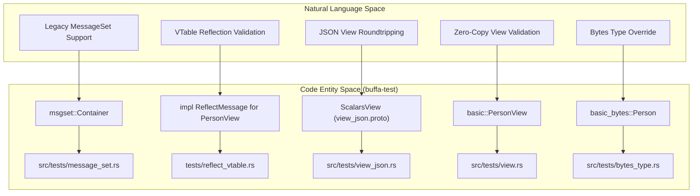
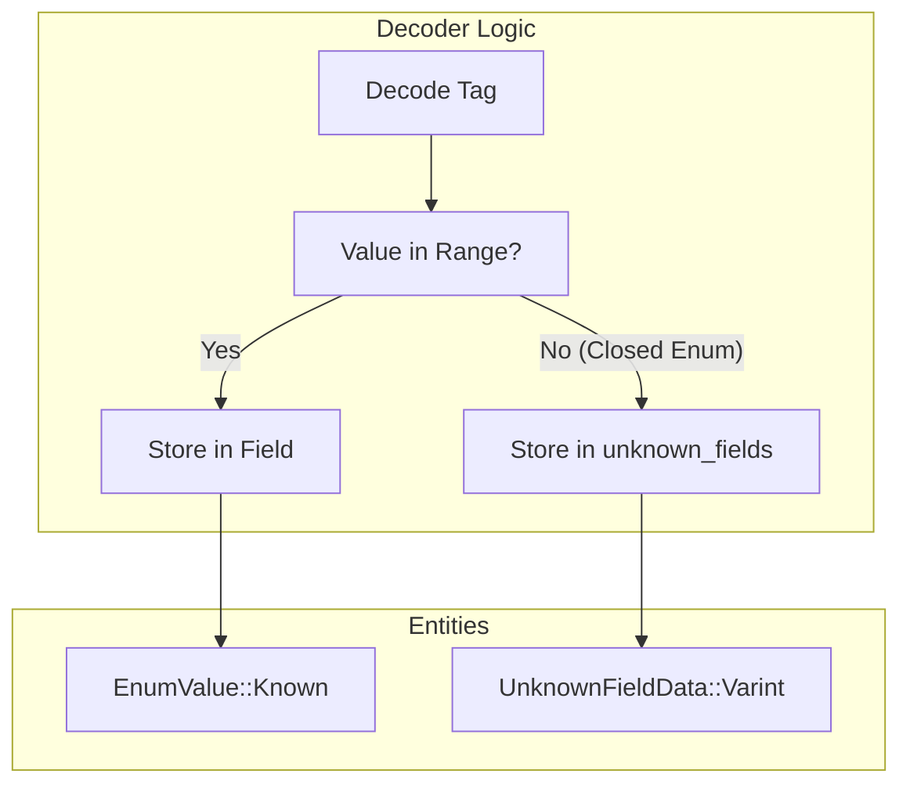

<!-- source: DeepWiki mcp.deepwiki.com · repo anthropics/buffa · page 7.1 Integration Test Suite (`buffa-test`) · fetched 2026-10-26 -->

# Integration Test Suite (`buffa-test`)

Relevant source files

The following files were used as context for generating this wiki page:

- [buffa-test/protos/basic.proto](buffa-test/protos/basic.proto)
- [buffa-test/protos/view_json.proto](buffa-test/protos/view_json.proto)
- [buffa-test/protos/view_json_proto2.proto](buffa-test/protos/view_json_proto2.proto)
- [buffa-test/src/tests/bytes_type.rs](buffa-test/src/tests/bytes_type.rs)
- [buffa-test/src/tests/closed_enum.rs](buffa-test/src/tests/closed_enum.rs)
- [buffa-test/src/tests/json.rs](buffa-test/src/tests/json.rs)
- [buffa-test/src/tests/proto2.rs](buffa-test/src/tests/proto2.rs)
- [buffa-test/src/tests/string_type.rs](buffa-test/src/tests/string_type.rs)
- [buffa-test/src/tests/view.rs](buffa-test/src/tests/view.rs)
- [buffa-test/src/tests/view_json.rs](buffa-test/src/tests/view_json.rs)
- [buffa-test/tests/reflect_bridge.rs](buffa-test/tests/reflect_bridge.rs)
- [buffa-test/tests/reflect_vtable.rs](buffa-test/tests/reflect_vtable.rs)
- [buffa-test/tests/reflectable.rs](buffa-test/tests/reflectable.rs)

The `buffa-test` crate serves as the primary integration testing ground for the `buffa` ecosystem. It exercises the full compilation pipeline—from `.proto` source files through `buffa-build` (which uses `buffa-codegen`) to the final generated Rust code—and validates the runtime behavior of the generated types against the Protobuf specification.

## Overview and Scope

The suite is designed to ensure that the code generator produces valid, compilable, and spec-compliant Rust code across a wide variety of Protobuf features and edge cases. It specifically targets:

*   **Syntax & Editions Support**: Validation of `proto2`, `proto3`, and `editions 2024` semantics [buffa-test/src/tests/proto2.rs:1-4]().
*   **Feature Flags**: Testing the impact of configuration options like `use_bytes_type()`, `generate_views()`, `generate_json()`, and `reflect_mode(VTable)` [buffa-test/src/tests/bytes_type.rs:1-5](), [buffa-test/src/tests/string_type.rs:1-12]().
*   **Complex Schemas**: Deeply nesting, cross-package references, and module name collision deconfliction [buffa-test/protos/basic.proto:1-50]().
*   **Legacy & Specialized Formats**: Support for `MessageSet` wire format, group-encoded extensions, and custom options.
*   **Reflection**: Validation of both bridge-mode and vtable-mode reflection over owned and view types [buffa-test/tests/reflectable.rs:1-11](), [buffa-test/tests/reflect_vtable.rs:1-9]().

## Test Infrastructure and Data Flow

The testing process follows a multi-stage pipeline where the `build.rs` script acts as the orchestrator for code generation.

### Compilation Pipeline

1.  **Code Generation**: `build.rs` invokes `buffa_build::Config` multiple times with different configurations to generate Rust modules.
2.  **Module Inclusion**: The generated files are included into the `buffa-test` crate.
3.  **Test Execution**: Integration tests in `src/tests/` use these generated modules to perform round-trip serialization, JSON parity checks, and reflection validation [buffa-test/src/tests/view.rs:20-28](), [buffa-test/src/tests/view_json.rs:16-29]().

### System Entity Mapping

The following diagram maps the logical test requirements to the specific code entities and files that implement them.

**Test Mapping: Requirements to Code Entities**

Sources: [buffa-test/src/tests/view.rs:20-28](), [buffa-test/src/tests/bytes_type.rs:6-19](), [buffa-test/src/tests/view_json.rs:1-12](), [buffa-test/tests/reflect_vtable.rs:1-13]().

## Reflection and VTable Testing

The suite includes dedicated tests for `ReflectMode::VTable`, which generates direct field accessors for both owned messages and zero-copy views.

### VTable View Reflection
The `reflect_vtable.rs` test exercises `impl ReflectMessage for FooView<'a>`. This allows a reflection consumer to read fields directly from a view decoded from wire bytes without materializing an owned message [buffa-test/tests/reflect_vtable.rs:1-9]().

*   **Scalar Access**: Validates `get()` returns `ValueRef` for numeric and string fields borrowed from the buffer [buffa-test/tests/reflect_vtable.rs:40-69]().
*   **Nested Messages**: Verifies that sub-messages are reflected without allocation via `ValueRef::Message(cow)` [buffa-test/tests/reflect_vtable.rs:72-93]().
*   **Map Fields**: Tests no-alloc string lookup in map views using `get_str()` [buffa-test/tests/reflect_vtable.rs:170-194]().

### Reflection Bridge
The `reflect_bridge.rs` module validates the round-trip between generated types and `DynamicMessage` [buffa-test/tests/reflect_bridge.rs:1-6](). It ensures that `DynamicMessage::from_message` correctly populates reflective structures for scalars, lists, and maps [buffa-test/tests/reflect_bridge.rs:21-112]().

## Zero-Copy View Validation

The `view.rs` module contains extensive tests for the zero-copy `*View` types. These tests ensure that views correctly borrow from the input buffer and provide an ergonomic API for reading complex structures.

*   **Zero-Copy Fields**: Validates that `PersonView` borrows `&str` and `&[u8]` directly from the source buffer [buffa-test/src/tests/view.rs:36-44]().
*   **Recursion Limits**: Verifies that view decoding respects the recursion budget and that unknown groups do not allow depth-doubling attacks [buffa-test/src/tests/view.rs:166-193]().
*   **To Owned**: Ensures the `to_owned_message()` method correctly performs a deep copy of the borrowed data into an owned message [buffa-test/src/tests/view.rs:124-142]().

## JSON Roundtrip and Parity

The `view_json.rs` test module asserts that `Owned` messages and their corresponding `View` types produce byte-identical JSON output [buffa-test/src/tests/view_json.rs:1-12]().

*   **Special Encodings**: Validates that both owned and view types correctly handle `int64` as quoted strings, `bytes` as base64, and `NaN/Infinity` floats [buffa-test/src/tests/view_json.rs:54-101]().
*   **Proto2/3 Semantics**: Tests implicit vs. explicit presence and required fields in JSON serialization [buffa-test/src/tests/view_json.rs:112-170]().
*   **WKT Integration**: Verifies that `TimestampView` and `DurationView` use the same hand-written JSON logic as their owned counterparts [buffa-test/protos/view_json.proto:102-109]().

## Specialized Type Testing

The suite exercises advanced codegen features that allow users to override the Rust types used for Protobuf fields.

### Bytes and String Type Overrides
*   **`use_bytes_type()`**: Tests the use of `bytes::Bytes` instead of `Vec<u8>`. This includes ensuring that views can be converted to owned messages using `to_owned_from_source` to maintain zero-copy slicing into the original buffer [buffa-test/src/tests/bytes_type.rs:48-66](), [buffa-test/src/tests/bytes_type.rs:166-184]().
*   **`string_type()`**: Validates configurable string representations such as `SmolStr`, `CompactStr`, and `EcoStr` [buffa-test/src/tests/string_type.rs:1-12](). It ensures that these types correctly implement round-trips for binary, JSON, and text formats [buffa-test/src/tests/string_type.rs:52-66](), [buffa-test/src/tests/string_type.rs:112-120]().

### Closed Enumerations
Tests in `closed_enum.rs` verify that unknown enum values in `proto2` or closed `proto3` enums are correctly routed to `unknown_fields` rather than being stored in the field, as per the Protobuf specification [buffa-test/src/tests/closed_enum.rs:1-3](), [buffa-test/src/tests/closed_enum.rs:26-42]().

**Enum Routing Logic**

Sources: [buffa-test/src/tests/closed_enum.rs:26-42](), [buffa-test/src/tests/closed_enum.rs:45-81]().

Sources: [buffa-test/src/tests/view.rs:1-193](), [buffa-test/src/tests/bytes_type.rs:1-184](), [buffa-test/src/tests/proto2.rs:1-146](), [buffa-test/tests/reflectable.rs:1-198](), [buffa-test/tests/reflect_bridge.rs:1-112](), [buffa-test/src/tests/string_type.rs:1-165](), [buffa-test/src/tests/closed_enum.rs:1-188](), [buffa-test/tests/reflect_vtable.rs:1-194](), [buffa-test/src/tests/json.rs:1-185](), [buffa-test/src/tests/view_json.rs:1-198]().

---

