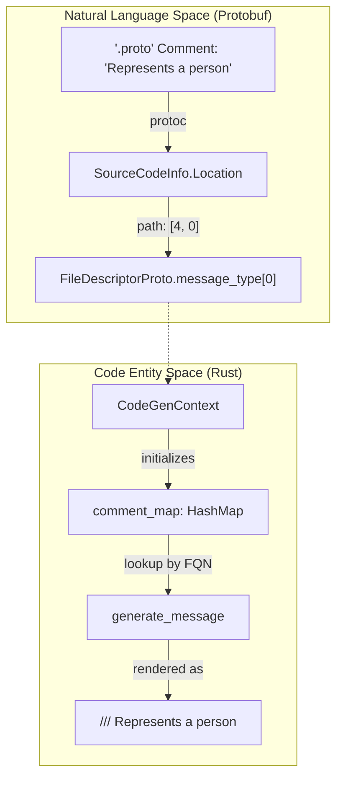
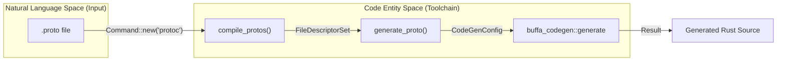

<!-- source: DeepWiki mcp.deepwiki.com · repo anthropics/buffa · page 7.2 Codegen Unit Tests · fetched 2026-10-26 -->

# Codegen Unit Tests

Relevant source files

The following files were used as context for generating this wiki page:

- [buffa-codegen/src/context.rs](buffa-codegen/src/context.rs)
- [buffa-codegen/src/extension.rs](buffa-codegen/src/extension.rs)
- [buffa-codegen/src/oneof.rs](buffa-codegen/src/oneof.rs)
- [buffa-codegen/src/tests/json_codegen.rs](buffa-codegen/src/tests/json_codegen.rs)
- [buffa-codegen/src/tests/mod.rs](buffa-codegen/src/tests/mod.rs)
- [buffa-codegen/tests/codegen_integration.rs](buffa-codegen/tests/codegen_integration.rs)
- [buffa-test/src/tests/mod.rs](buffa-test/src/tests/mod.rs)

The `buffa-codegen` crate includes a comprehensive suite of unit tests designed to validate the transformation of Protobuf descriptors into Rust source code. These tests focus on the logic of the code generator itself, ensuring that comments are preserved, WKT (Well-Known Type) mappings are correct, JSON serialization attributes are properly emitted, and naming collisions are handled gracefully.

## Test Module Structure

The unit tests are organized by functional area within the `src/tests/` directory of the `buffa-codegen` crate.

| Module | Responsibility | Source |
| :--- | :--- | :--- |
| `comments` | Propagation of `SourceCodeInfo` comments to Rust doc comments and AIP-192 resolution. | [buffa-codegen/src/tests/mod.rs:52]() |
| `generation` | General Proto3 codegen, WKT auto-mapping, and module path resolution. | [buffa-codegen/src/tests/mod.rs:56]() |
| `json_codegen` | `serde` attribute emission, JSON helper integration, and enum name mapping. | [buffa-codegen/src/tests/mod.rs:59]() |
| `view_codegen` | Validation of zero-copy view struct generation and lifetime management. | [buffa-codegen/src/tests/mod.rs:68]() |
| `naming` | Sanitization of Protobuf identifiers and conflict detection. | [buffa-codegen/src/tests/mod.rs:61]() |
| `proto2` | Legacy Proto2 specific features like required fields and default values. | [buffa-codegen/src/tests/mod.rs:64]() |
| `reexports` | Validation of the natural-path re-export tree generation. | [buffa-codegen/src/tests/mod.rs:65]() |
| `feature_gating` | Verification of `#[cfg(feature = "...")]` wrappers for conditional compilation. | [buffa-codegen/src/tests/mod.rs:55]() |
| `idiomatic_enums` | Validation of UpperCamelCase alias generation for enum variants. | [buffa-codegen/src/tests/mod.rs:57]() |
| `reflect_view` | Generation of reflection traits for zero-copy view types. | [buffa-codegen/src/tests/mod.rs:66]() |
| `owned_view_codegen` | Validation of `FooOwnedView` wrapper generation and `HasMessageView` impls. | [buffa-codegen/src/tests/mod.rs:62]() |

Sources: [buffa-codegen/src/tests/mod.rs:52-68]()

### Shared Test Helpers
To facilitate testing without writing raw `.proto` files to disk, the test suite uses builder functions to construct `FileDescriptorSet` components in memory.

*   `proto3_file(name)`: Creates a basic `FileDescriptorProto` with `syntax = "proto3"` [buffa-codegen/src/tests/mod.rs:13-19]().
*   `make_field(name, number, label, ty)`: Constructs a `FieldDescriptorProto` with specified metadata [buffa-codegen/src/tests/mod.rs:29-37]().
*   `enum_value(name, number)`: Constructs an `EnumValueDescriptorProto` [buffa-codegen/src/tests/mod.rs:21-27]().
*   `joined(files)`: Concatenates all generated-file contents into a single string for substring assertions [buffa-codegen/src/tests/mod.rs:44-50]().

## Comment Extraction and Resolution

The `comments` module validates that documentation in `.proto` files is correctly converted into Rust `///` doc comments.

### Implementation Detail: Path-Based Mapping
Protobuf comments are associated with code entities via a path (a `Vec<i32>`). The `CodeGenContext` translates these into an FQN-keyed map (`comment_map`) during initialization to simplify lookups during generation [buffa-codegen/src/context.rs:70-82]().

**Data Flow: SourceCodeInfo to Rust Doc**

Sources: [buffa-codegen/src/context.rs:70-82](), [buffa-codegen/src/tests/mod.rs:52]()

## Naming and Conflict Validation

The `naming` module ensures that Protobuf identifiers are safely transformed into Rust identifiers, rejecting reserved names and detecting collisions.

*   **Sentinel Modules**: The generator uses `__buffa` as a reserved module name for ancillary types. Collisions with this name in proto packages are caught during validation [buffa-codegen/src/context.rs:10-16]().
*   **Module Deconfliction**: Since Protobuf is case-sensitive but Rust module names are typically `snake_case`, the `nested_module_names` map tracks deconflicted names (e.g., appending `_` to avoid collisions between a message-module and a sub-package) [buffa-codegen/src/context.rs:83-92]().
*   **Keyword Escaping**: Integration tests verify that fields named `type` or `self` are escaped as `r#type` or `self_` [buffa-codegen/tests/codegen_integration.rs:148-154]().

## JSON and View Type Codegen

### JSON Field Attributes
The `json_codegen` tests verify that specific Protobuf types are linked to `buffa::json_helpers` for correct JSON representation and that `oneof` fields are flattened.

| Proto Type | JSON Helper / Attribute | Source |
| :--- | :--- | :--- |
| `int64` | `::buffa::json_helpers::int64` (String) | [buffa-codegen/src/tests/json_codegen.rs:147-150]() |
| `bytes` | `::buffa::json_helpers::bytes` (Base64) | [buffa-codegen/src/tests/json_codegen.rs:156-159]() |
| `float` | `::buffa::json_helpers::float` (NaN/Inf) | [buffa-codegen/src/tests/json_codegen.rs:166-168]() |
| `oneof` | `#[serde(flatten)]` | [buffa-codegen/src/tests/json_codegen.rs:204]() |
| `NullValue` | Special handling (no `NullableDeserializeSeed`) | [buffa-codegen/src/oneof.rs:25-40]() |

### View Type Validation
The `view_codegen` tests ensure that zero-copy views correctly handle lifetime parameters and field accessors [buffa-codegen/src/tests/view_codegen.rs:1-5]().
*   **Reborrowing**: Verifies `ViewReborrow` implementation for nested views.
*   **Owned Wrappers**: `owned_view_codegen` validates the generation of `FooOwnedView` which allows moving views across thread boundaries by holding the underlying buffer [buffa-codegen/src/tests/owned_view_codegen.rs:1-5]().

## Oneof and Pointer Representation

The generator determines whether fields should be stored `Inline` or as a `Box` based on configuration and recursion detection.

*   **Unboxed Oneofs**: `resolve_unboxed_variants` identifies variants that can be stored inline without creating unsized types [buffa-codegen/src/oneof.rs:79-98]().
*   **Inlined Fields**: `resolve_inlined_fields` performs a DFS to detect cycles in inline singular message fields, demoting recursive edges to `Box` [buffa-codegen/src/oneof.rs:100-113]().

## Integration Tests (`codegen_integration.rs`)

While unit tests use in-memory descriptors, `codegen_integration.rs` invokes the real `protoc` binary to ensure the full pipeline—from `.proto` file to generated Rust—is functional [buffa-codegen/tests/codegen_integration.rs:1-7]().

**Pipeline: Proto to Rust Source**

Sources: [buffa-codegen/tests/codegen_integration.rs:43-73](), [buffa-codegen/tests/codegen_integration.rs:77-97]()

*   **WKT Mapping**: Validates that well-known types automatically map to `buffa_types` unless overridden by `extern_paths` [buffa-codegen/tests/codegen_integration.rs:190-201]().
*   **Snapshot Comparisons**: Uses `generate_for` to run the generator on files from `buffa-test/protos/` and verify content markers like `@generated` [buffa-codegen/tests/codegen_integration.rs:100-106](), [buffa-codegen/tests/codegen_integration.rs:129-134]().

---

