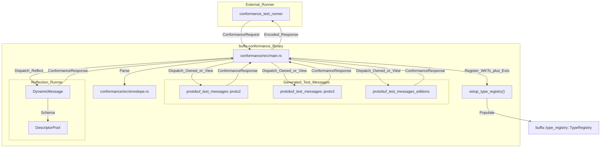
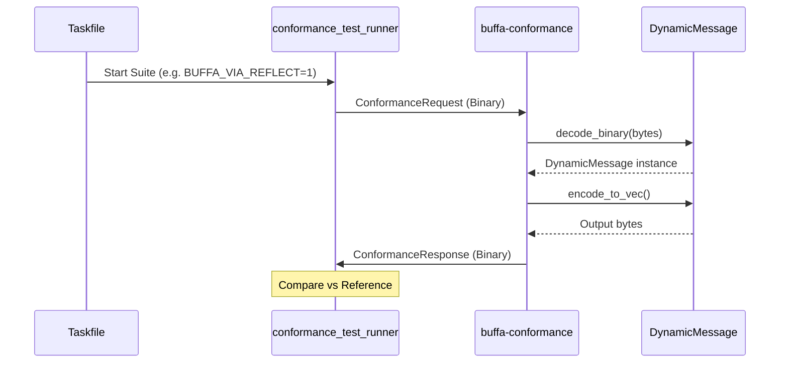

<!-- source: DeepWiki mcp.deepwiki.com · repo anthropics/buffa · page 7.3 Conformance Test Suite · fetched 2026-10-26 -->

# Conformance Test Suite

Relevant source files

The following files were used as context for generating this wiki page:

- [.github/workflows/ci.yml](.github/workflows/ci.yml)
- [CONTRIBUTING.md](CONTRIBUTING.md)
- [Taskfile.yml](Taskfile.yml)
- [buffa-descriptor/tests/protos/reflect_test.fds](buffa-descriptor/tests/protos/reflect_test.fds)
- [buffa-types/src/timestamp_chrono.rs](buffa-types/src/timestamp_chrono.rs)
- [conformance/Cargo.lock](conformance/Cargo.lock)
- [conformance/Dockerfile](conformance/Dockerfile)
- [conformance/build.rs](conformance/build.rs)
- [conformance/known_failures_reflect.txt](conformance/known_failures_reflect.txt)
- [conformance/run-conformance.sh](conformance/run-conformance.sh)
- [conformance/src/main.rs](conformance/src/main.rs)
- [rust-toolchain.toml](rust-toolchain.toml)

The buffa conformance test suite implements the `conformance_test_runner` protocol defined by Google's Protocol Buffers project. It serves as the primary verification mechanism for wire-format correctness, JSON mapping compliance, and feature parity across Proto2, Proto3, and Editions (2023 and 2024). The suite validates the standard owned-message API, the zero-copy view API, the lazy-decoding view API, and the descriptor-driven reflection runtime.

## Architecture and Protocol Implementation

The conformance binary implements the protocol expected by `conformance_test_runner`, where communication occurs over `stdin` and `stdout` using a repeated pattern of `[u32-LE length][Message bytes]` [conformance/src/main.rs:1-6]().

### Data Flow: Request to Response

1.  **Envelope Decoding**: The binary reads a `ConformanceRequest` from `stdin`. This envelope is decoded using a hand-rolled parser in `envelope.rs` [conformance/src/main.rs:7-8]().
2.  **Message Dispatch**: Based on the `requested_output_format` and `message_type` fields, the binary selects the appropriate generated message type (e.g., `TestAllTypesProto3`) or routes to the reflection runner [conformance/src/main.rs:180-200]().
3.  **Transcoding**: The binary performs the requested operation (e.g., Protobuf-to-JSON, JSON-to-Protobuf, or Roundtrip) using the `buffa` runtime or `DynamicMessage` reflection.
4.  **Response Encoding**: The result is wrapped in a `ConformanceResponse` and written back to `stdout` [conformance/src/main.rs:5-8]().

### System Component Mapping

The following diagram maps the logical components of the conformance runner to their implementation entities in the codebase.

**Conformance Component Mapping**

Sources: [conformance/src/main.rs:24-84](), [conformance/src/main.rs:104-130](), [conformance/src/main.rs:176-185]()

## Type Registry Setup

For JSON and Text format conformance, `buffa` requires a global registry to handle `google.protobuf.Any` expansion and extension field names. The `setup_type_registry` function initializes this state [conformance/src/main.rs:104-106]().

1.  **WKT Registration**: `buffa_types::register_wkt_types` registers well-known types with special JSON rules (e.g., `is_wkt: true` for Any wrapping) [conformance/src/main.rs:112-112]().
2.  **Generated Registration**: Each generated file provides a `register_types(&mut reg)` function. This registers message Any entries (JSON + text) and extension descriptors (e.g., `extension_int32` in proto2) [conformance/src/main.rs:118-127]().

Sources: [conformance/src/main.rs:104-130](), [buffa-types/src/lib.rs:103-104]()

## Execution Modes

The suite supports multiple execution modes, toggled via environment variables in the `run-conformance.sh` script [conformance/run-conformance.sh:43-89]().

| Mode | Env Var | Description |
| :--- | :--- | :--- |
| **Standard** | (None) | Direct owned-message decode/encode/JSON path. |
| **Via-View** | `BUFFA_VIA_VIEW=1` | Routes binary input through `decode_view → to_owned_message` to verify decoder parity [conformance/src/main.rs:132-157](). |
| **Via-Lazy** | `BUFFA_VIA_LAZY=1` | Routes binary input through `decode_lazy → to_owned_message` on the lazy view family to verify deferred decoding [conformance/run-conformance.sh:52-56](). |
| **View-JSON** | `BUFFA_VIEW_JSON=1` | Serves binary-to-JSON requests via `decode_view → Serialize` (generated view impls) [conformance/src/main.rs:159-174](). |
| **Via-Reflect** | `BUFFA_VIA_REFLECT=1` | Uses `DynamicMessage` for descriptor-driven binary round-trips [conformance/src/main.rs:176-185](). |
| **Via-VTable** | `BUFFA_VIA_VTABLE=1` | Decodes a view, walks its `ReflectMessage` vtable to build a `DynamicMessage`, then serializes to JSON [conformance/run-conformance.sh:85-89](). |

### Reflection JSON Codec
The `BUFFA_VIA_REFLECT` and `BUFFA_VIA_VTABLE` modes leverage the reflective JSON implementation in `buffa-descriptor`. This codec performs a mechanical walk over a `MessageDescriptor`'s fields, special-casing WKTs (Timestamp RFC3339, Duration, etc.) by reading their fields through the `DynamicMessage` surface [buffa-descriptor/src/reflect/json.rs:1-15]().

Sources: [conformance/src/main.rs:132-185](), [conformance/run-conformance.sh:43-89](), [buffa-descriptor/src/reflect/json.rs:1-72]()

## Testing Infrastructure and Failure Tracking

The suite is executed within a Docker container to provide the `conformance_test_runner` and reference `.proto` files [conformance/Dockerfile:1-64]().

### Failure Files
Expected failures are tracked in several `.txt` files. The runner ignores these failures, allowing the suite to pass while documenting known gaps.

*   `known_failures.txt`: Baseline failures for owned types.
*   `known_failures_nostd.txt`: Failures specific to the `no_std` build [conformance/Dockerfile:54-54]().
*   `known_failures_view_json.txt`: Failures in view-side JSON serialization [conformance/known_failures_view_json.txt:1-11]().
*   `known_failures_reflect.txt`: Failures in the reflection wire codec [conformance/known_failures_reflect.txt:1-4]().
*   `known_failures_view_vtable.txt`: Failures in the `ReflectMessage` vtable accessors [conformance/known_failures_view_vtable.txt:1-15]().
*   `known_failures_lazy.txt`: Failures in the lazy view decoder [conformance/Dockerfile:56-56]().

### Running the Suite
The suite is typically invoked via `task conformance`. This triggers the Docker build and execution of `run-conformance.sh`, which iterates through the standard, `no_std`, view, lazy, view-json, reflect, and vtable suites [conformance/run-conformance.sh:26-89]().

**Conformance Execution Flow**

Sources: [conformance/run-conformance.sh:64-69](), [conformance/src/main.rs:176-185](), [buffa-descriptor/src/reflect/json.rs:42-72](), [Taskfile.yml:63-68]()

---

