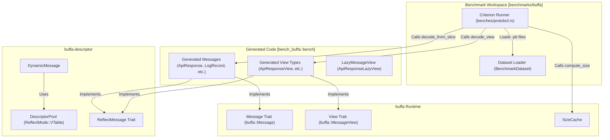

<!-- source: DeepWiki mcp.deepwiki.com · repo anthropics/buffa · page 8.1 Benchmark Suite · fetched 2026-10-26 -->

# Benchmark Suite

Relevant source files

The following files were used as context for generating this wiki page:

- [benchmarks/buffa/Cargo.lock](benchmarks/buffa/Cargo.lock)
- [benchmarks/buffa/Cargo.toml](benchmarks/buffa/Cargo.toml)
- [benchmarks/buffa/benches/analytics_event.rs](benchmarks/buffa/benches/analytics_event.rs)
- [benchmarks/buffa/benches/api_response.rs](benchmarks/buffa/benches/api_response.rs)
- [benchmarks/buffa/benches/google_message1.rs](benchmarks/buffa/benches/google_message1.rs)
- [benchmarks/buffa/benches/log_record.rs](benchmarks/buffa/benches/log_record.rs)
- [benchmarks/buffa/benches/media_frame.rs](benchmarks/buffa/benches/media_frame.rs)
- [benchmarks/buffa/benches/packed_tile.rs](benchmarks/buffa/benches/packed_tile.rs)
- [benchmarks/buffa/benches/protobuf.rs](benchmarks/buffa/benches/protobuf.rs)
- [benchmarks/buffa/build.rs](benchmarks/buffa/build.rs)
- [benchmarks/datasets/packed_signed.pb](benchmarks/datasets/packed_signed.pb)
- [benchmarks/gen-datasets/Cargo.lock](benchmarks/gen-datasets/Cargo.lock)
- [benchmarks/gen-datasets/src/main.rs](benchmarks/gen-datasets/src/main.rs)
- [benchmarks/history/README.md](benchmarks/history/README.md)
- [benchmarks/history/REPORT.md](benchmarks/history/REPORT.md)
- [benchmarks/history/annotations.md](benchmarks/history/annotations.md)
- [benchmarks/history/charts/compute_size.svg](benchmarks/history/charts/compute_size.svg)
- [benchmarks/proto/bench_messages.proto](benchmarks/proto/bench_messages.proto)

The `benchmarks/` workspace provides a comprehensive performance evaluation framework for `buffa`. It measures throughput for binary encoding/decoding, JSON serialization, and reflection-based access across representative message types, comparing `buffa` against other major Protobuf implementations including `prost`, Google's official C++ implementation (`protobuf-v4`), and Go.

## Overview and Methodology

The suite focuses on high-throughput scenarios using realistic data structures. It utilizes the `criterion` [benchmarks/buffa/Cargo.toml:23]() statistics-driven benchmarking library for Rust-based measurements and Docker-based isolation for cross-implementation comparisons.

### Representative Message Types
The suite uses specific message schemas to capture different performance profiles:
*   **`ApiResponse`**: A small, shallow message with mixed scalars, typical of REST/gRPC responses [benchmarks/proto/bench_messages.proto:14-23]().
*   **`LogRecord`**: A string-heavy message representing structured log entries, testing allocation overhead [benchmarks/proto/bench_messages.proto:27-51]().
*   **`AnalyticsEvent`**: A deeply nested message with repeated sub-messages, testing recursive decode and cached-size benefits [benchmarks/proto/bench_messages.proto:56-78]().
*   **`GoogleMessage1`**: A large "torture-test" message derived from Google's internal benchmarks [benchmarks/buffa/build.rs:17-19]().
*   **`MediaFrame`**: A binary-payload-heavy message with large blobs, highlighting zero-copy view advantages [benchmarks/proto/bench_messages.proto:85-92]().
*   **`PackedTile`**: Many small sub-messages with packed repeated scalars, pinning the packed-decode pre-allocation path [benchmarks/proto/bench_messages.proto:101-110]().
*   **`TriMesh`**: Many small singular sub-messages per repeated element, testing the regression target for inline-by-default storage [benchmarks/proto/bench_messages.proto:119-132]().

### Layout Normalization
To eliminate the "code-layout lottery" where identical machine code performs differently based on instruction alignment, the suite uses **64-byte block and loop alignment** [benchmarks/history/annotations.md:7-9]().
*   **Flags**: `-Cllvm-args=-align-all-nofallthru-blocks=6 -Cllvm-args=-align-loops=64` [benchmarks/history/README.md:58]().
*   **Impact**: Collapsed the cross-release spread on `json_encode` from 19.2% to 2.5% [benchmarks/history/annotations.md:91-100]().
*   **Profile**: Benchmarks are pinned to `lto=true` and `codegen-units=1` to ensure reproducible binary layout [benchmarks/history/README.md:44-45]().

Sources: [benchmarks/proto/bench_messages.proto:1-144](), [benchmarks/history/README.md:44-75](), [benchmarks/history/annotations.md:1-27]()

---

## Workspace Layout and Data Flow

The benchmarking process involves generating code from shared `.proto` files, loading static datasets generated by `gen-datasets`, and executing the measurement loop.

### Component Interaction Diagram

This diagram illustrates how the benchmark runner interacts with the `buffa` runtime, generated code, and the reflection system.

Sources: [benchmarks/buffa/benches/protobuf.rs:1-82](), [benchmarks/buffa/build.rs:27-39](), [benchmarks/buffa/Cargo.toml:13-17]()

---

## Reflection and Per-Message Isolation

The suite provides specific configurations to measure reflection overhead and to isolate the compilation of individual message decoders.

### Per-Message Isolation (`iso`)
The `iso` feature gates per-message isolated targets [benchmarks/buffa/Cargo.toml:37](). When building with `--no-default-features --features iso,<msg>`, only that specific message's proto is compiled [benchmarks/buffa/build.rs:3-5](). This removes cross-message inliner coupling, ensuring one message's benchmark does not perturb another's code layout [benchmarks/history/annotations.md:13-15]().

### Reflection Measurement Types
The suite measures three distinct paths for accessing data:
1.  **Generated Owned**: Standard `decode_from_slice` into owned structs [benchmarks/buffa/benches/protobuf.rs:36]().
2.  **Generated View**: Zero-copy `decode_view` into lifetime-bound view types [benchmarks/buffa/benches/protobuf.rs:139]().
3.  **Dynamic/Reflective**: Using `DynamicMessage` or `ReflectMessage` vtables for generic access [benchmarks/buffa/Cargo.toml:45-47]().

### Dataset Generation
Datasets are generated by the `gen-datasets` tool to provide realistic branch prediction and cache behavior [benchmarks/gen-datasets/src/main.rs:1-4](). Each dataset contains 50 varied payloads [benchmarks/gen-datasets/src/main.rs:41]().
*   **ApiResponse**: Random scalars and optional trace IDs [benchmarks/gen-datasets/src/main.rs:60-81]().
*   **LogRecord**: Random service names, severities, and labels [benchmarks/gen-datasets/src/main.rs:83-108]().
*   **MediaFrame**: Random byte blobs ranging from 1KB to 10KB [benchmarks/gen-datasets/src/main.rs:148-174]().

Sources: [benchmarks/buffa/build.rs:1-41](), [benchmarks/buffa/Cargo.toml:36-83](), [benchmarks/gen-datasets/src/main.rs:1-216]()

---

## Performance History and Regression Tracking

The `benchmarks/history/` directory tracks performance across releases (v0.1.0 to v0.8.0) to identify regressions [benchmarks/history/README.md:3-6]().

### Key Historical Findings (v0.1.0 → v0.8.0)
| Operation | Change | Cause |
| :--- | :--- | :--- |
| **`decode_view`** | +17–21% | `fast-utf8` default landing (v0.8.0) [benchmarks/history/annotations.md:33-37](). |
| **`decode_view` (PackedTile)** | +47% | Packed-varint reserve optimization (v0.7.1) [benchmarks/history/annotations.md:47-49](). |
| **`encode` (AnalyticsEvent)** | −12% | Regression in nested repeated submessage encoding (v0.4.0) [benchmarks/history/annotations.md:42-46](). |

### Throughput Samples (v0.8.0)
Measured on Intel Xeon Platinum 8488C (c7i.metal-24xl) [benchmarks/history/REPORT.md:14]():

| Message | decode (MiB/s) | decode_view (MiB/s) | encode (MiB/s) |
| :--- | :--- | :--- | :--- |
| **ApiResponse** | 647 [benchmarks/history/REPORT.md:51]() | 1,155 [benchmarks/history/REPORT.md:103]() | 1,987 [benchmarks/history/REPORT.md:77]() |
| **LogRecord** | 638 [benchmarks/history/REPORT.md:52]() | 1,670 [benchmarks/history/REPORT.md:104]() | 3,045 [benchmarks/history/REPORT.md:78]() |
| **MediaFrame** | 12,889 [benchmarks/history/REPORT.md:55]() | 52,150 [benchmarks/history/REPORT.md:107]() | 25,565 [benchmarks/history/REPORT.md:81]() |

Sources: [benchmarks/history/REPORT.md:1-120](), [benchmarks/history/annotations.md:28-56](), [benchmarks/history/README.md:1-113]()

---

