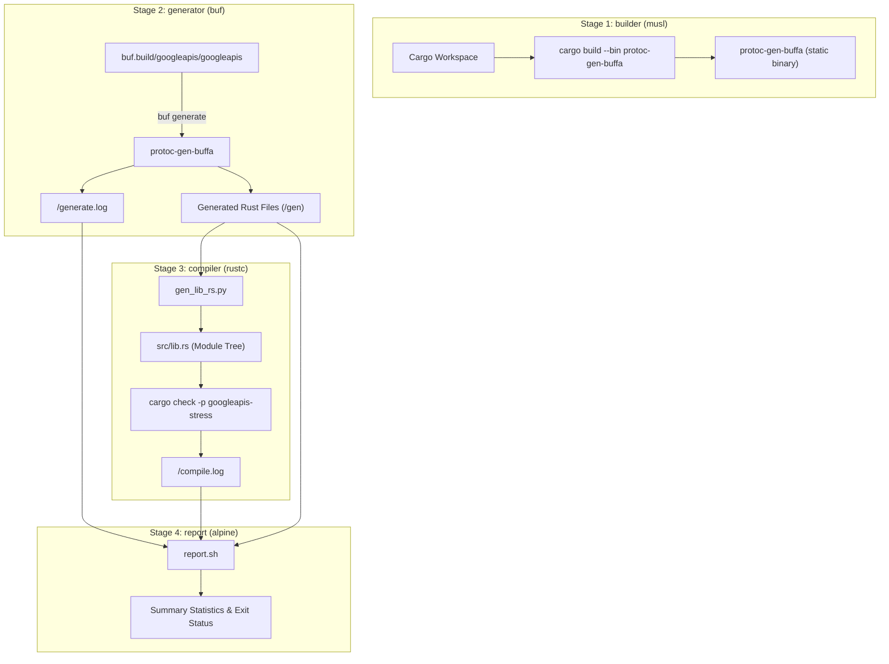
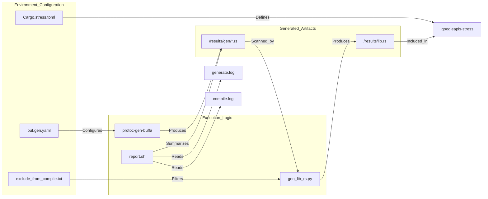

<!-- source: DeepWiki mcp.deepwiki.com · repo anthropics/buffa · page 8.2 Stress Test (googleapis) · fetched 2026-10-26 -->

# Stress Test (googleapis)

Relevant source files

The following files were used as context for generating this wiki page:

- [benchmarks/Dockerfile.bench-buffa](benchmarks/Dockerfile.bench-buffa)
- [examples/logging/buf.gen.yaml](examples/logging/buf.gen.yaml)
- [protoc-gen-buffa/Dockerfile](protoc-gen-buffa/Dockerfile)
- [stress/googleapis/Dockerfile](stress/googleapis/Dockerfile)
- [stress/googleapis/report.sh](stress/googleapis/report.sh)

The `stress/googleapis` suite is a large-scale validation mechanism designed to verify the robustness of `buffa` by generating and compiling Rust code for the entire Google Cloud APIs protobuf collection. This test ensures that the codegen handles thousands of `.proto` files, deep package hierarchies, complex cross-package imports, and large-scale type resolution without regressions [stress/googleapis/Dockerfile:1-6]().

## Overview and Purpose

The stress test operates as a multi-stage Docker build that simulates a high-pressure environment for the compiler and runtime. It targets the `buf.build/googleapis/googleapis` module, which contains a significant portion of the public Google Cloud API surface [stress/googleapis/Dockerfile:49-50]().

The primary goals of this test are:
1.  **Scale Validation**: Confirming `protoc-gen-buffa` can process thousands of files in a single invocation [stress/googleapis/Dockerfile:4-5]().
2.  **Correctness**: Ensuring the generated Rust code is syntactically correct and respects Rust's visibility and module rules [stress/googleapis/Dockerfile:5-6]().
3.  **Dependency Resolution**: Validating that cross-package imports in Protobuf are correctly mapped to Rust module paths [stress/googleapis/Dockerfile:5]().
4.  **Compiler Stress**: Testing `rustc`'s ability to handle the massive volume of generated types and trait implementations [stress/googleapis/Dockerfile:6]().

## Pipeline Architecture

The stress test is implemented as a four-stage Dockerfile to ensure a clean, reproducible environment.

### Stress Test Data Flow

The following diagram illustrates the progression from raw Protobuf definitions to a compiled Rust binary.

**Stress Test Pipeline Flow**

Sources: [stress/googleapis/Dockerfile:17-118]()

## Implementation Details

### Multi-Stage Build Process

The build is partitioned into distinct functional stages to separate concerns and optimize build times:

| Stage | Name | Responsibility | Key File Entities |
| :--- | :--- | :--- | :--- |
| **Stage 1** | `builder` | Compiles the `protoc-gen-buffa` plugin as a static musl binary [stress/googleapis/Dockerfile:18-36](). | `protoc-gen-buffa` |
| **Stage 2** | `generator` | Uses `buf` to pull the Google APIs and invoke the plugin to generate code [stress/googleapis/Dockerfile:38-60](). | `buf.gen.yaml`, `/workspace/gen`, `/generate.log` |
| **Stage 3** | `compiler` | Constructs a temporary Rust crate (`stress-crate`) and attempts to compile it [stress/googleapis/Dockerfile:63-104](). | `gen_lib_rs.py`, `Cargo.stress.toml`, `/compile.log` |
| **Stage 4** | `report` | Aggregates logs and generated artifacts for inspection [stress/googleapis/Dockerfile:107-118](). | `report.sh` |

Sources: [stress/googleapis/Dockerfile:17-118]()

### Code Generation and Module Mapping

Because the Google APIs contain hundreds of packages, the stress test uses a helper script, `gen_lib_rs.py`, to programmatically generate the `src/lib.rs` file [stress/googleapis/Dockerfile:81-88](). This script scans the output directory and creates the necessary `pub mod` or `include!` declarations to make the generated code accessible to the Rust compiler.

The test also utilizes a specific configuration for the generated crate:
*   **Exclusions**: Certain files may be excluded via `exclude_from_compile.txt` if they contain known incompatible Protobuf features [stress/googleapis/Dockerfile:82]().
*   **Crate Configuration**: `Cargo.stress.toml` defines the dependencies on the local `buffa` workspace crates, using relative paths to point to the source tree [stress/googleapis/Dockerfile:83, 97]().
*   **Workspace Integration**: The `Dockerfile` dynamically injects the `stress-crate` into the main `Cargo.toml` workspace via `sed` to ensure proper path dependency resolution [stress/googleapis/Dockerfile:96]().

### Code Entity Association

The following diagram bridges the logical stages of the stress test to the specific code entities and scripts involved in the execution.

**System-to-Code Mapping**

Sources: [stress/googleapis/Dockerfile:44-118](), [stress/googleapis/report.sh:11-27]()

## Validation and Reporting

The final stage of the build executes `report.sh` [stress/googleapis/Dockerfile:115-118](). This script is responsible for:
1.  **Metric Collection**: Counting the total number of generated `.rs` files, total lines of code, and disk size [stress/googleapis/report.sh:12-18]().
2.  **Generation Validation**: Checking the exit status recorded in `generate.log`. If non-zero, it surfaces "FAIL — code generation errors detected" and greps for specific errors/panics [stress/googleapis/report.sh:31-45]().
3.  **Compilation Validation**: Checking the exit status in `compile.log`. If the `cargo check` failed, it extracts the last 50 lines of compiler errors [stress/googleapis/report.sh:48-57]().
4.  **Artifact Export**: If a volume is mounted at `/out`, the script copies the logs and generated source code to the host for manual inspection [stress/googleapis/report.sh:62-69]().

Success is defined as a zero exit code from both the generation and compilation stages, indicating that `buffa` is capable of handling the full complexity of the Google Cloud API surface [stress/googleapis/report.sh:71]().

Sources: [stress/googleapis/Dockerfile:53-60, 92-104](), [stress/googleapis/report.sh:1-72]()

---

