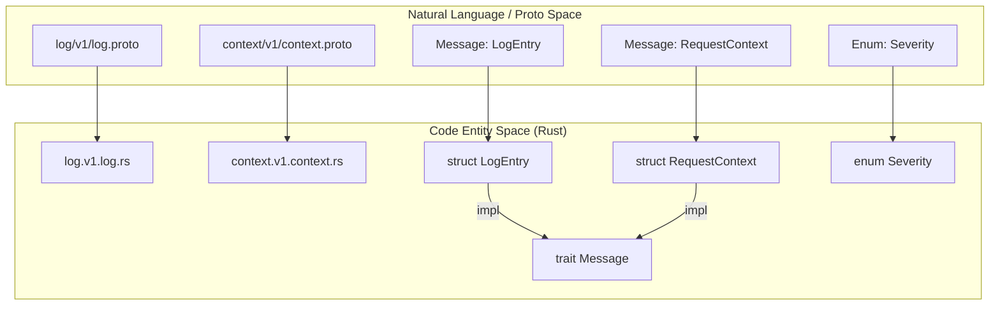
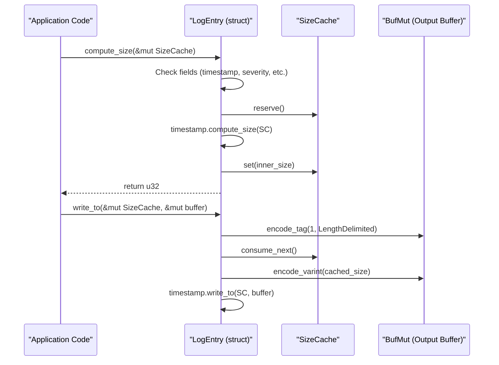

<!-- source: DeepWiki mcp.deepwiki.com · repo anthropics/buffa · page 9.1 Logging Example · fetched 2026-10-26 -->

# Logging Example

<details>
<summary>Relevant source files</summary>

The following files were used as context for generating this wiki page:

- [benchmarks/Dockerfile.bench-buffa](benchmarks/Dockerfile.bench-buffa)
- [examples/logging/buf.gen.yaml](examples/logging/buf.gen.yaml)
- [examples/logging/src/gen/context.v1.context.rs](examples/logging/src/gen/context.v1.context.rs)
- [examples/logging/src/gen/log.v1.log.rs](examples/logging/src/gen/log.v1.log.rs)
- [protoc-gen-buffa/Dockerfile](protoc-gen-buffa/Dockerfile)
- [stress/googleapis/Dockerfile](stress/googleapis/Dockerfile)
- [stress/googleapis/report.sh](stress/googleapis/report.sh)

</details>


The logging example demonstrates a multi-package Protobuf schema utilizing `buffa` for high-performance serialization. It showcases the integration between `protoc-gen-buffa` and `protoc-gen-buffa-packaging` to manage a clean Rust module hierarchy, as well as the use of `buffa-types` for Google's well-known types.

## Multi-Package Schema

The example is split into two distinct Protobuf packages to demonstrate cross-package references and code generation:

1.  **`buffa.examples.context.v1`**: Contains `RequestContext`, which holds metadata about a request (ID, user, HTTP method, and path) [examples/logging/src/gen/context.v1.context.rs:4-32]().
2.  **`buffa.examples.log.v1`**: Contains the primary `LogEntry` message and a `Severity` enum. `LogEntry` imports and references `RequestContext` from the other package [examples/logging/src/gen/log.v1.log.rs:89-121]().

### Message Definitions and Types
The generated code maps Protobuf types to specific Rust constructs designed for ergonomics and performance:

| Protobuf Type | Rust Representation | Purpose |
| :--- | :--- | :--- |
| `google.protobuf.Timestamp` | `::buffa::MessageField<::buffa_types::google_protobuf::Timestamp>` | Uses `buffa-types` and provides optionality via `MessageField` [examples/logging/src/gen/log.v1.log.rs:95](). |
| `map<string, string>` | `::buffa::__private::HashMap<String, String>` | Standard heap-allocated map for structured metadata [examples/logging/src/gen/log.v1.log.rs:115-118](). |
| `enum Severity` | `::buffa::EnumValue<Severity>` | Open enum wrapper that preserves unknown variants for forward compatibility [examples/logging/src/gen/log.v1.log.rs:99](). |
| `RequestContext` | `::buffa::MessageField<RequestContext>` | Cross-package message reference using relative module paths [examples/logging/src/gen/log.v1.log.rs:111](). |

Sources: [examples/logging/src/gen/log.v1.log.rs:89-121](), [examples/logging/src/gen/context.v1.context.rs:4-32]()

## Build Configuration

The example uses `buf` to orchestrate code generation. The configuration utilizes two plugins to transform `.proto` files into a ready-to-use Rust module tree.

### buf.gen.yaml
The configuration disables zero-copy views for this specific example to focus on the owned message types.

```yaml
version: v2
inputs:
  - directory: proto
plugins:
  - local: protoc-gen-buffa
    out: src/gen
    opt:
      - views=false
  - local: protoc-gen-buffa-packaging
    out: src/gen
    strategy: all
```
Sources: [examples/logging/buf.gen.yaml:1-12]()

### The Packaging Plugin
`protoc-gen-buffa-packaging` is a critical component for multi-package projects. It generates the `mod.rs` hierarchy that organizes the generated files at the correct module nesting levels, matching the Protobuf package structure. It requires `strategy: all` to ensure it has a global view of all generated files [examples/logging/buf.gen.yaml:9-11]().

## Generated Code Structure

The generation process produces a flat set of files in `src/gen/` named according to their Protobuf package (e.g., `log.v1.log.rs`), which are then organized by the generated module tree.

### Code Entity Association

This diagram bridges the Protobuf schema definitions to the generated Rust entities.

**Schema to Code Mapping**

Sources: [examples/logging/src/gen/log.v1.log.rs:1-121](), [examples/logging/src/gen/context.v1.context.rs:1-32]()

### Data Flow: Serialization
`buffa` uses a two-pass serialization model. The first pass computes the size of all fields (including nested messages) and caches them in a `SizeCache`. The second pass writes the data to a buffer.

**Serialization Flow**

Sources: [examples/logging/src/gen/log.v1.log.rs:160-205](), [examples/logging/src/gen/context.v1.context.rs:70-96]()

## Implementation Details

### Message Trait Implementation
Each generated message implements `::buffa::Message`. This includes:
*   `compute_size`: Recursively calculates the size of the message. For `LogEntry`, it sums the sizes of `timestamp`, `severity`, `message`, `logger`, `context`, `fields`, and `__buffa_unknown_fields` [examples/logging/src/gen/log.v1.log.rs:160-205]().
*   `write_to`: Writes the fields to a `BufMut`. It uses the `SizeCache` for nested messages to avoid redundant calculations [examples/logging/src/gen/log.v1.log.rs:206-259]().
*   `merge_field`: The decoding entry point. It matches incoming tags and delegates to `buffa::types` helpers like `merge_string` or `merge_int32` [examples/logging/src/gen/context.v1.context.rs:160-220]().

### Handling Enums
The `Severity` enum is generated as a standard Rust enum with an `Enumeration` trait implementation.
*   **Default**: Maps to `SEVERITY_UNSPECIFIED` (0) [examples/logging/src/gen/log.v1.log.rs:35-39]().
*   **Idiomatic Aliases**: Provides constants like `Severity::Info` for `SEVERITY_INFO` to follow Rust naming conventions [examples/logging/src/gen/log.v1.log.rs:15-34]().
*   **Mapping**: Provides `from_i32`, `to_i32`, `proto_name`, and `from_proto_name` for conversion and JSON support [examples/logging/src/gen/log.v1.log.rs:40-88]().

### Unknown Fields
Every message includes a `__buffa_unknown_fields` field of type `::buffa::UnknownFields` [examples/logging/src/gen/log.v1.log.rs:120](). During `merge_field`, any tag not recognized by the generated `match` block is passed to `::buffa::encoding::decode_unknown_field`, and the result is pushed to the internal storage, ensuring round-trip fidelity [examples/logging/src/gen/context.v1.context.rs:215-218]().

Sources: [examples/logging/src/gen/log.v1.log.rs:5-121](), [examples/logging/src/gen/context.v1.context.rs:160-220]()

---

