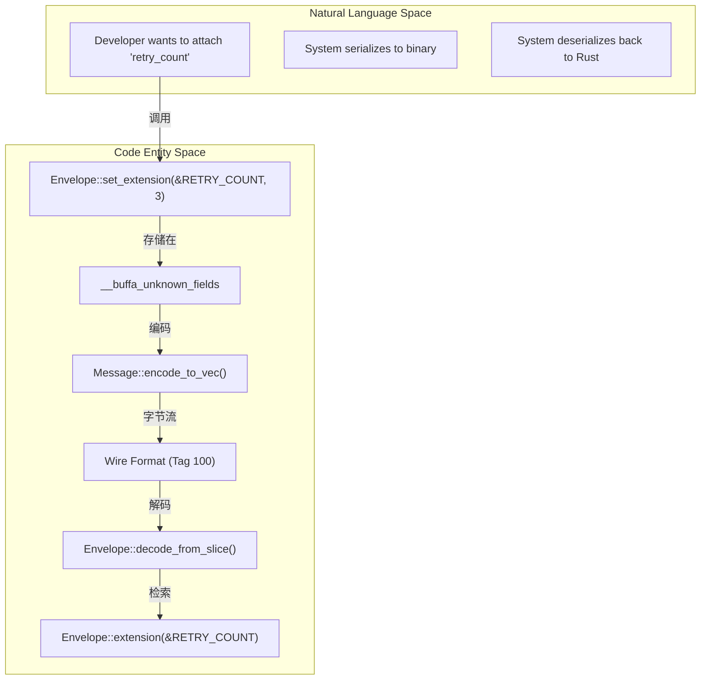
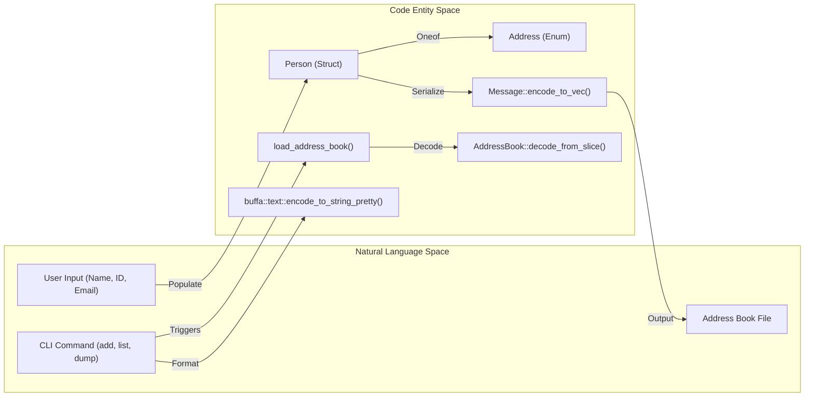
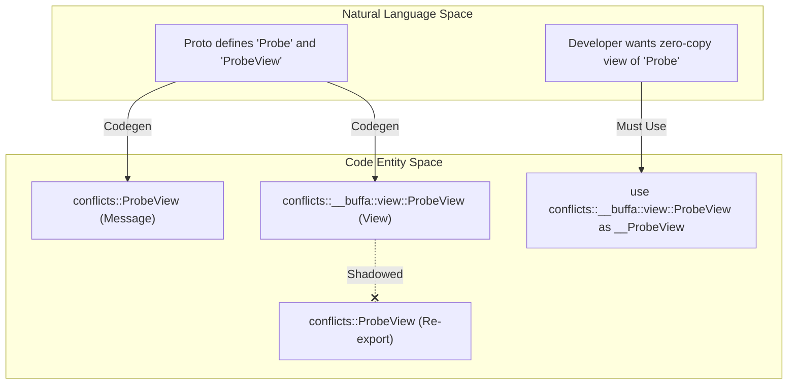

<!-- source: DeepWiki mcp.deepwiki.com · repo anthropics/buffa · page 9.2 Envelope, Addressbook, and BSR Quickstart Examples · fetched 2026-10-26 -->

# Envelope, Addressbook, and BSR Quickstart Examples

Relevant source files

The following files were used as context for generating this wiki page:

- [examples/addressbook/Cargo.lock](examples/addressbook/Cargo.lock)
- [examples/addressbook/build.rs](examples/addressbook/build.rs)
- [examples/addressbook/src/main.rs](examples/addressbook/src/main.rs)
- [examples/bsr-quickstart/Cargo.lock](examples/bsr-quickstart/Cargo.lock)
- [examples/bsr-quickstart/Cargo.toml](examples/bsr-quickstart/Cargo.toml)
- [examples/bsr-quickstart/README.md](examples/bsr-quickstart/README.md)
- [examples/bsr-quickstart/buf.gen.yaml](examples/bsr-quickstart/buf.gen.yaml)
- [examples/bsr-quickstart/buf.yaml](examples/bsr-quickstart/buf.yaml)
- [examples/bsr-quickstart/proto/example/v1/greeting.proto](examples/bsr-quickstart/proto/example/v1/greeting.proto)
- [examples/bsr-quickstart/src/gen/example.v1.rs](examples/bsr-quickstart/src/gen/example.v1.rs)

This page details the implementation and usage of the primary example projects in the `buffa` repository: the **Envelope** example for advanced Proto2 features; the **Addressbook** example for basic Proto2 and `build.rs` usage; the **Conflicts** example for naming collision handling; and the **BSR Quickstart** example for remote plugin workflows.

## Envelope Example

The Envelope example illustrates how to use Protobuf extensions to attach structured metadata to a message without modifying the original message definition. This pattern is commonly used for cross-cutting concerns like tracing, routing, and retry policies.

### Schema and Extension Ranges

The `Envelope` message defines an extension range from 100 to 999 [examples/envelope/proto/envelope.proto:11-12](). This allows other messages or scalar fields to be attached to `Envelope` using the `extend` keyword [examples/envelope/proto/envelope.proto:26-38]().

| Extension Name | Type | Field Number | Description |
| :--- | :--- | :--- | :--- |
| `retry_count` | `int32` | 100 | Singular scalar extension. |
| `trace` | `TraceContext` | 101 | Message-typed extension. |
| `routing_hops` | `repeated string` | 102 | Repeated field extension. |
| `priority` | `int32` | 103 | Extension with a Proto2 `[default = 5]`. |

Sources: [examples/envelope/proto/envelope.proto:1-39]()

### Extension API Flow

The `buffa` runtime provides a typed API for interacting with extensions via the `ExtensionSet` trait [examples/envelope/src/main.rs:9-9](). Extensions are stored internally within the `__buffa_unknown_fields` byte storage of the message [examples/envelope/src/main.rs:37-39]().

**Extension Lifecycle**

Sources: [examples/envelope/src/main.rs:22-85](), [examples/envelope/proto/envelope.proto:26-28]()

### Extension Features

*   **Explicit Presence**: Extensions always have explicit presence. Even if a value is set to the type's default (e.g., `0`), `has_extension` will return `true` [examples/envelope/src/main.rs:101-110]().
*   **Proto2 Defaults**: If an extension is not set but has a `[default = X]` annotation in the `.proto` file, `extension_or_default()` will return the annotated value [examples/envelope/src/main.rs:93-97]().
*   **Identity Checks**: Every generated `Extension` constant carries the Full Qualified Name (FQN) of its extendee. The API panics if a user attempts to use an extension on the wrong message type [examples/envelope/src/main.rs:162-171]().

Sources: [examples/envelope/src/main.rs:87-116](), [examples/envelope/src/main.rs:162-175]()

### JSON Serialization and Registry

To support the standard Protobuf JSON mapping for extensions (which uses `"[fully.qualified.name]"` as keys), `buffa` requires a `JsonRegistry`.

1.  **Code Generation**: The `build.rs` must call `generate_json(true)` [examples/envelope/build.rs:8-8]().
2.  **Registration**: At runtime, the generated `register_json` function must be called to populate a `JsonRegistry` [examples/envelope/src/main.rs:125-130]().
3.  **Flattening**: The generated Rust struct uses `#[serde(flatten)]` to allow the registry to inject extension keys into the JSON object during serialization [examples/envelope/build.rs:5-7]().

Sources: [examples/envelope/src/main.rs:120-158](), [examples/envelope/build.rs:1-12]()

## Addressbook Example

The Addressbook example is a CLI application demonstrating standard Proto2 usage, including optional fields, enums, and oneofs, integrated via `buffa-build`.

### Implementation Details

The project uses `buffa_build::Config` in a `build.rs` script to compile the proto schema [examples/addressbook/build.rs:2-22](). It specifically enables zero-copy views and human-readable textproto encoding [examples/addressbook/build.rs:7-8]().

| Feature | Implementation |
| :--- | :--- |
| **Optional Fields** | Represented as `Option<T>` or `MessageField<T>` in the generated Rust struct. |
| **Enums** | Handled via `EnumValue<T>` to support open enum semantics [examples/addressbook/src/main.rs:117-117](). |
| **Oneofs** | Generated as a separate enum type, re-exported at the "natural path" [examples/addressbook/src/main.rs:26-26](). |
| **Custom Attributes** | Demonstrates marking a legacy field as `#[deprecated]` via `field_attribute` [examples/addressbook/build.rs:17-20](). |

**Addressbook Data Handling**

Sources: [examples/addressbook/src/main.rs:1-30](), [examples/addressbook/src/main.rs:62-80](), [examples/addressbook/src/main.rs:172-175](), [examples/addressbook/build.rs:1-24]()

## Conflicts Example

The Conflicts example demonstrates how `buffa` maintains safety and ergonomics when proto-defined names collide with buffa's ancillary generated types (views, oneof enums, extension constants).

### Re-export Strategy

Generated views and oneofs live canonically under a reserved `__buffa::` module [examples/conflicts/src/main.rs:4-6](). Buffa attempts to re-export these at a "natural path" unless a collision occurs.

| Ancillary Item | Canonical Path (`__buffa::`) | Natural Re-export |
| :--- | :--- | :--- |
| View of `Foo` | `__buffa::view::FooView` | `FooView` |
| Oneof `kind` of `Foo` | `__buffa::oneof::foo::Kind` | `foo::Kind` |

**Collision Resolution Flow**

Sources: [examples/conflicts/src/main.rs:1-58](), [examples/conflicts/src/main.rs:107-143]()

## BSR Quickstart Example

The `bsr-quickstart` example demonstrates a "lightweight" integration using the Buf Schema Registry (BSR) remote plugin. This setup requires no local `protoc` or plugin installation [examples/bsr-quickstart/README.md:3-5]().

### Configuration and Generation

The project uses `buf.gen.yaml` to point to the remote plugin `buf.build/anthropics/buffa` [examples/bsr-quickstart/buf.gen.yaml:18-18](). 

*   **file_per_package**: Set to `true` to emit one self-contained `<dotted.package>.rs` file per proto package [examples/bsr-quickstart/buf.gen.yaml:21-21]().
*   **Module Wiring**: Because the remote plugin doesn't generate a `mod.rs` for the package hierarchy in this mode, the example uses a hand-written `src/gen/mod.rs` to nest the packages [examples/bsr-quickstart/README.md:20-20]().

### Usage Patterns

The example demonstrates common buffa surfaces including scalars, Well-Known Types (WKT), enums, and oneofs [examples/bsr-quickstart/proto/example/v1/greeting.proto:1-37]().

1.  **Construction**: Uses `Default` and `.into()` for ergonomic field setting [examples/bsr-quickstart/src/main.rs:21-33]().
2.  **Binary Round-trip**: Uses `encode_to_vec()` and `decode_from_slice()` from the `buffa::Message` trait [examples/bsr-quickstart/src/main.rs:37-39]().
3.  **Zero-Copy Views**: Demonstrates `GreetingView::decode_view(&wire)` to read fields directly from wire bytes without allocations [examples/bsr-quickstart/src/main.rs:48-55]().
4.  **JSON Serialization**: Uses `serde_json` to serialize and deserialize types because the plugin is configured with `json=true` [examples/bsr-quickstart/src/main.rs:59-62]().
5.  **Idiomatic Enums**: The generated code includes `Mood::Unspecified` and `Mood::Friendly` aliases for idiomatic Rust usage [examples/bsr-quickstart/src/gen/example.v1.rs:12-21]().

Sources: [examples/bsr-quickstart/README.md:1-33](), [examples/bsr-quickstart/buf.gen.yaml:1-26](), [examples/bsr-quickstart/src/main.rs:1-64](), [examples/bsr-quickstart/src/gen/example.v1.rs:1-187]()

---

