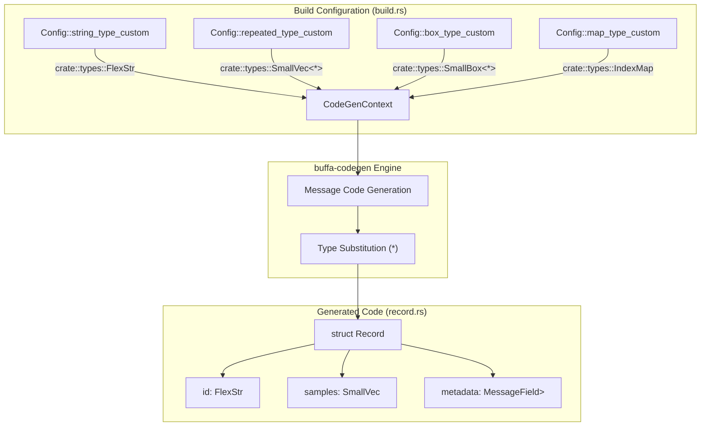
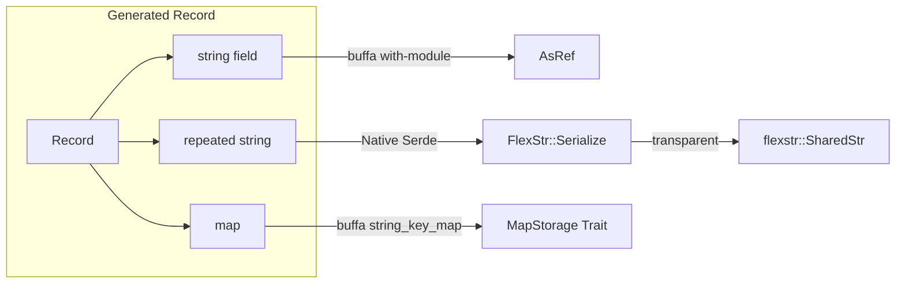

<!-- source: DeepWiki mcp.deepwiki.com · repo anthropics/buffa · page 9.3 Custom Types Example · fetched 2026-10-26 -->

# Custom Types Example

<details>
<summary>Relevant source files</summary>

The following files were used as context for generating this wiki page:

- [examples/custom-types/Cargo.lock](examples/custom-types/Cargo.lock)
- [examples/custom-types/Cargo.toml](examples/custom-types/Cargo.toml)
- [examples/custom-types/README.md](examples/custom-types/README.md)
- [examples/custom-types/build.rs](examples/custom-types/build.rs)
- [examples/custom-types/proto/record.proto](examples/custom-types/proto/record.proto)
- [examples/custom-types/src/main.rs](examples/custom-types/src/main.rs)
- [examples/custom-types/src/types/flex_str.rs](examples/custom-types/src/types/flex_str.rs)
- [examples/custom-types/src/types/index_map.rs](examples/custom-types/src/types/index_map.rs)
- [examples/custom-types/src/types/small_box.rs](examples/custom-types/src/types/small_box.rs)
- [examples/custom-types/src/types/small_vec.rs](examples/custom-types/src/types/small_vec.rs)

</details>


The **custom-types** example provides an end-to-end demonstration of buffa's pluggable owned-type system [examples/custom-types/README.md:1-4](). It shows how to replace the default Rust representations (like `String`, `Vec<u8>`, and `Box<T>`) with specialized storage types such as `FlexStr`, `SmallVec`, and `IndexMap` [examples/custom-types/README.md:15-18]().

This example serves as a reference for integrators who need to optimize memory layout, minimize heap allocations, or enforce specific collection behaviors (e.g., insertion-order preservation in maps) within their generated Protobuf schemas [examples/custom-types/README.md:3-4]().

### Pluggable Type Architecture

The system uses a **newtype pattern** to bridge foreign storage crates with buffa's internal traits, bypassing the Rust orphan rule [examples/custom-types/README.md:39-42](). Each custom type must implement a specific trait from the `buffa` runtime to participate in binary and JSON serialization [examples/custom-types/src/types/flex_str.rs:38-47]().

#### Data Flow: From Configuration to Generated Code

The following diagram illustrates how configuration in `build.rs` flows through the codegen engine to produce messages using custom types.

**Codegen Configuration Flow**

Sources: [examples/custom-types/build.rs:10-25](), [examples/custom-types/proto/record.proto:18-50](), [examples/custom-types/src/main.rs:29-36]()

### Implementation Details

The example defines five newtypes in `src/types/` that wrap foreign types [examples/custom-types/README.md:15-17](). Each is marked `#[repr(transparent)]` and verified with a compile-time `assert_transparent!` macro to ensure zero-cost wrapping [examples/custom-types/src/types/flex_str.rs:9-11](), [examples/custom-types/README.md:58-59]().

| Custom Type | Foreign Backing | Buffa Trait | Purpose |
| :--- | :--- | :--- | :--- |
| `FlexStr` | `flexstr::SharedStr` | `ProtoString` | Inline short strings, `Arc` long strings [examples/custom-types/src/types/flex_str.rs:5-6](). |
| `SmallBytes` | `smallvec::SmallVec<[u8; 24]>` | `ProtoBytes` | Avoid heap for small byte payloads [examples/custom-types/build.rs:16-17](). |
| `SmallVec<T>` | `smallvec::SmallVec<[T; 4]>` | `ProtoList<T>` | Inline storage for small repeated collections [examples/custom-types/src/types/small_vec.rs:5-15](). |
| `SmallBox<T>` | `smallbox::SmallBox<T, S4>` | `ProtoBox<T>` | Inline message storage (up to 4 words) [examples/custom-types/src/types/small_box.rs:5-18](). |
| `IndexMap<K, V>` | `indexmap::IndexMap<K, V>` | `MapStorage` | Preserves insertion order for maps [examples/custom-types/src/types/index_map.rs:5-16](). |

#### Trait Implementation Example: ProtoString
The `ProtoString` trait requires `from_wire`, which handles the transition from the raw wire payload to the custom type [examples/custom-types/src/types/flex_str.rs:38-42]().

```rust
impl ProtoString for FlexStr {
    fn from_wire(payload: WirePayload<'_>) -> Result<Self, DecodeError> {
        core::str::from_utf8(payload.as_slice())
            .map(|s| Self(flexstr::SharedStr::from_ref(s)))
            .map_err(|_| DecodeError::InvalidUtf8)
    }
}
```
Sources: [examples/custom-types/src/types/flex_str.rs:38-47]()

### JSON Serde Requirements

When `generate_json(true)` is enabled, the custom types must satisfy specific `serde` requirements because buffa routes different fields through different serialization paths [examples/custom-types/README.md:62-63]().

**Type-to-Serde Mapping**

Sources: [examples/custom-types/README.md:64-71]()

*   **`FlexStr`**: Needs `Serialize`/`Deserialize` with `#[serde(transparent)]` because `repeated string` elements use the type's native serde [examples/custom-types/README.md:66]().
*   **`SmallBytes`**: Does **not** need serde impls; all bytes fields are routed through buffa's base64 with-module [examples/custom-types/README.md:67]().
*   **`SmallBox<T>`**: Needs `Serialize` only for `oneof` message variants [examples/custom-types/README.md:70]().
*   **`SmallVec<T>`**: Needs `Serialize`/`Deserialize` for repeated fields with simple elements [examples/custom-types/README.md:68]().

### Compile-Time Validation

To ensure the configuration knobs are correctly applied, the example includes an `assert_field_types` function [examples/custom-types/src/main.rs:29-36](). This function performs no runtime work but will fail to compile if the generated fields do not match the expected custom types [examples/custom-types/src/main.rs:24-27]().

```rust
fn assert_field_types(r: &Record) {
    let _: &FlexStr = &r.id;
    let _: &SmallBytes = &r.payload;
    let _: &SmallVec<i64> = &r.samples;
    let _: &SmallVec<FlexStr> = &r.tags;
    let _: &IndexMap<i64, FlexStr> = &r.attributes;
    let _: &buffa::MessageField<Metadata, SmallBox<Metadata>> = &r.metadata;
}
```
Sources: [examples/custom-types/src/main.rs:29-36](), [examples/custom-types/README.md:72-85]()

### Build Configuration (`build.rs`)

The knobs are configured in the `buffa_build::Config` [examples/custom-types/build.rs:10-29](). 

*   **`string_type_custom`**: Takes a full path to the type [examples/custom-types/build.rs:15]().
*   **`repeated_type_custom` / `box_type_custom`**: Use a `*` placeholder for the inner type [examples/custom-types/build.rs:19-21]().
*   **`map_type_custom`**: Takes a bare path applied as `Path<K, V>` [examples/custom-types/build.rs:25]().

Sources: [examples/custom-types/build.rs:4-7](), [examples/custom-types/README.md:20-33]()

---

