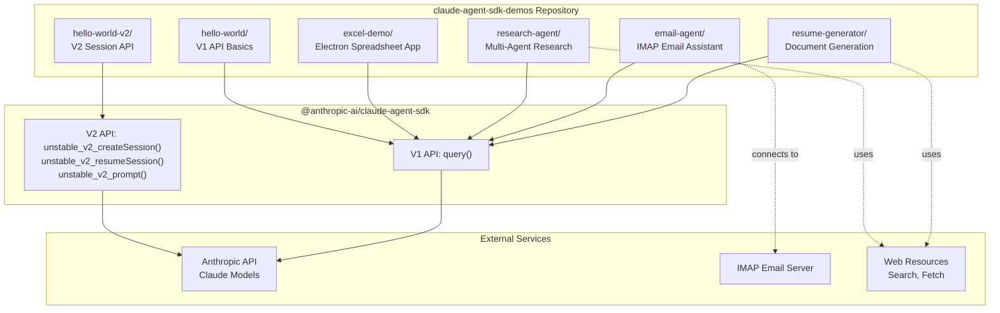
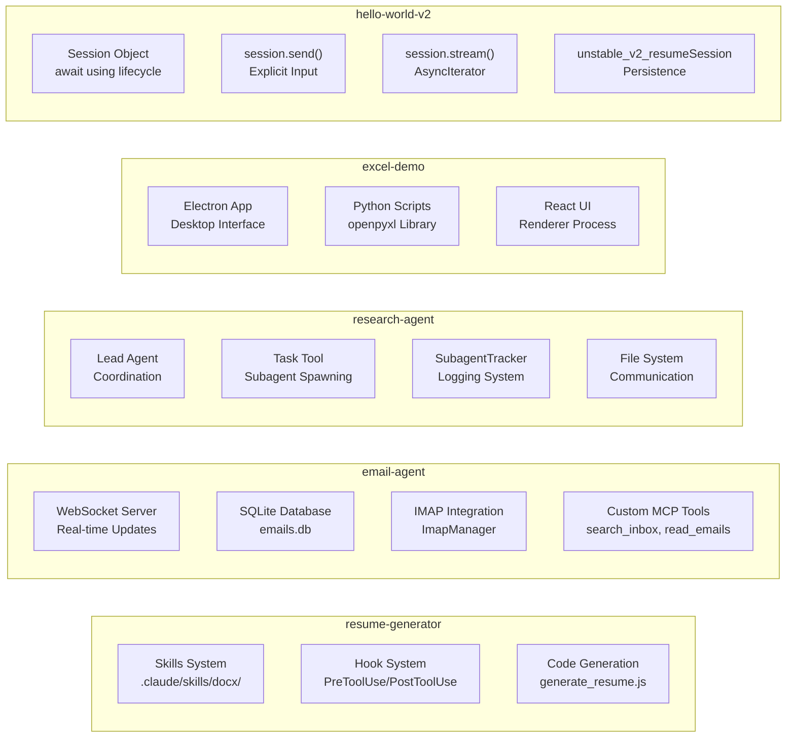
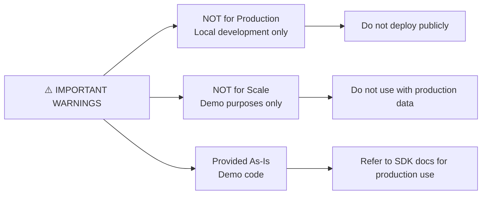

<!-- source: DeepWiki mcp.deepwiki.com · repo anthropics/claude-agent-sdk-demos · page 1 Overview · fetched 2026-10-26 -->

# Overview

<details>
<summary>Relevant source files</summary>

The following files were used as context for generating this wiki page:

- [README.md](README.md)
- [excel-demo/README.md](excel-demo/README.md)

</details>


This document provides a high-level introduction to the `claude-agent-sdk-demos` repository, which contains demonstration applications showcasing various capabilities of the Claude Agent SDK. This overview covers the repository structure, available demos, SDK integration patterns, and general setup guidance.

For detailed documentation on specific demos, see:
- Resume Generator: [Section 3](#3)
- Email Agent: [Section 4](#4)
- Research Agent: [Section 5](#5)
- Excel Demo: [Section 6](#6)
- Hello World examples: [Section 7](#7)

For comprehensive SDK integration documentation, see [Section 8](#8).

**Sources:** [README.md:1-69]()

## Purpose and Scope

The `claude-agent-sdk-demos` repository is a collection of demonstration applications built by Anthropic to showcase different capabilities and integration patterns of the [Claude Agent SDK](https://platform.claude.com/docs/en/agent-sdk/overview). These demos are intended for **local development only** and should not be deployed to production or used at scale.

The repository serves multiple purposes:
- Demonstrate practical implementations of the Claude Agent SDK
- Provide reference examples for common use cases (email automation, document generation, research coordination, spreadsheet manipulation)
- Showcase both V1 and V2 API patterns
- Illustrate advanced patterns like multi-agent coordination, skill systems, and WebSocket integration

**Sources:** [README.md:1-5]()

## Repository Structure

The repository contains six primary demonstration applications, each located in its own directory:

### Demo Applications Summary

| Demo | Directory | Primary Features | SDK API Version | Importance Score |
|------|-----------|------------------|-----------------|------------------|
| Resume Generator | `resume-generator/` | AI-powered document generation with docx skill | V1 | 16.08 |
| Email Agent | `email-agent/` | IMAP email assistant with WebSocket real-time updates | V1 | ~5.0 |
| Research Agent | `research-agent/` | Multi-agent coordination for research and reporting | V1 | N/A |
| Excel Demo | `excel-demo/` | Electron desktop app for spreadsheet manipulation | V1 | N/A |
| Hello World | `hello-world/` | Basic SDK introduction | V1 | N/A |
| Hello World V2 | `hello-world-v2/` | Session API demonstration | V2 | 8.97 |

**Sources:** [README.md:7-27]()

### Directory Structure

```
claude-agent-sdk-demos/
├── resume-generator/       # Document generation with skills
├── email-agent/           # IMAP assistant with WebSocket
├── research-agent/        # Multi-agent research pipeline
├── excel-demo/            # Electron spreadsheet application
├── hello-world/           # V1 API basics
├── hello-world-v2/        # V2 Session API
└── README.md              # Repository overview
```

**Sources:** [README.md:1-69](), [excel-demo/README.md:88-100]()

## Demo Applications Architecture

### High-Level Integration Pattern



**Diagram: Repository Structure and SDK Integration**

All demonstration applications integrate with the Claude Agent SDK as their foundation, which in turn communicates with the Anthropic API. The demos showcase different integration patterns, external service connections, and SDK features.

**Sources:** [README.md:1-69]()

### Demo-Specific Capabilities



**Diagram: Demo-Specific Features and Components**

Each demo showcases distinct SDK capabilities and integration patterns, from skill systems and hooks to session management and multi-agent coordination.

**Sources:** [README.md:7-27](), [excel-demo/README.md:1-122]()

## SDK API Patterns

The repository demonstrates two distinct API patterns provided by the Claude Agent SDK:

### V1 API Pattern (Production)

The V1 API is used by most demos and centers around the `query()` function:

**Key Components:**
- **Entry Point**: `query(prompt, options)` function
- **Return Type**: `AsyncGenerator<Message>` - combines input specification and output streaming
- **Configuration**: Single options object with `prompt`, `cwd`, `model`, `maxTurns`, `allowedTools`, `hooks`, `settingSources`
- **Hooks System**: `PreToolUse` and `PostToolUse` with matcher-based filtering
- **Usage Pattern**: Single-turn focused, manual history management for multi-turn conversations

**Demos Using V1:**
- `resume-generator/` - Uses hooks for validation and skills for document generation
- `email-agent/` - Integrates with WebSocket and custom MCP tools
- `research-agent/` - Leverages Task tool for multi-agent orchestration
- `hello-world/` - Basic introduction to query function
- `excel-demo/` - Python agent integration

**Sources:** [README.md:1-69]()

### V2 API Pattern (Session-Based)

The V2 API introduces explicit session management for multi-turn conversations:

**Key Components:**
- **Session Creation**: `unstable_v2_createSession(options)`
- **Session Resumption**: `unstable_v2_resumeSession(sessionId, options)`
- **One-Shot Helper**: `unstable_v2_prompt(prompt, options)`
- **Session Object**: Provides `send()` and `stream()` methods
- **Lifecycle Management**: `await using` pattern for automatic cleanup
- **Context Handling**: Automatic multi-turn context maintenance

**Demo Using V2:**
- `hello-world-v2/` - Demonstrates session creation, multi-turn conversations, and session persistence

**Sources:** [README.md:1-69]()

### API Comparison Table

| Feature | V1 API (`query`) | V2 API (Session) |
|---------|------------------|------------------|
| **Entry Point** | Single `query()` function | `unstable_v2_createSession()`, `unstable_v2_resumeSession()` |
| **Return Type** | `AsyncGenerator<Message>` | Session object with `send()`/`stream()` |
| **Multi-Turn** | Manual history management | Automatic context maintenance |
| **Session Persistence** | Not available | Via `sessionId` |
| **Input/Output** | Combined in generator | Separated: `send()` and `stream()` |
| **Cleanup** | Manual | `await using` pattern |
| **Primary Use Case** | Single-turn interactions | Multi-turn conversations |
| **Stability** | Stable | Unstable (experimental) |

**Sources:** [README.md:1-69]()

## Prerequisites and Dependencies

### Required Software

All demos require:

| Component | Version | Purpose | Installation |
|-----------|---------|---------|--------------|
| **Bun** or **Node.js** | Latest / 18+ | JavaScript runtime | [bun.sh](https://bun.sh) or [nodejs.org](https://nodejs.org) |
| **Anthropic API Key** | N/A | Claude model access | [console.anthropic.com](https://console.anthropic.com) |

**Sources:** [README.md:33-36]()

### Demo-Specific Dependencies

| Demo | Additional Requirements | Purpose |
|------|------------------------|---------|
| **email-agent** | IMAP email account | Email server access |
| **excel-demo** | Python 3.9+, LibreOffice (optional) | Spreadsheet generation, formula recalculation |
| **research-agent** | Python 3.9+ | Report generation with reportlab and matplotlib |

**Sources:** [README.md:33-36](), [excel-demo/README.md:23-28]()

## Getting Started

### Installation Steps

```bash
# 1. Clone repository
git clone https://github.com/anthropics/claude-agent-sdk-demos.git
cd claude-agent-sdk-demos

# 2. Choose a demo
cd email-agent  # or resume-generator, research-agent, excel-demo, hello-world, hello-world-v2

# 3. Follow demo-specific README
```

**Sources:** [README.md:38-51]()

### Configuration

Each demo requires an Anthropic API key, which can be provided via:
- Environment variable: `ANTHROPIC_API_KEY`
- Runtime prompt (some demos)

Demo-specific configuration is documented in each demo's README file.

**Sources:** [README.md:33-51]()

## Key Architectural Patterns

### Pattern 1: Skills System

Used in `resume-generator/` to provide domain-specific capabilities through markdown documentation.

**Key Files:**
- `.claude/skills/` - Skills directory
- `SKILL.md` - Decision tree and workflow guidance
- Supporting documentation files (e.g., `docx-js.md`)

**Configuration:** `settingSources: 'project'` in query options

For details, see [Section 8.5](#8.5).

**Sources:** [README.md:1-69]()

### Pattern 2: Multi-Agent Coordination

Used in `research-agent/` to coordinate specialized subagents through hierarchical delegation.

**Key Components:**
- Lead Agent with Task tool only
- Specialized subagents (Researcher, Data Analyst, Report Writer)
- File system communication via `files/` directory
- SubagentTracker for monitoring

For details, see [Section 5](#5).

**Sources:** [README.md:21-27]()

### Pattern 3: Real-Time Integration

Used in `email-agent/` to integrate Claude with external services via WebSocket.

**Key Components:**
- WebSocket server for real-time updates
- Custom MCP tools for domain operations
- Database layer for persistence
- React client for UI rendering

For details, see [Section 4](#4).

**Sources:** [README.md:9-13]()

### Pattern 4: Desktop Application Integration

Used in `excel-demo/` to integrate Claude within an Electron desktop application.

**Key Components:**
- Electron main process
- React renderer process
- Python agent scripts
- Claude Agent SDK integration

For details, see [Section 6](#6).

**Sources:** [excel-demo/README.md:1-122]()

## Important Warnings



**Diagram: Critical Usage Warnings**

These demonstrations are explicitly designed for local development and learning purposes. They should not be deployed to production environments or used at scale.

**Sources:** [README.md:3](), [excel-demo/README.md:3]()

## Resources and Support

### Documentation

| Resource | URL | Purpose |
|----------|-----|---------|
| **Claude Agent SDK Overview** | [platform.claude.com/docs](https://platform.claude.com/docs/en/agent-sdk/overview) | SDK documentation |
| **Claude Agent SDK Docs** | [docs.anthropic.com/claude-code/sdk](https://docs.anthropic.com/en/docs/claude-code/sdk/sdk-overview) | Detailed SDK reference |
| **API Reference** | [docs.anthropic.com/claude](https://docs.anthropic.com/claude) | Anthropic API documentation |

**Sources:** [README.md:53-57]()

### Support Channels

| Issue Type | Contact Method |
|------------|----------------|
| **Demo Issues** | [GitHub Issues](https://github.com/anthropics/claude-agent-sdk-demos/issues) |
| **SDK Questions** | [SDK Documentation](https://docs.anthropic.com/claude-code) |
| **API Questions** | [Anthropic Support](https://support.anthropic.com) |

**Sources:** [README.md:59-65]()

## License

This repository is provided under the MIT license as sample code for demonstration purposes.

**Sources:** [README.md:66-68]()

---

