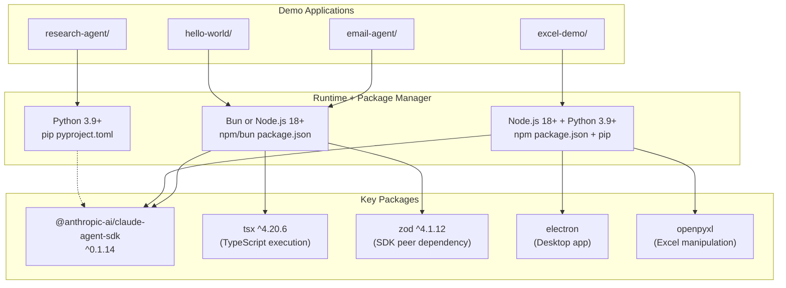
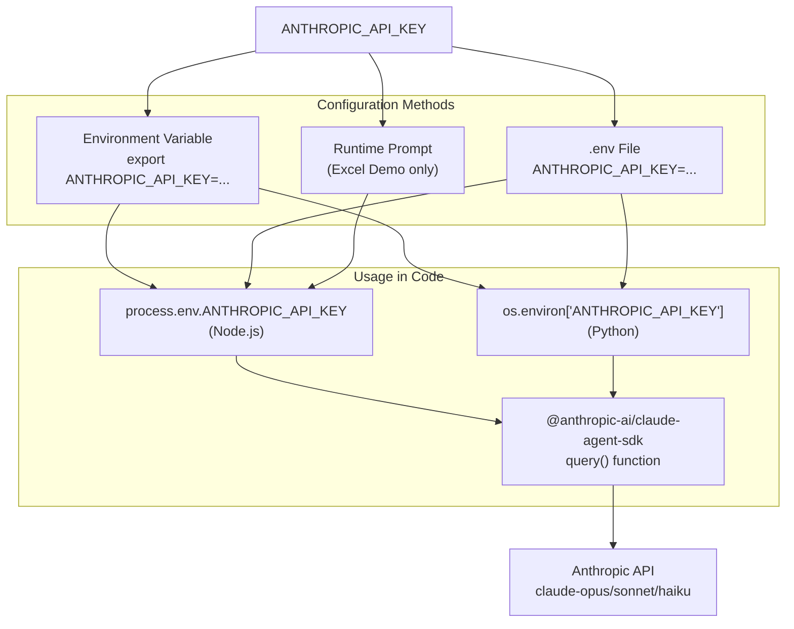
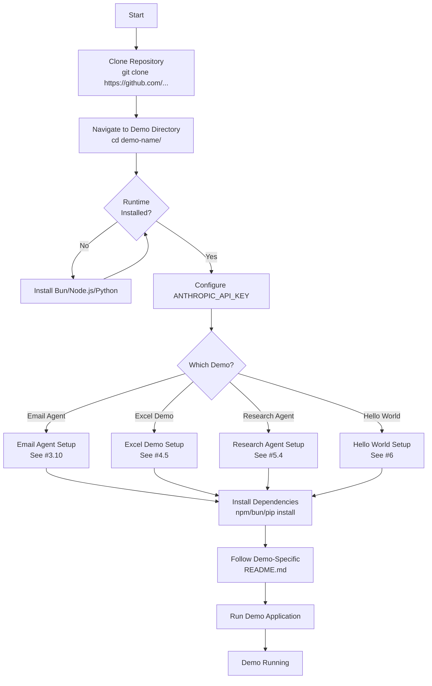

<!-- source: DeepWiki mcp.deepwiki.com · repo anthropics/claude-agent-sdk-demos · page 2 Getting Started · fetched 2026-10-26 -->

# Getting Started

<details>
<summary>Relevant source files</summary>

The following files were used as context for generating this wiki page:

- [README.md](README.md)
- [excel-demo/README.md](excel-demo/README.md)
- [hello-world-v2/README.md](hello-world-v2/README.md)
- [hello-world-v2/package.json](hello-world-v2/package.json)
- [hello-world-v2/tsconfig.json](hello-world-v2/tsconfig.json)
- [hello-world-v2/v2-examples.ts](hello-world-v2/v2-examples.ts)

</details>


This page covers the common prerequisites and initial setup steps required for all demos in the claude-agent-sdk-demos repository. These steps apply to the Email Agent, Excel Demo, Research Agent, and Hello World examples. For demo-specific configuration and usage instructions, see the individual demo pages: [Email Agent Demo](#3), [Excel Demo](#4), [Research Agent Demo](#5), or [Hello World Demo](#6).

**Sources**: [README.md:1-69]()

## Prerequisites

Before running any demo, ensure you have the following installed and configured:

| Requirement | Version | Purpose | Used By |
|------------|---------|---------|---------|
| **Bun** or **Node.js** | Bun (latest) or Node.js 18+ | JavaScript/TypeScript runtime for executing demos and `@anthropic-ai/claude-agent-sdk` | Email Agent, Excel Demo, Hello World |
| **Python** | 3.9+ | Python runtime for agent scripts and `pyproject.toml` dependencies | Excel Demo (`agent/` scripts), Research Agent |
| **Anthropic API Key** | N/A | `ANTHROPIC_API_KEY` environment variable for Claude API authentication | All demos |
| **LibreOffice** | Latest | Excel formula recalculation via `recalc.py` script (optional) | Excel Demo |
| **Git** | Any recent version | Repository cloning | All demos |

### Core SDK Dependency

All demos depend on the Claude Agent SDK package:

| Package | Version | Location | Purpose |
|---------|---------|----------|---------|
| `@anthropic-ai/claude-agent-sdk` | ^0.1.14 | npm registry | Core SDK for spawning Claude Code processes and agent communication |
| `zod` | ^3.24.1 or ^4.1.12 | npm registry | Peer dependency for SDK schema validation |

**Sources**: [README.md:33-36](), [excel-demo/README.md:23-28](), [hello-world/package.json:1-11]()

### Runtime Environment Selection

Each demo requires specific runtime environments and package managers:



**Diagram: Runtime Environment and Package Dependencies**

**Sources**: [README.md:35](), [excel-demo/README.md:25](), [hello-world/package.json:1-11]()

## Repository Structure

After cloning, the repository contains four self-contained demo applications with distinct entry points and configuration files:

```mermaid
graph TB
    Root["claude-agent-sdk-demos/"]
    
    Root --> README["README.md<br/>(Main documentation)"]
    Root --> Gitignore[".gitignore"]
    Root --> EmailAgent["email-agent/"]
    Root --> ExcelDemo["excel-demo/"]
    Root --> ResearchAgent["research-agent/"]
    Root --> HelloWorld["hello-world/"]
    
    EmailAgent --> EAReadme["README.md"]
    EmailAgent --> EAPackage["package.json<br/>(Bun/npm deps)"]
    EmailAgent --> EAServer["server/<br/>(Bun server)"]
    EmailAgent --> EAClient["client/<br/>(React UI)"]
    EmailAgent --> EADatabase["database/<br/>(SQLite + IMAP)"]
    EmailAgent --> EACCSDK["ccsdk/<br/>(MCP custom tools)"]
    
    ExcelDemo --> EDReadme["README.md"]
    ExcelDemo --> EDPackage["package.json<br/>(Electron deps)"]
    ExcelDemo --> EDAgent["agent/<br/>(Python scripts)"]
    ExcelDemo --> EDReqs["agent/requirements.txt"]
    ExcelDemo --> EDSrc["src/main/<br/>src/renderer/<br/>(Electron)"]
    
    ResearchAgent --> RAReadme["README.md"]
    ResearchAgent --> RAPyproject["pyproject.toml<br/>(Python deps)"]
    ResearchAgent --> RASrc["research_agent/<br/>(Lead agent, prompts)"]
    ResearchAgent --> RAUtils["research_agent/utils/<br/>(SubagentTracker)"]
    
    HelloWorld --> HWReadme["README.md"]
    HelloWorld --> HWPackage["package.json<br/>(SDK + tsx)"]
    HelloWorld --> HWScript["hello-world.ts<br/>(Entry point)"]
    HelloWorld --> HWTsconfig["tsconfig.json"]
    HelloWorld --> HWAgent["agent/<br/>(Working directory)"]
```



**Diagram: Repository File Structure and Key Artifacts**

**Sources**: [README.md:1-69](), [excel-demo/README.md:88-100](), [hello-world/package.json:1-11]()

## Initial Setup Steps

### 1. Clone the Repository

```bash
git clone https://github.com/anthropics/claude-code-sdk-demos.git
cd claude-code-sdk-demos
```

This creates a local copy of all demo applications. Each demo is fully self-contained within its subdirectory.

**Sources**: [README.md:40-44]()

### 2. Obtain an Anthropic API Key

All demos require an Anthropic API key to communicate with Claude models. To obtain one:

1. Navigate to the [Anthropic Console](https://console.anthropic.com)
2. Sign in or create an account
3. Go to API Keys section
4. Generate a new API key
5. Copy the key for use in configuration

**Sources**: [README.md:36](), [excel-demo/README.md:26]()

### 3. Navigate to Your Chosen Demo

```bash
# For Email Agent
cd email-agent

# For Excel Demo
cd excel-demo

# For Research Agent
cd research-agent

# For Hello World
cd hello-world
```

Each demo directory contains its own `README.md` with specific setup instructions.

**Sources**: [README.md:46-49]()

## API Key Configuration

The `ANTHROPIC_API_KEY` environment variable is required for SDK initialization and API communication with Claude models. Configuration methods vary by demo:



**Diagram: ANTHROPIC_API_KEY Configuration and Usage Flow**

### Environment Variable Method (Recommended)

Set the `ANTHROPIC_API_KEY` environment variable in your shell session:

```bash
# Linux/macOS (bash/zsh)
export ANTHROPIC_API_KEY=your_api_key_here

# Windows (PowerShell)
$env:ANTHROPIC_API_KEY="your_api_key_here"

# Windows (Command Prompt)
set ANTHROPIC_API_KEY=your_api_key_here
```

To persist across sessions, add to your shell profile:
- Linux/macOS: `~/.bashrc`, `~/.zshrc`, or `~/.profile`
- Windows: System Environment Variables via Settings

### .env File Method

Create a `.env` file in the demo's root directory. This is automatically loaded by some demos:

```bash
# In email-agent/.env, research-agent/.env, or excel-demo/.env
ANTHROPIC_API_KEY=your_api_key_here
```

**File location**: Place in the same directory as `package.json` or `pyproject.toml`

### Application-Specific Configuration

The Excel Demo (`excel-demo/src/main/`) prompts for the API key via dialog on first run if `process.env.ANTHROPIC_API_KEY` is undefined.

**Sources**: [README.md:36](), [excel-demo/README.md:44-46]()

## Setup Flow Overview

The complete setup process follows this workflow:



**Diagram: Complete Setup Workflow**

**Sources**: [README.md:38-51]()

## Dependency Installation

Each demo uses specific package managers and dependency files:

| Demo | Package Manager | Installation Command | Configuration File | Key Dependencies |
|------|----------------|---------------------|-------------------|------------------|
| Email Agent | Bun or npm | `bun install` or `npm install` | `package.json` | `@anthropic-ai/claude-agent-sdk`, `tsx` |
| Excel Demo (Desktop) | npm or Bun | `npm install` or `bun install` | `package.json` | `electron`, `@anthropic-ai/claude-agent-sdk` |
| Excel Demo (Python) | pip | `pip install -r requirements.txt` | `agent/requirements.txt` | `openpyxl`, `pandas` |
| Research Agent | pip | `pip install -e .` | `pyproject.toml` | Claude Agent SDK (Python bindings) |
| Hello World | npm or Bun | `npm install` or `bun install` | `package.json` | `@anthropic-ai/claude-agent-sdk`, `tsx`, `zod` |

### Installing Email Agent Dependencies

```bash
cd email-agent
bun install
# or
npm install
```

This installs:
- `@anthropic-ai/claude-agent-sdk` (^0.1.14) - Core SDK for agent creation
- `tsx` - TypeScript execution for server files
- Additional dependencies listed in [email-agent/package.json]()

### Installing Excel Demo Dependencies

The Excel Demo has a dual dependency structure for both Electron app and Python agents:

```bash
cd excel-demo

# Install Node.js/Electron dependencies (for desktop app)
npm install
# or
bun install

# Install Python dependencies (for agent/ scripts)
cd agent
python -m venv .venv
source .venv/bin/activate  # On Windows: .venv\Scripts\activate
pip install -r requirements.txt
```

Python dependencies include:
- `openpyxl` - Excel file manipulation (`.xlsx` read/write)
- `pandas` - Data analysis and DataFrame operations
- Additional packages in [excel-demo/agent/requirements.txt]()

### Installing Research Agent Dependencies

```bash
cd research-agent
pip install -e .
```

This installs dependencies from `pyproject.toml` including the Claude Agent SDK Python bindings and research-specific packages.

### Installing Hello World Dependencies

```bash
cd hello-world
npm install
# or
bun install
```

Key packages:
- `@anthropic-ai/claude-agent-sdk` (^0.1.14) - SDK for `query()` function
- `zod` (^4.1.12) - Required peer dependency for SDK
- `tsx` (^4.20.6) - TypeScript execution via `npx tsx hello-world.ts`
- `typescript` (^5.9.3) - TypeScript compiler

**Sources**: [excel-demo/README.md:38-65](), [hello-world/package.json:1-11](), [hello-world/package-lock.json:17-35]()

## Verifying Installation

After completing the setup steps, verify your installation:

### Check Runtime Versions

```bash
# Check Bun version (if using Bun)
bun --version

# Check Node.js version (required: 18+)
node --version

# Check npm version
npm --version

# Check Python version (required: 3.9+)
python --version
# or
python3 --version
```

Expected output:
- Node.js: `v18.0.0` or higher
- Python: `3.9.0` or higher

### Verify API Key Configuration

```bash
# Linux/macOS
echo $ANTHROPIC_API_KEY

# Windows (PowerShell)
echo $env:ANTHROPIC_API_KEY
```

Expected output: Your API key string starting with `sk-ant-`

### Verify SDK Installation

Check if the Claude Agent SDK is installed:

```bash
# For Node.js demos
npm list @anthropic-ai/claude-agent-sdk

# For Python demos
pip show anthropic  # or relevant package name
```

### Test Basic SDK Functionality

The Hello World demo provides the simplest verification test. After installing dependencies:

```bash
cd hello-world
npx tsx hello-world.ts
```

Expected behavior:
1. SDK spawns Claude Code process via `query()` function
2. Agent responds with introduction message
3. Process exits cleanly

If you encounter errors, see the Common Issues section below.

**Sources**: [README.md:33-51](), [hello-world/README.md:116-145]()

## Common Issues and Solutions

| Issue | Cause | Solution |
|-------|-------|----------|
| `ANTHROPIC_API_KEY not found` | Environment variable not set | Set via `export ANTHROPIC_API_KEY=...` or create `.env` file in demo root |
| `Failed to spawn Claude Code process: spawn node ENOENT` | `executable` option in `query()` cannot find Node.js | Set `executable: "node"` in query options or use full path: `executable: process.execPath` |
| `command not found: bun` | Bun not installed | Install from [bun.sh](https://bun.sh) or use Node.js/npm as alternative |
| `Node.js version too old` | Node.js < 18.0.0 | Install Node.js 18+ from [nodejs.org](https://nodejs.org) (SDK requires `>=18.0.0`) |
| `python: command not found` | Python not installed or not in PATH | Install Python 3.9+ from [python.org](https://python.org), verify with `python --version` |
| `Cannot find module '@anthropic-ai/claude-agent-sdk'` | SDK not installed | Run `npm install` or `bun install` in demo directory |
| `Error: Cannot find peer dependency 'zod'` | Missing peer dependency | Install zod: `npm install zod@^4.1.12` or `bun add zod@^4.1.12` |
| `ENOENT: no such file or directory` during SDK spawn | `cwd` directory doesn't exist | Create working directory: `mkdir -p agent` (see [hello-world/hello-world.ts:10]()) |
| Permission errors for file operations | Hook blocking file writes | Check `PreToolUse` hooks in query options, ensure target directory is allowed |
| Dependencies fail to install | Wrong directory or package manager | Verify you're in correct demo directory, check `package.json` or `pyproject.toml` exists |

### Debug Mode

To see detailed SDK communication, enable debug logging:

```bash
# Set debug environment variable before running
export DEBUG=claude-agent-sdk:*
npm run start  # or relevant command
```

**Sources**: [README.md:33-51](), [hello-world/README.md:121-144](), [hello-world/hello-world.ts:1-70]()

## Demo-Specific Setup

Once you've completed the common setup steps above, proceed to demo-specific configuration:

### Quick Start by Demo

| Demo | Next Steps | Entry Point | Documentation |
|------|-----------|-------------|---------------|
| **Email Agent** | Configure IMAP credentials, initialize SQLite database, start Bun server | [email-agent/server/server.ts]() | See page [#3.8]() |
| **Excel Demo** | Launch Electron app or run Python scripts | [excel-demo/src/main/]() or [excel-demo/agent/create_*.py]() | See page [#4.5]() |
| **Research Agent** | Configure web search API, run lead agent | [research-agent/research_agent/]() | See page [#5.4]() |
| **Hello World** | Run TypeScript example | [hello-world/hello-world.ts]() | See page [#6]() |

### Architecture Pages

For detailed understanding of each demo's architecture before setup:

- **[Email Agent Architecture](#3.1)**: Three-tier architecture with React client, Bun server, SQLite + IMAP data layer
- **[Excel Demo Architecture](#4.1)**: Hybrid Electron/Python architecture with desktop app and CLI scripts
- **[Research Agent Architecture](#5.1)**: Hierarchical multi-agent system with Lead Agent orchestration
- **[Hello World](#6)**: Basic SDK usage with `query()` function and PreToolUse hooks

### What to Read Next

**For SDK fundamentals**: Start with [Hello World Demo](#6) to understand the `query()` function, options, hooks, and message types

**For full-stack application**: Proceed to [Email Agent Demo](#3) to see client-server architecture with custom MCP tools

**For multi-agent systems**: See [Research Agent Demo](#5) to learn about Task tool and subagent coordination

**For desktop integration**: Explore [Excel Demo](#4) for Electron + Python hybrid architecture

**Sources**: [README.md:46-51]()

## Resources and Documentation

| Resource | URL | Description |
|----------|-----|-------------|
| Claude Agent SDK Documentation | [docs.anthropic.com](https://docs.anthropic.com/en/docs/claude-code/sdk/sdk-overview) | Official SDK documentation and API reference |
| Anthropic API Reference | [docs.anthropic.com/claude](https://docs.anthropic.com/claude) | Complete API documentation |
| GitHub Repository | [github.com/anthropics/claude-agent-sdk-demos](https://github.com/anthropics/claude-agent-sdk-demos) | Source code and issue tracker |
| Anthropic Console | [console.anthropic.com](https://console.anthropic.com) | API key management and usage monitoring |
| Anthropic Support | [support.anthropic.com](https://support.anthropic.com) | Technical support for API questions |

**Sources**: [README.md:53-65]()

---

