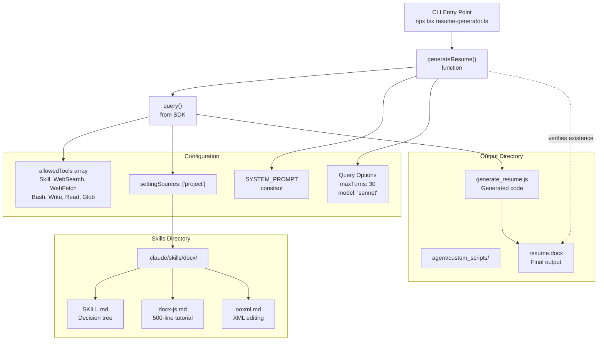

<!-- source: DeepWiki mcp.deepwiki.com · repo anthropics/claude-agent-sdk-demos · page 3 Resume Generator Demo · fetched 2026-10-26 -->

# Resume Generator Demo

<details>
<summary>Relevant source files</summary>

The following files were used as context for generating this wiki page:

- [resume-generator/.claude/skills/docx/SKILL.md](resume-generator/.claude/skills/docx/SKILL.md)
- [resume-generator/.claude/skills/docx/docx-js.md](resume-generator/.claude/skills/docx/docx-js.md)
- [resume-generator/.gitignore](resume-generator/.gitignore)
- [resume-generator/README.md](resume-generator/README.md)
- [resume-generator/package.json](resume-generator/package.json)
- [resume-generator/resume-generator.ts](resume-generator/resume-generator.ts)

</details>


## Purpose and Scope

This document provides an overview of the Resume Generator demonstration application, which showcases AI-powered resume creation using the Claude Agent SDK with web search capabilities and the docx skill system. This page covers the system's purpose, high-level architecture, and key components. For detailed information on specific aspects, see:

- [Architecture Overview](#3.1) for the four-phase workflow and agent orchestration
- [Document Generation Workflow](#3.2) for the step-by-step generation process
- [docx Skill System](#3.3) for comprehensive skill documentation
- [Configuration and Setup](#3.4) for setup instructions

For information about the Claude Agent SDK integration patterns used in this demo, see [Claude Agent SDK Integration](#8).

**Sources:** [resume-generator/README.md:1-28](), [resume-generator/resume-generator.ts:1-98]()

## Overview

The Resume Generator demonstrates the most sophisticated use of the Claude Agent SDK in the repository (importance score: 16.08). It orchestrates a multi-phase AI workflow that researches an individual using web search, synthesizes professional information, generates JavaScript code using the docx library, and executes the code to produce a professionally formatted .docx resume.

The demo showcases:
- **Web research automation** using `WebSearch` and `WebFetch` tools to gather professional background information
- **Skills system integration** with the comprehensive docx skill that teaches the agent document generation
- **Code generation and execution** where the agent writes and runs JavaScript to create Word documents
- **Strict formatting constraints** enforced through system prompts to ensure single-page output

**Sources:** [resume-generator/resume-generator.ts:1-98](), [resume-generator/README.md:1-28]()

## System Architecture

The following diagram shows the main components of the Resume Generator system and their relationships:

### Component Architecture Diagram



**Sources:** [resume-generator/resume-generator.ts:29-87](), [resume-generator/.claude/skills/docx/SKILL.md:1-198]()

## Core Components

### Entry Point and Main Function

The application entry point is [resume-generator/resume-generator.ts:89-97]() which validates command-line arguments and invokes the `generateResume()` function. The `generateResume()` function [resume-generator/resume-generator.ts:29-87]() orchestrates the entire workflow:

1. Creates the output directory at `agent/custom_scripts/` [resume-generator/resume-generator.ts:34-37]()
2. Constructs a research prompt with the person's name [resume-generator/resume-generator.ts:39]()
3. Invokes the SDK's `query()` function with configuration [resume-generator/resume-generator.ts:43-53]()
4. Streams and logs agent activity [resume-generator/resume-generator.ts:55-76]()
5. Verifies the final `.docx` file was created [resume-generator/resume-generator.ts:78-86]()

**Sources:** [resume-generator/resume-generator.ts:29-97]()

### System Prompt and Constraints

The `SYSTEM_PROMPT` constant [resume-generator/resume-generator.ts:14-27]() defines the agent's role and enforces critical constraints:

| Constraint Category | Requirements |
|-------------------|--------------|
| **Workflow** | WebSearch → docx creation in agent/custom_scripts/ |
| **Output Files** | generate_resume.js (script), resume.docx (final document) |
| **Page Fit** | Exactly 1 page with 0.5 inch margins |
| **Typography** | Name 24pt, Headers 12pt, Body 10pt |
| **Content Limits** | 2-3 bullets per job, ~80-100 chars each, Max 3 roles, 2-line summary, 2-line skills |

These constraints ensure the generated resume fits on a single page and maintains professional formatting standards.

**Sources:** [resume-generator/resume-generator.ts:14-27]()

### SDK Configuration

The `query()` function is configured with the following options [resume-generator/resume-generator.ts:43-53]():

```typescript
query({
  prompt,
  options: {
    maxTurns: 30,
    cwd: process.cwd(),
    model: 'sonnet',
    allowedTools: ['Skill', 'WebSearch', 'WebFetch', 'Bash', 'Write', 'Read', 'Glob'],
    settingSources: ['project'],  // Load skills from .claude/skills/
    systemPrompt: SYSTEM_PROMPT,
  },
})
```

Key configuration elements:
- `maxTurns: 30` allows for extensive research and iteration
- `model: 'sonnet'` uses Claude 3.5 Sonnet for sophisticated reasoning
- `settingSources: ['project']` enables skill discovery from `.claude/skills/`
- `allowedTools` includes both research tools (`WebSearch`, `WebFetch`) and file manipulation tools

**Sources:** [resume-generator/resume-generator.ts:43-53]()

## Execution Flow

The following diagram illustrates the four-phase execution flow from CLI invocation to final output:

### Four-Phase Workflow Diagram

```mermaid
graph LR
    subgraph "Phase 1: Research"
        WS["WebSearch tool<br/>LinkedIn, GitHub, etc."]
        WF["WebFetch tool<br/>Company pages, profiles"]
        Info["Information<br/>gathering"]
    end
    
    subgraph "Phase 2: Skill Loading"
        ST["Skill tool invocation"]
        ReadSkill["Read SKILL.md<br/>decision tree"]
        ReadTutorial["Read docx-js.md<br/>ENTIRE FILE (500 lines)"]
        Learn["Agent learns<br/>docx library API"]
    end
    
    subgraph "Phase 3: Code Generation"
        Synthesize["Synthesize<br/>information"]
        GenCode["Generate JS code<br/>using docx library"]
        WriteFile["Write tool<br/>generate_resume.js"]
    end
    
    subgraph "Phase 4: Execution"
        BashTool["Bash tool<br/>node generate_resume.js"]
        CreateDoc["Document creation<br/>via docx Packer"]
        Output["resume.docx<br/>final output"]
    end
    
    WS --> Info
    WF --> Info
    Info --> ST
    
    ST --> ReadSkill
    ReadSkill --> ReadTutorial
    ReadTutorial --> Learn
    
    Learn --> Synthesize
    Synthesize --> GenCode
    GenCode --> WriteFile
    
    WriteFile --> BashTool
    BashTool --> CreateDoc
    CreateDoc --> Output
```



**Sources:** [resume-generator/resume-generator.ts:1-98](), [resume-generator/.claude/skills/docx/SKILL.md:54-63]()

## File Structure

The Resume Generator operates with the following file structure:

```
resume-generator/
├── resume-generator.ts          # Main entry point with generateResume()
├── package.json                 # Dependencies: @anthropic-ai/claude-agent-sdk, docx
├── .claude/
│   └── skills/
│       └── docx/               # Skill directory discovered via settingSources
│           ├── SKILL.md        # Workflow decision tree
│           ├── docx-js.md      # 500-line library tutorial
│           └── ooxml.md        # XML editing patterns
└── agent/
    └── custom_scripts/         # Output directory (created if needed)
        ├── generate_resume.js  # Generated JavaScript code
        └── resume.docx         # Final resume document
```

### File Responsibilities

| File | Purpose |
|------|---------|
| `resume-generator.ts` | CLI interface, orchestration, SDK invocation |
| `SKILL.md` | Workflow decision tree routing agent to appropriate documentation |
| `docx-js.md` | Comprehensive tutorial on docx library with critical formatting rules |
| `generate_resume.js` | Agent-generated code (not checked into repo) |
| `resume.docx` | Final output document (not checked into repo) |

**Sources:** [resume-generator/.gitignore:1-6](), [resume-generator/resume-generator.ts:34-37](), [resume-generator/.claude/skills/docx/SKILL.md:1-198]()

## Agent Activity Logging

The `generateResume()` function streams messages from the SDK and provides real-time feedback:

```typescript
for await (const msg of q) {
  if (msg.type === 'assistant' && msg.message) {
    // Log text blocks and tool usage
    for (const block of msg.message.content) {
      if (block.type === 'text') {
        console.log(block.text);
      }
      if (block.type === 'tool_use') {
        if (block.name === 'WebSearch' && block.input && typeof block.input === 'object' && 'query' in block.input) {
          console.log(`\n🔍 Searching: "${block.input.query}"`);
        } else {
          console.log(`\n🔧 Using tool: ${block.name}`);
        }
      }
    }
  }
  if (msg.type === 'result') {
    if (msg.subtype === 'tool_result') {
      const resultStr = JSON.stringify(msg.content).slice(0, 200);
      console.log(`   ↳ Result: ${resultStr}${resultStr.length >= 200 ? '...' : ''}`);
    }
  }
}
```

This provides visibility into:
- Web search queries being executed
- Tool invocations (Skill, Write, Bash, etc.)
- Tool results (truncated to 200 characters)
- Agent text responses

**Sources:** [resume-generator/resume-generator.ts:55-76]()

## Dependencies

The Resume Generator requires the following dependencies defined in [resume-generator/package.json:8-16]():

| Dependency | Version | Purpose |
|-----------|---------|---------|
| `@anthropic-ai/claude-agent-sdk` | ^0.1.59 | Core SDK for agent orchestration |
| `docx` | ^9.5.1 | JavaScript library for creating Word documents |
| `tsx` | ^4.20.6 | TypeScript execution (dev dependency) |
| `typescript` | ^5.9.3 | TypeScript compiler (dev dependency) |

The `docx` library is installed globally by the agent's environment and used in the generated JavaScript code.

**Sources:** [resume-generator/package.json:1-18]()

## Output Verification

After the agent completes its work, the system verifies the output file exists [resume-generator/resume-generator.ts:78-86]():

```typescript
const expectedPath = path.join(process.cwd(), 'agent', 'custom_scripts', 'resume.docx');
if (fs.existsSync(expectedPath)) {
  console.log('\n' + '='.repeat(50));
  console.log(`📄 Resume saved to: ${expectedPath}`);
  console.log('='.repeat(50) + '\n');
} else {
  console.log('\n❌ Resume file was not created. Check the output above for errors.');
}
```

This provides immediate feedback on whether the resume generation succeeded.

**Sources:** [resume-generator/resume-generator.ts:78-86]()

## Integration with Skills System

The Resume Generator's power comes from the skills system integration. By setting `settingSources: ['project']` [resume-generator/resume-generator.ts:50](), the SDK automatically discovers skills in `.claude/skills/`. The docx skill provides:

1. **Decision tree** ([SKILL.md:13-30]()) that routes the agent to appropriate workflows
2. **Comprehensive tutorial** ([docx-js.md:1-350]()) with 500 lines of documentation
3. **Critical formatting rules** that prevent document corruption
4. **Mandatory full-file reading** requirement enforced by skill documentation

For complete documentation of the docx skill system, see [docx Skill System](#3.3).

**Sources:** [resume-generator/resume-generator.ts:43-53](), [resume-generator/.claude/skills/docx/SKILL.md:1-198]()

## Usage

The Resume Generator is invoked via the command line:

```bash
npx tsx resume-generator.ts "Person Name"
```

Example:
```bash
npx tsx resume-generator.ts "Jane Doe"
```

The script validates that a person name is provided [resume-generator/resume-generator.ts:90-95]() and exits with an error message if missing.

**Sources:** [resume-generator/resume-generator.ts:89-97](), [resume-generator/README.md:11-16]()

---

