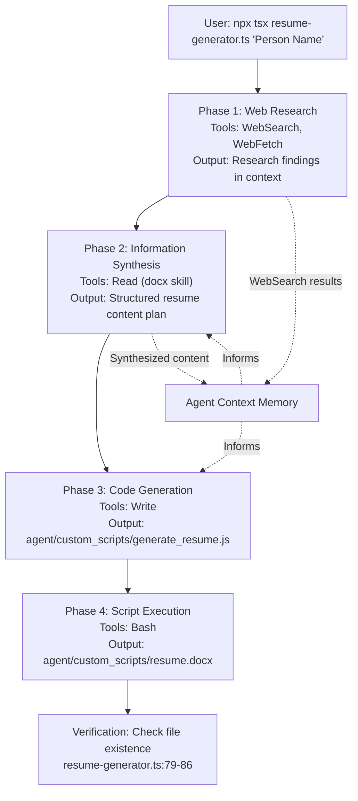
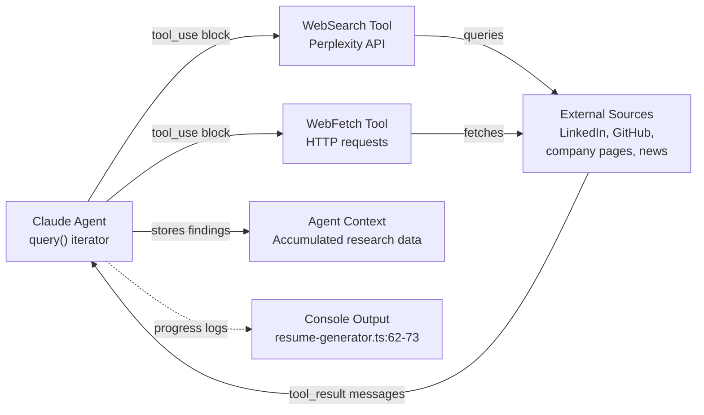
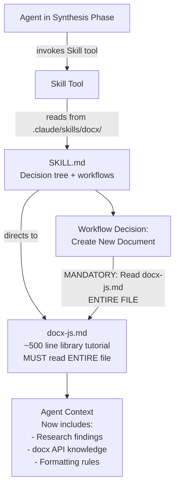
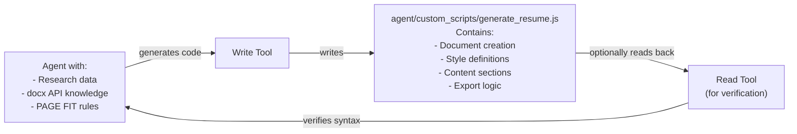
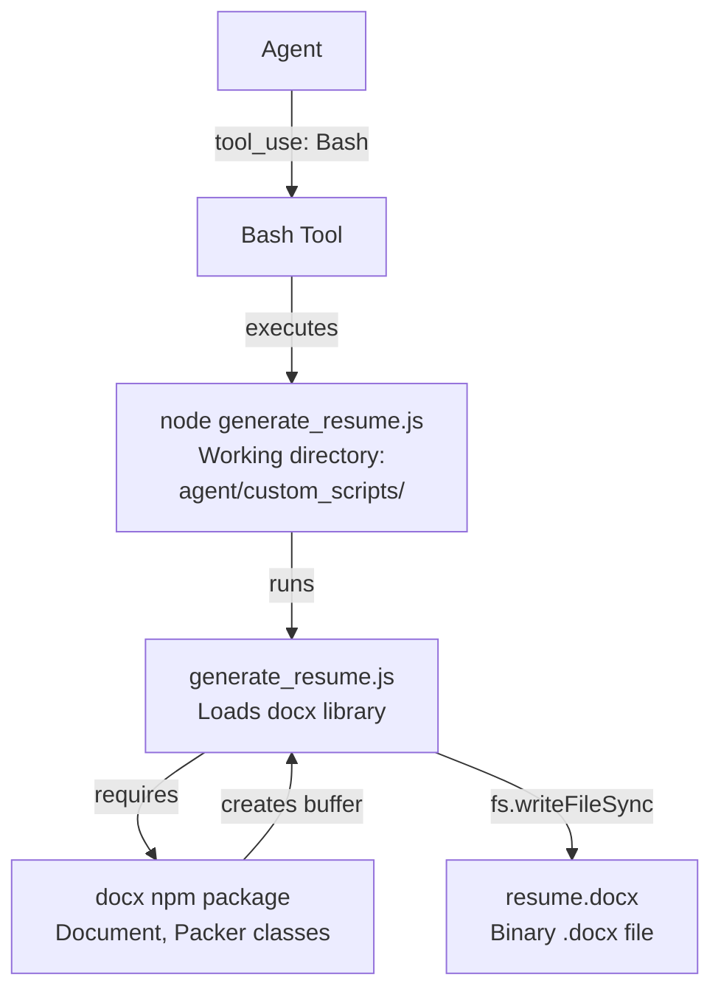
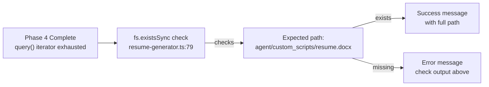
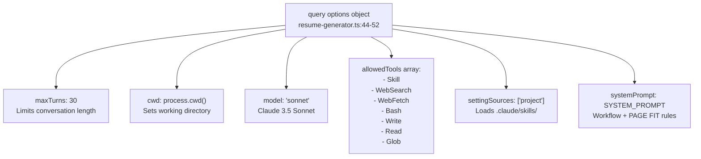
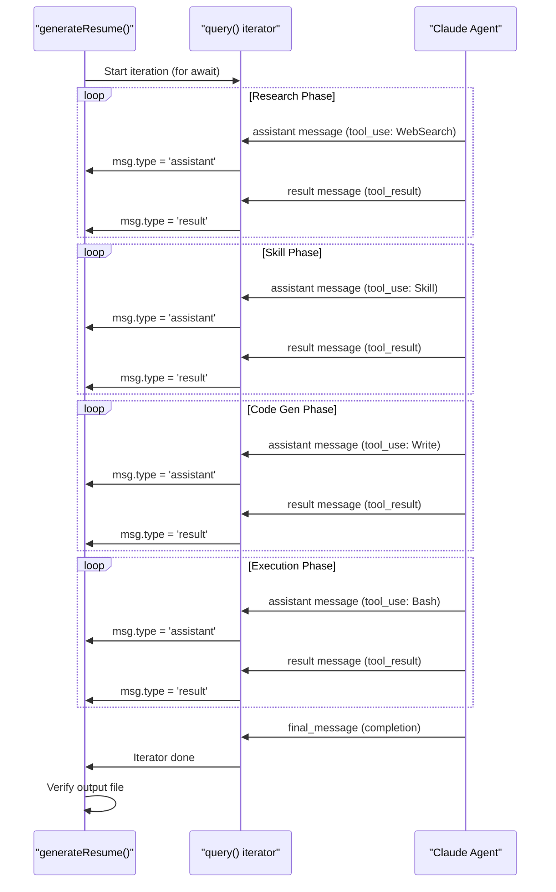

<!-- source: DeepWiki mcp.deepwiki.com · repo anthropics/claude-agent-sdk-demos · page 3.2 Document Generation Workflow · fetched 2026-10-26 -->

# Document Generation Workflow

<details>
<summary>Relevant source files</summary>

The following files were used as context for generating this wiki page:

- [resume-generator/.claude/skills/docx/SKILL.md](resume-generator/.claude/skills/docx/SKILL.md)
- [resume-generator/.claude/skills/docx/docx-js.md](resume-generator/.claude/skills/docx/docx-js.md)
- [resume-generator/.gitignore](resume-generator/.gitignore)
- [resume-generator/README.md](resume-generator/README.md)
- [resume-generator/package.json](resume-generator/package.json)
- [resume-generator/resume-generator.ts](resume-generator/resume-generator.ts)

</details>


## Purpose and Scope

This document details the step-by-step execution flow of the Resume Generator, from initial web research through final document creation. It covers the four-phase workflow orchestrated by the Claude agent, the tools used at each stage, and the generation and execution of JavaScript code that produces the final `.docx` file.

For architectural overview and agent configuration, see [Architecture Overview](#3.1). For detailed documentation of the docx skill system, see [docx Skill System](#3.3).

---

## Workflow Overview

The Resume Generator implements a sequential four-phase pipeline where each phase builds upon the results of the previous one. The workflow is orchestrated by a single Claude agent configured with specific tools and a structured system prompt that enforces constraints.

### Four-Phase Pipeline



**Sources:** [resume-generator/resume-generator.ts:14-27](), [resume-generator/resume-generator.ts:29-87]()

---

## Phase 1: Web Research

The agent begins by gathering professional information about the target person through web searches. This phase uses the `WebSearch` and `WebFetch` tools to query public sources.

### Research Strategy

The agent autonomously determines search queries based on the person's name and iteratively refines searches to gather:
- Current employment and role
- Professional experience history
- Educational background
- Technical skills and expertise
- Notable achievements and projects

### Tool Usage Pattern



The code that handles this logging is found in [resume-generator/resume-generator.ts:55-76](), which iterates over messages from the `query()` async generator and logs tool usage.

**Key Code References:**
- Tool configuration: [resume-generator/resume-generator.ts:49]()
- WebSearch detection: [resume-generator/resume-generator.ts:62-66]()
- Result logging: [resume-generator/resume-generator.ts:70-74]()

**Sources:** [resume-generator/resume-generator.ts:43-76](), [resume-generator/README.md:20-23]()

---

## Phase 2: Information Synthesis and Skill Discovery

After gathering raw research data, the agent synthesizes information and prepares to generate the document by accessing the docx skill documentation.

### Skill Tool Invocation

The agent uses the `Skill` tool to access the docx skill documentation stored in `.claude/skills/docx/`. The skill system is enabled via the `settingSources: ['project']` configuration.



**Critical Requirement:** The skill documentation at [resume-generator/.claude/skills/docx/SKILL.md:59]() explicitly states: "**MANDATORY - READ ENTIRE FILE**: Read [`docx-js.md`](docx-js.md) (~500 lines) completely from start to finish. **NEVER set any range limits when reading this file.**"

This ensures the agent understands:
- The docx JavaScript library API (Document, Paragraph, TextRun, Table classes)
- Critical formatting rules (never use `\n`, always use `LevelFormat.BULLET` for bullets)
- Professional styling patterns (Arial fonts, proper spacing, margins)
- Common pitfalls (PageBreak placement, table width configuration, image type parameter)

**Key Configuration:**
- Skill loading: [resume-generator/resume-generator.ts:50]()
- Allowed tools include Skill: [resume-generator/resume-generator.ts:49]()

**Sources:** [resume-generator/resume-generator.ts:49-51](), [resume-generator/.claude/skills/docx/SKILL.md:54-60](), [resume-generator/.claude/skills/docx/docx-js.md:1-6]()

---

## Phase 3: Code Generation

With complete knowledge of the docx API and researched content, the agent generates a JavaScript file that will create the resume document.

### Generated Script Structure

The agent writes a Node.js script to `agent/custom_scripts/generate_resume.js` that:

1. Imports the docx library classes
2. Creates a `Document` instance with proper styles configuration
3. Builds resume sections (header, summary, experience, education, skills)
4. Applies professional formatting according to PAGE FIT constraints
5. Exports the document to `resume.docx` using `Packer.toBuffer()`

### Output Directory Creation

The directory structure is ensured by [resume-generator/resume-generator.ts:34-37]():

```
agent/
└── custom_scripts/
    ├── generate_resume.js  (Phase 3 output)
    └── resume.docx         (Phase 4 output)
```

### PAGE FIT Constraints

The `SYSTEM_PROMPT` enforces strict formatting rules to ensure the resume fits on exactly one page:

| Constraint | Value | Source Line |
|------------|-------|-------------|
| Margins | 0.5 inch (720 DXA) | [resume-generator/resume-generator.ts:25]() |
| Name font size | 24pt (48 half-points) | [resume-generator/resume-generator.ts:25]() |
| Header font size | 12pt (24 half-points) | [resume-generator/resume-generator.ts:25]() |
| Body font size | 10pt (20 half-points) | [resume-generator/resume-generator.ts:25]() |
| Bullets per job | 2-3 | [resume-generator/resume-generator.ts:26]() |
| Bullet length | ~80-100 characters | [resume-generator/resume-generator.ts:26]() |
| Max job roles | 3 | [resume-generator/resume-generator.ts:27]() |
| Summary lines | 2 | [resume-generator/resume-generator.ts:27]() |
| Skills lines | 2 | [resume-generator/resume-generator.ts:27]() |

### Code Generation Tools



**Sources:** [resume-generator/resume-generator.ts:14-27](), [resume-generator/resume-generator.ts:49](), [resume-generator/.claude/skills/docx/docx-js.md:11-22]()

---

## Phase 4: Script Execution

The final phase executes the generated JavaScript file to produce the `.docx` binary file.

### Execution Flow



### Execution Command

The agent typically generates a command similar to:

```bash
cd agent/custom_scripts && node generate_resume.js
```

This ensures the script executes in the correct directory where the output file should be created.

### Working Directory

The `cwd` parameter passed to `query()` at [resume-generator/resume-generator.ts:47]() sets the working directory to `process.cwd()`, which is the repository root. The agent must navigate to the `agent/custom_scripts/` subdirectory to execute the script correctly.

**Sources:** [resume-generator/resume-generator.ts:43-54](), [resume-generator/package.json:8-11]()

---

## Verification and Output

After the four phases complete, the main function verifies the output file was created successfully.

### File Existence Check



The verification logic at [resume-generator/resume-generator.ts:78-86]() constructs the expected path and checks for file existence:

```typescript
const expectedPath = path.join(process.cwd(), 'agent', 'custom_scripts', 'resume.docx');
if (fs.existsSync(expectedPath)) {
  console.log(`📄 Resume saved to: ${expectedPath}`);
} else {
  console.log('❌ Resume file was not created. Check the output above for errors.');
}
```

### Output Locations

| File | Path | Description |
|------|------|-------------|
| Generated script | `agent/custom_scripts/generate_resume.js` | JavaScript code using docx library |
| Final resume | `agent/custom_scripts/resume.docx` | Word document binary file |

**Exclusions:** Both output files are excluded from version control via [resume-generator/.gitignore:3-4]().

**Sources:** [resume-generator/resume-generator.ts:78-86](), [resume-generator/.gitignore:3-4]()

---

## Agent Configuration and Turn Management

The workflow is constrained by the agent configuration passed to `query()`.

### Configuration Parameters



### Turn Budget

The `maxTurns: 30` parameter at [resume-generator/resume-generator.ts:46]() provides sufficient turns for:
- Multiple web searches (5-10 turns)
- Skill documentation reading (1-2 turns)
- Code generation and refinement (2-5 turns)
- Execution and verification (1-2 turns)
- Buffer for retries and error handling (remaining turns)

If the agent exhausts all 30 turns before completing the workflow, the `query()` iterator terminates and the final verification may detect a missing output file.

**Sources:** [resume-generator/resume-generator.ts:43-53]()

---

## Error Handling and Recovery

The workflow includes implicit error handling through the agent's ability to retry and adapt.

### Common Failure Points

| Phase | Potential Issue | Agent Recovery Strategy |
|-------|----------------|------------------------|
| Phase 1 | No search results | Refine query, try alternative sources |
| Phase 2 | Skill file not found | Verify settingSources configuration |
| Phase 3 | Syntax errors in generated code | Read code back, identify error, regenerate |
| Phase 4 | Execution failure | Read error output, fix code, re-execute |

### Execution Error Example

If the generated script has a syntax error or runtime exception:

1. Bash tool returns error output in `tool_result` message
2. Agent reads the error message
3. Agent uses Read tool to examine the generated code
4. Agent identifies the issue (e.g., missing parenthesis, undefined variable)
5. Agent regenerates the corrected code with Write tool
6. Agent retries execution with Bash tool

This retry loop continues until success or turn limit is reached.

**Sources:** [resume-generator/resume-generator.ts:55-76]()

---

## Message Flow and Event Sequence

The execution produces a sequence of messages through the `query()` async generator.

### Message Type Sequence



The iteration logic at [resume-generator/resume-generator.ts:55-76]() processes each message:
- `msg.type === 'assistant'`: Contains text and tool_use blocks
- `msg.type === 'result'`: Contains tool execution results

**Sources:** [resume-generator/resume-generator.ts:55-76]()

---

## Integration with docx Library

The generated JavaScript code uses the `docx` npm package, which is pre-installed as a dependency.

### Library Classes Used

The agent's generated code typically creates documents using these core classes from the docx library:

| Class | Purpose | Documentation Reference |
|-------|---------|------------------------|
| `Document` | Root document container | [docx-js.md:19]() |
| `Packer` | Exports to buffer/blob | [docx-js.md:20-21]() |
| `Paragraph` | Text paragraph | [docx-js.md:31-48]() |
| `TextRun` | Formatted text span | [docx-js.md:36-47]() |
| `Table` / `TableRow` / `TableCell` | Table structures | [docx-js.md:164-217]() |
| `AlignmentType` | Text alignment constants | [docx-js.md:32]() |
| `HeadingLevel` | Heading style constants | [docx-js.md:81]() |
| `LevelFormat` | List format constants | [docx-js.md:113-155]() |

### Example Document Structure

Based on the tutorial at [resume-generator/.claude/skills/docx/docx-js.md](), the generated code follows this pattern:

```javascript
const { Document, Packer, Paragraph, TextRun } = require('docx');

const doc = new Document({
  styles: { /* style definitions */ },
  numbering: { /* bullet list config */ },
  sections: [{
    properties: { page: { margin: { /* margins */ } } },
    children: [
      new Paragraph({ /* name header */ }),
      new Paragraph({ /* contact info */ }),
      new Paragraph({ /* summary */ }),
      new Paragraph({ /* experience section */ }),
      // ... more sections
    ]
  }]
});

Packer.toBuffer(doc).then(buffer => fs.writeFileSync("resume.docx", buffer));
```

**Dependency:** The docx package version `^9.5.1` is declared in [resume-generator/package.json:10]().

**Sources:** [resume-generator/package.json:8-11](), [resume-generator/.claude/skills/docx/docx-js.md:11-22](), [resume-generator/.claude/skills/docx/docx-js.md:54-89]()

---

