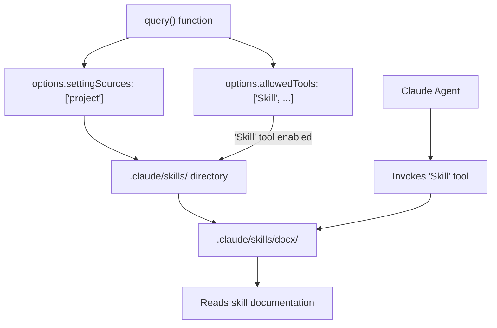
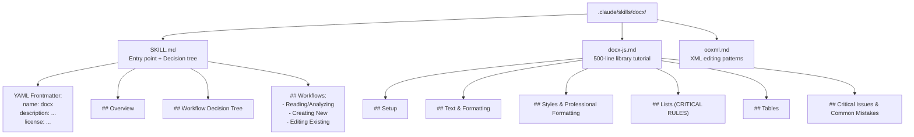
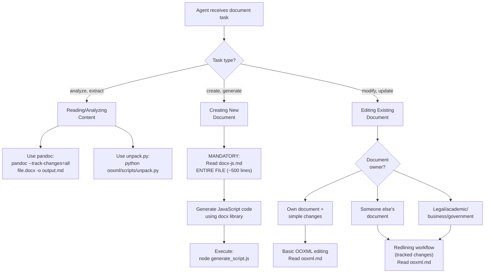
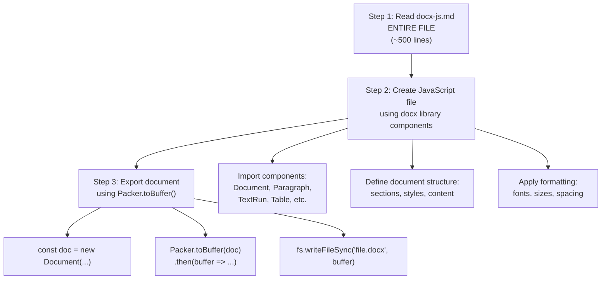
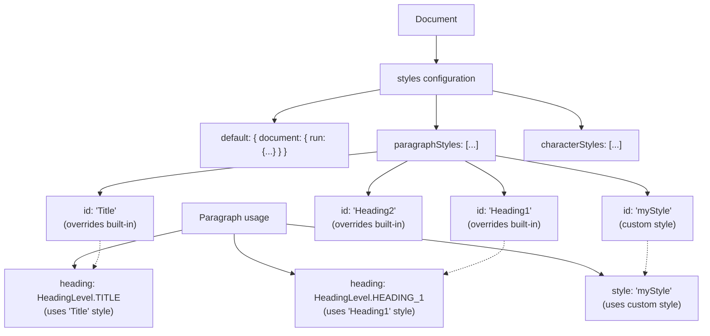
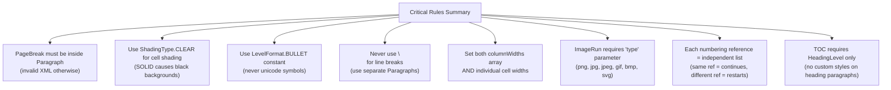
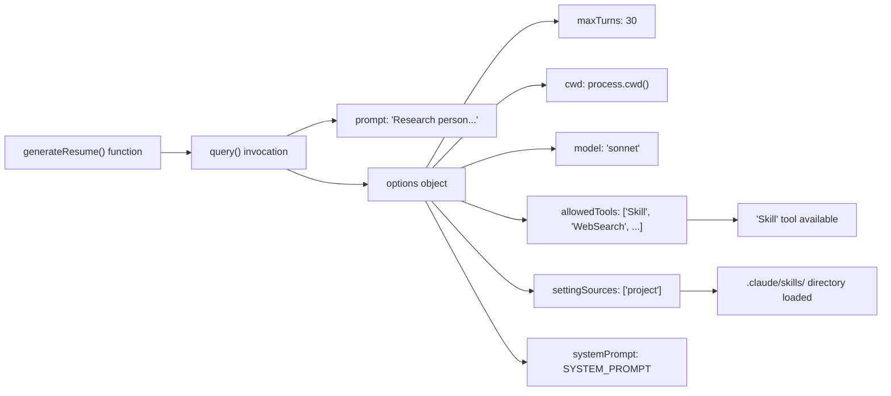
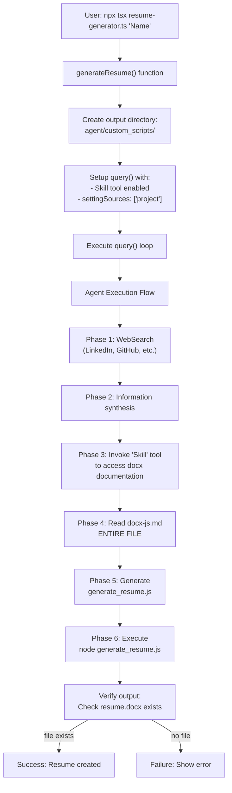

<!-- source: DeepWiki mcp.deepwiki.com · repo anthropics/claude-agent-sdk-demos · page 3.3 docx Skill System · fetched 2026-10-26 -->

# docx Skill System

<details>
<summary>Relevant source files</summary>

The following files were used as context for generating this wiki page:

- [resume-generator/.claude/skills/docx/SKILL.md](resume-generator/.claude/skills/docx/SKILL.md)
- [resume-generator/.claude/skills/docx/docx-js.md](resume-generator/.claude/skills/docx/docx-js.md)
- [resume-generator/.gitignore](resume-generator/.gitignore)
- [resume-generator/README.md](resume-generator/README.md)
- [resume-generator/package.json](resume-generator/package.json)
- [resume-generator/resume-generator.ts](resume-generator/resume-generator.ts)

</details>


## Purpose and Scope

This document covers the **docx skill system** used in the Resume Generator demo to enable the Claude agent to create professional Word documents (.docx files) using the JavaScript `docx` library. The skill system provides structured documentation that guides the agent through document creation workflows, ensuring proper formatting and avoiding common pitfalls.

For information about the overall Resume Generator architecture, see [Architecture Overview](#3.1). For details on the complete document generation workflow, see [Document Generation Workflow](#3.2). For general information about the Claude Agent SDK skills system, see [Skills System](#8.5).

**Sources:** [resume-generator/.claude/skills/docx/SKILL.md:1-10](), [resume-generator/resume-generator.ts:1-28]()

## Skill Discovery and Integration

The docx skill is loaded through the Claude Agent SDK's project settings mechanism. The skill is discovered when the `query()` function includes `settingSources: ['project']` in its options.



The Resume Generator configures skills at [resume-generator/resume-generator.ts:43-53]():

| Configuration Key | Value | Purpose |
|------------------|-------|---------|
| `allowedTools` | `['Skill', 'WebSearch', 'WebFetch', 'Bash', 'Write', 'Read', 'Glob']` | Enables the `Skill` tool for accessing skill documentation |
| `settingSources` | `['project']` | Loads skills from the `.claude/skills/` directory |
| `cwd` | `process.cwd()` | Establishes project root for skill resolution |

**Sources:** [resume-generator/resume-generator.ts:43-53](), [resume-generator/.claude/skills/docx/SKILL.md:1-10]()

## Skill Structure

The docx skill is organized as a directory containing multiple markdown documentation files. The skill follows a modular structure where each file serves a specific purpose.



### Skill Entry Point (SKILL.md)

The [resume-generator/.claude/skills/docx/SKILL.md:1-10]() file serves as the skill entry point and contains:

- **YAML frontmatter** with skill metadata (name, description, license)
- **Overview** describing when to use the skill
- **Workflow Decision Tree** routing the agent to appropriate documentation
- **Workflow sections** for reading, creating, and editing documents

**Sources:** [resume-generator/.claude/skills/docx/SKILL.md:1-155]()

### Library Tutorial (docx-js.md)

The [resume-generator/.claude/skills/docx/docx-js.md:1-5]() file is a comprehensive 500-line tutorial covering:

- JavaScript/TypeScript API for the `docx` library
- Complete formatting syntax and examples
- Critical rules to avoid document corruption
- Common mistakes and pitfalls

**Sources:** [resume-generator/.claude/skills/docx/docx-js.md:1-350]()

## Workflow Decision Tree

The skill provides a decision tree that routes the agent to the appropriate workflow based on the task requirements. This decision logic is defined at [resume-generator/.claude/skills/docx/SKILL.md:13-30]().



**Sources:** [resume-generator/.claude/skills/docx/SKILL.md:13-30]()

## Creating New Documents Workflow

When the agent needs to create a new Word document, it follows a mandatory three-step process defined at [resume-generator/.claude/skills/docx/SKILL.md:54-62]().

### Mandatory Full-File Reading Pattern

The skill enforces a critical constraint: the agent **must read the entire `docx-js.md` file** before proceeding with document creation. This pattern is explicitly stated at [resume-generator/.claude/skills/docx/SKILL.md:59]():

> "**MANDATORY - READ ENTIRE FILE**: Read [`docx-js.md`](docx-js.md) (~500 lines) completely from start to finish. **NEVER set any range limits when reading this file.**"

This ensures the agent has complete context about:
- All API syntax and formatting options
- Critical formatting rules that prevent corruption
- Common mistakes and how to avoid them
- Best practices for professional document generation

**Sources:** [resume-generator/.claude/skills/docx/SKILL.md:54-62]()

### Document Creation Steps



**Sources:** [resume-generator/.claude/skills/docx/SKILL.md:54-62](), [resume-generator/.claude/skills/docx/docx-js.md:11-22]()

## Core Library API

The `docx-js.md` file documents the complete JavaScript API for creating Word documents. Key components are imported from the `docx` package as shown at [resume-generator/.claude/skills/docx/docx-js.md:11-16]().

### Primary Components

| Component | Purpose | Usage Example |
|-----------|---------|---------------|
| `Document` | Root container for document structure | `new Document({ sections: [...] })` |
| `Paragraph` | Text paragraph with formatting | `new Paragraph({ children: [...] })` |
| `TextRun` | Formatted text span | `new TextRun({ text: "...", bold: true })` |
| `Table` | Table structure with rows/cells | `new Table({ rows: [...] })` |
| `TableRow` | Table row container | `new TableRow({ children: [...] })` |
| `TableCell` | Table cell with content | `new TableCell({ children: [...] })` |
| `Packer` | Export document to buffer/blob | `Packer.toBuffer(doc)` |

**Sources:** [resume-generator/.claude/skills/docx/docx-js.md:11-22]()

### Document Structure Example

The basic structure pattern is documented at [resume-generator/.claude/skills/docx/docx-js.md:18-21]():

```javascript
const doc = new Document({ 
  sections: [{ 
    children: [/* Paragraph, Table, etc. */] 
  }] 
});
Packer.toBuffer(doc).then(buffer => fs.writeFileSync("doc.docx", buffer));
```

**Sources:** [resume-generator/.claude/skills/docx/docx-js.md:18-21]()

## Critical Formatting Rules

The skill documentation contains numerous critical rules that prevent document corruption and rendering issues. These rules are emphasized throughout [resume-generator/.claude/skills/docx/docx-js.md:335-350]().

### Line Break Rule (CRITICAL)

**Rule:** Never use `\n` for line breaks. Always use separate `Paragraph` elements.

```javascript
// ❌ WRONG
new TextRun("Line 1\nLine 2")

// ✅ CORRECT
new Paragraph({ children: [new TextRun("Line 1")] })
new Paragraph({ children: [new TextRun("Line 2")] })
```

This rule is documented at [resume-generator/.claude/skills/docx/docx-js.md:26-28]().

**Sources:** [resume-generator/.claude/skills/docx/docx-js.md:26-28](), [resume-generator/.claude/skills/docx/docx-js.md:344]()

### Bullet Point Rule (CRITICAL)

**Rule:** Never use Unicode bullet characters. Always use proper numbering configuration with `LevelFormat.BULLET`.

The correct pattern is shown at [resume-generator/.claude/skills/docx/docx-js.md:109-156]():

```javascript
// CRITICAL: Use LevelFormat.BULLET constant, NOT string "bullet"
const doc = new Document({
  numbering: {
    config: [
      { 
        reference: "bullet-list",
        levels: [{ 
          level: 0, 
          format: LevelFormat.BULLET,  // ✅ Constant, not string
          text: "•",
          alignment: AlignmentType.LEFT,
          style: { paragraph: { indent: { left: 720, hanging: 360 } } }
        }]
      }
    ]
  },
  sections: [{
    children: [
      new Paragraph({ 
        numbering: { reference: "bullet-list", level: 0 },
        children: [new TextRun("Bullet point")]
      })
    ]
  }]
});
```

**Wrong approaches** documented at [resume-generator/.claude/skills/docx/docx-js.md:152-155]():
- `new TextRun("• Item")` - Creates fake bullet
- `new SymbolRun({ char: "2022" })` - Creates fake bullet

**Sources:** [resume-generator/.claude/skills/docx/docx-js.md:109-156](), [resume-generator/.claude/skills/docx/docx-js.md:342-346]()

### Table Width Rule (CRITICAL)

**Rule:** Set both `columnWidths` array at table level AND individual `width` on each cell.

The correct pattern is documented at [resume-generator/.claude/skills/docx/docx-js.md:159-217]():

```javascript
new Table({
  columnWidths: [4680, 4680],  // ✅ Set at table level
  rows: [
    new TableRow({
      children: [
        new TableCell({
          width: { size: 4680, type: WidthType.DXA },  // ✅ Also set on cell
          children: [/* ... */]
        })
      ]
    })
  ]
})
```

**Sources:** [resume-generator/.claude/skills/docx/docx-js.md:159-217](), [resume-generator/.claude/skills/docx/docx-js.md:220-228]()

### ImageRun Type Parameter Rule (CRITICAL)

**Rule:** The `type` parameter is **REQUIRED** for `ImageRun`.

This rule is documented at [resume-generator/.claude/skills/docx/docx-js.md:257-269]():

```javascript
new ImageRun({
  type: "png",  // ✅ REQUIRED - must specify: png, jpg, jpeg, gif, bmp, or svg
  data: fs.readFileSync("image.png"),
  transformation: { width: 200, height: 150 }
})
```

**Sources:** [resume-generator/.claude/skills/docx/docx-js.md:257-269](), [resume-generator/.claude/skills/docx/docx-js.md:345]()

### PageBreak Placement Rule (CRITICAL)

**Rule:** `PageBreak` must **ALWAYS** be inside a `Paragraph`. Standalone `PageBreak` creates invalid XML.

This rule is documented at [resume-generator/.claude/skills/docx/docx-js.md:272-286]():

```javascript
// ❌ WRONG - Creates invalid XML
new PageBreak()

// ✅ CORRECT - PageBreak inside Paragraph
new Paragraph({ children: [new PageBreak()] })
```

**Sources:** [resume-generator/.claude/skills/docx/docx-js.md:272-286](), [resume-generator/.claude/skills/docx/docx-js.md:336]()

### Table Cell Shading Rule (CRITICAL)

**Rule:** Always use `ShadingType.CLEAR` for table cell backgrounds. Never use `ShadingType.SOLID`.

This rule is documented at [resume-generator/.claude/skills/docx/docx-js.md:174-179]():

```javascript
new TableCell({
  shading: { 
    fill: "D5E8F0", 
    type: ShadingType.CLEAR  // ✅ Use CLEAR, not SOLID
  }
})
```

**Sources:** [resume-generator/.claude/skills/docx/docx-js.md:174-179](), [resume-generator/.claude/skills/docx/docx-js.md:337]()

## Professional Styling and Formatting

The skill provides comprehensive guidance on professional document styling at [resume-generator/.claude/skills/docx/docx-js.md:52-107]().

### Style System Architecture



### Key Styling Principles

The skill documents these principles at [resume-generator/.claude/skills/docx/docx-js.md:97-107]():

| Principle | Implementation | Purpose |
|-----------|----------------|---------|
| Override built-in styles | Use IDs like `"Heading1"`, `"Heading2"`, `"Title"` | Ensures `HeadingLevel` constants work correctly |
| Include `outlineLevel` | Set `outlineLevel: 0` for H1, `outlineLevel: 1` for H2 | Required for Table of Contents functionality |
| Set default font | `styles.default.document.run.font = "Arial"` | Ensures universal compatibility |
| Visual hierarchy | Title > Headers > Body font sizes | Improves document readability |
| Proper spacing | Use `before` and `after` paragraph spacing | Professional document layout |
| Color restraint | Default to black (`"000000"`) for headers | Professional appearance |

**Professional Font Combinations** documented at [resume-generator/.claude/skills/docx/docx-js.md:92-95]():
- **Arial (Headers) + Arial (Body)** - Most universally supported
- **Times New Roman (Headers) + Arial (Body)** - Classic serif/sans-serif contrast
- **Georgia (Headers) + Verdana (Body)** - Optimized for screen reading

**Sources:** [resume-generator/.claude/skills/docx/docx-js.md:52-107]()

## Complete Critical Rules Summary

The skill maintains a comprehensive list of all critical rules at [resume-generator/.claude/skills/docx/docx-js.md:335-350]():



**Complete list from source:**
- PageBreak must always be inside Paragraph (standalone creates invalid XML)
- Always use `ShadingType.CLEAR` for table cell shading (SOLID causes black backgrounds)
- Never use unicode symbols for bullets - use `LevelFormat.BULLET` constant
- Never use `\n` for line breaks - use separate Paragraph elements
- Set `columnWidths` array at table level + individual cell widths
- ImageRun requires `type` parameter (`"png"`, `"jpg"`, etc.)
- Each numbering reference creates independent list (same ref continues, different ref restarts)
- TOC requires `HeadingLevel` only (no custom styles on heading paragraphs)

**Sources:** [resume-generator/.claude/skills/docx/docx-js.md:335-350]()

## Usage in Resume Generator

The Resume Generator demonstrates how the docx skill integrates with the Claude Agent SDK to produce professional documents.

### Configuration and Invocation

The Resume Generator invokes the skill through the SDK's `query()` function at [resume-generator/resume-generator.ts:43-53]():



**Sources:** [resume-generator/resume-generator.ts:43-53]()

### System Prompt Constraints

The Resume Generator provides a `SYSTEM_PROMPT` that works in conjunction with the docx skill to ensure 1-page formatting at [resume-generator/resume-generator.ts:14-27]():

```
WORKFLOW:
1. WebSearch for the person's background (LinkedIn, GitHub, company pages)
2. Create a .docx file using the docx library

OUTPUT:
- Script: agent/custom_scripts/generate_resume.js
- Resume: agent/custom_scripts/resume.docx

PAGE FIT (must be exactly 1 page):
- 0.5 inch margins, Name 24pt, Headers 12pt, Body 10pt
- 2-3 bullet points per job, ~80-100 chars each
- Max 3 job roles, 2-line summary, 2-line skills
```

These constraints guide the agent to create concise, professional resumes that adhere to standard formatting conventions.

**Sources:** [resume-generator/resume-generator.ts:14-27]()

### Output Directory Structure

The Resume Generator enforces a specific output structure at [resume-generator/resume-generator.ts:34-37]():

```
agent/
└── custom_scripts/
    ├── generate_resume.js    (generated JavaScript code)
    └── resume.docx           (final Word document)
```

This directory structure provides:
- **Isolation:** All agent-generated files in dedicated directory
- **Security:** Restricts agent file operations to `custom_scripts/`
- **Traceability:** Generated code is preserved for debugging

**Sources:** [resume-generator/resume-generator.ts:34-37](), [resume-generator/resume-generator.ts:79-86]()

### Execution Flow



**Sources:** [resume-generator/resume-generator.ts:29-97]()

## Benefits of the Skill System

The docx skill system demonstrates several key architectural benefits:

| Benefit | Implementation | Impact |
|---------|----------------|--------|
| **Mandatory full-context reading** | Agent must read entire ~500-line tutorial | Prevents partial knowledge leading to corrupt documents |
| **Structured documentation** | Decision tree routes to appropriate workflow | Ensures agent follows correct process |
| **Comprehensive rule coverage** | All critical rules documented with examples | Reduces trial-and-error, avoids common mistakes |
| **Code generation safety** | Agent generates and executes JavaScript in isolated directory | Provides traceability and security |
| **Professional formatting** | Detailed styling guidance with font combinations | Ensures consistent, professional output |

**Sources:** [resume-generator/.claude/skills/docx/SKILL.md:54-62](), [resume-generator/.claude/skills/docx/docx-js.md:1-350]()

---

