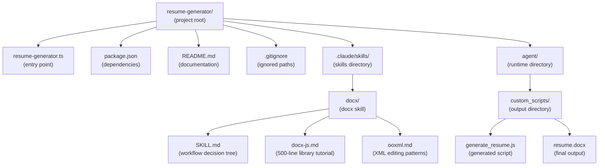
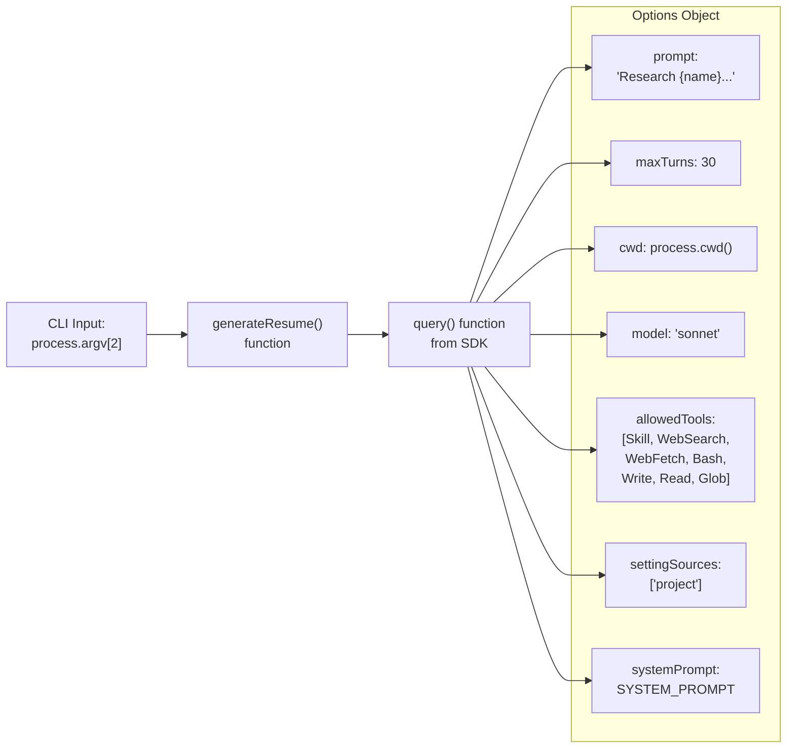
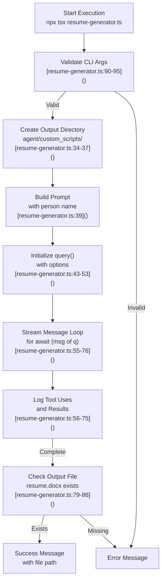

<!-- source: DeepWiki mcp.deepwiki.com · repo anthropics/claude-agent-sdk-demos · page 3.4 Configuration and Setup · fetched 2026-10-26 -->

# Configuration and Setup

<details>
<summary>Relevant source files</summary>

The following files were used as context for generating this wiki page:

- [resume-generator/.claude/skills/docx/SKILL.md](resume-generator/.claude/skills/docx/SKILL.md)
- [resume-generator/.claude/skills/docx/docx-js.md](resume-generator/.claude/skills/docx/docx-js.md)
- [resume-generator/.gitignore](resume-generator/.gitignore)
- [resume-generator/README.md](resume-generator/README.md)
- [resume-generator/package.json](resume-generator/package.json)
- [resume-generator/resume-generator.ts](resume-generator/resume-generator.ts)

</details>


This page provides instructions for configuring and running the Resume Generator demo. It covers installation, directory structure, configuration parameters, execution, and output verification.

For information about the Resume Generator's architecture and workflow phases, see [Architecture Overview](#3.1). For details about the docx skill system used by the generator, see [docx Skill System](#3.3).

## Overview

The Resume Generator requires minimal setup: installing dependencies, understanding the directory structure, and executing the main TypeScript file with a person's name. The agent automatically creates necessary directories, loads skills from `.claude/skills/`, and generates output in `agent/custom_scripts/`. No environment variables or external API keys are required beyond what the Claude Agent SDK needs.

**Sources:** [resume-generator/README.md:1-28](), [resume-generator/resume-generator.ts:1-98]()

## Prerequisites

The Resume Generator requires the following software installed on your system:

| Requirement | Purpose | Verification Command |
|-------------|---------|---------------------|
| Node.js (v18+) | Runtime environment | `node --version` |
| npm | Package manager | `npm --version` |
| Anthropic API key | Claude model access | `echo $ANTHROPIC_API_KEY` |

The Anthropic API key must be set in your environment as `ANTHROPIC_API_KEY`. This is consumed by the `@anthropic-ai/claude-agent-sdk` package.

**Sources:** [resume-generator/package.json:1-18]()

## Installation

Navigate to the `resume-generator` directory and install dependencies:

```bash
cd resume-generator
npm install
```

This installs the following packages as specified in [resume-generator/package.json:8-16]():

- `@anthropic-ai/claude-agent-sdk` (^0.1.59) - Agent orchestration and tool execution
- `docx` (^9.5.1) - Word document generation library
- `tsx` (^4.20.6) - TypeScript execution
- `typescript` (^5.9.3) - TypeScript compiler

The `docx` package is globally available to the agent when it generates JavaScript code for resume creation.

**Sources:** [resume-generator/package.json:1-18]()

## Directory Structure

### File System Layout



**Directory Structure Details**

The Resume Generator uses the following directory structure as shown in [resume-generator/resume-generator.ts:33-37]() and [resume-generator/.gitignore:1-6]():

| Path | Purpose | Created By | Gitignored |
|------|---------|------------|------------|
| `resume-generator/` | Project root | Manual | No |
| `.claude/skills/` | Skills discovery directory | Manual | No |
| `.claude/skills/docx/` | docx skill files | Manual | No |
| `agent/` | Agent runtime workspace | Auto | No |
| `agent/custom_scripts/` | Output directory for generated files | Auto ([resume-generator.ts:34-37]()) | Yes |
| `agent/custom_scripts/generate_resume.js` | Generated JavaScript code | Agent | Yes |
| `agent/custom_scripts/resume.docx` | Final resume file | Agent (via Bash tool) | Yes |

The `settingSources: ['project']` configuration at [resume-generator/resume-generator.ts:50]() instructs the SDK to load skills from `.claude/skills/`.

**Sources:** [resume-generator/resume-generator.ts:33-37](), [resume-generator/.gitignore:1-6](), [resume-generator/resume-generator.ts:50]()

### Skills Directory Structure

The `.claude/skills/docx/` directory contains three markdown files that the agent reads:

- **SKILL.md** - Workflow decision tree routing to appropriate documentation
- **docx-js.md** - 500-line comprehensive tutorial on the docx JavaScript library
- **ooxml.md** - XML editing patterns for existing documents (not used in resume generation)

The agent must read these files entirely (no range limits) as specified in [resume-generator/.claude/skills/docx/SKILL.md:59]() and [resume-generator/.claude/skills/docx/SKILL.md:68]().

**Sources:** [resume-generator/.claude/skills/docx/SKILL.md:1-197](), [resume-generator/.claude/skills/docx/docx-js.md:1-350]()

## Configuration Parameters

### Query Function Configuration



The `query()` function is configured at [resume-generator/resume-generator.ts:43-53]() with the following parameters:

| Parameter | Value | Purpose |
|-----------|-------|---------|
| `prompt` | `"Research \"{personName}\" and create a professional 1-page resume as a .docx file..."` | Initial task instruction |
| `maxTurns` | `30` | Maximum agent turns (includes tool uses) |
| `cwd` | `process.cwd()` | Current working directory for file operations |
| `model` | `'sonnet'` | Claude model identifier |
| `allowedTools` | `['Skill', 'WebSearch', 'WebFetch', 'Bash', 'Write', 'Read', 'Glob']` | Enabled tools for the agent |
| `settingSources` | `['project']` | Load skills from `.claude/skills/` directory |
| `systemPrompt` | `SYSTEM_PROMPT` | Workflow instructions and constraints |

**Sources:** [resume-generator/resume-generator.ts:39-53]()

### System Prompt

The `SYSTEM_PROMPT` constant at [resume-generator/resume-generator.ts:14-27]() provides critical constraints:

```typescript
const SYSTEM_PROMPT = `You are a professional resume writer. Research a person and create a 1-page .docx resume.

WORKFLOW:
1. WebSearch for the person's background (LinkedIn, GitHub, company pages)
2. Create a .docx file using the docx library

OUTPUT:
- Script: agent/custom_scripts/generate_resume.js
- Resume: agent/custom_scripts/resume.docx

PAGE FIT (must be exactly 1 page):
- 0.5 inch margins, Name 24pt, Headers 12pt, Body 10pt
- 2-3 bullet points per job, ~80-100 chars each
- Max 3 job roles, 2-line summary, 2-line skills`;
```

The PAGE FIT section enforces strict formatting requirements to ensure the resume fits on exactly one page.

**Sources:** [resume-generator/resume-generator.ts:14-27]()

## Running the Generator

### Command Line Execution

Execute the Resume Generator using the `tsx` runtime:

```bash
npx tsx resume-generator.ts "Person Name"
```

The person's name must be provided as the first command-line argument. If omitted, the script exits with usage instructions at [resume-generator/resume-generator.ts:90-95]():

```bash
# Success case
npx tsx resume-generator.ts "Jane Doe"

# Error case (missing argument)
npx tsx resume-generator.ts
# Output: Usage: npx tsx resume-generator.ts "Person Name"
#         Example: npx tsx resume-generator.ts "Jane Doe"
```

Alternatively, use the npm script defined in [resume-generator/package.json:6-7]():

```bash
npm start "Person Name"
```

**Sources:** [resume-generator/resume-generator.ts:90-97](), [resume-generator/package.json:6-7]()

### Execution Flow



**Sources:** [resume-generator/resume-generator.ts:29-97]()

### Console Output

The generator logs execution progress to console:

1. **Research phase**: `🔍 Searching: "query text"` for WebSearch tool uses [resume-generator/resume-generator.ts:62-63]()
2. **Tool execution**: `🔧 Using tool: toolName` for other tools [resume-generator/resume-generator.ts:65]()
3. **Tool results**: Truncated JSON results [resume-generator/resume-generator.ts:71-73]()
4. **Text blocks**: Assistant text responses [resume-generator/resume-generator.ts:58-60]()

**Sources:** [resume-generator/resume-generator.ts:55-76]()

## Output Verification

### File Validation

After the query completes, the generator verifies that `resume.docx` was created at [resume-generator/resume-generator.ts:78-86]():

```typescript
const expectedPath = path.join(process.cwd(), 'agent', 'custom_scripts', 'resume.docx');
if (fs.existsSync(expectedPath)) {
  console.log('\n' + '='.repeat(50));
  console.log(`📄 Resume saved to: ${expectedPath}`);
  console.log('='.repeat(50) + '\n');
} else {
  console.log('\n❌ Resume file was not created. Check the output above for errors.');
}
```

**Expected Output Location**: `<project-root>/agent/custom_scripts/resume.docx`

**Sources:** [resume-generator/resume-generator.ts:78-86]()

### Verification Checklist

After execution, verify:

| Check | Location | Expected Result |
|-------|----------|-----------------|
| JavaScript script created | `agent/custom_scripts/generate_resume.js` | File exists with docx library code |
| Resume file created | `agent/custom_scripts/resume.docx` | File exists and is valid .docx format |
| File size | `resume.docx` | Typically 15-50 KB for one-page resume |
| Page count | Open in Word/LibreOffice | Exactly 1 page (enforced by SYSTEM_PROMPT) |

Open the resume in Microsoft Word, LibreOffice, or Google Docs to verify formatting and content accuracy.

**Sources:** [resume-generator/resume-generator.ts:21-27](), [resume-generator/.gitignore:3-4]()

## Troubleshooting

### Common Issues

#### Missing API Key

**Symptom**: Error about missing Anthropic API key

**Solution**: Set the environment variable:
```bash
export ANTHROPIC_API_KEY="your-api-key-here"
```

#### Skills Not Found

**Symptom**: Agent doesn't use docx skill or can't create proper .docx files

**Solution**: Verify `.claude/skills/docx/` directory exists with `SKILL.md`, `docx-js.md`, and `ooxml.md` files. The `settingSources: ['project']` setting at [resume-generator/resume-generator.ts:50]() requires this directory structure.

#### Output Directory Permissions

**Symptom**: Error creating `agent/custom_scripts/` directory

**Solution**: The directory is created automatically with `fs.mkdirSync(outputDir, { recursive: true })` at [resume-generator/resume-generator.ts:36](). Ensure write permissions in the project root directory.

#### Resume Not Created

**Symptom**: Script completes but no `resume.docx` file

**Solution**: Review console output for errors. Common causes:
- Agent exceeded `maxTurns: 30` limit before completing
- JavaScript generation script had syntax errors
- Bash tool execution failed

Check `agent/custom_scripts/generate_resume.js` for the generated code and run it manually:
```bash
cd agent/custom_scripts
node generate_resume.js
```

**Sources:** [resume-generator/resume-generator.ts:34-37](), [resume-generator/resume-generator.ts:43-53](), [resume-generator/resume-generator.ts:78-86]()

### Debug Mode

To see more detailed output, modify the message loop at [resume-generator/resume-generator.ts:55-76]() to log complete message objects:

```typescript
for await (const msg of q) {
  console.log(JSON.stringify(msg, null, 2)); // Log complete message
  // ... existing code
}
```

This reveals the full conversation history, tool inputs, and tool results.

**Sources:** [resume-generator/resume-generator.ts:55-76]()

## Related Configuration

For configuring the Claude Agent SDK itself (API keys, model selection, tool configuration), see [SDK Core Concepts](#8.1) and [V1 API: Query Function](#8.2).

For understanding how the skills system discovers and loads `.claude/skills/`, see [Skills System](#8.5).

For modifying the docx skill documentation or adding new skills, see [docx Skill System](#3.3).

**Sources:** [resume-generator/resume-generator.ts:1-98]()

---

