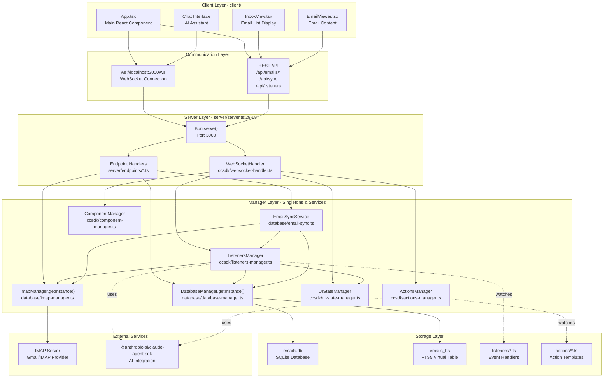
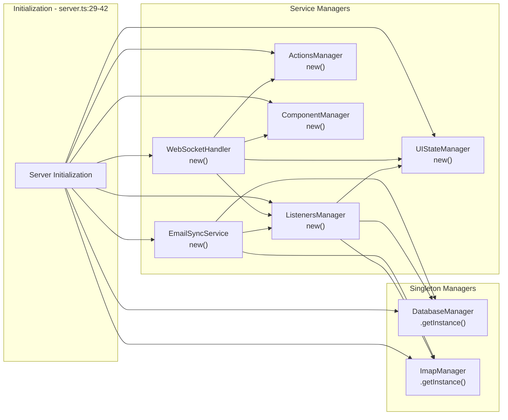
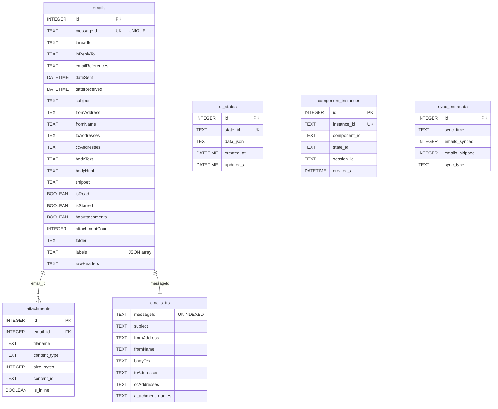
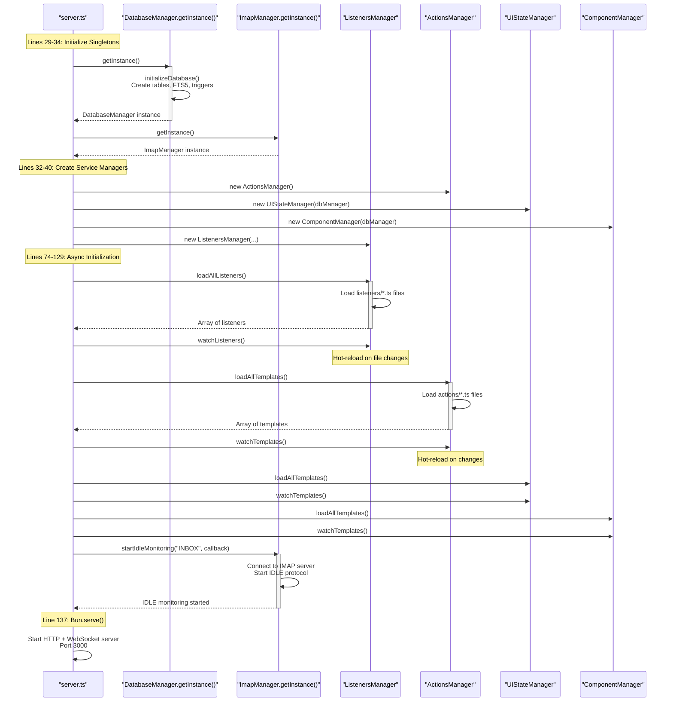
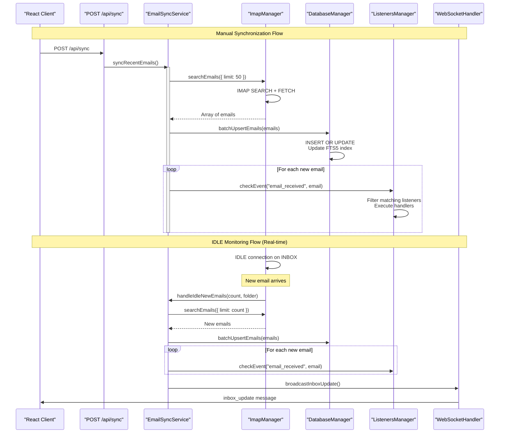

<!-- source: DeepWiki mcp.deepwiki.com · repo anthropics/claude-agent-sdk-demos · page 4 Email Agent Demo · fetched 2026-10-26 -->

# Email Agent Demo

Relevant source files

The following files were used as context for generating this wiki page:

- [email-agent/client/App.tsx](email-agent/client/App.tsx)
- [email-agent/client/components/InboxView.tsx](email-agent/client/components/InboxView.tsx)
- [email-agent/database/database-manager.ts](email-agent/database/database-manager.ts)
- [email-agent/server/server.ts](email-agent/server/server.ts)

## Purpose and Scope

This document provides an overview of the Email Agent demo application, a full-stack web application that demonstrates the capabilities of the Claude Agent SDK for building an AI-powered email assistant. The Email Agent showcases IMAP integration, agentic search, event-driven automation through listeners, and real-time communication patterns.

This page covers the application's purpose, capabilities, high-level architecture, and core components. For detailed documentation of specific subsystems, see:
- Server layer components: [Server Layer](#4.2)
- Client application structure: [Client Layer](#4.4)
- Database schema and operations: [Database Layer](#4.3)
- AI integration: [AI Integration](#4.5)
- Event-driven automation: [Listeners System](#4.6)
- Search capabilities: [Search and Filtering](#4.7)
- Setup instructions: [Configuration and Setup](#4.8)

**Sources**: [README.md:1-69](), [email-agent/server/server.ts:1-342]()

## Application Overview

The Email Agent is an in-development IMAP email assistant built with Bun, React, and SQLite. It connects to IMAP email servers (Gmail, etc.) to synchronize emails locally and provide AI-powered assistance through the Claude Agent SDK.

**Key Capabilities**:
- **Inbox Display**: View and manage emails with full-text search and filtering
- **Agentic Search**: Use natural language queries to find specific emails
- **AI Assistance**: Chat with Claude about emails, get summaries, and perform actions
- **Event-Driven Automation**: Custom TypeScript listeners that respond to email events
- **Real-Time Updates**: WebSocket-based live notifications and synchronization
- **IDLE Monitoring**: Instant email notifications via IMAP IDLE protocol

**Important**: This is a demo application intended for local development only and should NOT be deployed to production or used at scale.

**Sources**: [README.md:9-14](), [email-agent/server/server.ts:118-129]()

## Technology Stack

| Layer | Technology | Purpose |
|-------|-----------|---------|
| Runtime | Bun / Node.js 18+ | Server-side JavaScript/TypeScript execution |
| Frontend | React + TailwindCSS | User interface components and styling |
| State Management | Jotai | Client-side state management |
| Backend Framework | Bun.serve | HTTP and WebSocket server |
| Database | bun:sqlite + FTS5 | Local email storage with full-text search |
| Email Protocol | node-imap | IMAP server communication |
| AI Integration | Claude Agent SDK | Agentic capabilities and Claude AI access |
| Type Safety | Zod | Runtime schema validation |

**Sources**: [email-agent/server/server.ts:1-12](), Package.json files

## High-Level System Architecture

**Diagram: Email Agent Three-Tier Architecture with Code Entity Mapping**

The architecture consists of:

1. **Client Layer** ([email-agent/client/]()): React components (`App.tsx`, `InboxView.tsx`, `EmailViewer.tsx`) communicate via WebSocket and REST APIs
2. **Server Layer** ([email-agent/server/server.ts:29-68]()): `Bun.serve()` handles HTTP/WebSocket routing to `WebSocketHandler` and endpoint handlers
3. **Manager Layer**: Singleton instances (`DatabaseManager`, `ImapManager`) and service classes (`EmailSyncService`, `ListenersManager`, `ActionsManager`, `UIStateManager`, `ComponentManager`) coordinate business logic
4. **Storage Layer**: SQLite database at `emails.db` with FTS5 full-text search, plus file-based listeners and action templates
5. **External Services**: IMAP servers for email retrieval and Claude Agent SDK for AI capabilities

For detailed documentation of each layer:
- Client components: [Client Layer](#4.4)
- Server implementation: [Server Layer](#4.2)
- Database operations: [Database Layer](#4.3)
- AI integration: [AI Integration](#4.5)
- Listeners system: [Listeners System](#4.6)

**Sources**: [email-agent/server/server.ts:1-342](), [email-agent/database/database-manager.ts:1-845](), [email-agent/database/imap-manager.ts](), [email-agent/ccsdk/websocket-handler.ts]()

## Core Components Overview

The Email Agent's business logic is organized into specialized manager classes and services:

**Diagram: Component Initialization and Dependencies**

| Component | Type | Location | Primary Responsibility |
|-----------|------|----------|------------------------|
| `DatabaseManager` | Singleton | [database/database-manager.ts]() | SQLite operations, FTS5 search, email CRUD |
| `ImapManager` | Singleton | [database/imap-manager.ts]() | IMAP protocol, email fetch, IDLE monitoring |
| `EmailSyncService` | Service | [database/email-sync.ts]() | Sync orchestration, listener triggering |
| `ListenersManager` | Service | [ccsdk/listeners-manager.ts]() | Event-driven automation, hot-reload listeners |
| `ActionsManager` | Service | [ccsdk/actions-manager.ts]() | Action template loading and execution |
| `UIStateManager` | Service | [ccsdk/ui-state-manager.ts]() | UI state persistence and templates |
| `ComponentManager` | Service | [ccsdk/component-manager.ts]() | Dynamic component instance tracking |
| `WebSocketHandler` | Service | [ccsdk/websocket-handler.ts]() | Real-time bidirectional messaging |

Detailed documentation for each component is available in the child pages:
- Server layer components: [Server Layer](#4.2)
- Database operations: [Database Layer](#4.3)
- Listeners system: [Listeners System](#4.6)

**Sources**: [email-agent/server/server.ts:29-68]()

## Database Schema Overview

The Email Agent uses SQLite with FTS5 full-text search for local email storage:

**Diagram: SQLite Database Schema - emails.db**

### Core Tables

| Table | Purpose | Key Features |
|-------|---------|--------------|
| `emails` | Email metadata and content | UNIQUE constraint on `messageId`, indexes on `dateSent`, `fromAddress`, `folder`, `isRead` |
| `attachments` | Email attachment metadata | Foreign key to `emails(id)` with CASCADE delete |
| `emails_fts` | FTS5 full-text search index | `porter unicode61` tokenizer, automatically synced via triggers |
| `ui_states` | Persistent UI state storage | Used by actions and listeners to maintain state across sessions |
| `component_instances` | Dynamic component tracking | Links component instances to UI states and sessions |
| `sync_metadata` | Synchronization history | Tracks sync operations, email counts, and sync types |

### Automatic Index Maintenance

Three triggers ([database-manager.ts:174-210]()) maintain `emails_fts` synchronization:
- `emails_fts_insert`: Adds new emails to FTS5 index
- `emails_fts_update`: Updates FTS5 when email content changes
- `emails_fts_delete`: Removes deleted emails from FTS5

For detailed schema documentation and operations, see [Schema and Models](#4.3.1).

**Sources**: [email-agent/database/database-manager.ts:88-256](), [email-agent/server/server.ts:44-52]()

## Communication Patterns

The Email Agent uses both WebSocket for real-time communication and HTTP REST APIs for stateless operations:

### WebSocket Protocol

**Client → Server Messages** (handled by [ccsdk/websocket-handler.ts]()):
- `subscribe`: Subscribe to inbox updates for specific folders
- `unsubscribe`: Unsubscribe from inbox updates
- `agent_message`: Send message to Claude agent with streaming response
- `execute_action`: Trigger predefined action template from `actions/*.ts`

**Server → Client Messages**:
- `inbox_update`: Broadcast email list updates to subscribed clients
- `listener_log`: Broadcast listener execution logs in real-time
- `agent_response`: Stream Claude agent responses with tool use display

For WebSocket implementation details, see [WebSocket Handler](#4.2.2).

### HTTP REST API

| Endpoint | Method | Handler Location | Purpose |
|----------|--------|------------------|---------|
| `/api/sync` | POST | [server/endpoints/sync.ts]() | Trigger manual email synchronization |
| `/api/sync/status` | GET | [server/endpoints/sync.ts]() | Get synchronization status and metadata |
| `/api/emails/inbox` | GET | [server/endpoints/emails.ts:16-60]() | Retrieve inbox emails with `limit` and `includeRead` params |
| `/api/emails/search` | POST | [server/endpoints/emails.ts:62-144]() | Search emails with `SearchCriteria` (from, to, subject, date, gmailQuery) |
| `/api/email/:messageId` | GET | [server/endpoints/emails.ts:146-241]() | Get detailed email by `messageId` |
| `/api/emails/batch` | POST | [server/endpoints/emails.ts:243-301]() | Retrieve multiple emails by array of IDs |
| `/api/listeners` | GET | [server/server.ts:285-297]() | List all loaded listeners with execution stats |
| `/api/listener/:filename` | GET | [server/endpoints/listeners.ts]() | Get specific listener details and source code |
| `/api/listener/:id/logs` | GET | [server/server.ts:264-278]() | Get execution logs for a listener |
| `/api/ui-states` | GET | [server/endpoints/ui-state.ts]() | List all saved UI states |
| `/api/ui-state/:id` | GET/PUT/DELETE | [server/endpoints/ui-state.ts]() | CRUD operations on UI state by `stateId` |
| `/api/component-templates` | GET | [server/server.ts:332-334]() | List available component templates |

For API endpoint implementation details, see [API Endpoints](#4.2.3).

**Sources**: [email-agent/server/server.ts:238-334](), [email-agent/server/endpoints/emails.ts:1-301]()

## Application Startup Sequence

**Diagram: Server Initialization Flow - server.ts:29-138**

Startup sequence:
1. **Singleton Initialization** ([server.ts:29-31]()): `DatabaseManager.getInstance()` creates tables, indexes, and FTS5 triggers; `ImapManager.getInstance()` prepares IMAP connection
2. **Service Manager Creation** ([server.ts:32-40]()): Instantiate `ActionsManager`, `UIStateManager`, `ComponentManager`, `ListenersManager`, `WebSocketHandler`
3. **Async Loading** ([server.ts:74-116]()): Load all listeners, actions, UI state templates, and component templates from disk
4. **File Watchers** ([server.ts:79-115]()): Start watching for file changes to enable hot-reloading without restarts
5. **IDLE Monitoring** ([server.ts:118-129]()): Connect to IMAP server and start IDLE protocol for real-time email notifications
6. **HTTP/WebSocket Server** ([server.ts:137-338]()): Start `Bun.serve()` on port 3000 with WebSocket upgrade support

**Sources**: [email-agent/server/server.ts:29-138]()

## Email Synchronization Flow

**Diagram: Email Synchronization - Manual and Real-Time Flows**

The Email Agent supports two synchronization modes:

### Manual Synchronization
1. Client sends `POST /api/sync` ([server/endpoints/sync.ts]())
2. `EmailSyncService.syncRecentEmails()` fetches recent emails via `ImapManager.searchEmails()`
3. Emails stored in SQLite via `DatabaseManager.batchUpsertEmails()`
4. `ListenersManager.checkEvent("email_received", email)` triggers matching listeners

### IDLE Monitoring (Real-Time)
1. `ImapManager.startIdleMonitoring("INBOX", callback)` maintains persistent IMAP IDLE connection ([server.ts:120-123]())
2. IMAP server sends EXISTS notification when new email arrives
3. Callback invokes `EmailSyncService.handleIdleNewEmails(count, folder)`
4. New emails fetched, stored, indexed, and listeners triggered
5. `WebSocketHandler.broadcastInboxUpdate()` notifies all subscribed clients

For detailed IMAP operations, see [IMAP Integration and Email Sync](#4.3.2).

**Sources**: [email-agent/server/server.ts:120-123](), [email-agent/database/email-sync.ts]()

## Getting Started

### Prerequisites

- Bun runtime (or Node.js 18+)
- Anthropic API key
- IMAP email server credentials (Gmail, etc.)

### Quick Start

1. Navigate to the email-agent directory
2. Install dependencies: `bun install`
3. Configure environment variables (see [Configuration and Setup](#3.10))
4. Start the server: `bun run dev`
5. Open browser to `http://localhost:3000`

For detailed setup instructions including database initialization, IMAP configuration, and listener creation, see [Configuration and Setup](#4.8).

**Sources**: [README.md:28-50]()

## Key Features Summary

| Feature | Description | Component |
|---------|-------------|-----------|
| **Full-Text Search** | FTS5-powered search across subject, body, senders, and attachments | `DatabaseManager`, `emails_fts` |
| **Gmail Query Syntax** | Support for Gmail-style search queries (e.g., "from:user@example.com is:unread") | `SearchCriteria.gmailQuery` |
| **Event Listeners** | Hot-reloadable TypeScript scripts that respond to email events | `ListenersManager` |
| **Action Templates** | Predefined AI-powered actions executable via WebSocket | `ActionsManager` |
| **IDLE Monitoring** | Real-time email notifications via IMAP IDLE protocol | `ImapManager.startIdleMonitoring()` |
| **UI State Persistence** | Save and restore UI state across sessions | `UIStateManager`, `ui_states` table |
| **WebSocket Streaming** | Real-time agent responses and inbox updates | `WebSocketHandler` |
| **Attachment Support** | Store and query email attachments with metadata | `attachments` table |

**Sources**: [email-agent/database/database-manager.ts:48-66](), [email-agent/server/server.ts:55-117]()

## Architecture Highlights

The Email Agent demonstrates several architectural patterns:

1. **Singleton Pattern**: `DatabaseManager` and `ImapManager` ensure single instances for resource management
2. **Manager Pattern**: Distinct managers (`ListenersManager`, `ActionsManager`, `UIStateManager`) handle specific concerns
3. **Event-Driven Architecture**: Listeners respond to email events without tight coupling
4. **Hot Module Reloading**: File watchers enable development without server restarts
5. **Full-Text Search**: SQLite FTS5 with automatic index maintenance via triggers
6. **Real-Time Communication**: WebSocket for bidirectional streaming with subscription model
7. **Transaction Safety**: Database transactions ensure atomicity for multi-step operations

For deeper dives into these patterns and their implementations, see the subsection pages listed at the beginning of this document.

**Sources**: [email-agent/server/server.ts:29-117](), [email-agent/database/database-manager.ts:68-86]()

---

