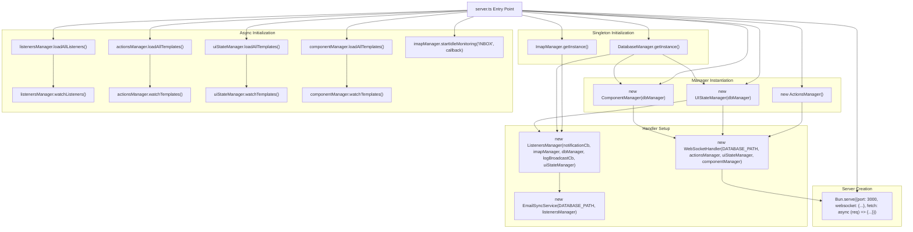
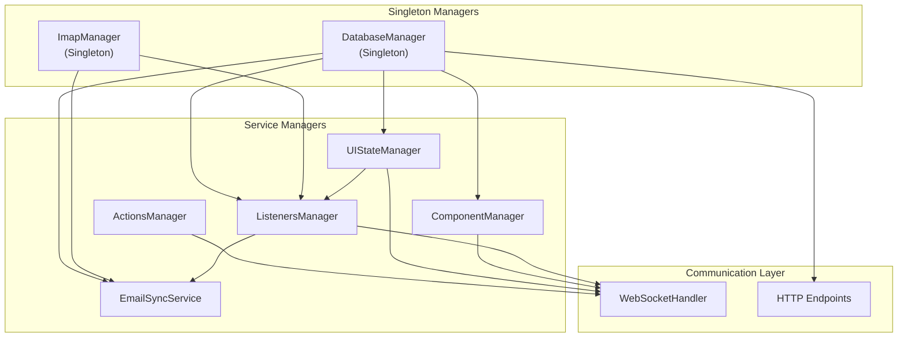
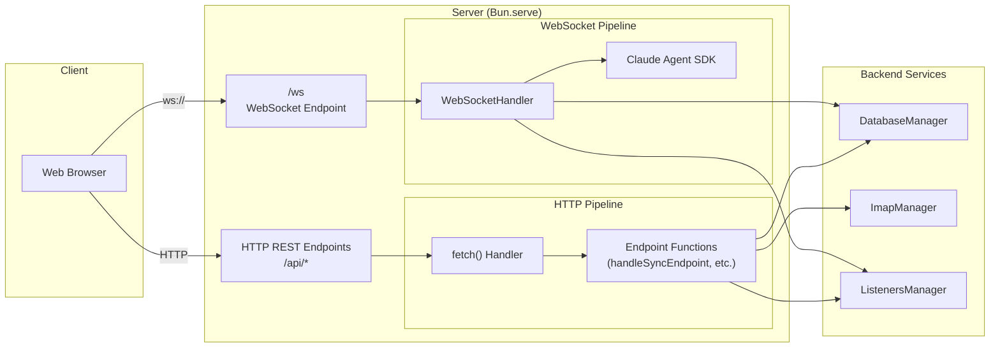
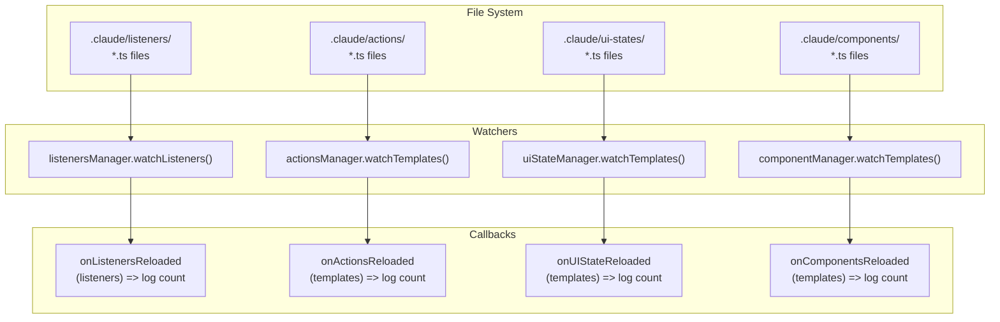
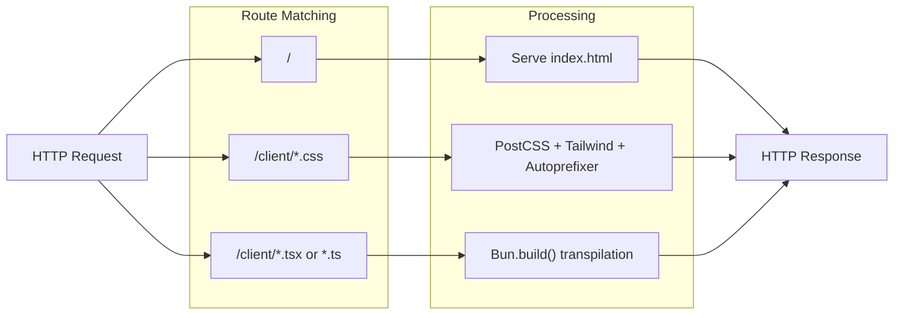

<!-- source: DeepWiki mcp.deepwiki.com · repo anthropics/claude-agent-sdk-demos · page 4.2 Server Layer · fetched 2026-10-26 -->

# Server Layer

<details>
<summary>Relevant source files</summary>

The following files were used as context for generating this wiki page:

- [email-agent/database/database-manager.ts](email-agent/database/database-manager.ts)
- [email-agent/server/server.ts](email-agent/server/server.ts)

</details>


## Purpose and Scope

This document describes the server infrastructure for the Email Agent demo, powered by the Bun runtime. It covers the main server initialization, manager pattern architecture, WebSocket and HTTP endpoint handling, and the coordination between various service components.

For the high-level multi-tier architecture of the Email Agent, see [Architecture Overview](#4.1). For details on specific subsystems, see [Core Server and Managers](#4.2.1), [WebSocket Handler](#4.2.2), [API Endpoints](#4.2.3), and [Actions and UI State Management](#4.2.4). For database operations, see [Database Layer](#4.3).

---

## Server Architecture Overview

The Email Agent server is implemented in [email-agent/server/server.ts]() using `Bun.serve`, which provides integrated WebSocket support and native TypeScript execution. The server manages two primary communication channels: WebSocket connections at `/ws` for real-time bidirectional agent interactions, and HTTP REST endpoints for email CRUD operations and synchronization.

### Server Initialization Flow



**Server Initialization and Manager Instantiation**

Sources: [email-agent/server/server.ts:29-72]()

---

## Manager Pattern and Dependencies

The server uses a manager pattern to separate concerns across different functional areas. Two managers use the singleton pattern (`DatabaseManager` and `ImapManager`) to ensure single instances for resource management, while others are instantiated directly.

### Manager Dependency Graph



**Manager Dependencies and Data Flow**

Sources: [email-agent/server/server.ts:29-71]()

### Manager Responsibilities

| Manager | Type | Purpose | Key Dependencies |
|---------|------|---------|------------------|
| `DatabaseManager` | Singleton | SQLite database operations, email storage, UI state persistence | None |
| `ImapManager` | Singleton | IMAP connection management, IDLE monitoring, email fetching | None |
| `ActionsManager` | Instance | Action template loading and file watching | None |
| `UIStateManager` | Instance | UI state management and template loading | `DatabaseManager` |
| `ComponentManager` | Instance | Component instance tracking and template loading | `DatabaseManager` |
| `ListenersManager` | Instance | Listener lifecycle, execution, and file watching | `ImapManager`, `DatabaseManager`, `UIStateManager` |
| `EmailSyncService` | Instance | Email synchronization orchestration | `DatabaseManager`, `ImapManager`, `ListenersManager` |
| `WebSocketHandler` | Instance | WebSocket session management, agent communication | `ActionsManager`, `UIStateManager`, `ComponentManager` |

Sources: [email-agent/server/server.ts:29-41]()

---

## Communication Channels

The server provides two distinct communication mechanisms optimized for different interaction patterns.

### Dual Channel Architecture



**Dual Communication Channel Architecture**

Sources: [email-agent/server/server.ts:137-337]()

### WebSocket Communication

The WebSocket endpoint at `/ws` handles real-time agent interactions. The server upgrades HTTP requests to WebSocket connections using `server.upgrade(req)` at [email-agent/server/server.ts:162-167]().

WebSocket events are handled by:
- `open(ws)` - client connection established, handled at [email-agent/server/server.ts:142-144]()
- `message(ws, message)` - client message received, handled at [email-agent/server/server.ts:146-148]()
- `close(ws)` - client disconnection, handled at [email-agent/server/server.ts:150-152]()

The `WebSocketHandler` processes all WebSocket messages and coordinates with the Claude Agent SDK for AI-powered responses. See [WebSocket Handler](#4.2.2) for detailed documentation.

### HTTP REST API

HTTP endpoints provide traditional request-response operations for email management, synchronization, and configuration. The `fetch()` handler routes requests based on pathname and HTTP method at [email-agent/server/server.ts:155-337]().

Key endpoint categories:

| Category | Pattern | Methods | Purpose |
|----------|---------|---------|---------|
| Email Operations | `/api/emails/*` | GET, POST | Email retrieval, search, batch operations |
| Synchronization | `/api/sync/*` | GET, POST | Manual sync trigger, sync status |
| Listeners | `/api/listener/*`, `/api/listeners` | GET | Listener details, logs, list all listeners |
| UI State | `/api/ui-state/*`, `/api/ui-states` | GET, PUT, DELETE | UI state management |
| Templates | `/api/ui-state-templates`, `/api/component-templates` | GET | Template listing |

For complete endpoint documentation, see [API Endpoints](#4.2.3).

Sources: [email-agent/server/server.ts:238-335]()

---

## Asynchronous Initialization

The server performs several asynchronous initialization tasks in an immediately invoked async function at [email-agent/server/server.ts:74-129](). This ensures that the server can accept connections immediately while background services start up.

### File Watching System



**File Watching System for Hot Reloading**

The server watches four categories of files and automatically reloads them when changes are detected:

1. **Listeners** - [email-agent/server/server.ts:79-83]()
   - Watches `.claude/listeners/*.ts`
   - Reloads via `listenersManager.watchListeners()`

2. **Action Templates** - [email-agent/server/server.ts:89-94]()
   - Watches `.claude/actions/*.ts`
   - Reloads via `actionsManager.watchTemplates()`

3. **UI State Templates** - [email-agent/server/server.ts:100-105]()
   - Watches `.claude/ui-states/*.ts`
   - Reloads via `uiStateManager.watchTemplates()`

4. **Component Templates** - [email-agent/server/server.ts:111-116]()
   - Watches `.claude/components/*.ts`
   - Reloads via `componentManager.watchTemplates()`

Each watcher receives a callback that logs the reload event. File watching enables development without server restarts.

Sources: [email-agent/server/server.ts:74-116]()

### IMAP IDLE Monitoring

The server starts IMAP IDLE monitoring at [email-agent/server/server.ts:118-128]() to receive push notifications for new emails:

```typescript
await imapManager.startIdleMonitoring("INBOX", async (count: number) => {
  console.log(`[Server] IDLE: ${count} new email(s) detected`);
  await syncService.handleIdleNewEmails(count, "INBOX");
});
```

When new emails arrive, the `EmailSyncService.handleIdleNewEmails()` method is invoked to:
1. Fetch new emails from IMAP
2. Store them in the database
3. Trigger listener execution
4. Broadcast updates to connected WebSocket clients

IDLE monitoring failures are caught and logged, allowing the server to continue operating with manual sync only.

Sources: [email-agent/server/server.ts:118-128]()

---

## Static File Serving

The server serves the React client application through three mechanisms:

### Client File Processing



**Static File Processing Pipeline**

1. **HTML Entry Point** - [email-agent/server/server.ts:170-177]()
   - Route: `/`
   - Serves `./client/index.html`

2. **CSS Processing** - [email-agent/server/server.ts:179-209]()
   - Route: `/client/*.css`
   - Processes Tailwind directives with PostCSS
   - Adds vendor prefixes with Autoprefixer

3. **TypeScript/TSX Transpilation** - [email-agent/server/server.ts:211-236]()
   - Route: `/client/*.tsx` or `/client/*.ts`
   - Transpiles to ES modules using `Bun.build()`
   - Target: browser, format: ESM

This approach enables development without a separate build step, as Bun handles transpilation on-the-fly.

Sources: [email-agent/server/server.ts:170-236]()

---

## CORS Configuration

CORS headers are defined at [email-agent/server/server.ts:131-135]() and applied to all responses:

```typescript
const corsHeaders = {
  'Access-Control-Allow-Origin': '*',
  'Access-Control-Allow-Methods': 'GET, POST, OPTIONS',
  'Access-Control-Allow-Headers': 'Content-Type',
};
```

OPTIONS preflight requests are handled at [email-agent/server/server.ts:158-160](), returning CORS headers without further processing.

Sources: [email-agent/server/server.ts:131-160]()

---

## Server Configuration

The server is configured at [email-agent/server/server.ts:137-153]() with:

| Parameter | Value | Purpose |
|-----------|-------|---------|
| `port` | `3000` | HTTP/WebSocket listening port |
| `idleTimeout` | `120` seconds | Connection timeout for inactive connections |
| `websocket.open` | `wsHandler.onOpen` | WebSocket connection handler |
| `websocket.message` | `wsHandler.onMessage` | WebSocket message handler |
| `websocket.close` | `wsHandler.onClose` | WebSocket disconnection handler |
| `fetch` | `async (req, server) => {...}` | HTTP request handler |

The server starts listening and logs connection information at [email-agent/server/server.ts:340-342]():

```
Server running at http://localhost:3000
WebSocket endpoint available at ws://localhost:3000/ws
Visit http://localhost:3000 to view the email chat interface
```

Sources: [email-agent/server/server.ts:137-342]()

---

## Database Initialization

The server creates a `sync_metadata` table at [email-agent/server/server.ts:44-52]() for tracking email synchronization operations:

```sql
CREATE TABLE IF NOT EXISTS sync_metadata (
  id INTEGER PRIMARY KEY AUTOINCREMENT,
  sync_time TEXT NOT NULL,
  emails_synced INTEGER DEFAULT 0,
  emails_skipped INTEGER DEFAULT 0,
  sync_type TEXT DEFAULT 'manual'
)
```

This is separate from the main database schema initialization in `DatabaseManager`, which creates tables for emails, attachments, FTS search, UI states, and component instances. See [Schema and Models](#4.3.1) for complete database documentation.

Sources: [email-agent/server/server.ts:42-52]()

---

## Error Handling

The server implements graceful error handling for non-critical failures:

- **IDLE Monitoring Failures** - Caught and logged at [email-agent/server/server.ts:125-128](), allowing manual sync operation
- **File Watcher Failures** - Caught and logged for each watcher at lines 82-83, 92-94, 103-105, 114-116
- **CSS Processing Errors** - Caught at [email-agent/server/server.ts:204-207](), returning 500 status
- **Transpilation Errors** - Caught at [email-agent/server/server.ts:231-234](), returning 500 status

Critical errors (database initialization, manager creation) will throw and prevent server startup.

Sources: [email-agent/server/server.ts:82-234]()

---

