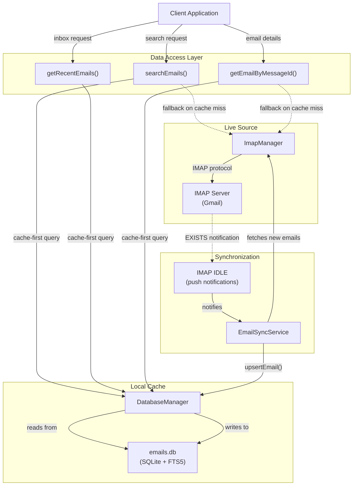
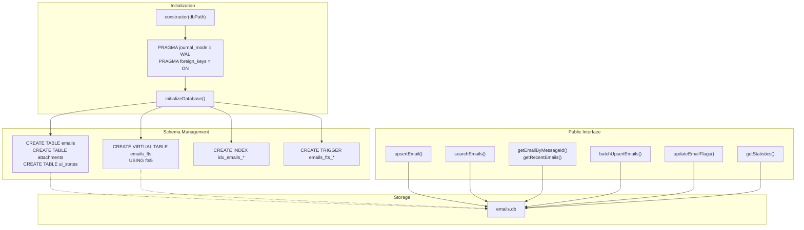
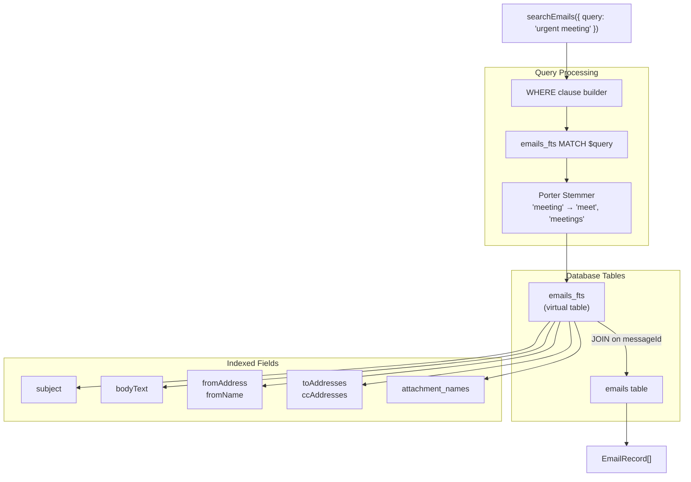
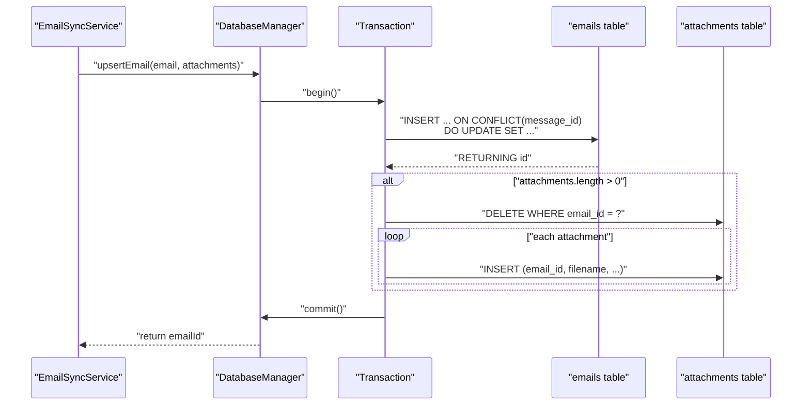
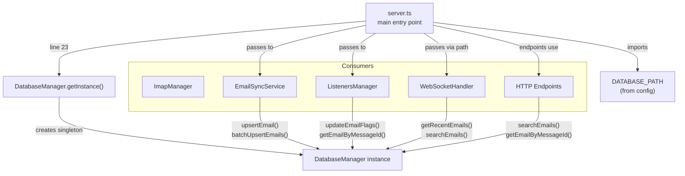
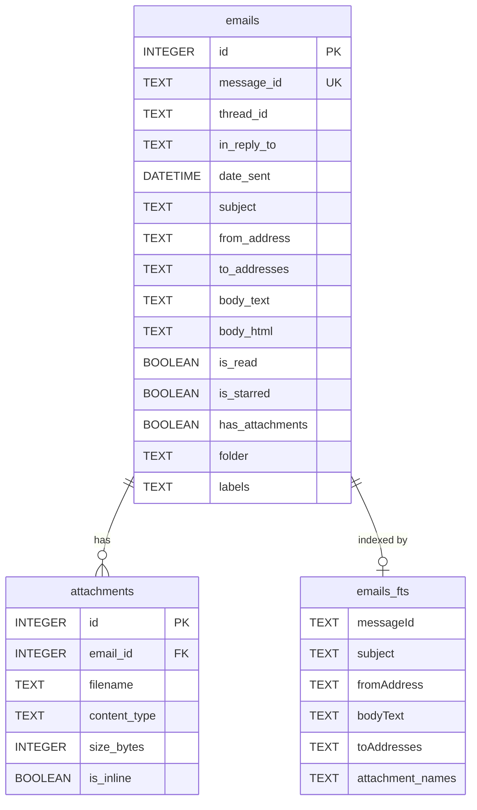

<!-- source: DeepWiki mcp.deepwiki.com · repo anthropics/claude-agent-sdk-demos · page 4.3 Database Layer · fetched 2026-10-26 -->

# Database Layer

<details>
<summary>Relevant source files</summary>

The following files were used as context for generating this wiki page:

- [email-agent/database/database-manager.ts](email-agent/database/database-manager.ts)
- [email-agent/server/server.ts](email-agent/server/server.ts)

</details>


## Purpose and Scope

The Database Layer implements a local SQLite cache with FTS5 full-text search for fast email access and querying. This layer operates as part of a dual-source data strategy: SQLite provides cached data for rapid queries, while IMAP serves as the authoritative source for fresh email retrieval. The `DatabaseManager` singleton manages all database operations, schema initialization, and transaction handling.

For detailed schema documentation, see [Schema and Models](4.3.1). For IMAP integration and synchronization mechanisms, see [IMAP Integration and Email Sync](4.3.2). For server endpoints that expose database queries, see [API Endpoints](4.2.3).

---

## Dual-Source Data Strategy

The Email Agent implements a hybrid data access pattern combining local caching with live IMAP queries. This strategy balances performance (fast local reads) with freshness (authoritative IMAP data).

**Dual-Source Data Flow**



**Access Patterns**:
- **Cache-first reads**: Most queries hit SQLite for sub-millisecond response times
- **Write-through caching**: New emails from IMAP are immediately persisted to SQLite
- **Background sync**: `EmailSyncService` periodically refreshes the cache
- **Push updates**: IMAP IDLE monitoring triggers immediate sync on new emails

Sources: [email-agent/database/database-manager.ts:1-7](), [email-agent/server/server.ts:29-71]()

---

## DatabaseManager Singleton

The `DatabaseManager` class provides centralized database access using the singleton pattern. It initializes the schema, manages connections, and exposes methods for email CRUD operations, search, and batch processing.

**DatabaseManager Architecture**



**Key Configuration**:
- **WAL Mode**: Write-Ahead Logging enables concurrent reads during writes
- **Foreign Keys**: Enforced referential integrity between `emails` and `attachments`
- **Singleton Pattern**: Single instance shared across application via `getInstance()`

Sources: [email-agent/database/database-manager.ts:68-86](), [email-agent/database/database-manager.ts:88-257]()

---

## Core Schema Components

The database schema consists of four primary tables: `emails` for message data, `attachments` for file attachments, `emails_fts` for full-text search, and `ui_states` for persistent UI state. Detailed schema documentation is available in [Schema and Models](4.3.1).

**Schema Overview**

| Table | Purpose | Key Features |
|-------|---------|-------------|
| `emails` | Email metadata and content | 30+ columns including headers, body, flags, timestamps |
| `attachments` | File attachment metadata | Links to emails via foreign key with CASCADE delete |
| `emails_fts` | FTS5 virtual table | Full-text search on subject, body, sender, recipients |
| `ui_states` | UI component state | JSON storage for persistent component configurations |
| `sync_metadata` | Sync tracking | Records sync timestamps and statistics |

**Indexes for Performance**:
- `idx_emails_date_sent`: Fast chronological sorting (DESC for recent-first)
- `idx_emails_message_id`: Unique message lookup
- `idx_emails_from_address`: Sender filtering
- `idx_emails_thread_id`: Thread-based queries
- `idx_emails_is_read`: Unread email queries
- `idx_emails_folder`: Folder-based filtering

Sources: [email-agent/database/database-manager.ts:88-257](), [email-agent/database/config.ts:1-5]()

---

## Full-Text Search with FTS5

The database uses SQLite's FTS5 extension for efficient content searching across email subject, body, sender, and recipient fields. The `emails_fts` virtual table is automatically maintained by database triggers.

**FTS5 Search Architecture**



**FTS5 Configuration**:
- **Tokenizer**: `porter unicode61` for stemming and Unicode support
- **Query Syntax**: Supports AND, OR, NOT, phrases ("exact match"), prefix (meet*)
- **Automatic Maintenance**: Triggers keep FTS index synchronized with `emails` table

Detailed trigger implementations are documented in [Schema and Models](4.3.1).

Sources: [email-agent/database/database-manager.ts:142-154](), [email-agent/database/database-manager.ts:174-210](), [email-agent/database/database-manager.ts:396-410]()

---

## Database Operations

### Email CRUD Operations

The `DatabaseManager` provides methods for creating, reading, updating, and deleting emails. All operations use prepared statements for SQL injection prevention and performance.

**Core Operations**

| Operation | Method | Transaction | Use Case |
|-----------|--------|-------------|----------|
| Insert/Update | `upsertEmail()` | Automatic | Single email with attachments |
| Bulk Insert | `batchUpsertEmails()` | Single transaction | Initial sync, batch operations |
| Retrieve Single | `getEmailByMessageId()` | Read-only | Email details display |
| Retrieve Multiple | `getEmailsByIds()`, `getEmailsByMessageIds()` | Read-only | Batch fetching |
| Retrieve Recent | `getRecentEmails()` | Read-only | Inbox display |
| Search | `searchEmails()` | Read-only | FTS5 + filter queries |
| Update Flags | `updateEmailFlags()` | Automatic | Mark read, star, label changes |

**Upsert Pattern**:

The `upsertEmail()` method uses `INSERT ... ON CONFLICT DO UPDATE` to handle both new and existing emails atomically. The `message_id` field (RFC Message-ID header) serves as the natural unique key.



**Batch Operations**:

The `batchUpsertEmails()` method wraps multiple upserts in a single transaction, providing 10-100x performance improvement during bulk sync operations.

Sources: [email-agent/database/database-manager.ts:260-393](), [email-agent/database/database-manager.ts:593-601](), [email-agent/database/database-manager.ts:661-713]()

---

## Search Capabilities

### SearchCriteria Interface

The `SearchCriteria` interface provides a flexible query builder supporting FTS5 full-text search, multiple filter types, and pagination. It allows combining full-text queries with structured filters for precise email retrieval.

**SearchCriteria Fields**

| Field | Type | Purpose |
|-------|------|---------|
| `query` | `string` | FTS5 full-text search across subject, body, addresses |
| `from` | `string \| string[] \| 'me'` | Sender email address filter (supports arrays) |
| `to` | `string \| string[]` | Recipient email address filter |
| `subject` | `string` | Subject line substring match |
| `dateRange` | `{ start: Date; end: Date }` | Filter by sent date range |
| `hasAttachments` | `boolean` | Filter emails with/without attachments |
| `isUnread` | `boolean` | Filter by read status |
| `isStarred` | `boolean` | Filter starred emails |
| `folder` | `string` | Single folder filter (e.g., 'INBOX') |
| `folders` | `string[]` | Multiple folder filter |
| `threadId` | `string` | Conversation thread filter |
| `limit` | `number` | Result limit (default: 30) |
| `offset` | `number` | Result offset for pagination |
| `minSize`, `maxSize` | `number` | Size filtering in bytes |
| `gmailQuery` | `string` | Gmail-specific search syntax (X-GM-RAW) |

**Dynamic Query Construction**:

The `searchEmails()` method builds SQL dynamically based on provided criteria. All filters are combined with AND logic. FTS5 queries are executed as a subquery joined to the main `emails` table.

```typescript
// Example: Complex multi-filter search
const results = dbManager.searchEmails({
  query: "budget report",              // FTS5 search
  from: ["boss@company.com"],          // Sender filter
  isUnread: true,                      // Unread only
  hasAttachments: true,                // Must have attachments
  dateRange: {
    start: new Date("2025-01-01"),
    end: new Date()
  },
  limit: 30
});
```

Sources: [email-agent/database/database-manager.ts:48-66](), [email-agent/database/database-manager.ts:396-523]()

### Common Query Patterns

**Recent Inbox Emails**:

The `getRecentEmails()` method is optimized for the inbox view, using `idx_emails_date_sent` index for fast chronological sorting.

```typescript
// Get 50 most recent emails including read
dbManager.getRecentEmails(50, true);

// Get unread emails only
dbManager.getRecentEmails(50, false);
```

**Batch Retrieval**:

Multiple emails can be fetched efficiently by IDs or message IDs:

```typescript
// Retrieve by internal database IDs
dbManager.getEmailsByIds([1, 2, 3]);

// Retrieve by RFC Message-IDs
dbManager.getEmailsByMessageIds([
  "<msg1@example.com>",
  "<msg2@example.com>"
]);
```

Sources: [email-agent/database/database-manager.ts:526-542](), [email-agent/database/database-manager.ts:555-582]()

---

## Transaction and Consistency

### ACID Guarantees

SQLite with WAL (Write-Ahead Logging) mode provides full ACID compliance:

- **Atomicity**: All database writes occur within transactions (all-or-nothing)
- **Consistency**: Foreign key constraints and triggers enforce data integrity
- **Isolation**: WAL mode enables concurrent reads during writes
- **Durability**: Committed transactions are persisted to disk

**WAL Mode Configuration**:

```typescript
// Applied during DatabaseManager initialization
db.exec("PRAGMA journal_mode = WAL");
db.exec("PRAGMA foreign_keys = ON");
```

WAL mode provides:
- Non-blocking reads during write transactions
- Better concurrency for real-time applications
- Improved write performance

Sources: [email-agent/database/database-manager.ts:76-77]()

### Transaction Patterns

**Automatic Transactions**:

Methods like `upsertEmail()` wrap operations in transactions using `db.transaction()`:

```typescript
const upsertTransaction = this.db.transaction(() => {
  const result = upsertEmail.get(params);
  const emailId = result.id;
  
  // Delete and re-insert attachments atomically
  deleteAttachments.run({ $emailId: emailId });
  for (const attachment of attachments) {
    insertAttachment.run(attachmentParams);
  }
  
  return emailId;
});

return upsertTransaction();  // Atomic execution
```

**Batch Transactions**:

The `batchUpsertEmails()` method wraps multiple upserts in a single transaction for performance:

```typescript
const batchTransaction = this.db.transaction(() => {
  for (const { email, attachments } of emails) {
    this.upsertEmail(email, attachments || []);
  }
});

batchTransaction();  // All succeed or all rollback
```

This approach provides 10-100x performance improvement during bulk operations by minimizing disk I/O.

Sources: [email-agent/database/database-manager.ts:325-393](), [email-agent/database/database-manager.ts:593-601]()

---

## Integration with Other Components

### Server Integration

The server initializes the `DatabaseManager` singleton at startup and passes it to various components.



Sources: [email-agent/server/server.ts:29-42](), [email-agent/database/config.ts:1-5]()

### Email Sync Service Integration

The `EmailSyncService` uses `DatabaseManager` to persist emails fetched from IMAP, checking for duplicates before inserting.

**Sync Integration Pattern**:

```typescript
// EmailSyncService checks if email exists before inserting
const existing = this.database.db.prepare(
  "SELECT id FROM emails WHERE message_id = ?"
).get(rawEmail.messageId);

if (existing) {
  stats.skipped++;
  continue;
}

// Insert new email
this.database.insertEmail(emailRecord, recipients, attachments);
stats.synced++;
```

After inserting, the sync service triggers listener events by calling `listenersManager.checkEvent('email_received', email)`.

The `EmailSyncService` is covered in detail in [IMAP Integration and Email Sync](4.3.2).

### Listeners Manager Integration

The `ListenersManager` uses `DatabaseManager` to implement automation actions like starring emails, archiving, and updating labels.

**Listener Action Pattern**:

```typescript
// Listener context method for starring an email
starEmail: async (emailId: string) => {
  // 1. Retrieve email from database
  const email = await this.databaseManager.getEmailByMessageId(emailId);
  if (!email?.imapUid) throw new Error(`Email not found: ${emailId}`);
  
  // 2. Perform IMAP operation (not in database layer)
  await this.imapManager.starEmail(email.imapUid, email.folder);
  
  // 3. Update database flag
  this.databaseManager.updateEmailFlags(emailId, { isStarred: true });
}
```

This pattern ensures both IMAP server and local database remain synchronized.

For complete listener integration details, see [Listeners System](4.6).

---

## Database Configuration

### Configuration File

Database configuration is centralized in `database/config.ts`:

```typescript
export const DATABASE_PATH = process.env.DATABASE_PATH || 
  path.join(process.cwd(), "database", "emails.db");
```

The path can be overridden via the `DATABASE_PATH` environment variable for testing or alternative storage locations.

Sources: [email-agent/database/config.ts:1-5]()

### Schema Versioning and Migrations

The database supports schema evolution through SQL migration files located in `database/migrations/`. Each migration file is a standalone SQL script that can be applied to update the schema.

**Migration Structure**:
- Migration files use descriptive names: `add-imap-uid.sql`
- Each migration is additive (no data deletion)
- Migrations are documented in `migrations/README.md`
- Manual execution via SQLite CLI or programmatic application

**Example Migration Application**:

```bash
# Via SQLite CLI
sqlite3 database/emails.db < database/migrations/add-imap-uid.sql

# Via Bun
bun run -e "
  import { Database } from 'bun:sqlite';
  import { readFileSync } from 'fs';
  const db = new Database('database/emails.db');
  const migration = readFileSync('database/migrations/add-imap-uid.sql', 'utf-8');
  db.exec(migration);
"
```

Migration files are maintained as standalone SQL scripts that can be applied incrementally as schema evolves.

### Database Statistics

The `getStatistics()` method provides aggregate metrics about stored emails:

**Statistics Returned**:
- `totalEmails`: Total email count
- `unreadCount`: Number of unread emails
- `starredCount`: Number of starred emails  
- `withAttachments`: Emails with attachments
- `threadCount`: Unique conversation threads
- `uniqueSenders`: Distinct sender addresses
- `avgSizeBytes`: Average email size
- `oldestEmail`: Earliest email date
- `newestEmail`: Most recent email date

This method uses efficient aggregate queries with indexes to compute statistics without scanning entire table.

Sources: [email-agent/database/database-manager.ts:604-618]()

---

## Data Model and Relationships

**Entity Relationship Diagram**



**Relationship Constraints**:
- One email can have zero or many attachments (1:N)
- Each attachment belongs to exactly one email (cascade delete)
- Each email has exactly one FTS5 entry (maintained by triggers)
- Foreign key constraints are enforced via `PRAGMA foreign_keys = ON`

Sources: [email-agent/database/database-manager.ts:89-154](), [email-agent/database/schema.sql:8-84](), [email-agent/database/schema.sql:115-124]()

---

