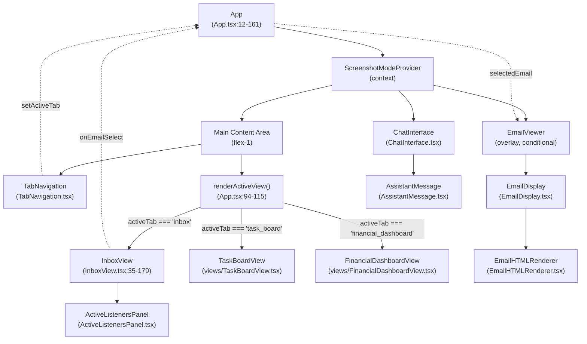
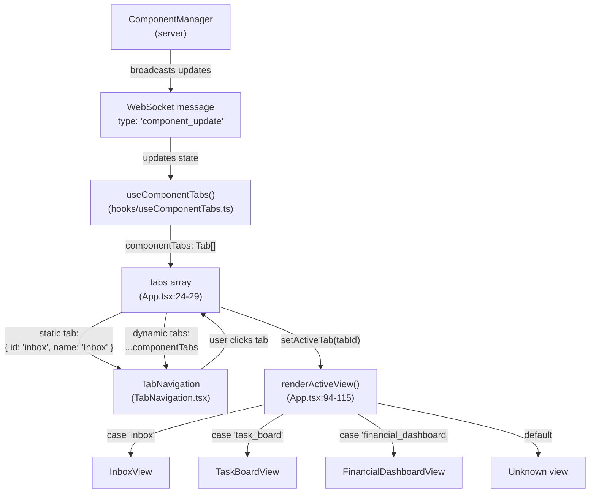
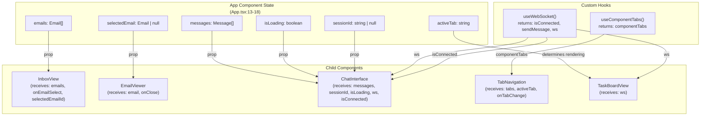
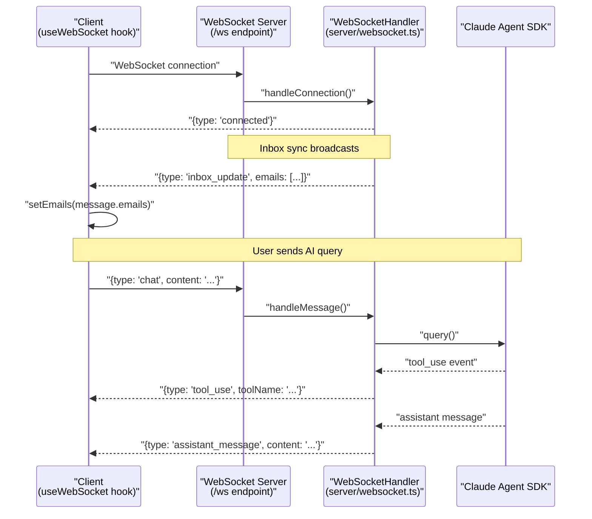
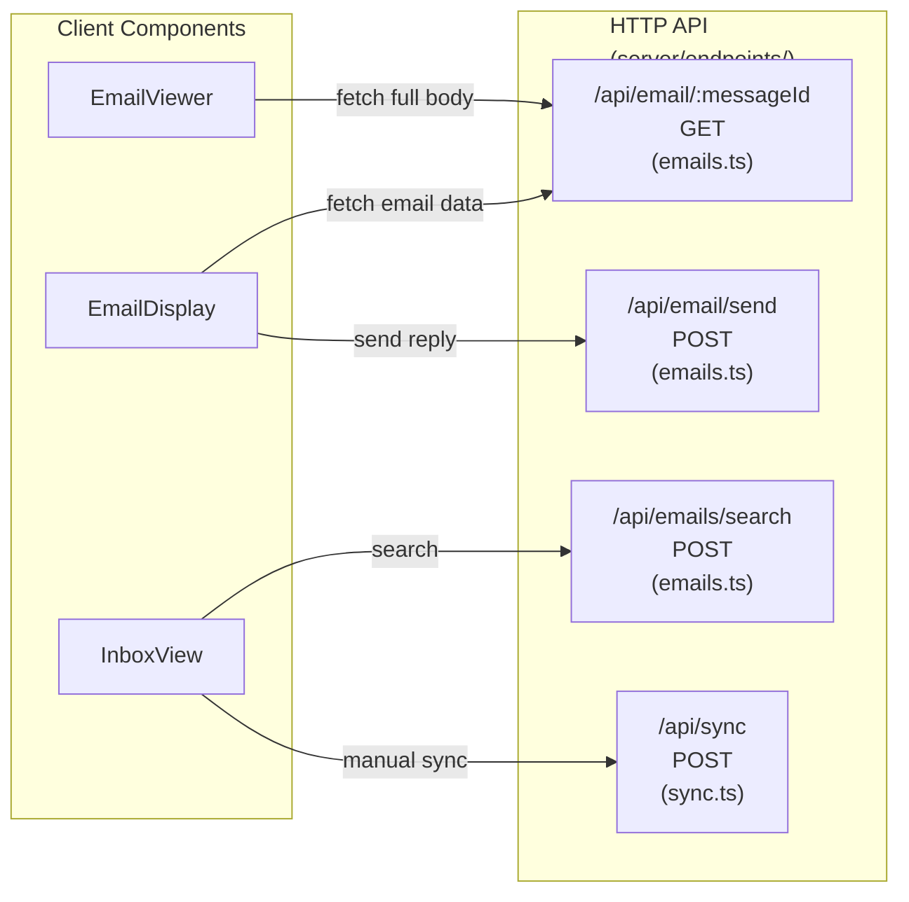
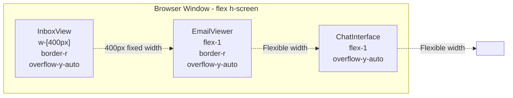

<!-- source: DeepWiki mcp.deepwiki.com · repo anthropics/claude-agent-sdk-demos · page 4.4 Client Layer · fetched 2026-10-26 -->

# Client Layer

<details>
<summary>Relevant source files</summary>

The following files were used as context for generating this wiki page:

- [email-agent/client/App.tsx](email-agent/client/App.tsx)
- [email-agent/client/components/InboxView.tsx](email-agent/client/components/InboxView.tsx)

</details>


## Purpose and Scope

The Client Layer is the React-based frontend application that provides the user interface for the Email Agent Demo. It implements a multi-panel layout with tab-based navigation, real-time WebSocket communication, and a persistent AI assistant interface. The client runs in the browser and communicates with the server layer documented in page 4.2.

**Technology Stack:**
- **Framework**: React with TypeScript
- **Styling**: Tailwind CSS with custom theme extensions
- **Communication**: WebSocket for real-time updates, HTTP REST for CRUD operations
- **Build Tool**: Vite for development and production builds

This page provides a high-level overview of the client architecture, component organization, and communication patterns. For detailed documentation of specific components and features, see:
- **Application Structure**: page 4.4.1 - `App.tsx` root component, WebSocket integration, tab system, state management
- **Email Viewing Components**: page 4.4.2 - `EmailViewer`, `EmailDisplay`, `EmailHTMLRenderer` for displaying email content
- **Inbox Management**: page 4.4.3 - `InboxView` component, email list rendering, screenshot mode
- **AI Assistant Messages**: page 4.4.4 - `AssistantMessage` component, tool use display, action buttons

**Sources:** [email-agent/client/App.tsx:1-161](), [email-agent/client/components/InboxView.tsx:1-179]()
</thinking>

## Directory Structure

```
email-agent/client/
├── App.tsx                           # Root component
├── main.tsx                          # Application entry point
├── globals.css                       # Tailwind configuration and global styles
├── components/
│   ├── ChatInterface.tsx             # AI assistant chat panel
│   ├── InboxView.tsx                 # Email list view
│   ├── EmailViewer.tsx               # Email detail viewer (overlay)
│   ├── EmailDisplay.tsx              # Email content renderer
│   ├── EmailHTMLRenderer.tsx         # Sandboxed HTML email renderer
│   ├── AssistantMessage.tsx          # AI message display with tool use
│   ├── TabNavigation.tsx             # Tab bar component
│   ├── ActiveListenersPanel.tsx      # Listener status display
│   └── views/
│       ├── TaskBoardView.tsx         # Task management view (dynamic)
│       └── FinancialDashboardView.tsx # Financial dashboard (dynamic)
├── hooks/
│   ├── useWebSocket.ts               # WebSocket connection management
│   └── useComponentTabs.ts           # Dynamic tab discovery
├── context/
│   └── ScreenshotModeContext.tsx     # Screenshot mode state provider
└── utils/
    └── placeholders.ts               # Placeholder data for screenshot mode
```

**Sources:** [email-agent/client/App.tsx:1-10](), [email-agent/client/components/InboxView.tsx:1-11]()

---

## Component Architecture

The client layer follows a hierarchical component structure with `App` as the root component. The architecture implements a three-panel layout: a switchable main content area (controlled by tabs), an optional email viewer overlay, and a persistent AI assistant chat interface.

### Component Hierarchy

**Diagram: Client Component Tree and Data Flow**



### Component Roles

| Component | Location | Primary Responsibility | Documented In |
|-----------|----------|------------------------|---------------|
| `App` | [email-agent/client/App.tsx:12-161]() | Root orchestration, WebSocket management, state coordination | page 4.4.1 |
| `TabNavigation` | `components/TabNavigation.tsx` | Tab bar rendering and selection | page 4.4.1 |
| `InboxView` | [email-agent/client/components/InboxView.tsx:35-179]() | Email list display, selection handling | page 4.4.3 |
| `TaskBoardView` | `components/views/TaskBoardView.tsx` | Task management interface (dynamic component) | page 4.4.1 |
| `FinancialDashboardView` | `components/views/FinancialDashboardView.tsx` | Financial data visualization (dynamic component) | page 4.4.1 |
| `EmailViewer` | `components/EmailViewer.tsx` | Full email content overlay | page 4.4.2 |
| `EmailDisplay` | `components/EmailDisplay.tsx` | Email body rendering and reply interface | page 4.4.2 |
| `EmailHTMLRenderer` | `components/EmailHTMLRenderer.tsx` | Sandboxed HTML email rendering | page 4.4.2 |
| `ChatInterface` | `components/ChatInterface.tsx` | AI assistant conversation interface | page 4.4.1 |
| `AssistantMessage` | `components/AssistantMessage.tsx` | AI message display with tool use visualization | page 4.4.4 |
| `ActiveListenersPanel` | `components/ActiveListenersPanel.tsx` | Listener status monitoring | page 4.4.3 |

**Sources:** [email-agent/client/App.tsx:1-161](), [email-agent/client/components/InboxView.tsx:1-179]()

---

## Tab Navigation System

The application implements a dynamic tab system that combines static tabs (like `inbox`) with dynamically discovered component tabs from the server's component registry. This enables the server to register new UI views that automatically appear as tabs in the client.

**Diagram: Tab Discovery and Rendering Pipeline**



### Tab Construction

The `tabs` array in [email-agent/client/App.tsx:24-29]() merges static and dynamic tabs:

```typescript
const tabs = useMemo(() => {
  return [
    { id: 'inbox', name: 'Inbox' },  // Static tab
    ...componentTabs                  // Dynamic tabs from server
  ];
}, [componentTabs]);
```

**Current Tab Registry:**

| Tab ID | Tab Name | Source | Component | Receives WebSocket |
|--------|----------|--------|-----------|-------------------|
| `inbox` | Inbox | Static | `InboxView` | No (uses REST) |
| `task_board` | Task Board | Dynamic | `TaskBoardView` | Yes (`ws` prop) |
| `financial_dashboard` | Financial Dashboard | Dynamic | `FinancialDashboardView` | Yes (`ws` prop) |

### View Rendering

The `renderActiveView()` function in [email-agent/client/App.tsx:94-115]() maps tab IDs to components:

```typescript
switch (activeTab) {
  case 'inbox':
    return <InboxView emails={emails} onEmailSelect={setSelectedEmail} selectedEmailId={selectedEmail?.id} />;
  case 'task_board':
    return <TaskBoardView ws={ws} />;
  case 'financial_dashboard':
    return <FinancialDashboardView ws={ws} />;
  default:
    return <div className="...">Unknown view: {activeTab}</div>;
}
```

Dynamic components receive the `ws` (WebSocket) prop for subscribing to real-time updates from the server. See page 4.4.1 for details on the tab system implementation.

**Sources:** [email-agent/client/App.tsx:9-29](), [email-agent/client/App.tsx:94-115]()

---

## State Management

The client uses React's `useState` hooks for component-local state. Application-wide state is managed in the `App` component and distributed to child components via props. There is no global state management library (e.g., Redux, Zustand) - instead, state flows unidirectionally from `App` down through the component tree.

### State Variables

**Diagram: State Flow from App to Components**



**State Variables** [email-agent/client/App.tsx:13-18]():

| Variable | Type | Purpose | Updated By |
|----------|------|---------|------------|
| `emails` | `Email[]` | Email list for `InboxView` | WebSocket `inbox_update` message |
| `messages` | `Message[]` | Chat conversation history | WebSocket `assistant_message`, `tool_use` messages |
| `sessionId` | `string \| null` | Claude agent session ID | WebSocket `session`, `session_info` messages |
| `isLoading` | `boolean` | AI processing indicator | User sends message (set true), response received (set false) |
| `selectedEmail` | `Email \| null` | Email to display in `EmailViewer` overlay | User clicks email in `InboxView` |
| `activeTab` | `string` | Currently active tab ID | User clicks tab in `TabNavigation` |

### Update Flow

State updates follow a unidirectional flow pattern:

1. **WebSocket messages** arrive at `useWebSocket` hook
2. **Message handler** in [email-agent/client/App.tsx:34-90]() dispatches to state setters
3. **React re-renders** affected components with new props
4. **User interactions** trigger callbacks that update state in `App`

See page 4.4.1 for detailed state management implementation and WebSocket message handling.

**Sources:** [email-agent/client/App.tsx:13-91]()

---

## Communication Protocols

The client uses two communication channels with the server:

1. **WebSocket** - Real-time bidirectional communication for AI assistant chat, inbox updates, and component state synchronization
2. **HTTP REST** - Request-response operations for email CRUD, search, and attachment handling

### WebSocket Communication

The `useWebSocket` hook in `hooks/useWebSocket.ts` establishes a persistent connection to `ws://localhost:3000/ws` and provides message handling, reconnection logic, and send functionality.

**Diagram: WebSocket Message Flow**



**WebSocket Message Types** (handled in [email-agent/client/App.tsx:34-90]()):

| Type | Direction | Purpose | State Update |
|------|-----------|---------|--------------|
| `connected` | Server → Client | Connection confirmation | Logs message |
| `inbox_update` | Server → Client | Email list sync | `setEmails()` |
| `session` / `session_info` | Server → Client | Agent session ID | `setSessionId()` |
| `assistant_message` | Server → Client | AI response text | `setMessages()`, `setIsLoading(false)` |
| `tool_use` | Server → Client | Tool invocation display | `setMessages()` |
| `result` | Server → Client | Query completion | `setIsLoading(false)` |
| `error` | Server → Client | Error notification | `setMessages()`, `setIsLoading(false)` |
| `chat` | Client → Server | User message to AI | Triggers agent query |

See page 4.4.1 for detailed WebSocket integration and page 4.2.2 for server-side WebSocket handler implementation.

**Sources:** [email-agent/client/App.tsx:32-91]()

### HTTP REST Communication

HTTP requests are made using `fetch()` for operations that don't require real-time updates.

**Diagram: HTTP API Endpoints**



**Key HTTP Operations:**

| Endpoint | Method | Component | Purpose | Response |
|----------|--------|-----------|---------|----------|
| `/api/email/:messageId` | GET | `EmailViewer`, `EmailDisplay` | Fetch full email body | Email object with `body_html` and `body_text` |
| `/api/email/send` | POST | `EmailDisplay` | Send email reply | `{ success: boolean }` |
| `/api/emails/search` | POST | Search components | Gmail-style query search | `{ emails: Email[] }` |
| `/api/sync` | POST | `InboxView` | Manual inbox sync | `{ success: boolean }` |

See page 4.4.2 for `EmailViewer` HTTP usage and page 4.3 for server-side API endpoint documentation.

**Sources:** [email-agent/client/App.tsx:32-91]()

---

## Key Component Overview

This section provides brief overviews of the main client components. For detailed documentation, see the respective sub-pages.

### InboxView Component

The `InboxView` component ([email-agent/client/components/InboxView.tsx:35-179]()) renders the email list panel with a scrollable list of email summaries. It includes:

- **Header** with inbox icon and email count badge
- **ActiveListenersPanel** showing active listener status
- **Email list** with sender, subject, snippet, timestamp, and visual indicators (unread dot, star, attachment icon)
- **Footer** with screenshot mode toggle button

**Key Features:**
- Relative time formatting ("5m ago", "3h ago", "2d ago")
- Selection highlighting with gray background and left border
- Unread email indication with blue tint background
- Text truncation for subjects (50 character limit)

**Email Interface** [email-agent/client/components/InboxView.tsx:13-27]():
```typescript
interface Email {
  id: number;
  message_id: string;
  subject: string;
  from_address: string;
  from_name?: string;
  date_sent: string;
  snippet?: string;
  is_read: boolean;
  is_starred: boolean;
  has_attachments: boolean;
  folder?: string;
}
```

See page 4.4.3 for complete `InboxView` documentation including screenshot mode and `ActiveListenersPanel` integration.

**Sources:** [email-agent/client/components/InboxView.tsx:13-179]()

### EmailViewer Component

The `EmailViewer` component displays full email content in an overlay panel. It implements:

- **Lazy loading**: Fetches `body_html` and `body_text` from `/api/email/:messageId` when not cached
- **HTML rendering**: Uses `EmailHTMLRenderer` component for HTML emails
- **Plain text rendering**: Displays in `<pre>` element with preserved whitespace
- **Header display**: Subject, from/to addresses, formatted timestamp

See page 4.4.2 for detailed documentation of `EmailViewer`, `EmailDisplay`, and `EmailHTMLRenderer` components.

**Sources:** [email-agent/client/components/EmailViewer.tsx:34-161]()

### EmailHTMLRenderer Component

The `EmailHTMLRenderer` component renders HTML email content in a sandboxed iframe for security and style isolation:

- **Security**: `sandbox="allow-same-origin allow-popups"` prevents script execution
- **Style injection**: Injects base styles for consistent rendering
- **Auto-resize**: Dynamically adjusts iframe height to fit content
- **Image handling**: Listens to image load events for accurate sizing

See page 4.4.2 for implementation details.

**Sources:** [email-agent/client/components/EmailHTMLRenderer.tsx:8-136]()

### ChatInterface Component

The `ChatInterface` component provides the AI assistant conversation interface on the right side of the application. It includes:

- Message history display with user and assistant messages
- Tool use visualization (see page 4.4.4)
- Input textarea for sending messages
- Loading indicator during AI processing
- WebSocket integration for real-time responses

See page 4.4.1 for `ChatInterface` implementation details and page 4.4.4 for `AssistantMessage` component documentation.

**Sources:** [email-agent/client/App.tsx:144-154]()

---

## Styling System

The client uses **Tailwind CSS** as its primary styling framework with custom theme extensions via CSS variables. This approach enables consistent styling across components and supports future dark mode implementation.

### Tailwind Configuration

The Tailwind configuration in `email-agent/tailwind.config.js` extends the default theme with HSL-based color variables defined in `globals.css`.

**Key Configuration Elements:**

- **Content paths**: Scans `.tsx` files in `client/` directory for class usage
- **Theme extension**: Maps Tailwind color utilities to CSS variables (e.g., `bg-background`, `text-foreground`)
- **Dark mode**: Uses `class` strategy for manual dark mode toggling

**Color System** (defined in [email-agent/client/globals.css:4-47]()):

| CSS Variable | Light Value | Purpose |
|-------------|-------------|---------|
| `--foreground` | `0 0% 0%` | Primary text (black) |
| `--background` | `0 0% 100%` | Main background (white) |
| `--border` | `0 0% 89%` | Border colors (light gray) |
| `--muted-foreground` | `0 0% 45%` | Secondary text (gray) |
| `--primary` | `0 0% 0%` | Primary buttons/accents (black) |

### Global Styles

**Base Styles** [email-agent/client/globals.css:50-61]():

```css
body {
  background-color: hsl(var(--background));
  color: hsl(var(--foreground));
  font-family: -apple-system, BlinkMacSystemFont, 'Segoe UI', 'Roboto', ...;
  font-size: 14px;
  line-height: 1.5;
}
```

**Custom Utility Classes** [email-agent/client/globals.css:63-94]():

| Class | Purpose | Usage |
|-------|---------|-------|
| `.mono-button` | Monochrome button | Black bg, white text, hover invert |
| `.mono-input` | Minimal input style | Border on focus, no heavy styling |
| `.border-thin` | 1px border | `border-width: 1px` |
| `.text-xs-tight` | Compact small text | `font-size: 11px`, `line-height: 1.2` |

**Email Content Styles** [email-agent/client/globals.css:97-244]():

The `.email-content` class provides comprehensive styling for rendered email HTML:
- Typography: Headings, paragraphs, lists, blockquotes
- Code blocks: Monospace font, gray background
- Tables: Border collapse, cell padding
- Images: Responsive with `max-width: 100%`
- Links: Blue color with hover underline

**Sources:** [email-agent/tailwind.config.js:1-53](), [email-agent/client/globals.css:1-244]()

---

## Screenshot Mode

Screenshot Mode is a privacy feature that replaces sensitive email data (names, addresses, subjects, content) with generic placeholders. This enables taking screenshots and recordings without exposing real user data.

### Implementation

**Context Provider** [email-agent/client/App.tsx:118]():

The `ScreenshotModeProvider` wraps the entire application tree, providing:
- `isScreenshotMode`: boolean state
- `toggleScreenshotMode()`: function to toggle mode on/off

**Usage Pattern:**

Components access the context via `useScreenshotMode()` hook and conditionally render placeholder or real data:

```typescript
const { isScreenshotMode } = useScreenshotMode();

// In render:
{isScreenshotMode 
  ? getPlaceholderName(index) 
  : email.from_name}
```

**Placeholder Functions** (from `utils/placeholders.ts`):

| Function | Returns | Example Output |
|----------|---------|----------------|
| `getPlaceholderEmail(index)` | Generic email | `user1@example.com` |
| `getPlaceholderName(index)` | Generic name | `John Smith` |
| `getPlaceholderSubject(index)` | Generic subject | `Project Update - Q4 Planning` |
| `getPlaceholderSnippet(index)` | Generic preview | `Thanks for reaching out...` |
| `getPlaceholderDate(minutes)` | Generic timestamp | `2h ago` |
| `getPlaceholderBodyText()` | Generic body | `Dear Team,\n\nThis is a sample email...` |

**Components Using Screenshot Mode:**

1. **InboxView** [email-agent/client/components/InboxView.tsx:104-136]():
   - Replaces: sender name, email address, subject, snippet, date
   - Maintains visual layout and indicators (unread, starred, attachments)

2. **EmailViewer**: 
   - Replaces: subject, from/to addresses, body content
   - See page 4.4.2 for details

**Toggle Button** [email-agent/client/components/InboxView.tsx:164-176]():
- Location: Bottom-right of `InboxView` footer
- Icon: Camera (enabled) or CameraOff (disabled)
- Label: "Screenshot mode"

See page 4.4.3 for detailed screenshot mode implementation in `InboxView`.

**Sources:** [email-agent/client/App.tsx:118](), [email-agent/client/components/InboxView.tsx:3-11](), [email-agent/client/components/InboxView.tsx:104-176]()

---

## Layout Structure

The application uses a three-panel horizontal layout with fixed positioning.

**Layout Diagram:**



**Layout Implementation** [email-agent/client/App.tsx:79-101]():

- Container: `flex h-screen bg-white` - Full viewport height, horizontal flex layout
- InboxView: `w-[400px]` - Fixed 400px width
- EmailViewer: `flex-1` - Takes remaining space, shares with ChatInterface
- ChatInterface: `flex-1` - Takes remaining space

Each panel manages its own scroll independently using `overflow-y-auto` classes.

**Sources:** [email-agent/client/App.tsx:77-102]()

---

