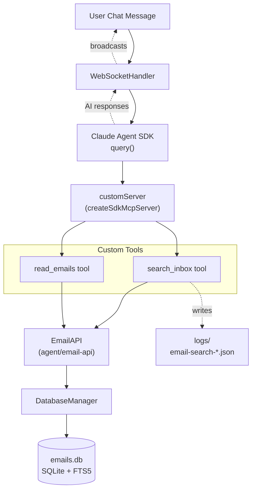
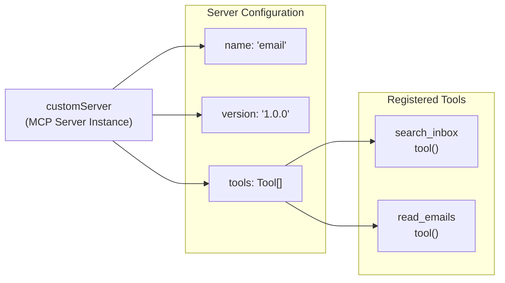
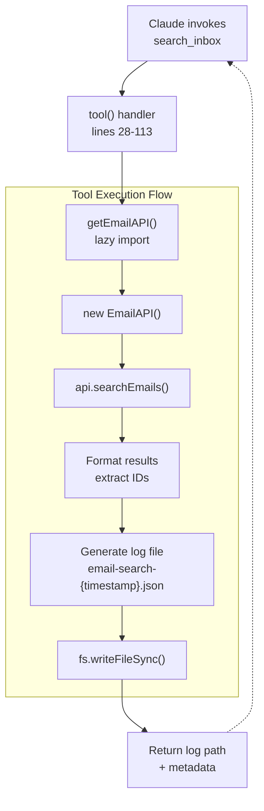
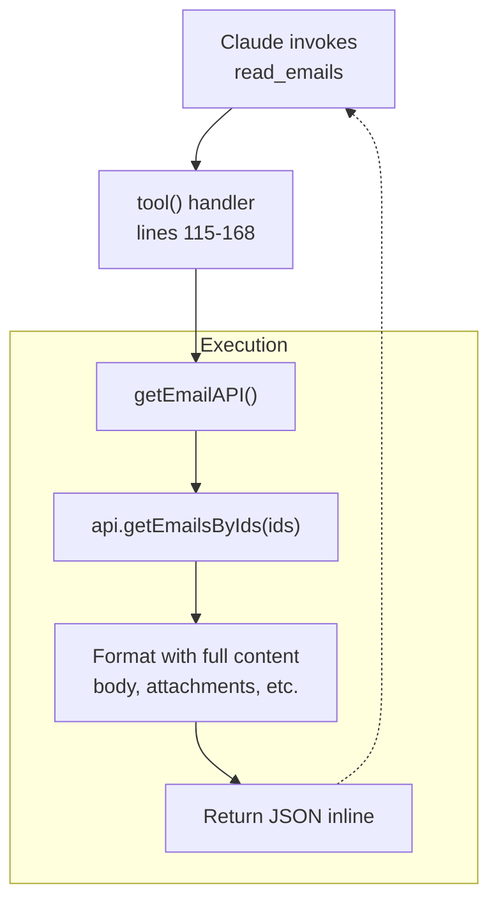
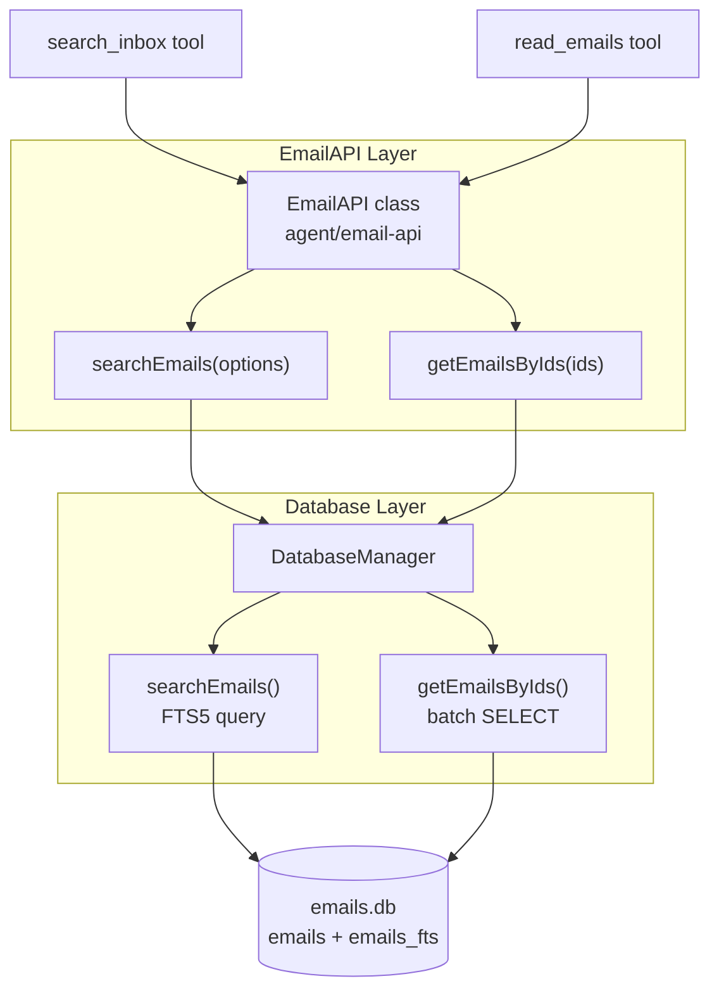

<!-- source: DeepWiki mcp.deepwiki.com · repo anthropics/claude-agent-sdk-demos · page 4.5 AI Integration · fetched 2026-10-26 -->

# AI Integration

<details>
<summary>Relevant source files</summary>

The following files were used as context for generating this wiki page:

- [email-agent/README.md](email-agent/README.md)
- [email-agent/ccsdk/custom-tools.ts](email-agent/ccsdk/custom-tools.ts)
- [email-agent/ccsdk/email-agent-prompt.ts](email-agent/ccsdk/email-agent-prompt.ts)
- [email-agent/ccsdk/types.ts](email-agent/ccsdk/types.ts)
- [email-agent/client/components/message/AssistantMessage.tsx](email-agent/client/components/message/AssistantMessage.tsx)

</details>


This page documents how Claude is integrated into the Email Agent through custom Model Context Protocol (MCP) tools and system prompts. The AI integration layer enables Claude to search and read emails from the local database using domain-specific tools.

For information about the client-side rendering of AI messages, see [AI Assistant Messages](#3.4.4). For the overall server architecture, see [Server Layer](#3.2).

## Overview

The Email Agent extends Claude's capabilities by creating a custom MCP server with email-specific tools. This integration allows Claude to perform operations on the email database while maintaining the conversational interface users expect.



**Sources:** [email-agent/ccsdk/custom-tools.ts:1-170](), Diagram 2 and Diagram 5 from architecture overview

## Custom MCP Server Creation

The custom MCP server is created using `createSdkMcpServer` from the Claude Agent SDK. This server registers email-specific tools that Claude can invoke during conversations.



The server is defined in [email-agent/ccsdk/custom-tools.ts:24-170]() with two specialized tools:

| Tool Name | Purpose | Input Schema | Output |
|-----------|---------|--------------|--------|
| `search_inbox` | Search emails using Gmail query syntax | `gmailQuery: string` | Log file path + metadata |
| `read_emails` | Fetch full email content by IDs | `ids: string[]` | Email details JSON |

**Sources:** [email-agent/ccsdk/custom-tools.ts:24-170]()

## search_inbox Tool

The `search_inbox` tool enables Claude to query the email database using Gmail-compatible search syntax.



**Tool Schema:**

[email-agent/ccsdk/custom-tools.ts:28-36]() defines the tool with:
- **Name:** `search_inbox`
- **Description:** "Search emails in the inbox using Gmail query syntax"
- **Input:** `gmailQuery` - Gmail query string supporting operators like `from:`, `subject:`, `newer_than:`, etc.

**Execution Details:**

1. **API Initialization:** [email-agent/ccsdk/custom-tools.ts:39-40]() - Lazy-loads `EmailAPI` to ensure environment variables are available
2. **Search Execution:** [email-agent/ccsdk/custom-tools.ts:45-48]() - Calls `api.searchEmails()` with limit of 30 results
3. **Result Formatting:** [email-agent/ccsdk/custom-tools.ts:51-64]() - Formats each email with fields:
   - `id`, `messageId`, `date`, `from`, `to`, `subject`
   - `body`, `hasAttachments`, `isRead`, `folder`, `labels`
4. **Log File Creation:** [email-agent/ccsdk/custom-tools.ts:69-89]() - Writes full results to timestamped JSON file in `logs/` directory

**Why Log Files?**

The tool writes search results to log files rather than returning them inline because:
- Email content can be large, exceeding token limits
- Log files provide persistent storage for reference
- Claude can read log files using the built-in `Read` tool if needed
- Enables debugging and audit trails

**Sources:** [email-agent/ccsdk/custom-tools.ts:28-113]()

## read_emails Tool

The `read_emails` tool fetches full email content for specified message IDs.



**Tool Schema:**

[email-agent/ccsdk/custom-tools.ts:115-120]() defines:
- **Name:** `read_emails`
- **Description:** "Read multiple emails by their IDs to get full content and details"
- **Input:** `ids` - Array of email message IDs (e.g., `['<abc123@example.com>', '<def456@example.com>']`)

**Execution Details:**

1. **Batch Fetch:** [email-agent/ccsdk/custom-tools.ts:129]() - Fetches multiple emails in one call
2. **Full Content:** [email-agent/ccsdk/custom-tools.ts:132-145]() - Returns complete email objects with all metadata
3. **Inline Response:** Unlike `search_inbox`, results are returned directly in the tool response JSON [email-agent/ccsdk/custom-tools.ts:149-157]()

**Typical Usage Pattern:**

1. Claude uses `search_inbox` to find relevant emails
2. Gets log file path with message IDs
3. Uses `Read` tool to read the log file
4. Extracts specific message IDs of interest
5. Uses `read_emails` to fetch full content of those emails

**Sources:** [email-agent/ccsdk/custom-tools.ts:115-168]()

## EmailAPI Integration

Both custom tools delegate to `EmailAPI` for actual database operations.



The `EmailAPI` class ([email-agent/agent/email-api.ts]()) serves as an abstraction layer that:
- Initializes `DatabaseManager` connection
- Provides async methods for email operations
- Handles error translation and response formatting
- Supports both Gmail query syntax and direct ID lookup

**Sources:** [email-agent/ccsdk/custom-tools.ts:18-22](), [email-agent/ccsdk/custom-tools.ts:39-40](), [email-agent/ccsdk/custom-tools.ts:123-124]()

## System Prompt Configuration

The `EMAIL_AGENT_PROMPT` provides Claude with context about its capabilities and formatting conventions.

```mermaid
graph TB
    Prompt["EMAIL_AGENT_PROMPT<br/>email-agent-prompt.ts"]
    
    subgraph "Core Capabilities Section"
        SearchCap["Search emails<br/>by various criteria"]
        AttachCap["Find attachments"]
        FilterCap["Filter read/unread"]
        AnalyzeCap["Analyze patterns"]
        SyncCap["Sync new emails"]
    end
    
    subgraph "Listener Creation Instructions"
        ListenerSkill["Use listener-creator skill<br/>for automated monitoring"]
        ListenerFormat["Reference format:<br/>[listener:filename.ts]"]
    end
    
    subgraph "Action Creation Instructions"
        ActionSkill["Use action-creator skill<br/>for one-click actions"]
        ActionDiff["Listeners=automatic<br/>Actions=user-triggered"]
    end
    
    subgraph "Formatting Conventions"
        MarkdownFmt["Use markdown"]
        EmailRef["Email references:<br/>[email:MESSAGE_ID]"]
        CompactInfo["Show key details only"]
    end
    
    Prompt --> SearchCap
    Prompt --> AttachCap
    Prompt --> FilterCap
    Prompt --> AnalyzeCap
    Prompt --> SyncCap
    
    Prompt --> ListenerSkill
    Prompt --> ListenerFormat
    
    Prompt --> ActionSkill
    Prompt --> ActionDiff
    
    Prompt --> MarkdownFmt
    Prompt --> EmailRef
    Prompt --> CompactInfo
```



**Key Sections:**

**1. Capabilities Overview** [email-agent/ccsdk/email-agent-prompt.ts:1-9]()
- Lists what Claude can help users accomplish
- Sets expectations for search and analysis features

**2. Listener Creation Guidance** [email-agent/ccsdk/email-agent-prompt.ts:11-16]()
- Instructs when to use `listener-creator` skill via `Skill` tool
- Defines automated/event-driven use cases
- Specifies reference format: `[listener:filename.ts]`

**3. Action Template Guidance** [email-agent/ccsdk/email-agent-prompt.ts:18-28]()
- Instructs when to use `action-creator` skill
- Clarifies difference: listeners auto-trigger, actions are user-triggered
- Emphasizes personalization to user's workflows

**4. Formatting Conventions** [email-agent/ccsdk/email-agent-prompt.ts:30-34]()
- Email reference syntax: `[email:MESSAGE_ID]` for clickable links
- Markdown for readability
- Concise, relevant responses

**Reference Format Parsing:**

The client-side `AssistantMessage` component parses special reference formats:
- `[email:MESSAGE_ID]` → Renders `EmailDisplay` component [email-agent/client/components/message/AssistantMessage.tsx:346-349]()
- `[listener:filename.ts]` → Renders `ListenerDisplay` component [email-agent/client/components/message/AssistantMessage.tsx:346-349]()

This enables inline display of emails and listeners directly in chat messages.

**Sources:** [email-agent/ccsdk/email-agent-prompt.ts:1-36](), [email-agent/client/components/message/AssistantMessage.tsx:345-404]()

## Tool Call Logging Strategy

The `search_inbox` tool implements a logging strategy that persists search results to the filesystem.

**Log File Structure:**

```
logs/
└── email-search-2024-01-15T10-30-45-123Z.json
    ├── query: "from:boss@company.com subject:urgent"
    ├── timestamp: "2024-01-15T10:30:45.123Z"
    ├── totalResults: 5
    ├── ids: ["<msg1@...>", "<msg2@...>", ...]
    └── emails: [
          {
            index: 1,
            id: "<msg1@...>",
            messageId: "<msg1@...>",
            date: "2024-01-15T09:00:00Z",
            from: "boss@company.com",
            subject: "URGENT: Client presentation",
            body: "...",
            ...
          },
          ...
        ]
```

**Implementation:**

1. **Directory Creation:** [email-agent/ccsdk/custom-tools.ts:69-73]() - Ensures `logs/` directory exists
2. **Timestamp Generation:** [email-agent/ccsdk/custom-tools.ts:76]() - Creates ISO timestamp with sanitized characters
3. **Log Data Structure:** [email-agent/ccsdk/custom-tools.ts:81-87]() - Includes query, timestamp, result count, IDs, and full emails
4. **File Write:** [email-agent/ccsdk/custom-tools.ts:89]() - Writes JSON with 2-space indentation

**Tool Response:**

The tool returns minimal metadata to Claude [email-agent/ccsdk/custom-tools.ts:93-102]():
```json
{
  "totalResults": 5,
  "logFilePath": "/path/to/logs/email-search-2024-01-15T10-30-45-123Z.json",
  "message": "Full email search results written to /path/to/logs/..."
}
```

Claude can then use the built-in `Read` tool to access log file contents if needed.

**Benefits:**

| Benefit | Description |
|---------|-------------|
| Token Efficiency | Avoids returning large email bodies in tool response |
| Persistence | Results remain available across conversation turns |
| Debugging | Provides audit trail of all searches |
| Flexibility | Claude decides when to read full content |

**Sources:** [email-agent/ccsdk/custom-tools.ts:69-102]()

## Message Types and Flow

The WebSocket communication includes Claude message types defined for the AI integration.

```mermaid
graph LR
    subgraph "Client Types"
        ChatMsg["ChatMessage<br/>type: 'chat'<br/>content: string"]
    end
    
    subgraph "SDK Message Types"
        UserMsg["SDKUserMessage<br/>(to Claude)"]
        SDKMsg["SDKMessage<br/>(from Claude)"]
    end
    
    subgraph "Response Types"
        AssistantMsg["AssistantMessage<br/>content: Block[]<br/>actions: ActionInstance[]<br/>components: Component[]"]
        TextBlock["TextBlock<br/>type: 'text'<br/>text: string"]
        ToolUse["ToolUseBlock<br/>type: 'tool_use'<br/>name: string<br/>input: object"]
    end
    
    ChatMsg --> UserMsg
    UserMsg -.->|SDK query()| SDKMsg
    SDKMsg --> AssistantMsg
    
    AssistantMsg --> TextBlock
    AssistantMsg --> ToolUse
```

**Type Definitions:**

- `ChatMessage` [email-agent/ccsdk/types.ts:8-13]() - User message to server
- `SDKUserMessage`, `SDKMessage` [email-agent/ccsdk/types.ts:31-32]() - Re-exported from SDK
- `AssistantMessage` - Client-side type for rendering Claude responses
- `ToolUseBlock` - Represents tool invocations in Claude's response

**Tool Use Display:**

The `AssistantMessage` component renders tool calls with formatted parameters for various tool types including the custom email tools [email-agent/client/components/message/AssistantMessage.tsx:20-332]().

**Sources:** [email-agent/ccsdk/types.ts:1-32](), [email-agent/client/components/message/AssistantMessage.tsx:1-514]()

---

