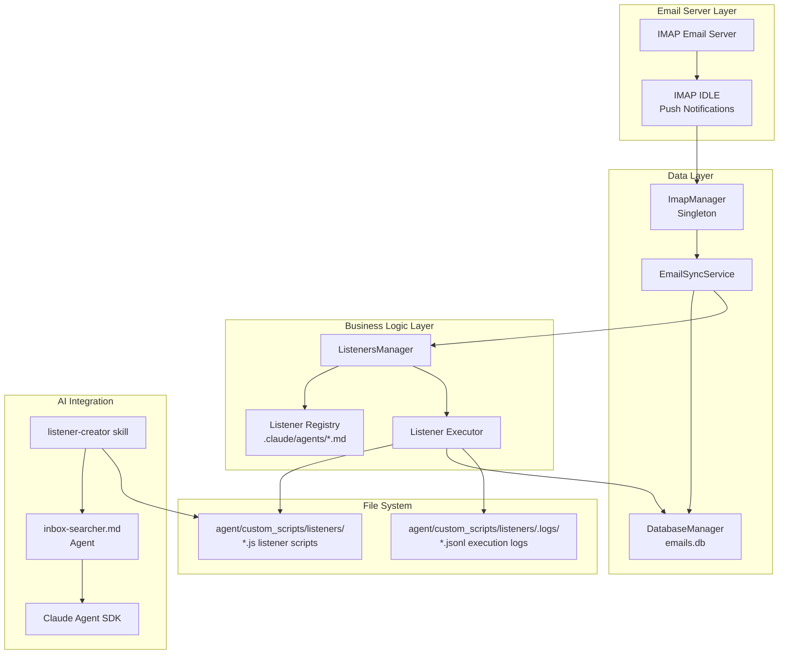
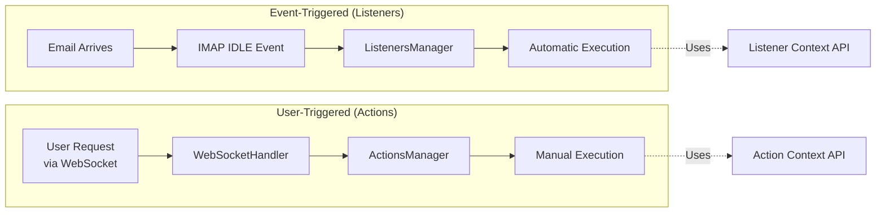
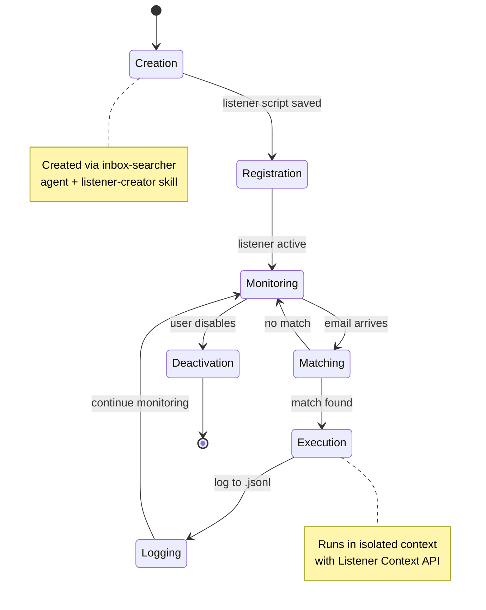

<!-- source: DeepWiki mcp.deepwiki.com · repo anthropics/claude-agent-sdk-demos · page 4.6 Listeners System · fetched 2026-10-26 -->

# Listeners System

<details>
<summary>Relevant source files</summary>

The following files were used as context for generating this wiki page:

- [email-agent/.gitignore](email-agent/.gitignore)
- [email-agent/agent/.claude/agents/inbox-searcher.md](email-agent/agent/.claude/agents/inbox-searcher.md)
- [email-agent/agent/data/PROFILE.MD](email-agent/agent/data/PROFILE.MD)

</details>


The Listeners System is the automated email monitoring and response framework within the Email Agent. Listeners are event-triggered rules that continuously monitor incoming emails and execute specified actions when matching conditions are detected. Unlike user-triggered actions which require manual invocation, listeners operate autonomously in the background to provide automated email processing capabilities.

This page provides an architectural overview of the listeners system and its integration within the Email Agent. For detailed information about listener concepts and lifecycle, see [Listener Concepts](#4.6.1). For instructions on creating listeners, see [Creating Listeners](#4.6.2). For the API available within listener execution, see [Listener Context API](#4.6.3).

## Purpose and Capabilities

The Listeners System enables automated email workflows such as:

- Auto-categorizing and labeling incoming emails based on content
- Extracting and logging specific information from emails (invoices, receipts, meeting invitations)
- Forwarding or replying to emails matching certain criteria
- Triggering notifications or external integrations based on email events
- Monitoring for specific senders, subjects, or keywords

Listeners execute in response to IMAP IDLE notifications, allowing near-real-time processing of incoming emails without continuous polling.

## System Architecture



**Listeners System Architecture**

Sources: [email-agent/.gitignore:134-136](), Architecture Diagram 4 from context

The Listeners System spans multiple architectural layers:

| Layer | Components | Responsibilities |
|-------|-----------|------------------|
| **Email Server** | IMAP Server, IDLE notifications | Push email events to the application |
| **Data Layer** | `ImapManager`, `EmailSyncService`, `DatabaseManager` | Receive email events, sync to database |
| **Business Logic** | `ListenersManager`, Listener Registry, Listener Executor | Manage listener lifecycle, execute listener logic |
| **AI Integration** | `inbox-searcher.md`, `listener-creator` skill | Create and validate listener rules |
| **File System** | Listener scripts (`.js`), Execution logs (`.jsonl`) | Store listener code and execution history |

## Event-Triggered vs User-Triggered Execution

The Email Agent supports two distinct execution models:



**Execution Model Comparison**

Sources: Architecture Diagram 4 from context

### Listeners (Event-Triggered)

- **Trigger**: IMAP IDLE notifications when new emails arrive
- **Execution**: Automatic, background processing
- **Frequency**: Runs on every matching email event
- **Manager**: `ListenersManager`
- **Storage**: `agent/custom_scripts/listeners/`
- **Logging**: `.logs/*.jsonl` for audit trail

### Actions (User-Triggered)

- **Trigger**: Explicit user request via WebSocket
- **Execution**: On-demand, interactive
- **Frequency**: Only when user invokes
- **Manager**: `ActionsManager`
- **Storage**: Different storage location
- **Logging**: Different logging mechanism

## Listener Lifecycle



**Listener Lifecycle State Machine**

Sources: [email-agent/agent/.claude/agents/inbox-searcher.md:1-4]()

### Creation Phase

1. User describes desired automation to the Email Agent
2. Agent uses `inbox-searcher.md` to understand email patterns
3. Agent invokes `listener-creator` skill to generate listener JavaScript
4. Listener script saved to `agent/custom_scripts/listeners/`

### Registration Phase

1. `ListenersManager` discovers listener scripts on startup
2. Listener metadata parsed from script comments/exports
3. Listener added to active registry

### Monitoring Phase

1. `EmailSyncService` receives IMAP IDLE notifications
2. New emails synced to `emails.db` via `DatabaseManager`
3. `ListenersManager` notified of new email events
4. All active listeners evaluated against new email

### Execution Phase

1. Listener's matching logic determines if email qualifies
2. If match, listener's action logic executes
3. Listener Context API provides access to:
   - Email database operations
   - Search capabilities
   - Action execution primitives
4. Execution details logged to `.logs/*.jsonl`

### Logging and Audit

All listener executions generate structured logs:

```jsonl
{"timestamp": "2024-01-15T10:30:45Z", "listener": "invoice-logger", "emailId": 1234, "action": "extracted", "result": {...}}
```

Sources: [email-agent/.gitignore:134-136]()

Logs are written to `agent/custom_scripts/listeners/.logs/` and excluded from version control for privacy. Each log entry includes:

- Timestamp of execution
- Listener identifier
- Email ID that triggered execution
- Action performed
- Result or error information

## Integration with Email Search

```mermaid
graph TB
    subgraph "Listener Creation Workflow"
        UserGoal["User: 'Auto-save all invoices'"]
        InboxSearcher["inbox-searcher agent"]
        SearchTool["mcp__email__search_inbox"]
        LogAnalysis["Log File Analysis<br/>Find patterns"]
        ListenerCreator["listener-creator skill"]
        GeneratedCode["Generated Listener<br/>invoice-saver.js"]
    end
    
    subgraph "Listener Execution Workflow"
        EmailArrives["New Email Arrives"]
        ListenerCheck["Listener: invoice-saver.js"]
        ContextAPI["Listener Context API"]
        SearchEmails["Search for invoice emails"]
        SaveAction["Save attachment to disk"]
    end
    
    UserGoal --> InboxSearcher
    InboxSearcher --> SearchTool
    SearchTool --> LogAnalysis
    LogAnalysis --> ListenerCreator
    ListenerCreator --> GeneratedCode
    
    EmailArrives --> ListenerCheck
    ListenerCheck --> ContextAPI
    ContextAPI --> SearchEmails
    ContextAPI --> SaveAction
```



**Listener Creation and Execution Integration**

Sources: [email-agent/agent/.claude/agents/inbox-searcher.md:1-10]()

The `inbox-searcher.md` agent plays a critical role in listener creation:

1. **Pattern Discovery**: Uses `mcp__email__search_inbox` tool to find example emails
2. **Log File Analysis**: Examines search results in `logs/email-search-*.json` to identify patterns
3. **Rule Generation**: Determines appropriate matching criteria (sender, subject, keywords)
4. **Skill Invocation**: Passes discovered patterns to `listener-creator` skill
5. **Code Generation**: Skill generates JavaScript listener with appropriate matching and action logic

The `inbox-searcher.md` agent is configured with tools:

- `Read`, `Bash`, `Glob`, `Grep`: File system operations for log analysis
- `mcp__email__search_inbox`: Gmail query-based email search
- `mcp__email__read_emails`: Retrieve full email content by ID

Sources: [email-agent/agent/.claude/agents/inbox-searcher.md:4]()

## File System Organization

The Listeners System uses a dedicated directory structure:

```
email-agent/
└── agent/
    └── custom_scripts/
        └── listeners/
            ├── invoice-logger.js        # Example listener script
            ├── meeting-notifier.js      # Example listener script
            └── .logs/                   # Execution logs (gitignored)
                ├── 2024-01-15.jsonl
                └── 2024-01-16.jsonl
```

Sources: [email-agent/.gitignore:134-136]()

### Listener Script Format

Each listener is a JavaScript module exporting:

- **Matcher function**: Determines if email triggers listener
- **Action function**: Executes when email matches
- **Metadata**: Name, description, enabled status

### Privacy and Security

The `.logs/` directory is excluded from version control to prevent exposure of personal email data. This is enforced in [.gitignore:134-136]():

```gitignore
# Listener logs with personal email data
agent/custom_scripts/listeners/.logs/
agent/custom_scripts/listeners/.logs/*.jsonl
```

## Manager Responsibilities

The `ListenersManager` component is responsible for:

| Responsibility | Description |
|---------------|-------------|
| **Discovery** | Scan `listeners/` directory for `.js` files on startup |
| **Registration** | Load and validate listener modules |
| **Event Routing** | Receive email events from `EmailSyncService` |
| **Execution** | Invoke matching listeners with appropriate context |
| **Logging** | Write execution logs to `.logs/*.jsonl` |
| **Error Handling** | Isolate listener failures to prevent system-wide issues |
| **State Management** | Track enabled/disabled listeners |

Sources: Architecture Diagram 4 from context

The manager operates as a singleton within the server's business logic layer, ensuring consistent listener state across all WebSocket sessions and HTTP requests.

## Performance Considerations

The Listeners System is designed for efficient background processing:

- **IMAP IDLE**: Push-based notifications eliminate continuous polling overhead
- **Database Caching**: `EmailSyncService` caches emails in SQLite, reducing IMAP queries
- **Selective Execution**: Only listeners with potentially matching criteria execute
- **Asynchronous Processing**: Listener execution doesn't block email synchronization
- **Log Rotation**: Structured logs enable efficient searching without memory overhead

## Next Steps

For detailed information about the Listeners System:

- **Understanding Listeners**: See [Listener Concepts](#4.6.1) for event-triggered vs user-triggered actions, lifecycle details, and use cases
- **Creating Listeners**: See [Creating Listeners](#4.6.2) for the workflow using `inbox-searcher` agent and `listener-creator` skill
- **Development Reference**: See [Listener Context API](#4.6.3) for the complete API available within listener execution context

For related email functionality:

- **Email Search**: See [Search and Filtering](#4.7) for Gmail query syntax and FTS5 full-text search
- **AI Integration**: See [AI Integration](#4.5) for custom MCP tools and agent capabilities
- **Database Schema**: See [Schema and Models](#4.3.1) for email storage structure

Sources: Table of Contents from context

---

