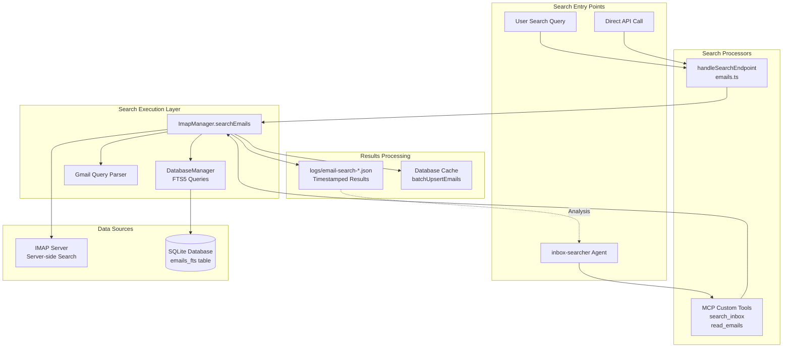
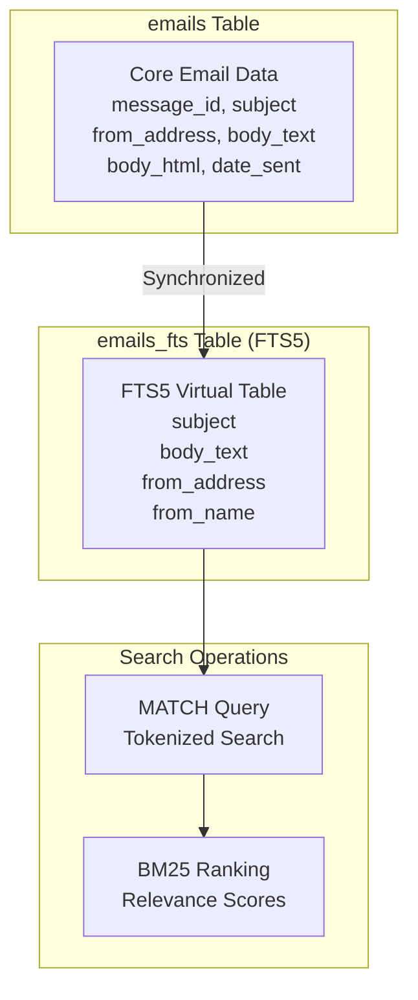
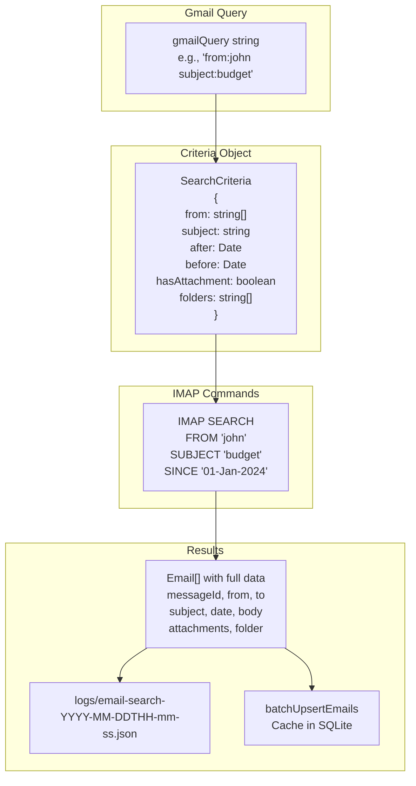
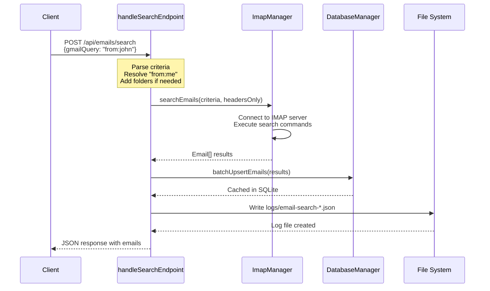
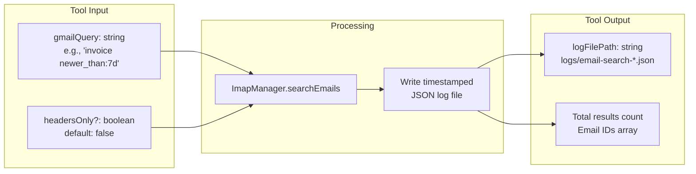
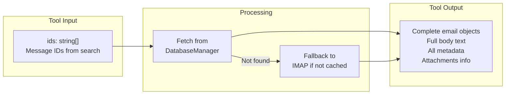
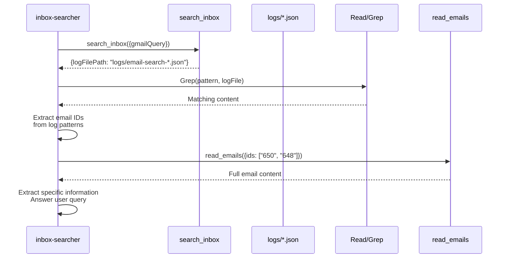

<!-- source: DeepWiki mcp.deepwiki.com · repo anthropics/claude-agent-sdk-demos · page 4.7 Search and Filtering · fetched 2026-10-26 -->

# Search and Filtering

<details>
<summary>Relevant source files</summary>

The following files were used as context for generating this wiki page:

- [email-agent/.gitignore](email-agent/.gitignore)
- [email-agent/agent/.claude/agents/inbox-searcher.md](email-agent/agent/.claude/agents/inbox-searcher.md)
- [email-agent/agent/data/PROFILE.MD](email-agent/agent/data/PROFILE.MD)
- [email-agent/bun.lock](email-agent/bun.lock)
- [email-agent/client/globals.css](email-agent/client/globals.css)
- [email-agent/package.json](email-agent/package.json)
- [email-agent/server/endpoints/emails.ts](email-agent/server/endpoints/emails.ts)
- [email-agent/tailwind.config.js](email-agent/tailwind.config.js)

</details>


## Purpose and Scope

This document covers the email search and filtering capabilities in the Email Agent demo. The system provides multiple search mechanisms including Gmail-style query syntax, SQLite FTS5 full-text search, IMAP-based searching, and AI-powered intelligent search through specialized agents. For information about the custom MCP tools that enable these searches, see [Custom MCP Tools](#4.5.1). For details on the inbox-searcher agent's capabilities, see [Email Agent Prompt and Capabilities](#4.5.2).

The search system enables users to find emails using:
- **Gmail Query Syntax**: Familiar operators like `from:`, `subject:`, `has:attachment`, date ranges
- **FTS5 Full-Text Search**: Fast content-based searching in the SQLite database
- **IMAP Search**: Direct server-side searching for comprehensive results
- **AI-Powered Search**: Strategic, hypothesis-driven searching with the inbox-searcher agent

---

## Search Architecture Overview



**Sources:** [email-agent/server/endpoints/emails.ts:62-144](), [email-agent/agent/.claude/agents/inbox-searcher.md:1-425]()

---

## Gmail Query Syntax Support

The Email Agent implements Gmail's powerful query syntax for flexible email searching. All search operations accept a `gmailQuery` parameter that supports the following operators:

### Basic Operators

| Operator | Purpose | Example |
|----------|---------|---------|
| `from:` | Emails from specific sender | `from:sender@example.com` |
| `to:` | Emails to specific recipient | `to:recipient@example.com` |
| `subject:` | Search in subject line | `subject:meeting` |
| `has:attachment` | Emails with attachments | `has:attachment` |
| `filename:` | Specific attachment types | `filename:pdf` |
| `is:unread` | Unread emails only | `is:unread` |
| `is:read` | Read emails only | `is:read` |

### Date and Time Operators

| Operator | Purpose | Example |
|----------|---------|---------|
| `after:` | Emails after specific date | `after:2024/1/1` |
| `before:` | Emails before specific date | `before:2024/12/31` |
| `newer_than:` | Relative date (days/months) | `newer_than:7d` |
| `older_than:` | Relative date (days/months) | `older_than:1m` |

### Advanced Operators

| Operator | Purpose | Example |
|----------|---------|---------|
| `OR` | Match either term | `(invoice OR receipt)` |
| `AND` | Match both (implicit with space) | `invoice payment` |
| `""` | Exact phrase match | `"quarterly report"` |
| `-` | Exclude terms | `invoice -draft` |
| `()` | Group terms | `from:vendor.com (invoice OR receipt)` |

### Special Handling

The system includes special handling for certain query patterns:

```mermaid
graph LR
    FromMe["from:me in query"]
    UserEmail[Resolve to actual<br/>EMAIL_ADDRESS]
    AddFolders[Auto-add folders:<br/>[Gmail]/Sent Mail<br/>[Gmail]/All Mail]
    
    FromMe --> UserEmail
    UserEmail --> AddFolders
```

When a search includes `from:me`, the system automatically:
1. Resolves `me` to the authenticated user's email address from environment variables
2. Expands the search to include `[Gmail]/Sent Mail` and `[Gmail]/All Mail` folders
3. Ensures sent messages are searchable

**Sources:** [email-agent/server/endpoints/emails.ts:71-91](), [email-agent/agent/.claude/agents/inbox-searcher.md:166-193]()

---

## Database Full-Text Search (FTS5)

The Email Agent uses SQLite's FTS5 (Full-Text Search 5) extension for fast content-based searching. This enables efficient searching through email subject lines, body text, and sender information.

### FTS5 Table Schema



The `emails_fts` table is a virtual table that automatically indexes and tokenizes:
- `subject` - Email subject line
- `body_text` - Plain text email body
- `from_address` - Sender email address
- `from_name` - Sender display name

FTS5 provides:
- **Tokenization**: Automatic word boundary detection and stemming
- **BM25 Ranking**: Industry-standard relevance scoring
- **Fast Lookups**: Inverted index for sub-millisecond searches
- **Phrase Matching**: Support for exact phrase queries with quotes

**Sources:** Based on SQLite FTS5 standard implementation patterns referenced in [email-agent/agent/.claude/agents/inbox-searcher.md:220-227]()

---

## IMAP Search Integration

The `ImapManager` class provides server-side searching through IMAP, which is the primary search mechanism for comprehensive results.

### Search Criteria Mapping



### Search Endpoint Implementation

The `handleSearchEndpoint` function processes search requests:

1. **Parse Search Criteria**: Extracts Gmail query syntax into structured criteria
2. **Special Handling**: Resolves `from:me` to user's email address
3. **Execute IMAP Search**: Calls `imapManager.searchEmails(criteria, headersOnly)`
4. **Cache Results**: Saves emails to database via `batchUpsertEmails`
5. **Write Log File**: Creates timestamped JSON log for AI agent analysis
6. **Return Results**: Normalized email objects with consistent format



**Sources:** [email-agent/server/endpoints/emails.ts:62-144](), [email-agent/database/imap-manager]() (referenced)

---

## Custom MCP Tools for Search

The Email Agent provides two custom MCP tools that enable AI agents to search and read emails.

### search_inbox Tool



The `search_inbox` tool:
- Accepts Gmail query syntax
- Searches IMAP server directly for comprehensive results
- Returns up to 30 emails per search
- Writes complete results to timestamped log files
- Returns log file path for further analysis
- Enables file-based analysis with Read/Grep tools

### read_emails Tool



The `read_emails` tool:
- Fetches full content of specific emails by ID
- More efficient than searching when IDs are known
- Returns complete email body (not just snippets)
- Preferred for extracting detailed information
- Supports batch reading of multiple emails

**Sources:** [email-agent/agent/.claude/agents/inbox-searcher.md:27-80](), [email-agent/agent/.claude/agents/inbox-searcher.md:310-369]()

---

## Search API Endpoints

### POST /api/emails/search

Primary search endpoint that accepts Gmail query syntax and returns matching emails.

**Request Format:**
```json
{
  "gmailQuery": "from:vendor.com invoice has:attachment after:2024/1/1",
  "headersOnly": false,
  "from": "sender@example.com",
  "subject": "budget",
  "after": "2024-01-01",
  "before": "2024-12-31",
  "hasAttachment": true,
  "folders": ["INBOX", "[Gmail]/Sent Mail"]
}
```

**Response Format:**
```json
[
  {
    "id": "message-id-123",
    "messageId": "message-id-123",
    "from": "vendor@company.com",
    "to": "user@example.com",
    "subject": "Invoice #12345",
    "date": "2024-01-15T10:30:00Z",
    "body": "Email body text...",
    "body_text": "Plain text body...",
    "body_html": "<html>...",
    "hasAttachments": true,
    "isRead": false,
    "folder": "INBOX",
    "labels": ["Important"]
  }
]
```

**Performance Characteristics:**
- Search duration logged in milliseconds
- Results cached to database for future queries
- Log files created for AI agent analysis
- Typical search: 200-500ms for IMAP query + database caching

### POST /api/emails/batch

Retrieves multiple specific emails by their message IDs.

**Request Format:**
```json
{
  "ids": ["msg-id-1", "msg-id-2", "msg-id-3"]
}
```

**Response Format:**
```json
{
  "emails": [
    { /* email object */ },
    { /* email object */ }
  ]
}
```

**Sources:** [email-agent/server/endpoints/emails.ts:16-60](), [email-agent/server/endpoints/emails.ts:243-301]()

---

## AI-Powered Search with inbox-searcher Agent

The `inbox-searcher` agent implements a strategic, hypothesis-driven search methodology that goes beyond simple keyword matching.

### Strategic Search Workflow

```mermaid
graph TB
    UserQuery[User Search Query]
    
    subgraph "Phase 1: Targeted Search"
        InitialSearch[Initial Targeted Search<br/>Based on specific criteria]
        AnalyzeResults[Analyze Results<br/>Form hypotheses]
    end
    
    subgraph "Phase 2: Hypothesis Testing"
        FormHypothesis[Form Specific Hypothesis<br/>About email location/terms]
        TestHypothesis[Test with Targeted Search<br/>Refined criteria]
        EvaluateResults[Evaluate if sufficient<br/>to answer query]
    end
    
    subgraph "Phase 3: Recursive Search (Conditional)"
        CheckNeed{Recursive<br/>search needed?}
        RecursiveSearch[Systematic Exhaustive Search<br/>Multiple dimensions]
    end
    
    subgraph "Decision Points"
        Sufficient{Results<br/>sufficient?}
        Justified{Recursion<br/>justified?}
    end
    
    UserQuery --> InitialSearch
    InitialSearch --> AnalyzeResults
    AnalyzeResults --> Sufficient
    
    Sufficient -->|No| FormHypothesis
    FormHypothesis --> TestHypothesis
    TestHypothesis --> EvaluateResults
    EvaluateResults --> Sufficient
    
    Sufficient -->|Yes| CheckNeed
    CheckNeed -->|User wants "all"<br/>OR results suspiciously low| Justified
    CheckNeed -->|Answer found| End[Return Results]
    
    Justified -->|Yes| RecursiveSearch
    Justified -->|No| End
    RecursiveSearch --> End
```

### Search Strategy Decision Framework

The inbox-searcher uses a three-tiered approach:

#### When to STOP Searching
- ✅ Found specific email(s) user asked about
- ✅ Have sufficient examples to answer question
- ✅ Results clearly indicate no more relevant emails exist
- ✅ User's question is answered with current findings

#### When to CONTINUE with Hypothesis Testing
- 🔬 Results suggest related emails might exist (test specific hypothesis)
- 🔬 Found partial information, need specific follow-up
- 🔬 Initial search was too narrow, test broader hypothesis

#### When to Initiate RECURSIVE Search
- 🔄 User explicitly requested "all", "every", or "comprehensive"
- 🔄 Initial results suspiciously low for the query type
- 🔄 Investigation requires mapping relationships between emails
- 🔄 Building complete picture of a topic/project/conversation

### Log File Analysis Workflow



The agent leverages log files for efficient analysis:
1. **Initial Search**: Run `search_inbox` to get log file path
2. **Pattern Matching**: Use Grep to find specific patterns in log
3. **ID Extraction**: Parse log to extract relevant email IDs
4. **Detailed Reading**: Use `read_emails` for full content when needed
5. **Information Extraction**: Extract specific data from full emails

### When to Use read_emails vs Snippets

**Use `read_emails` when:**
- 📖 Snippets don't contain the specific information requested
- 📖 Need to extract specific data (amounts, dates, names, addresses)
- 📖 User asks for details requiring full email content
- 📖 Need to verify email content matches search criteria
- 📖 Looking for information likely in body rather than subject/headers

**Snippets are sufficient when:**
- ✂️ Just need to identify if emails exist
- ✂️ Subject line and sender information answers the query
- ✂️ Creating a list or count of emails
- ✂️ User only needs overview/presence confirmation
- ✂️ Metadata (date, sender, subject) provides the answer

**Sources:** [email-agent/agent/.claude/agents/inbox-searcher.md:12-425]()

---

## Search Result Formatting

The inbox-searcher agent formats results for maximum readability:

```markdown
## Search Results: Q4 Financial Reports

### Primary Documents (3 emails)
- **Q4 Financial Summary** from cfo@company.com [email:1234]
  *Date: 2024-01-15* | 📎 Has attachments
  Relevance: Main Q4 report with Excel attachments

### Related Discussions (5 emails)
- **Re: Q4 Numbers Review** from analyst@company.com [email:1235]
  *Date: 2024-01-16*
  Relevance: Analysis and feedback on Q4 results
```

Results include:
- **Clickable References**: `[email:ID]` format for navigation
- **Bold Important Info**: Subject lines and key details
- **Grouping**: Related emails organized by category
- **Context**: Relevance explanation for each email
- **Limits**: Initially 20-50 most relevant results
- **Extensibility**: Offers to search deeper if needed

**Sources:** [email-agent/agent/.claude/agents/inbox-searcher.md:193-217]()

---

## Performance Considerations

### Search Performance Characteristics

| Search Method | Typical Duration | Best For |
|--------------|------------------|----------|
| IMAP Search | 200-500ms | Comprehensive results, recent emails |
| SQLite FTS5 | <50ms | Cached emails, content-based search |
| Database Lookup | <10ms | Known message IDs, batch retrieval |

### Optimization Strategies

1. **Date Ranges**: Use `newer_than:` or `after:` to limit scope
2. **Folder Targeting**: Specify folders to reduce search space
3. **Combined Criteria**: Single searches with multiple criteria
4. **Caching**: Results saved to database for future queries
5. **Log File Analysis**: Search log files instead of repeated API calls
6. **Headers Only**: Use `headersOnly: true` when body content not needed

### Search Logging

All searches create timestamped log files in the `logs/` directory:

```
logs/
  email-search-2025-01-15T10-30-45.json
  email-search-2025-01-15T10-35-22.json
  email-search-2025-01-15T11-02-15.json
```

Log files contain:
- Search query and timestamp
- Total number of results
- Array of email IDs for use with `read_emails`
- Complete email objects with full body text
- Search criteria used

**Sources:** [email-agent/server/endpoints/emails.ts:93-103](), [email-agent/agent/.claude/agents/inbox-searcher.md:220-247]()

---

