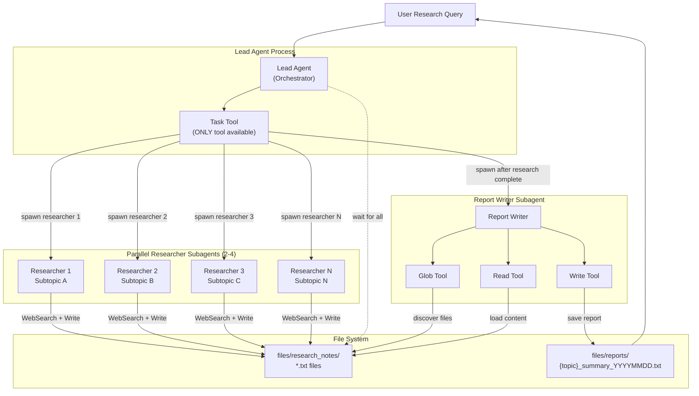
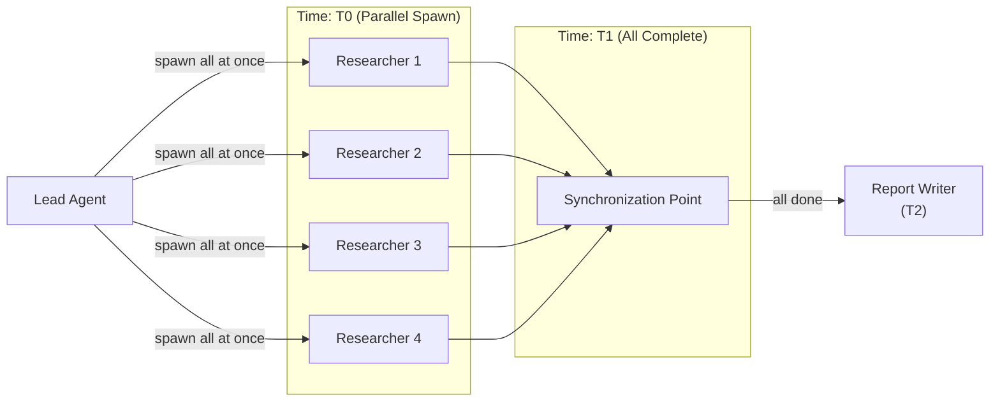
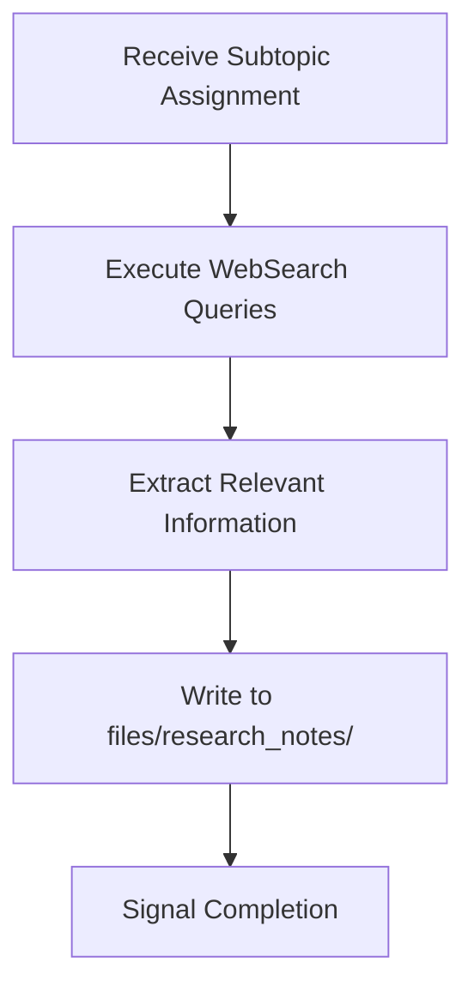
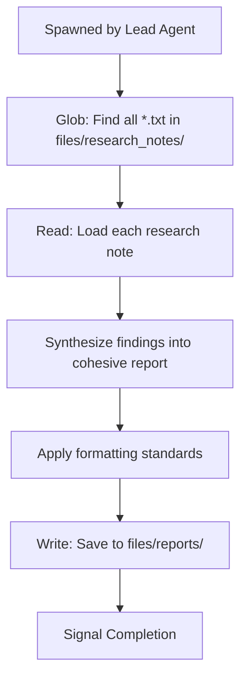
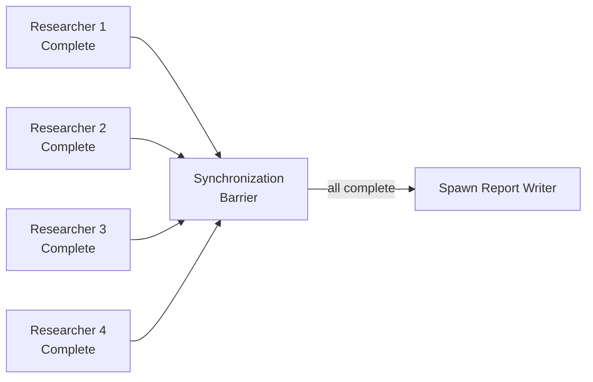

<!-- source: DeepWiki mcp.deepwiki.com · repo anthropics/claude-agent-sdk-demos · page 5 Research Agent Demo · fetched 2026-10-26 -->

# Research Agent Demo

<details>
<summary>Relevant source files</summary>

The following files were used as context for generating this wiki page:

- [README.md](README.md)
- [excel-demo/README.md](excel-demo/README.md)
- [research-agent/README.md](research-agent/README.md)
- [research-agent/research_agent/agent.py](research-agent/research_agent/agent.py)

</details>


## Purpose and Scope

This document provides an overview of the Research Agent Demo, a multi-agent system that orchestrates parallel research tasks and synthesizes findings into comprehensive reports. The demo demonstrates hierarchical agent coordination, file-based communication, and activity tracking patterns.

For detailed information on specific components, see:
- Multi-agent coordination patterns: [5.2](#5.2)
- Lead Agent implementation: [5.2.1](#5.2.1)
- Researcher subagent behavior: [5.2.2](#5.2.2)
- Report Writer synthesis process: [5.2.3](#5.2.3)
- Subagent tracking and logging: [5.3](#5.3)
- Setup and configuration: [5.4](#5.4)

For general Claude Agent SDK concepts, see [7](#7).

## Overview

The Research Agent Demo implements a hierarchical multi-agent architecture where a Lead Agent orchestrates specialized subagents to conduct research and generate reports. Unlike single-agent demos, this system demonstrates delegation patterns, parallel execution, and inter-agent communication through a file-based pipeline.

**Key Characteristics:**

| Aspect | Implementation |
|--------|---------------|
| **Agent Types** | Lead Agent (orchestrator), Researcher subagents (2-4), Report Writer subagent |
| **Delegation Pattern** | Strict - Lead Agent ONLY spawns subagents, never executes research itself |
| **Execution Model** | Parallel spawning of researchers, sequential report writing |
| **Communication** | File-based: researchers write to `files/research_notes/`, report-writer reads and synthesizes |
| **Tools** | Lead Agent: `Task` only; Researchers: `WebSearch`, `Write`; Report Writer: `Glob`, `Read`, `Write` |
| **Output** | Plain text reports in `files/reports/{topic}_summary_YYYYMMDD.txt` |

**Sources:** [research-agent/research_agent/prompts/lead_agent.txt:1-18](), [research-agent/research_agent/prompts/report_writer.txt:1-16]()

## System Architecture

### High-Level Agent Hierarchy



**Sources:** [research-agent/research_agent/prompts/lead_agent.txt:8-18](), [research-agent/research_agent/prompts/lead_agent.txt:26-47](), [research-agent/research_agent/prompts/report_writer.txt:5-23]()

### Key Design Principles

**1. Strict Delegation Pattern**

The Lead Agent enforces a critical architectural constraint: it NEVER performs research or report writing itself. Its sole function is coordination through the `Task` tool.

```
Lead Agent Rules (enforced by prompt):
- ONLY use Task tool to spawn subagents
- NEVER research anything directly
- NEVER write reports directly
- ALWAYS spawn 2-4 researchers in parallel
- ALWAYS wait for all researchers before spawning report-writer
```

**Sources:** [research-agent/research_agent/prompts/lead_agent.txt:54-65]()

**2. Parallel Execution Model**

Researchers are spawned simultaneously, not sequentially, to maximize efficiency:



**Sources:** [research-agent/research_agent/prompts/lead_agent.txt:67-80]()

**3. File-Based Communication Pipeline**

Agents communicate through the file system, enabling loose coupling and inspectability:

| Stage | Agent | Action | Location |
|-------|-------|--------|----------|
| **Research** | Researchers | Write findings | `files/research_notes/*.txt` |
| **Synchronization** | Lead Agent | Wait for completion | (implicit barrier) |
| **Discovery** | Report Writer | Glob to find notes | `files/research_notes/*.txt` |
| **Loading** | Report Writer | Read all notes | `files/research_notes/*.txt` |
| **Synthesis** | Report Writer | Write final report | `files/reports/{topic}_summary_YYYYMMDD.txt` |

**Sources:** [research-agent/research_agent/prompts/lead_agent.txt:29-46](), [research-agent/research_agent/prompts/report_writer.txt:18-23]()

## Workflow Example

### Topic Breakdown and Parallel Spawning

When a user requests research on a topic, the Lead Agent breaks it into 2-4 distinct subtopics and spawns researchers in parallel:

```
User Query: "Research quantum computing"

Lead Agent Analysis:
1. Current state of quantum hardware and qubit technology
2. Quantum algorithms and real-world applications  
3. Major companies and investments in quantum computing
4. Challenges and timeline to practical quantum advantage

Spawned Subagents (parallel):
- Task(subagent_type="researcher", description="quantum hardware qubits", prompt="...")
- Task(subagent_type="researcher", description="algorithms applications", prompt="...")
- Task(subagent_type="researcher", description="industry investments", prompt="...")
- Task(subagent_type="researcher", description="challenges timeline", prompt="...")
```

**Sources:** [research-agent/research_agent/prompts/lead_agent.txt:32-37](), [research-agent/research_agent/prompts/lead_agent.txt:82-94]()

### Researcher Subagent Operations

Each researcher follows this workflow:



Researchers save their findings as plain text files in `files/research_notes/`, with each file containing:
- Research findings on their assigned subtopic
- Source URLs and citations
- Specific data points and statistics

**Sources:** [research-agent/research_agent/prompts/lead_agent.txt:29-30]()

### Report Writer Synthesis

After all researchers complete, the Lead Agent spawns a single Report Writer that:



**Report Requirements:**
- One-page length (500-800 words)
- Plain text format (`.txt` extension)
- Naming pattern: `{topic}_summary_YYYYMMDD.txt`
- Every claim must have a citation
- Clear, professional language
- Include specific data and statistics

**Sources:** [research-agent/research_agent/prompts/report_writer.txt:1-33]()

## File System Organization

```
research-agent/
├── files/
│   ├── research_notes/        # Researcher output
│   │   ├── *.txt             # Individual research findings
│   └── reports/              # Final reports
│       └── {topic}_summary_YYYYMMDD.txt
├── tool_calls.jsonl          # Structured tool call log
└── transcript.txt            # Human-readable activity log
```

| Directory/File | Purpose | Written By | Read By |
|----------------|---------|------------|---------|
| `files/research_notes/` | Individual research findings | Researcher subagents | Report Writer |
| `files/reports/` | Final synthesized reports | Report Writer | User |
| `tool_calls.jsonl` | Structured log of all tool calls | SubagentTracker | Analysis tools |
| `transcript.txt` | Human-readable activity log | MessageHandler | Developers |

**Sources:** [research-agent/research_agent/prompts/lead_agent.txt:30](), [research-agent/research_agent/prompts/report_writer.txt:6-8,19-22,26]()

## Agent Response Style

The Lead Agent enforces an extremely concise response style to minimize latency:

**Requirements:**
- Maximum 2-3 sentences per response
- No greetings, emojis, or friendly chatter
- No explanations of how the system works unless asked
- Get straight to work immediately

**Good Example:**
```
User: "Research electric vehicles"

Lead Agent: "Breaking this into 4 research areas: battery technology, 
market trends, major manufacturers, and charging infrastructure. 
Spawning researchers now."

[spawns subagents]

Lead Agent: "Research complete. Report saved to 
files/reports/electric_vehicles_summary_20251110.txt"
```

**Bad Examples:**
- ❌ "Hello! 👋 I'm your lead research coordinator..."
- ❌ "Let me explain how I work..."
- ❌ "I'll search for information on..." (Lead Agent doesn't search)
- ❌ "Based on my findings..." (Lead Agent doesn't have findings)

**Sources:** [research-agent/research_agent/prompts/lead_agent.txt:3-6](), [research-agent/research_agent/prompts/lead_agent.txt:96-133](), [research-agent/research_agent/prompts/lead_agent.txt:136-145]()

## Key Capabilities

### Topic Decomposition

The Lead Agent analyzes research requests and decomposes them into 2-4 non-overlapping subtopics that collectively provide comprehensive coverage:

| Topic | Subtopics (2-4) |
|-------|-----------------|
| Quantum Computing | 1. Hardware/qubits<br>2. Algorithms/applications<br>3. Industry players/investments<br>4. Challenges/timeline |
| Electric Vehicles | 1. Battery technology<br>2. Market trends<br>3. Major manufacturers<br>4. Charging infrastructure |

**Sources:** [research-agent/research_agent/prompts/lead_agent.txt:21-37]()

### Parallel Coordination

The system enforces parallel spawning rather than sequential execution:

```
CORRECT (Parallel):
- Spawn all 4 researchers simultaneously
- All execute concurrently
- Wait for all to complete

INCORRECT (Sequential):  
- Spawn researcher 1, wait for completion
- Spawn researcher 2, wait for completion
- Spawn researcher 3, wait for completion
- Spawn researcher 4, wait for completion
```

**Sources:** [research-agent/research_agent/prompts/lead_agent.txt:67-80]()

### Synchronization Point

The Lead Agent implements a critical synchronization barrier:



The Report Writer is NEVER spawned until all researchers have completed their work.

**Sources:** [research-agent/research_agent/prompts/lead_agent.txt:39-47](), [research-agent/research_agent/prompts/lead_agent.txt:61]()

## Comparison with Other Demos

| Feature | Research Agent | Email Agent | Excel Demo | Hello World |
|---------|---------------|-------------|-----------|-------------|
| **Agent Model** | Multi-agent (hierarchical) | Single agent | Single agent per script | Single agent |
| **Coordination** | Lead Agent orchestrates subagents | N/A | N/A | N/A |
| **Parallelization** | Parallel researcher spawning | N/A | N/A | N/A |
| **Communication** | File-based pipeline | WebSocket/HTTP | N/A | N/A |
| **Primary Tools** | Task, WebSearch, Glob, Read, Write | Custom MCP (search_inbox, read_emails) | xlsx skill (openpyxl) | Basic SDK tools |
| **Use Case** | Complex research synthesis | Email management | Spreadsheet generation | SDK introduction |

**Sources:** [research-agent/research_agent/prompts/lead_agent.txt:16-17](), [research-agent/research_agent/prompts/report_writer.txt:12-15]()

## Use Cases

The hierarchical multi-agent pattern demonstrated by the Research Agent is appropriate for:

1. **Research and Analysis Tasks**
   - Comprehensive topic investigation with multiple angles
   - Parallel information gathering from different sources
   - Synthesis of findings into cohesive reports

2. **Decomposable Workflows**
   - Tasks that can be broken into independent subtasks
   - Work that benefits from parallel execution
   - Processes requiring final synthesis of sub-results

3. **Long-Running Operations**
   - Tasks where parallelization reduces total latency
   - Workflows with natural synchronization points
   - Operations requiring coordination without tight coupling

**Not Appropriate For:**
- Simple single-step tasks (use single agent instead)
- Tasks requiring tight real-time coordination between agents
- Workflows where sequential execution is required by dependencies

**Sources:** [research-agent/research_agent/prompts/lead_agent.txt:8-14](), [research-agent/research_agent/prompts/lead_agent.txt:147-156]()

---

**Sources:** [research-agent/research_agent/prompts/lead_agent.txt:1-157](), [research-agent/research_agent/prompts/report_writer.txt:1-34]()

---

