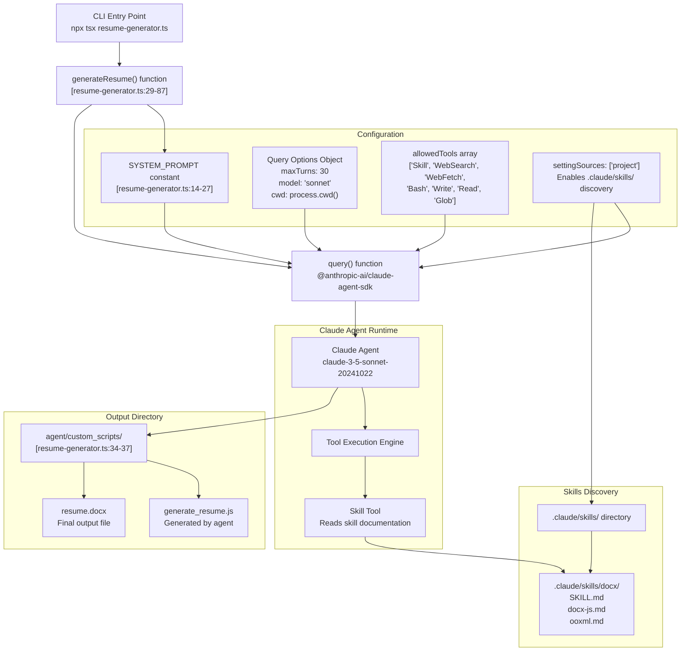
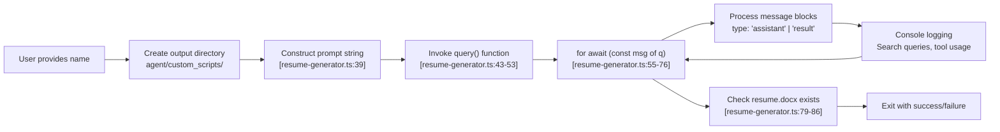
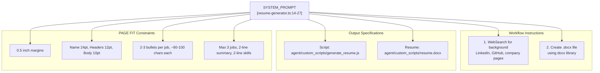
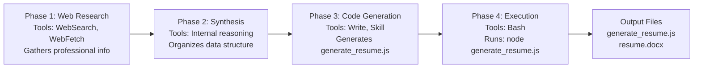
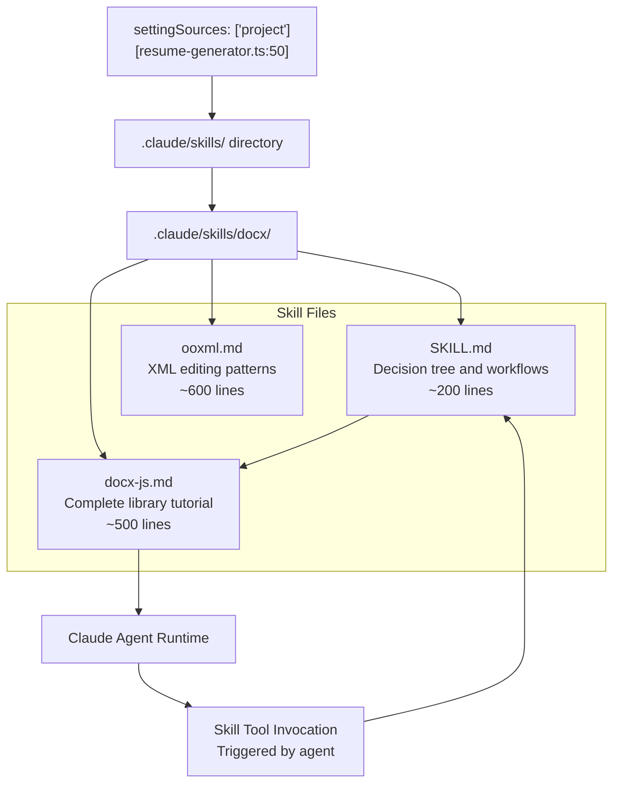
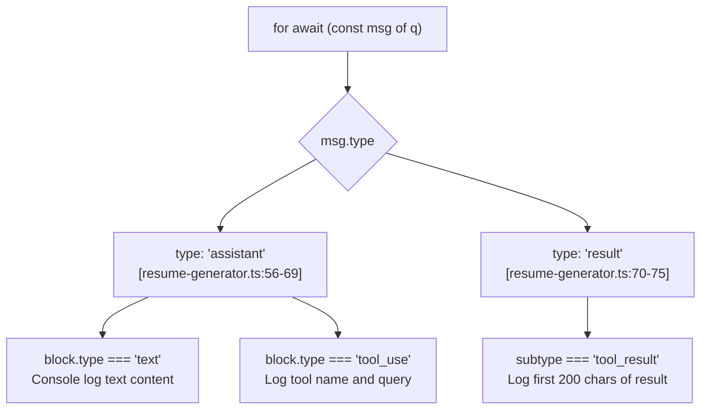

<!-- source: DeepWiki mcp.deepwiki.com · repo anthropics/claude-agent-sdk-demos · page 5.1 Architecture Overview · fetched 2026-10-26 -->

# Architecture Overview

<details>
<summary>Relevant source files</summary>

The following files were used as context for generating this wiki page:

- [resume-generator/.claude/skills/docx/SKILL.md](resume-generator/.claude/skills/docx/SKILL.md)
- [resume-generator/.claude/skills/docx/docx-js.md](resume-generator/.claude/skills/docx/docx-js.md)
- [resume-generator/.gitignore](resume-generator/.gitignore)
- [resume-generator/README.md](resume-generator/README.md)
- [resume-generator/package.json](resume-generator/package.json)
- [resume-generator/resume-generator.ts](resume-generator/resume-generator.ts)

</details>


## Purpose and Scope

This page provides a high-level architectural overview of the Resume Generator demo, focusing on the major components, their interactions, and the orchestration pattern used to generate professional resumes. This includes the entry point, agent configuration, skills system integration, and the four-phase execution pipeline.

For detailed workflow steps and phase-by-phase execution details, see [Document Generation Workflow](#3.2). For comprehensive documentation of the docx skill including library API and formatting rules, see [docx Skill System](#3.3).

## System Components

The Resume Generator is structured as a single-file orchestrator that configures and invokes the Claude Agent SDK with specific tools and skills. The architecture follows a linear execution model where a Claude agent autonomously performs research, synthesizes information, generates code, and produces a final document.

**Component Architecture**



**Sources:** [resume-generator/resume-generator.ts:1-98]()

## Entry Point and CLI Interface

The application exposes a single command-line interface that accepts a person's name as input:

```bash
npx tsx resume-generator.ts "Person Name"
```

The entry point validates arguments and invokes the `generateResume()` function at [resume-generator.ts:89-97](). If no name is provided, it prints usage instructions and exits.

**Sources:** [resume-generator/resume-generator.ts:89-97]()

## Core Orchestration Pattern

The `generateResume()` function at [resume-generator.ts:29-87]() implements the core orchestration pattern. It performs three primary responsibilities:

1. **Directory Setup**: Creates `agent/custom_scripts/` directory if it doesn't exist [resume-generator.ts:34-37]()
2. **Agent Invocation**: Calls `query()` with configuration and streams responses [resume-generator.ts:43-76]()
3. **Output Verification**: Checks for the presence of `resume.docx` after completion [resume-generator.ts:78-86]()

**Orchestration Flow**



**Sources:** [resume-generator/resume-generator.ts:29-87]()

## Agent Configuration

The `query()` function is configured with specific options that define the agent's capabilities and constraints:

| Configuration Key | Value | Purpose |
|------------------|-------|---------|
| `prompt` | `"Research \"${personName}\" and create..."` | User instruction passed to agent |
| `maxTurns` | `30` | Maximum conversation turns allowed |
| `cwd` | `process.cwd()` | Working directory for file operations |
| `model` | `'sonnet'` | Claude model identifier (sonnet-3.5) |
| `allowedTools` | Array of 7 tools | Permitted tool set (see below) |
| `settingSources` | `['project']` | Enables project-level skills discovery |
| `systemPrompt` | `SYSTEM_PROMPT` constant | Workflow instructions and constraints |

**Allowed Tools Configuration**

The agent has access to seven tools at [resume-generator.ts:49]():

1. **`Skill`** - Reads skill documentation from `.claude/skills/`
2. **`WebSearch`** - Performs web searches for research
3. **`WebFetch`** - Fetches web page content
4. **`Bash`** - Executes shell commands
5. **`Write`** - Writes files to disk
6. **`Read`** - Reads file contents
7. **`Glob`** - Pattern-based file discovery

**Sources:** [resume-generator/resume-generator.ts:43-53]()

## System Prompt Architecture

The `SYSTEM_PROMPT` constant at [resume-generator.ts:14-27]() encodes three critical aspects:

**System Prompt Structure**



The PAGE FIT constraints at [resume-generator.ts:24-27]() are critical for ensuring the final document fits exactly one page, which is the core requirement for professional resumes.

**Sources:** [resume-generator/resume-generator.ts:14-27]()

## Four-Phase Execution Pipeline

The agent autonomously executes a four-phase pipeline to generate the resume. Each phase represents a distinct goal that the agent must accomplish before proceeding to the next:

**Pipeline Architecture**



### Phase Details

| Phase | Tools Used | Outputs | Key Actions |
|-------|-----------|---------|-------------|
| **1. Research** | `WebSearch`, `WebFetch` | Research data (in-memory) | Searches LinkedIn, GitHub, company pages; fetches detailed information |
| **2. Synthesis** | Internal reasoning | Structured data model | Organizes findings into resume sections (summary, experience, education, skills) |
| **3. Code Generation** | `Skill`, `Write` | `generate_resume.js` | Reads docx skill documentation; generates JavaScript using docx library |
| **4. Execution** | `Bash` | `resume.docx` | Executes: `node agent/custom_scripts/generate_resume.js` |

**Sources:** [resume-generator/resume-generator.ts:14-27](), [resume-generator/.claude/skills/docx/SKILL.md:54-62]()

## Skills System Integration

The Resume Generator relies heavily on the skills system to provide domain expertise in document generation. The `settingSources: ['project']` configuration at [resume-generator.ts:50]() enables skill discovery from `.claude/skills/`.

**Skill Discovery and Loading**



The skill system enforces a critical workflow at [.claude/skills/docx/SKILL.md:54-62]():

1. Agent invokes `Skill` tool to read `SKILL.md`
2. `SKILL.md` contains a decision tree routing to appropriate workflow
3. For new documents, agent **must read entire** `docx-js.md` file (~500 lines)
4. Agent generates JavaScript code using the `docx` library API
5. Generated code is written to `agent/custom_scripts/generate_resume.js`

**Sources:** [resume-generator/resume-generator.ts:50](), [resume-generator/.claude/skills/docx/SKILL.md:1-197](), [resume-generator/.claude/skills/docx/docx-js.md:1-350]()

## Directory Structure and File Organization

The Resume Generator maintains a strict directory organization:

```
resume-generator/
├── resume-generator.ts          # Main orchestration file [10.00 importance]
├── package.json                 # Dependencies: SDK, docx library
├── .claude/
│   └── skills/
│       └── docx/               # Document generation skill
│           ├── SKILL.md        # Workflow decision tree
│           ├── docx-js.md      # Complete library tutorial
│           └── ooxml.md        # XML editing patterns
└── agent/
    └── custom_scripts/         # Agent workspace (created at runtime)
        ├── generate_resume.js  # Generated by agent in Phase 3
        └── resume.docx         # Final output from Phase 4
```

The `agent/custom_scripts/` directory is created at [resume-generator.ts:34-37]() and serves as the agent's workspace. This directory is in `.gitignore` at [.gitignore:4]() since it contains generated files.

**Sources:** [resume-generator/resume-generator.ts:34-37](), [resume-generator/.gitignore:1-6]()

## Message Streaming and Output

The orchestration loop at [resume-generator.ts:55-76]() processes two message types from the async generator:

**Message Processing Flow**



The streaming pattern provides real-time visibility into:
- Agent reasoning (text blocks)
- Web searches being performed (WebSearch tool with query parameter)
- Tool invocations (tool names logged to console)
- Tool results (first 200 characters logged)

**Sources:** [resume-generator/resume-generator.ts:55-76]()

## Dependencies and Runtime Requirements

The Resume Generator requires two primary dependencies specified in [package.json:8-11]():

| Dependency | Version | Purpose |
|-----------|---------|---------|
| `@anthropic-ai/claude-agent-sdk` | `^0.1.59` | Core agent runtime and tools |
| `docx` | `^9.5.1` | JavaScript library for .docx generation (used by agent's generated code) |

The `docx` library is installed globally in the environment and used by the agent-generated JavaScript code during Phase 4 execution.

**Sources:** [resume-generator/package.json:1-18]()

---

