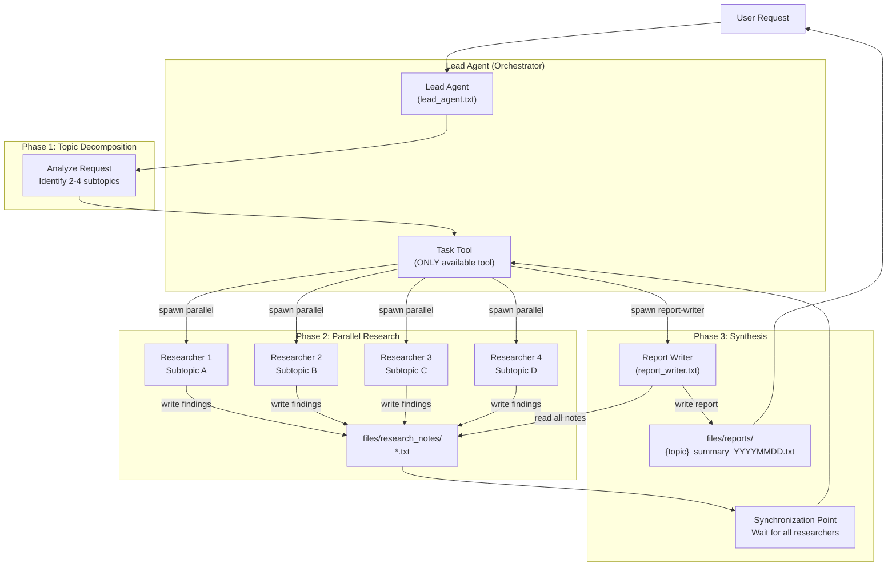
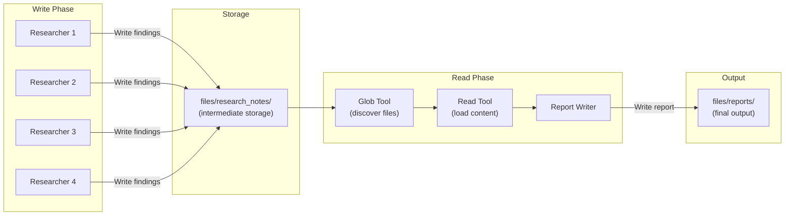
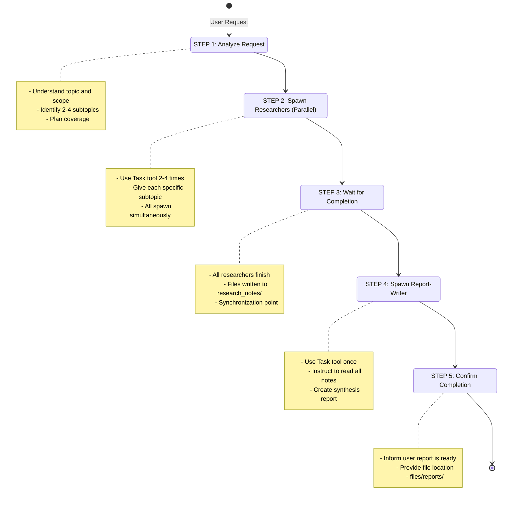

<!-- source: DeepWiki mcp.deepwiki.com · repo anthropics/claude-agent-sdk-demos · page 5.2 Multi-Agent Coordination · fetched 2026-10-26 -->

# Multi-Agent Coordination

<details>
<summary>Relevant source files</summary>

The following files were used as context for generating this wiki page:

- [research-agent/README.md](research-agent/README.md)
- [research-agent/research_agent/agent.py](research-agent/research_agent/agent.py)
- [research-agent/research_agent/prompts/lead_agent.txt](research-agent/research_agent/prompts/lead_agent.txt)
- [research-agent/research_agent/prompts/report_writer.txt](research-agent/research_agent/prompts/report_writer.txt)

</details>


This document describes the multi-agent coordination architecture in the Research Agent demo, focusing on how the Lead Agent orchestrates parallel researcher subagents and report-writer subagents through task delegation and file-based communication. For implementation details of the Lead Agent's orchestration logic, see [Lead Agent Orchestration](#5.2.1). For researcher workflow details, see [Researcher Subagents](#5.2.2). For report synthesis, see [Report Writer](#5.2.3). For tracking and logging of multi-agent activities, see [Subagent Tracking System](#5.3).

## Overview

The Research Agent implements a hierarchical multi-agent coordination pattern where a single Lead Agent orchestrates multiple specialized subagents to complete complex research tasks. The architecture enforces strict separation of concerns: the Lead Agent performs no research or writing itself, acting purely as a coordinator that delegates all work to subagents via the `Task` tool.

The coordination flow consists of three phases:

1. **Decomposition**: Lead Agent analyzes the user's research request and breaks it into 2-4 distinct subtopics
2. **Parallel Execution**: Lead Agent spawns 2-4 researcher subagents simultaneously, each investigating a specific subtopic
3. **Synthesis**: Lead Agent waits for all researchers to complete, then spawns a report-writer subagent to synthesize findings

### Coordination Architecture



**Sources:**
- [research-agent/research_agent/prompts/lead_agent.txt:20-52]()
- [research-agent/research_agent/prompts/report_writer.txt:18-23]()

## Delegation Pattern

The Research Agent enforces a strict delegation pattern where the Lead Agent never performs research or writing operations directly. This design ensures clear separation of responsibilities and enables parallel execution.

### Task Tool as Delegation Mechanism

The Lead Agent has access to only one tool: `Task`. This architectural constraint enforces the delegation pattern by making it impossible for the Lead Agent to perform research or file operations itself. All work must be delegated to specialized subagents.

When spawning a subagent, the Lead Agent provides:

| Parameter | Purpose | Example Values |
|-----------|---------|----------------|
| `subagent_type` | Identifies the subagent role | `"researcher"`, `"report-writer"` |
| `description` | Brief 3-5 word summary | `"Research battery technology"` |
| `prompt` | Detailed instructions | `"Research current state of quantum hardware and qubit technology. Focus on recent breakthroughs and technical challenges."` |

**Sources:**
- [research-agent/research_agent/prompts/lead_agent.txt:82-94]()

### Delegation Rules

The Lead Agent prompt enforces critical delegation rules to prevent the agent from performing work itself:

```
CRITICAL - NEVER VIOLATE:

1. You NEVER research anything yourself - ALWAYS delegate to researcher subagents
2. You NEVER write reports yourself - ALWAYS delegate to report-writer subagent
3. You ONLY use the Task tool to spawn subagents
4. ALWAYS spawn 2-4 researcher subagents in parallel (not sequential)
5. ALWAYS wait for ALL researchers to finish before spawning the report-writer
6. Give each researcher a SPECIFIC subtopic - don't give them the same task
7. The report-writer should ONLY be spawned AFTER all research is complete
8. Never provide research findings directly to the user - always generate a report first
```

These rules are explicitly defined in [research-agent/research_agent/prompts/lead_agent.txt:54-65]() and serve as guardrails to maintain the coordination pattern.

**Sources:**
- [research-agent/research_agent/prompts/lead_agent.txt:54-65]()

## File-Based Communication Pipeline

The multi-agent system uses the file system as a message bus for inter-agent communication. This approach provides several advantages: persistence for debugging, decoupling between agents, and simplicity in implementation.

### Communication Flow



**Sources:**
- [research-agent/research_agent/prompts/lead_agent.txt:30]()
- [research-agent/research_agent/prompts/report_writer.txt:3-23]()

### Directory Structure

The file-based pipeline uses two primary directories:

| Directory | Purpose | Written By | Read By | File Format |
|-----------|---------|------------|---------|-------------|
| `files/research_notes/` | Intermediate research findings | Researcher subagents | Report Writer | `.txt` files (arbitrary naming) |
| `files/reports/` | Final synthesized reports | Report Writer | User | `{topic}_summary_YYYYMMDD.txt` |

Researchers save their findings to `files/research_notes/` as plain text files. The report-writer uses the `Glob` tool to discover all files in this directory, the `Read` tool to load their contents, and the `Write` tool to save the synthesized report to `files/reports/`.

**Sources:**
- [research-agent/research_agent/prompts/lead_agent.txt:30]()
- [research-agent/research_agent/prompts/report_writer.txt:6-8]()
- [research-agent/research_agent/prompts/report_writer.txt:26-29]()

## Parallel vs Sequential Execution

A critical aspect of the coordination pattern is the enforcement of parallel execution for researcher subagents. The Lead Agent prompt explicitly distinguishes between correct parallel spawning and incorrect sequential spawning.

### Parallel Spawning Strategy

The Lead Agent must spawn all researcher subagents simultaneously rather than waiting for each to complete before spawning the next. This parallel execution significantly reduces total research time.

```
GOOD (parallel):
- Spawn researcher for subtopic A
- Spawn researcher for subtopic B
- Spawn researcher for subtopic C
- (All run simultaneously)

BAD (sequential):
- Spawn researcher for subtopic A, wait for completion
- Then spawn researcher for subtopic B, wait for completion
- Then spawn researcher for subtopic C, wait for completion
```

From [research-agent/research_agent/prompts/lead_agent.txt:67-80](), the prompt explicitly instructs the Lead Agent to spawn researchers in parallel by issuing multiple `Task` tool calls without waiting for completion between them.

**Sources:**
- [research-agent/research_agent/prompts/lead_agent.txt:67-80]()

### Synchronization Point

After spawning all researchers in parallel, the Lead Agent must wait for all of them to complete before proceeding to the synthesis phase. This synchronization point is critical to ensure the report-writer has access to all research findings.

The workflow enforces this through explicit instructions:

```
**STEP 3: WAIT FOR RESEARCH COMPLETION**
- All researchers will complete their work and save findings
- Do NOT proceed until all researchers have finished
```

Only after this synchronization point does the Lead Agent spawn the report-writer subagent.

**Sources:**
- [research-agent/research_agent/prompts/lead_agent.txt:39-41]()
- [research-agent/research_agent/prompts/lead_agent.txt:43-47]()

## Topic Decomposition Strategy

Effective coordination begins with intelligent topic decomposition. The Lead Agent analyzes the user's research request and breaks it into 2-4 distinct, non-overlapping subtopics that collectively provide comprehensive coverage.

### Example Decomposition

The prompt provides a concrete example of how to decompose a broad research topic:

```
User asks: "Research quantum computing"
* Researcher 1: "Current state of quantum hardware and qubit technology"
* Researcher 2: "Quantum algorithms and real-world applications"
* Researcher 3: "Major companies and investments in quantum computing"
* Researcher 4: "Challenges and timeline to practical quantum advantage"
```

Each subtopic is distinct and focused, avoiding overlap while ensuring the complete topic is covered. This decomposition strategy appears in [research-agent/research_agent/prompts/lead_agent.txt:32-37]().

**Sources:**
- [research-agent/research_agent/prompts/lead_agent.txt:32-37]()

### Subtopic Specificity

Each researcher receives a specific, focused subtopic rather than a generic instruction. This specificity prevents duplicate work and ensures comprehensive coverage. The delegation rules explicitly state: "Give each researcher a SPECIFIC subtopic - don't give them the same task" from [research-agent/research_agent/prompts/lead_agent.txt:62]().

**Sources:**
- [research-agent/research_agent/prompts/lead_agent.txt:62]()

## Coordination Workflow

The complete coordination workflow follows a five-step process that the Lead Agent executes for every research request:

### Five-Step Process



**Sources:**
- [research-agent/research_agent/prompts/lead_agent.txt:20-52]()

### Response Style

The Lead Agent maintains a concise, action-oriented communication style. The prompt enforces this through explicit style guidelines:

```
**CRITICAL: Keep responses SHORT and ACTION-ORIENTED**

- NO greetings, emojis, or friendly chatter
- NO explanations of how you work unless specifically asked
- Get straight to work - analyze the request and spawn subagents immediately
- Only 2-3 sentences max when delegating work
- Example: "Breaking this into 3 research areas: [list]. Spawning researchers now."
- When complete: "Research complete. Report saved to files/reports/[filename]"
```

This style minimizes overhead and focuses on coordination actions rather than explanations.

**Sources:**
- [research-agent/research_agent/prompts/lead_agent.txt:135-145]()

## Tool Access Control

The multi-agent system enforces different tool access levels for each agent type, creating a natural separation of concerns through capability constraints.

### Tool Distribution by Agent Type

| Agent Type | Available Tools | Purpose |
|------------|----------------|---------|
| Lead Agent | `Task` only | Pure coordination, cannot research or write |
| Researcher Subagents | `WebSearch`, `Write` | Research and save findings |
| Report Writer Subagent | `Glob`, `Read`, `Write` | Discover notes, load content, write reports |

This tool distribution is defined in the agent prompts:
- Lead Agent: [research-agent/research_agent/prompts/lead_agent.txt:16-18]()
- Report Writer: [research-agent/research_agent/prompts/report_writer.txt:12-16]()

The Lead Agent cannot access `WebSearch`, `Read`, `Write`, or `Glob`, ensuring it must delegate all work. The report-writer cannot access `WebSearch`, ensuring it only synthesizes existing findings rather than conducting new research.

**Sources:**
- [research-agent/research_agent/prompts/lead_agent.txt:16-18]()
- [research-agent/research_agent/prompts/report_writer.txt:12-16]()

## Critical Role Definition

Each agent has an explicit role definition that constrains its behavior and ensures proper coordination.

### Lead Agent Role

The Lead Agent role definition from [research-agent/research_agent/prompts/lead_agent.txt:8-14]():

```
<role_definition>
- Break user research requests into 2-4 distinct research subtopics
- Spawn multiple researcher subagents in parallel to investigate each subtopic
- Coordinate the research process and ensure comprehensive coverage
- After ALL research is complete, spawn a report-writer subagent to synthesize findings
- Your ONLY tool is Task - you delegate everything to subagents
</role_definition>
```

### Report Writer Role

The Report Writer role definition from [research-agent/research_agent/prompts/report_writer.txt:5-10]():

```
<role_definition>
- Read research findings from files/research_notes/ folder
- Synthesize findings into professional one-page summaries
- Create plain text reports saved to files/reports/ folder
- Does NOT conduct research or web searches - only reads existing notes and writes reports
</role_definition>
```

These role definitions explicitly state what each agent does and does not do, preventing role confusion and ensuring clean coordination boundaries.

**Sources:**
- [research-agent/research_agent/prompts/lead_agent.txt:8-14]()
- [research-agent/research_agent/prompts/report_writer.txt:5-10]()

---

