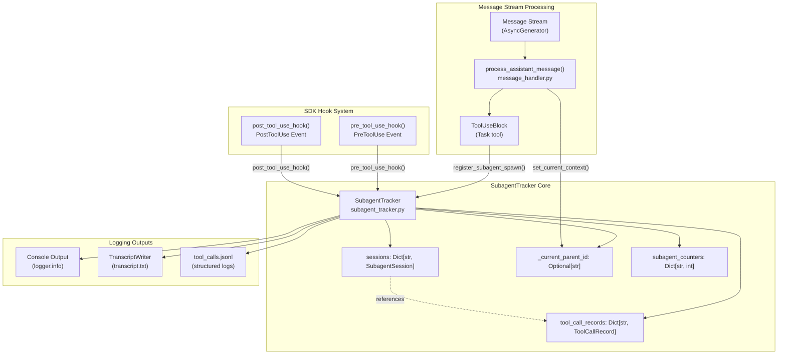
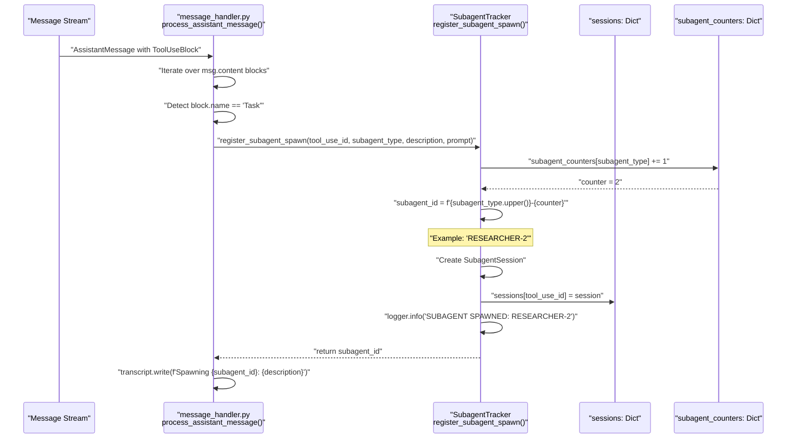
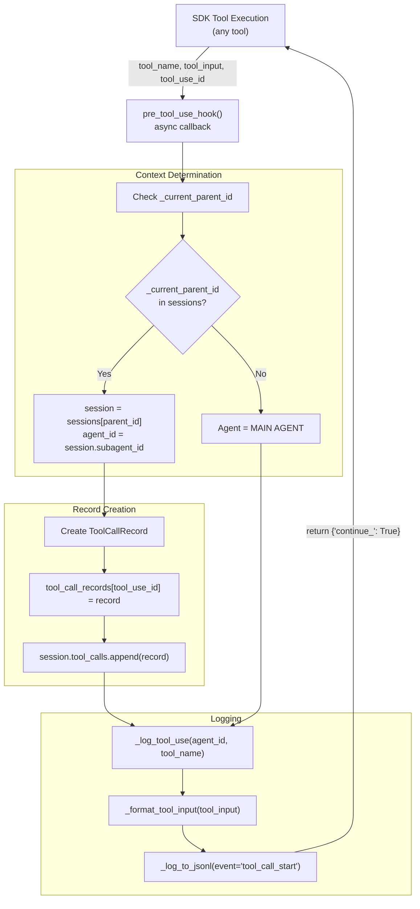
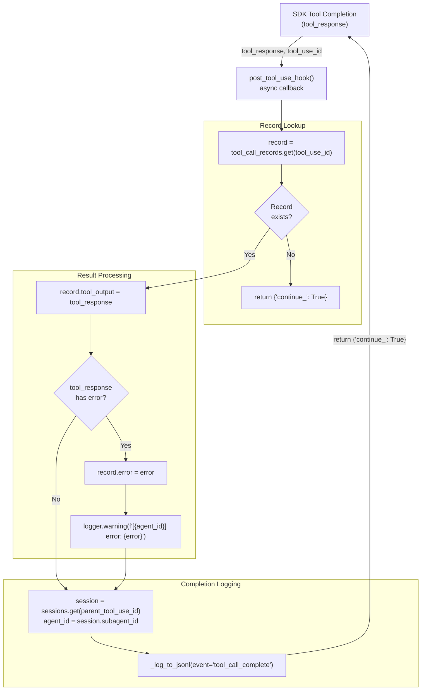
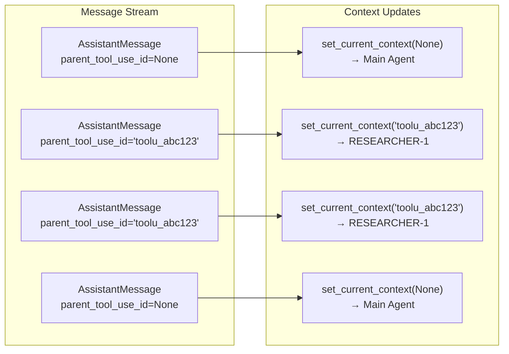
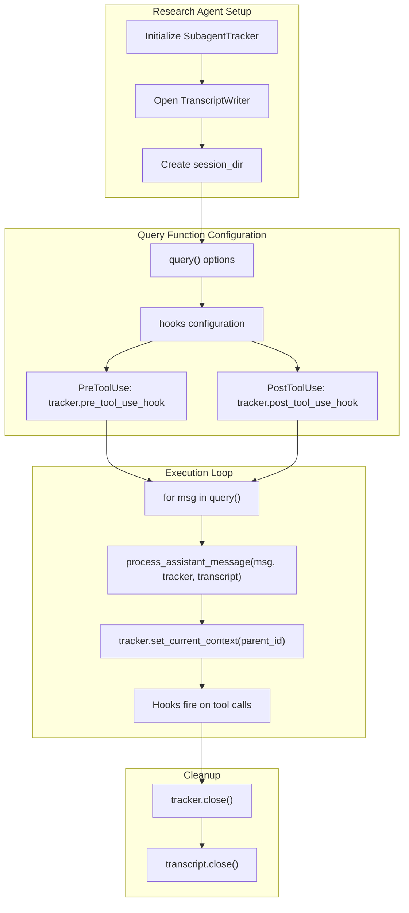

<!-- source: DeepWiki mcp.deepwiki.com · repo anthropics/claude-agent-sdk-demos · page 5.3 Subagent Tracking System · fetched 2026-10-26 -->

# Subagent Tracking System

<details>
<summary>Relevant source files</summary>

The following files were used as context for generating this wiki page:

- [research-agent/research_agent/utils/message_handler.py](research-agent/research_agent/utils/message_handler.py)
- [research-agent/research_agent/utils/subagent_tracker.py](research-agent/research_agent/utils/subagent_tracker.py)

</details>


## Purpose and Scope

The Subagent Tracking System provides comprehensive monitoring and logging of all tool calls made by subagents in the Research Agent demo. This system intercepts every tool invocation, associates it with the correct subagent, and produces both human-readable transcripts and machine-parseable JSONL logs. The tracking enables full observability of the multi-agent research workflow, making it possible to understand which subagent performed which actions and when.

This document covers the `SubagentTracker` class, its integration with the SDK's hook system, and the dual-phase tracking mechanism. For information about how subagents are orchestrated by the Lead Agent, see [Multi-Agent Coordination](#5.2). For details on the file-based communication pattern between subagents, see [File System Communication](#5.4).

---

## Architecture Overview

The tracking system operates at the intersection of the Claude Agent SDK's hook system and the message stream processing pipeline. It captures two critical events: (1) subagent spawn detection via Task tool messages, and (2) all subsequent tool calls made by each subagent via PreToolUse/PostToolUse hooks.

### System Integration Diagram



**Sources:** [research-agent/research_agent/utils/subagent_tracker.py:39-73](), [research-agent/research_agent/utils/message_handler.py:10-54]()

---

## Core Data Structures

The tracking system uses two dataclasses to represent tracked entities: individual tool call records and complete subagent sessions.

### ToolCallRecord

Represents a single tool invocation with its inputs, outputs, and context.

| Field | Type | Description |
|-------|------|-------------|
| `timestamp` | `str` | ISO format timestamp of the tool call |
| `tool_name` | `str` | Name of the tool (e.g., "WebSearch", "Write") |
| `tool_input` | `Dict[str, Any]` | Input parameters passed to the tool |
| `tool_use_id` | `str` | Unique identifier for this tool use block |
| `subagent_type` | `str` | Type of subagent that made the call |
| `parent_tool_use_id` | `Optional[str]` | ID of the Task tool that spawned this subagent |
| `tool_output` | `Optional[Any]` | Tool response (populated in post hook) |
| `error` | `Optional[str]` | Error message if tool call failed |

**Sources:** [research-agent/research_agent/utils/subagent_tracker.py:14-25]()

### SubagentSession

Represents a complete subagent execution session with all its tool calls.

| Field | Type | Description |
|-------|------|-------------|
| `subagent_type` | `str` | Type identifier (e.g., "researcher", "data-analyst") |
| `parent_tool_use_id` | `str` | ID of the Task tool that spawned this subagent |
| `spawned_at` | `str` | ISO format timestamp of spawn time |
| `description` | `str` | Task description from Task tool input |
| `prompt_preview` | `str` | First 200 characters of the prompt |
| `subagent_id` | `str` | Human-readable ID (e.g., "RESEARCHER-1") |
| `tool_calls` | `List[ToolCallRecord]` | All tool calls made by this subagent |

**Sources:** [research-agent/research_agent/utils/subagent_tracker.py:27-37]()

---

## Tracking Lifecycle

The tracking system operates in three distinct phases: initialization, spawn detection, and tool call monitoring.

### Initialization and Context Setup

```mermaid
stateDiagram-v2
    [*] --> Initialized: "__init__(transcript_writer, session_dir)"
    
    Initialized --> SpawnDetection: "Message stream processing starts"
    
    state Initialized {
        [*] --> CreateMaps
        CreateMaps --> OpenJSONL: "sessions: {}"
        CreateMaps --> InitCounters: "tool_call_records: {}"
        OpenJSONL --> Ready: "tool_calls.jsonl opened"
        InitCounters --> Ready: "subagent_counters: {}"
    }
    
    state SpawnDetection {
        MessageStream --> DetectTaskTool: "ToolUseBlock(name='Task')"
        DetectTaskTool --> RegisterSpawn: "register_subagent_spawn()"
        RegisterSpawn --> CreateSession: "Increment counter"
        CreateSession --> StoreSession: "Create SubagentSession"
        StoreSession --> UpdateContext: "sessions[tool_use_id] = session"
        UpdateContext --> [*]: "set_current_context(tool_use_id)"
    }
    
    SpawnDetection --> ToolMonitoring: "Subagent executes"
    
    state ToolMonitoring {
        [*] --> PreHook: "Tool invoked"
        PreHook --> CheckContext: "pre_tool_use_hook()"
        CheckContext --> CreateRecord: "Lookup _current_parent_id"
        CreateRecord --> LogStart: "Create ToolCallRecord"
        LogStart --> PostHook: "Write to console/transcript/JSONL"
        PostHook --> UpdateRecord: "post_tool_use_hook()"
        UpdateRecord --> LogComplete: "Add tool_output/error"
        LogComplete --> [*]: "Write completion to JSONL"
    }
    
    ToolMonitoring --> [*]: "close()"
```



**Sources:** [research-agent/research_agent/utils/subagent_tracker.py:50-73](), [research-agent/research_agent/utils/subagent_tracker.py:74-113]()

---

## Subagent Spawn Detection

When a Task tool is used in the message stream, the tracker registers a new subagent session and assigns it a unique identifier.

### Spawn Registration Flow



### Subagent ID Generation

The tracker maintains a counter for each subagent type and generates human-readable identifiers:

| Subagent Type | Counter Value | Generated ID |
|---------------|---------------|--------------|
| `researcher` | 1 | `RESEARCHER-1` |
| `researcher` | 2 | `RESEARCHER-2` |
| `data-analyst` | 1 | `DATA-ANALYST-1` |
| `report-writer` | 1 | `REPORT-WRITER-1` |

**Sources:** [research-agent/research_agent/utils/subagent_tracker.py:74-113](), [research-agent/research_agent/utils/message_handler.py:38-53]()

---

## Hook System Integration

The tracker implements both PreToolUse and PostToolUse hooks to capture the complete lifecycle of each tool call. These hooks are registered with the SDK's query function when the agent is initialized.

### PreToolUse Hook: Capturing Tool Invocations



The hook determines whether the tool call originates from a subagent or the main agent by checking if `_current_parent_id` exists in the `sessions` dictionary. For subagent calls, it creates a `ToolCallRecord`, stores it in both the session's `tool_calls` list and the global `tool_call_records` map for efficient lookup in the post hook.

**Sources:** [research-agent/research_agent/utils/subagent_tracker.py:181-232]()

### PostToolUse Hook: Capturing Tool Results



The post hook looks up the previously created record using `tool_use_id`, updates it with the tool response, checks for errors, and logs the completion event to the JSONL file. This completes the tracking of a single tool call lifecycle.

**Sources:** [research-agent/research_agent/utils/subagent_tracker.py:234-271]()

---

## Context Management

The tracker maintains execution context through the `_current_parent_id` field, which is updated by the message handler for each message in the stream.

### Context Update Mechanism



The `parent_tool_use_id` field in each `AssistantMessage` identifies which Task tool spawned the current execution context. The message handler calls `set_current_context()` for every message, ensuring that subsequent tool calls in the hook system are correctly attributed to the right agent.

**Sources:** [research-agent/research_agent/utils/subagent_tracker.py:115-122](), [research-agent/research_agent/utils/message_handler.py:20-22]()

---

## Logging Outputs

The tracker produces three types of logging output, each serving different purposes for monitoring and debugging.

### Logging Destinations

| Output Type | Format | Purpose | File Path |
|-------------|--------|---------|-----------|
| Console | Human-readable | Real-time monitoring during execution | stdout |
| Transcript | Human-readable with details | Complete session record for review | `logs/session_*/transcript.txt` |
| JSONL | Structured JSON | Machine-parseable for analysis | `logs/session_*/tool_calls.jsonl` |

### Console and Transcript Output Format

The `_log_tool_use()` method produces concise, readable output for both console and transcript:

```
[RESEARCHER-1] → WebSearch
[RESEARCHER-1] → Write
[DATA-ANALYST-1] → Bash
[REPORT-WRITER-1] → Read
```

For transcript files only, additional input details are appended:

```
[RESEARCHER-1] → WebSearch
    Input: query='quantum computing applications in cryptography...'
[RESEARCHER-1] → Write
    Input: file='research_notes/quantum_crypto.md' (2847 chars)
```

**Sources:** [research-agent/research_agent/utils/subagent_tracker.py:124-146]()

### Tool Input Formatting

The `_format_tool_input()` method provides tool-specific formatting logic:

| Tool Type | Formatted Output |
|-----------|------------------|
| WebSearch | `query='search text...'` |
| Write | `file='filename.md' (N chars)` |
| Read/Glob | `path='file/path'` or `pattern='*.md'` |
| Task | `spawn=researcher (Research quantum computing)` |
| Other | First 100 characters of input dict |

**Sources:** [research-agent/research_agent/utils/subagent_tracker.py:147-173]()

### JSONL Structured Logs

Each tool call produces two JSONL entries: one at start and one at completion.

**Tool Call Start Event:**
```json
{
  "event": "tool_call_start",
  "timestamp": "2024-01-15T10:30:45.123456",
  "tool_use_id": "toolu_xyz789",
  "agent_id": "RESEARCHER-1",
  "agent_type": "researcher",
  "tool_name": "WebSearch",
  "tool_input": {"query": "quantum computing applications"},
  "parent_tool_use_id": "toolu_abc123"
}
```

**Tool Call Complete Event:**
```json
{
  "event": "tool_call_complete",
  "timestamp": "2024-01-15T10:30:47.456789",
  "tool_use_id": "toolu_xyz789",
  "agent_id": "RESEARCHER-1",
  "agent_type": "researcher",
  "tool_name": "WebSearch",
  "success": true,
  "error": null,
  "output_size": 5423
}
```

**Sources:** [research-agent/research_agent/utils/subagent_tracker.py:175-179](), [research-agent/research_agent/utils/subagent_tracker.py:209-230](), [research-agent/research_agent/utils/subagent_tracker.py:259-269]()

---

## Usage Pattern

The tracker is instantiated and integrated into the research agent's query function through the hook system.

### Integration Example



The tracker requires:
1. A `TranscriptWriter` instance for human-readable output
2. A `session_dir` Path for the JSONL log file
3. Registration of `pre_tool_use_hook` and `post_tool_use_hook` in the query options
4. Integration with the message handler for context updates

The tracker must be explicitly closed via `close()` to ensure the JSONL file is properly flushed and closed.

**Sources:** [research-agent/research_agent/utils/subagent_tracker.py:50-73](), [research-agent/research_agent/utils/subagent_tracker.py:273-276]()

---

## Summary

The Subagent Tracking System provides comprehensive observability for multi-agent workflows through:

- **Dual-phase tracking**: Message stream parsing detects subagent spawns, while hooks capture all tool calls
- **Context association**: Every tool call is correctly attributed to its originating agent via `parent_tool_use_id`
- **Multiple output formats**: Console for real-time monitoring, transcripts for human review, JSONL for programmatic analysis
- **Unique identification**: Human-readable IDs (RESEARCHER-1, etc.) generated via per-type counters
- **Complete lifecycle**: PreToolUse captures invocations with inputs, PostToolUse captures results and errors

This system enables full traceability of complex research workflows where multiple specialized agents coordinate through file-based communication.

---

