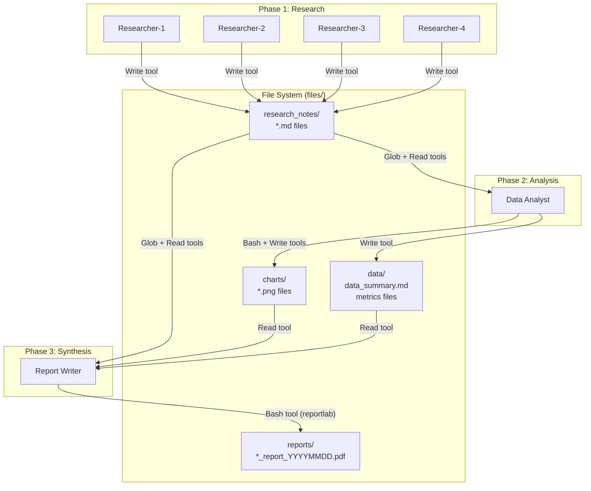
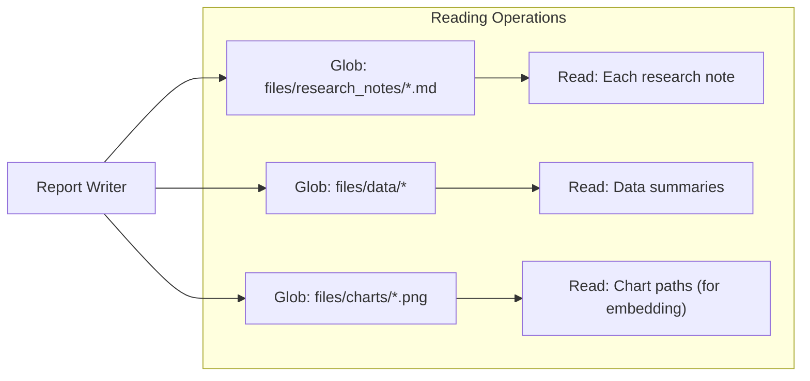
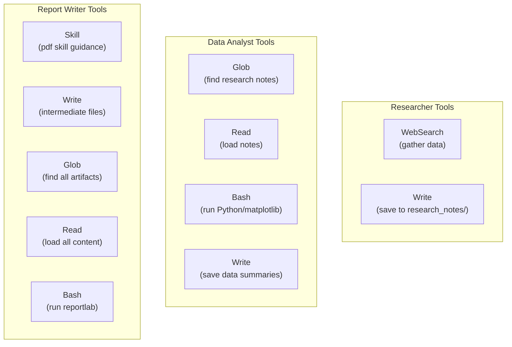

<!-- source: DeepWiki mcp.deepwiki.com · repo anthropics/claude-agent-sdk-demos · page 5.4 File System Communication · fetched 2026-10-26 -->

# File System Communication

<details>
<summary>Relevant source files</summary>

The following files were used as context for generating this wiki page:

- [research-agent/README.md](research-agent/README.md)
- [research-agent/research_agent/agent.py](research-agent/research_agent/agent.py)
- [research-agent/research_agent/prompts/lead_agent.txt](research-agent/research_agent/prompts/lead_agent.txt)
- [research-agent/research_agent/prompts/report_writer.txt](research-agent/research_agent/prompts/report_writer.txt)

</details>


## Purpose and Scope

This document describes how subagents in the Research Agent Demo communicate with each other through file system operations. Unlike traditional inter-process communication, the Research Agent uses a file-based message-passing pattern where subagents write outputs to standardized directories and later subagents read those outputs as inputs.

For information about the overall Research Agent architecture and multi-agent coordination, see [Architecture Overview](#5.1). For details on how subagents are spawned and tracked, see [Multi-Agent Coordination](#5.2) and [Subagent Tracking System](#5.3).

**Sources:** [research-agent/README.md:54-67]()

## Directory Structure

The Research Agent organizes file-based communication through a standardized `files/` directory hierarchy. Each subdirectory serves a specific role in the communication pipeline:

| Directory | Purpose | Written By | Read By |
|-----------|---------|------------|---------|
| `files/research_notes/` | Markdown research findings | Researcher subagents | Data Analyst, Report Writer |
| `files/data/` | Data summaries and extracted metrics | Data Analyst | Report Writer |
| `files/charts/` | PNG visualization files | Data Analyst | Report Writer |
| `files/reports/` | Final PDF reports | Report Writer | End user |

This structure ensures a unidirectional data flow: researchers produce notes, the data analyst consumes notes to produce charts/data, and the report writer consumes all artifacts to produce the final PDF.

**Sources:** [research-agent/README.md:54-67](), [research-agent/research_agent/prompts/lead_agent.txt:30-56]()

## Communication Flow Diagram



**Diagram: File-Based Communication Pipeline**

This diagram shows the sequential file-based communication pattern. Researchers run in parallel and independently write to `research_notes/`. The Data Analyst waits for all research completion, then reads the notes to generate charts and data summaries. Finally, the Report Writer reads all artifacts to produce the PDF.

**Sources:** [research-agent/research_agent/prompts/lead_agent.txt:22-61](), [research-agent/README.md:20-26]()

## File Writing Patterns

### Researcher File Output

Researcher subagents use the `Write` tool to save findings as markdown files in `files/research_notes/`. Each researcher typically creates one or more files named after their subtopic:

```
files/research_notes/
├── quantum_hardware_qubits_YYYYMMDD.md
├── quantum_algorithms_applications_YYYYMMDD.md
├── quantum_industry_investments_YYYYMMDD.md
└── quantum_challenges_timeline_YYYYMMDD.md
```

Files are written incrementally as research progresses. Researchers have access to the `Write` tool specifically for this purpose.

**Sources:** [research-agent/research_agent/agent.py:54-65](), [research-agent/research_agent/prompts/lead_agent.txt:27-38]()

### Data Analyst File Output

The Data Analyst subagent writes two types of files:

1. **Charts** - PNG visualization files generated via Python/matplotlib, saved to `files/charts/`
2. **Data Summaries** - Markdown or text files with extracted metrics, saved to `files/data/`

The Data Analyst uses the `Bash` tool to execute Python scripts that generate matplotlib charts, and the `Write` tool to save data summaries.

**Sources:** [research-agent/research_agent/agent.py:66-76](), [research-agent/research_agent/prompts/lead_agent.txt:44-49]()

### Report Writer File Output

The Report Writer subagent generates PDF files using the `reportlab` library via the `Bash` tool. Files are named with the pattern `{topic}_report_YYYYMMDD.pdf` and saved to `files/reports/`:

```python
# From report_writer.txt example pattern
doc = SimpleDocTemplate(
    "files/reports/topic_report_YYYYMMDD.pdf",
    pagesize=letter,
    rightMargin=72, leftMargin=72,
    topMargin=72, bottomMargin=72
)
```

**Sources:** [research-agent/research_agent/prompts/report_writer.txt:32-53](), [research-agent/research_agent/agent.py:78-90]()

## File Reading Patterns

### Discovery with Glob Tool

Before reading files, subagents use the `Glob` tool to discover what files exist. This is critical for the Data Analyst and Report Writer who don't know in advance how many research notes were created:

```
# Data Analyst workflow
1. Use Glob to find files/research_notes/*.md
2. Use Glob to find files/charts/*.png (if checking for existing charts)
3. Read each discovered file
```

The `Glob` tool enables dynamic discovery of all artifacts created by previous pipeline stages.

**Sources:** [research-agent/research_agent/prompts/report_writer.txt:22-24](), [research-agent/research_agent/agent.py:74-76]()

### Sequential Reading with Read Tool

The `Read` tool is used to load file contents. The Report Writer demonstrates comprehensive reading across all artifact types:



**Diagram: Report Writer File Discovery and Reading Pattern**

**Sources:** [research-agent/research_agent/prompts/report_writer.txt:22-25]()

## Tool Configuration for File Operations

Each subagent is configured with specific tools that determine its file system capabilities:



**Diagram: Tool Allocation by Subagent Type**

Note that Researchers have no `Read` or `Glob` capabilities - they only write. The Data Analyst and Report Writer have full read access but write to different directories, enforcing the pipeline structure.

**Sources:** [research-agent/research_agent/agent.py:52-91]()

## Sequential Dependencies

The file-based communication pattern enforces strict sequential dependencies between pipeline stages:

### Phase 1: Parallel Research

Multiple Researcher subagents run simultaneously, all writing to `files/research_notes/`. The Lead Agent spawns 2-4 researchers in parallel using the `Task` tool.

**Sources:** [research-agent/research_agent/prompts/lead_agent.txt:27-38](), [research-agent/research_agent/prompts/lead_agent.txt:77-90]()

### Phase 2: Data Analysis (Sequential Barrier)

The Data Analyst is spawned only after ALL researchers complete. This is enforced by the Lead Agent's workflow:

> **STEP 3: WAIT FOR RESEARCH COMPLETION**
> - All researchers will complete their work and save findings
> - Do NOT proceed until all researchers have finished

The Data Analyst then:
1. Uses `Glob` to find all files in `files/research_notes/`
2. Uses `Read` to load each research note
3. Extracts quantitative data (numbers, percentages, trends)
4. Uses `Bash` to generate charts via Python/matplotlib
5. Writes summary to `files/data/data_summary.md`

**Sources:** [research-agent/research_agent/prompts/lead_agent.txt:40-49]()

### Phase 3: Report Writing (Final Synthesis)

The Report Writer is spawned only after the Data Analyst completes. This ensures all artifacts (research notes, charts, data summaries) are available:

> **STEP 5: SPAWN REPORT-WRITER SUBAGENT**
> - Use Task tool to spawn ONE report-writer subagent
> - Instruct it to read research notes from files/research_notes/
> - Instruct it to incorporate charts from files/charts/ and data from files/data/
> - Instruct it to create a comprehensive synthesis report in files/reports/

**Sources:** [research-agent/research_agent/prompts/lead_agent.txt:51-56]()

## File Naming Conventions

### Research Notes

Research notes use descriptive names derived from the subtopic with date suffix:

```
{subtopic_description}_YYYYMMDD.md
```

Examples:
- `quantum_hardware_qubits_20251110.md`
- `ev_battery_technology_20251110.md`

**Sources:** [research-agent/research_agent/prompts/lead_agent.txt:30-38]()

### Charts and Data Files

Charts use descriptive names matching the data they visualize:

```
files/charts/{metric_name}.png
files/data/data_summary.md
```

The data summary file typically uses a standardized name (`data_summary.md`) as it aggregates all quantitative findings.

**Sources:** [research-agent/research_agent/prompts/report_writer.txt:24](), [research-agent/research_agent/prompts/lead_agent.txt:103]()

### PDF Reports

Reports follow a strict naming pattern enforced by the requirements:

```
{topic}_report_YYYYMMDD.pdf
```

Examples:
- `quantum_computing_report_20251110.pdf`
- `electric_vehicles_report_20251110.pdf`

**Sources:** [research-agent/research_agent/prompts/report_writer.txt:102](), [research-agent/README.md:125]()

## Prompt Instructions for File Operations

Each subagent's prompt explicitly defines its file system responsibilities:

### Report Writer File Instructions

The Report Writer prompt demonstrates the complete file operation workflow:

```
<workflow>
1. Use Glob to find all research notes in files/research_notes/
2. Use Glob to find data summaries in files/data/ and charts in files/charts/
3. Use Read to load each research note and data summary file
4. Invoke the "pdf" skill if you need guidance on reportlab usage
5. Generate a professional PDF report using Python/reportlab via Bash
6. Include any charts from files/charts/ in the PDF
7. Save the PDF to files/reports/{topic}_report_YYYYMMDD.pdf
</workflow>
```

This workflow explicitly defines the Glob → Read → Process → Write pipeline for consuming all artifacts.

**Sources:** [research-agent/research_agent/prompts/report_writer.txt:22-30]()

### Lead Agent Coordination Instructions

The Lead Agent prompt specifies how to instruct subagents about file operations:

For Data Analyst:
```
prompt: "Read all research notes from files/research_notes/, extract quantitative 
data (numbers, percentages, trends, comparisons), and generate 2-4 charts using 
Python/matplotlib. Save charts to files/charts/ and write a data summary to 
files/data/data_summary.md."
```

For Report Writer:
```
prompt: "Read all research notes from files/research_notes/, incorporate charts 
from files/charts/ and data analysis from files/data/, and create a professional 
PDF report with embedded visuals in files/reports/ using reportlab."
```

**Sources:** [research-agent/research_agent/prompts/lead_agent.txt:100-108]()

## Directory Initialization

The `files/` directory structure is created on-demand by subagents as they write files. Each subagent that writes to a directory is responsible for creating it:

```python
# From report_writer.txt example
os.makedirs('files/reports', exist_ok=True)
```

Similarly, researchers create `files/research_notes/` and the data analyst creates `files/charts/` and `files/data/` as needed.

**Sources:** [research-agent/research_agent/prompts/report_writer.txt:45]()

## Advantages of File-Based Communication

This file-based communication pattern provides several architectural benefits:

1. **Loose Coupling** - Subagents don't need to know about each other; they only read/write standard directories
2. **Persistence** - All intermediate artifacts are preserved for debugging and auditing
3. **Asynchronous** - Readers can be spawned after writers complete without direct coordination
4. **Resumability** - Failed pipelines can resume from the last completed stage
5. **Inspectability** - Humans can examine intermediate outputs at any stage
6. **Tool-Based** - Leverages existing SDK tools (`Write`, `Read`, `Glob`, `Bash`) without custom infrastructure

The file system acts as a shared message bus where each directory represents a communication channel between pipeline stages.

**Sources:** [research-agent/README.md:54-67](), [research-agent/research_agent/prompts/lead_agent.txt:1-177]()

---

