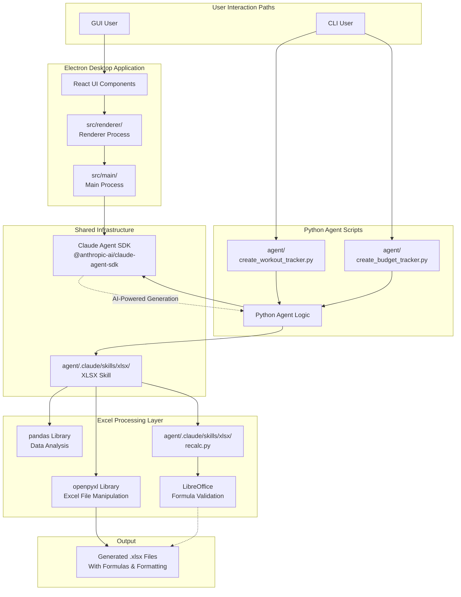
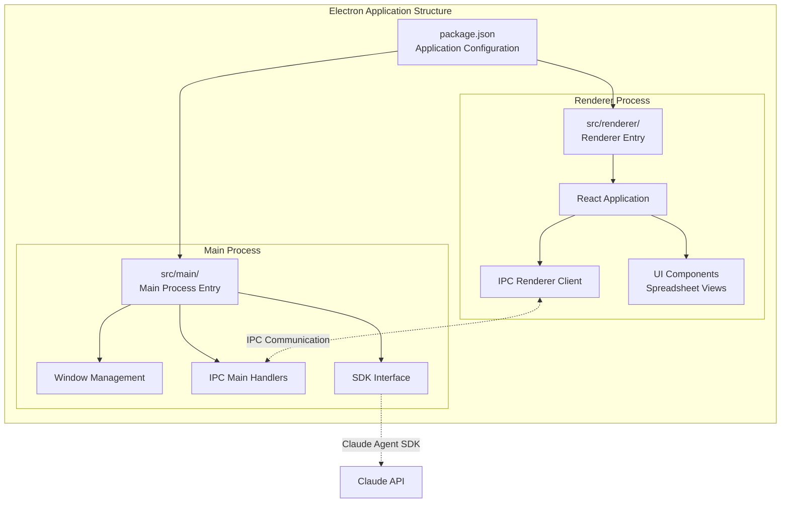
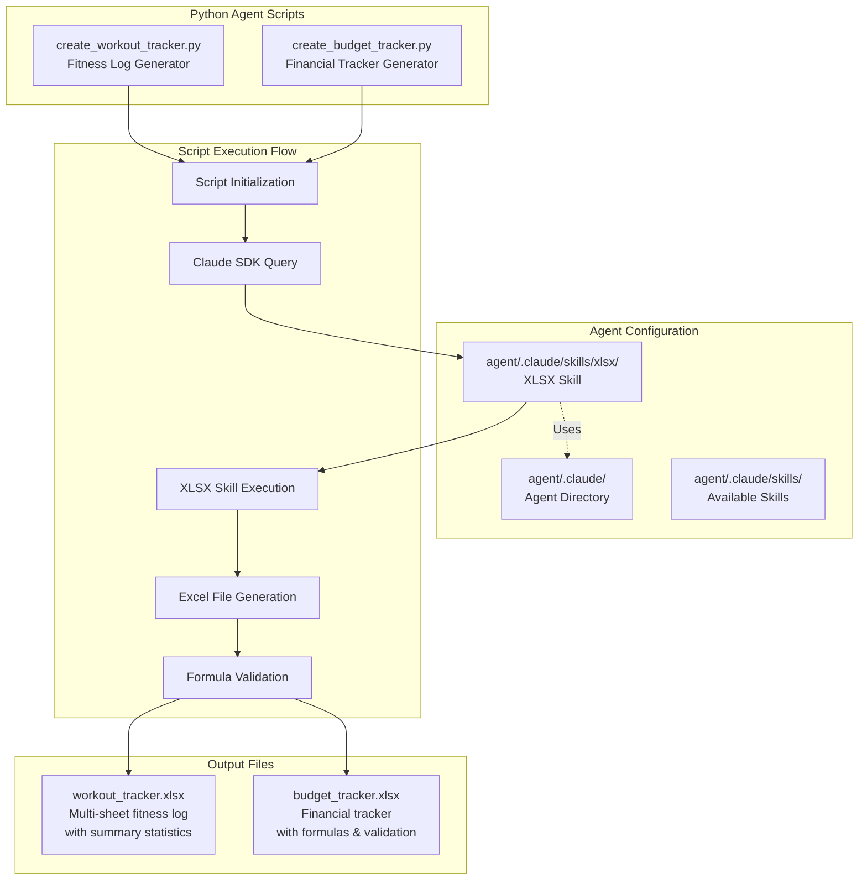
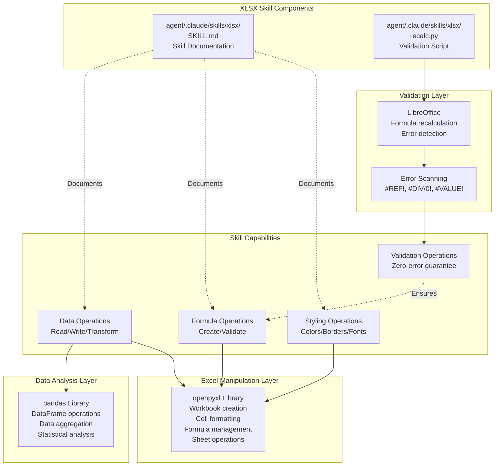
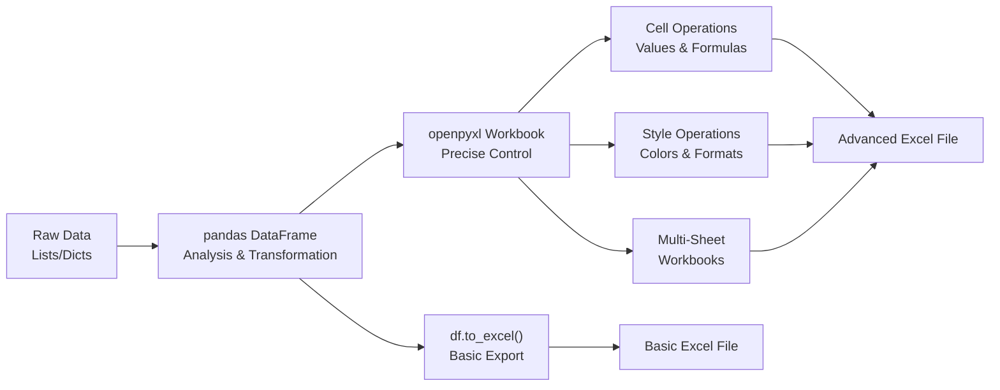
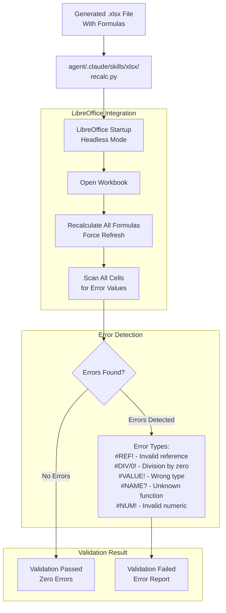

<!-- source: DeepWiki mcp.deepwiki.com · repo anthropics/claude-agent-sdk-demos · page 6 Excel Demo · fetched 2026-10-26 -->

# Excel Demo

<details>
<summary>Relevant source files</summary>

The following files were used as context for generating this wiki page:

- [README.md](README.md)
- [excel-demo/README.md](excel-demo/README.md)

</details>


**Purpose and Scope**: This document covers the Excel Demo, a hybrid Electron desktop application and Python script system for AI-powered spreadsheet creation and manipulation. The demo showcases how to integrate the Claude Agent SDK with both GUI-driven (Electron) and command-line (Python) workflows for generating complex Excel files with formulas, formatting, and multi-sheet workbooks. For information about other demos in the repository, see [Overview](#1). For details on Claude Agent SDK integration patterns, see [Claude Agent SDK Integration](#7).

**Sources**: [README.md:15-16](), [excel-demo/README.md:5-14]()

---

## Architecture Overview

The Excel Demo implements a dual-architecture approach that supports two distinct interaction models for spreadsheet generation and manipulation. This design enables both exploratory interactive work and production batch processing workflows.



**Diagram**: Excel Demo Dual-Architecture System

The architecture comprises two independent execution paths:

| Component | Purpose | Entry Point | SDK Integration |
|-----------|---------|-------------|-----------------|
| Electron Desktop App | GUI-driven interactive spreadsheet work | `src/main/` main process | JavaScript/TypeScript SDK |
| Python Agent Scripts | Command-line batch spreadsheet generation | `agent/*.py` scripts | Python SDK (if available) or subprocess calls |

Both paths leverage the Claude Agent SDK for AI-powered logic, but the Python scripts additionally integrate directly with `openpyxl` for precise Excel file manipulation, enabling control over formulas, formatting, cell ranges, and multi-sheet workbooks. The `recalc.py` validation script ensures generated files meet zero-error requirements by invoking LibreOffice to recalculate all formulas and scan for error values.

**Sources**: [excel-demo/README.md:5-22](), [excel-demo/README.md:88-100]()

---

## Desktop Application

The Electron-based desktop application provides a GUI-driven interface for spreadsheet creation and manipulation. The application follows the standard Electron architecture with separated main and renderer processes.



**Diagram**: Electron Application Structure

### Application Components

| Directory | Component Type | Responsibilities |
|-----------|---------------|------------------|
| `src/main/` | Main Process | Window lifecycle, native APIs, SDK integration, file system access |
| `src/renderer/` | Renderer Process | React UI, user interactions, spreadsheet display |
| `package.json` | Configuration | Dependencies, scripts, Electron configuration |

The main process handles communication with the Claude Agent SDK and manages file system operations for reading/writing Excel files. The renderer process provides the React-based user interface for interacting with spreadsheets. Inter-process communication (IPC) enables the renderer to request operations from the main process.

**Starting the Application**:
```bash
npm start
# or
bun start
```

**Sources**: [excel-demo/README.md:9-14](), [excel-demo/README.md:48-52](), [excel-demo/README.md:88-100]()

---

## Python Agents

The `agent/` directory contains Python scripts that demonstrate command-line driven spreadsheet generation using AI-powered logic. These scripts provide reproducible, automated workflows for creating complex Excel files.



**Diagram**: Python Agent Script Workflow

### Available Scripts

The demonstration includes two example generators:

| Script | Purpose | Output Features |
|--------|---------|-----------------|
| `create_workout_tracker.py` | Fitness log | Multiple sheets, automatic summary statistics, date tracking |
| `create_budget_tracker.py` | Financial tracking | Formula calculations, data validation, category summaries |

### Python Environment Setup

The Python agents require a dedicated virtual environment with specific dependencies:

```bash
cd agent
python -m venv .venv
source .venv/bin/activate  # On Windows: .venv\Scripts\activate
pip install -r requirements.txt
```

**Key Dependencies**:
- `openpyxl`: Excel file manipulation library
- `pandas`: Data analysis and manipulation
- Claude Agent SDK (Python bindings or subprocess interface)

### Running Agent Scripts

```bash
# Create workout tracker spreadsheet
python create_workout_tracker.py

# Create budget tracker spreadsheet
python create_budget_tracker.py
```

Each script generates a complete `.xlsx` file with professional formatting, formulas, and multiple sheets as appropriate for the use case.

**Sources**: [excel-demo/README.md:16-21](), [excel-demo/README.md:54-75](), [excel-demo/README.md:88-100]()

---

## XLSX Skill

The XLSX skill provides the core capabilities for Excel file manipulation, accessible to Claude agents through the skill system. Located in `agent/.claude/skills/xlsx/`, this skill integrates both `pandas` for data analysis and `openpyxl` for precise Excel file construction.



**Diagram**: XLSX Skill Architecture

### Skill Location and Structure

| Component | Path | Purpose |
|-----------|------|---------|
| Skill Documentation | `agent/.claude/skills/xlsx/SKILL.md` | Capability descriptions, usage patterns, requirements |
| Validation Script | `agent/.claude/skills/xlsx/recalc.py` | LibreOffice-based formula validation |
| Supporting Code | `agent/.claude/skills/xlsx/*.py` | Additional skill implementation files |

The skill system enables Claude to understand and execute complex spreadsheet operations by providing structured documentation and executable tools.

**Sources**: [excel-demo/README.md:77](), [excel-demo/README.md:92-95]()

---

## Spreadsheet Operations

The XLSX skill supports comprehensive spreadsheet operations through integration with `pandas` and `openpyxl`, enabling both data-centric and presentation-centric workflows.

### Data Analysis with pandas

The skill leverages `pandas` for high-level data operations:

- **DataFrame Construction**: Building tabular data from lists, dictionaries, or existing files
- **Data Aggregation**: Grouping, summing, averaging, and statistical calculations
- **Data Transformation**: Filtering, sorting, pivoting, and reshaping data
- **Data Import/Export**: Reading from and writing to CSV, Excel, and other formats

### File Manipulation with openpyxl

The skill uses `openpyxl` for precise Excel file control:

| Operation Category | Capabilities |
|-------------------|--------------|
| Workbook Management | Create workbooks, add/remove sheets, set active sheet |
| Cell Operations | Write values, read values, merge cells, set cell ranges |
| Formula Management | Insert Excel formulas (SUM, AVERAGE, IF, VLOOKUP, etc.) |
| Styling | Apply fonts, colors, borders, number formats |
| Sheet Configuration | Set column widths, freeze panes, add headers |
| Data Validation | Create dropdown lists, numeric constraints |

### Integration Pattern



**Diagram**: Data Processing to Excel File Pipeline

For simple data exports, `pandas.DataFrame.to_excel()` suffices. For complex spreadsheets with custom formulas, professional styling, and multi-sheet structures, the skill uses `openpyxl` directly to construct workbooks cell-by-cell with full control over all Excel features.

**Sources**: [excel-demo/README.md:9-13](), [excel-demo/README.md:79-86](), [excel-demo/README.md:106]()

---

## Formula Management and Validation

Formula creation and validation are critical capabilities of the XLSX skill, ensuring generated spreadsheets are functionally correct and error-free.

### Formula Construction Rules

When creating formulas with `openpyxl`, the skill follows Excel formula syntax:

```python
# Example formula patterns (not actual code, illustrative)
cell.value = "=SUM(B2:B10)"           # Range sum
cell.value = "=AVERAGE(C:C)"          # Column average
cell.value = "=IF(D2>0, D2*E2, 0)"    # Conditional logic
cell.value = "=VLOOKUP(A2, Table1, 2, FALSE)"  # Lookup
```

### Validation with recalc.py

The `recalc.py` script provides automated validation of generated Excel files using LibreOffice as a calculation engine.



**Diagram**: Formula Validation Pipeline

### Validation Process

The validation script performs the following steps:

1. **Launch LibreOffice**: Starts LibreOffice in headless mode (no GUI)
2. **Open Workbook**: Loads the generated `.xlsx` file
3. **Force Recalculation**: Triggers recalculation of all formulas in all sheets
4. **Error Scanning**: Iterates through all cells checking for error values
5. **Report Generation**: Outputs validation results with cell locations of any errors

### Zero-Error Requirement

The XLSX skill enforces a zero-error standard for all generated spreadsheets. Any formula that produces an error value (`#REF!`, `#DIV/0!`, `#VALUE!`, `#NAME?`, `#NUM!`) indicates a defect that must be corrected before the file is considered valid.

**Prerequisites**: LibreOffice must be installed and accessible in the system PATH for validation to function.

**Sources**: [excel-demo/README.md:28](), [excel-demo/README.md:82]()

---

## Financial Model Standards

The XLSX skill incorporates industry-standard conventions for financial modeling and professional spreadsheet design, ensuring generated files follow best practices.

### Color Conventions

Financial models use specific color codes to indicate cell types:

| Color | Purpose | Excel Application |
|-------|---------|-------------------|
| Blue | Input cells | User-entered data, assumptions |
| Black | Formula cells | Calculated values, references |
| Green | Links from other sheets | Cross-sheet references |

These conventions enable users to quickly identify which cells are editable inputs versus calculated outputs.

### Number Formatting Standards

Professional spreadsheets apply consistent number formatting:

- **Currency**: `$#,##0.00` or `$#,##0` for whole dollars
- **Percentages**: `0.0%` or `0.00%` with appropriate decimal places
- **Large Numbers**: `#,##0` with thousands separators
- **Dates**: Standard date formats (`MM/DD/YYYY` or region-appropriate)

### Professional Styling Requirements

Generated spreadsheets include:

- **Header Rows**: Bold text, colored backgrounds, border separators
- **Column Widths**: Auto-adjusted or explicitly set for readability
- **Borders**: Appropriate use of borders to separate sections
- **Alignment**: Right-align numbers, left-align text, center-align headers
- **Font Choices**: Professional fonts (Arial, Calibri) with consistent sizing

### Multi-Sheet Organization

Complex workbooks organize data across multiple sheets:

- **Input Sheet**: User-provided data and assumptions
- **Calculation Sheets**: Intermediate calculations and transformations
- **Output/Summary Sheet**: Final results and key metrics
- **Documentation Sheet**: Explanations and instructions (optional)

The XLSX skill generates workbooks that follow these conventions automatically when creating financial models, budgets, or similar professional spreadsheets.

**Sources**: [excel-demo/README.md:79-86](), [excel-demo/README.md:16-21]()

---

## Configuration and Setup

The Excel Demo requires setup for both the Electron desktop application and the Python agent environment.

### Electron Application Setup

**Prerequisites**:
- Node.js 18+ or Bun runtime
- Anthropic API key

**Installation Steps**:

```bash
# Navigate to excel-demo directory
cd excel-demo

# Install dependencies
npm install
# or
bun install
```

**Configuration**:

Set the Anthropic API key via environment variable:
```bash
export ANTHROPIC_API_KEY='your-api-key-here'
```

Alternatively, the application will prompt for the API key on first run.

**Running the Application**:

```bash
npm start
# or
bun start
```

### Python Agent Environment Setup

**Prerequisites**:
- Python 3.9+
- LibreOffice (for formula validation)
- Anthropic API key

**Virtual Environment Creation**:

```bash
cd agent
python -m venv .venv

# Activate virtual environment
# On Unix/macOS:
source .venv/bin/activate

# On Windows:
.venv\Scripts\activate
```

**Dependency Installation**:

```bash
pip install -r requirements.txt
```

This installs required packages including:
- `openpyxl` for Excel file manipulation
- `pandas` for data analysis
- Claude Agent SDK dependencies

**Environment Variables**:

Set the Anthropic API key:
```bash
export ANTHROPIC_API_KEY='your-api-key-here'
```

### Verification

Verify the setup by running an example script:

```bash
python create_workout_tracker.py
```

This should generate a `workout_tracker.xlsx` file in the output directory. If LibreOffice is installed, the validation script will automatically verify all formulas.

### Directory Structure

```
excel-demo/
├── agent/                     # Python agent scripts and skills
│   ├── .claude/              # Agent configuration
│   │   └── skills/
│   │       └── xlsx/         # XLSX skill implementation
│   ├── create_workout_tracker.py
│   ├── create_budget_tracker.py
│   ├── requirements.txt      # Python dependencies
│   └── README.md             # Agent-specific documentation
├── src/
│   ├── main/                 # Electron main process
│   └── renderer/             # Electron renderer process
├── package.json              # Node/Electron dependencies
└── README.md                 # Demo documentation
```

**Sources**: [excel-demo/README.md:23-52](), [excel-demo/README.md:54-77](), [excel-demo/README.md:88-100]()

---

