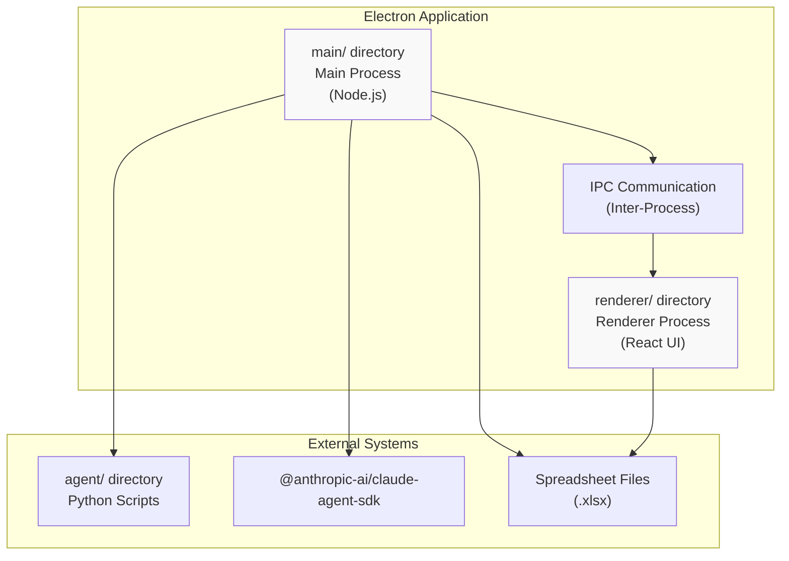
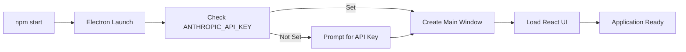
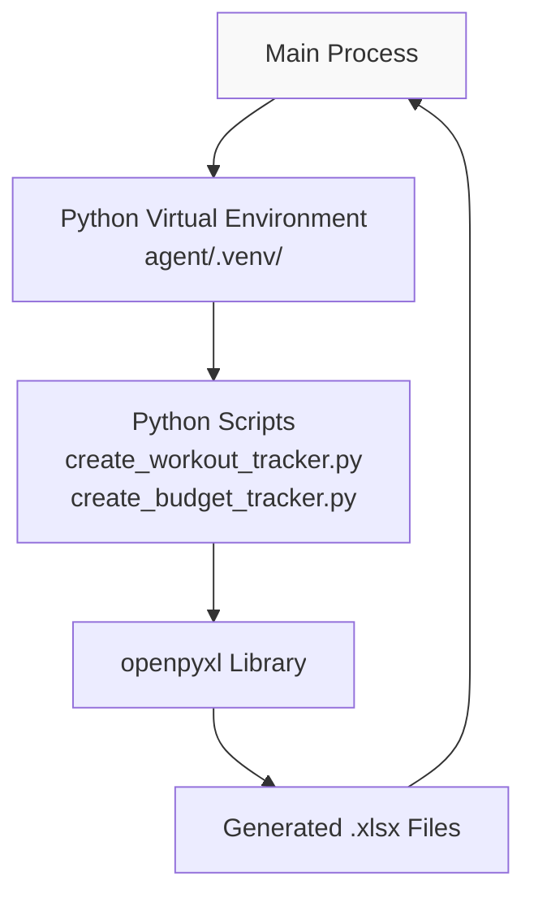
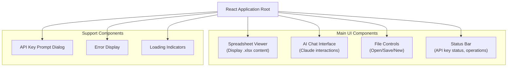
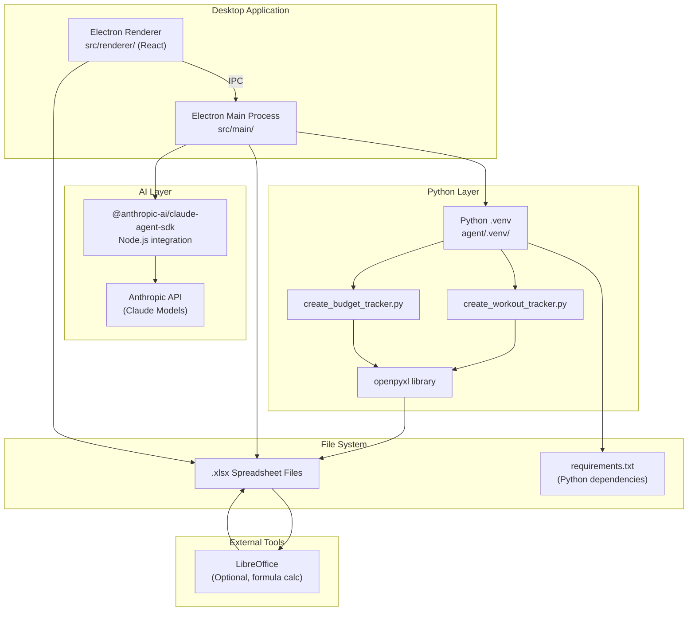
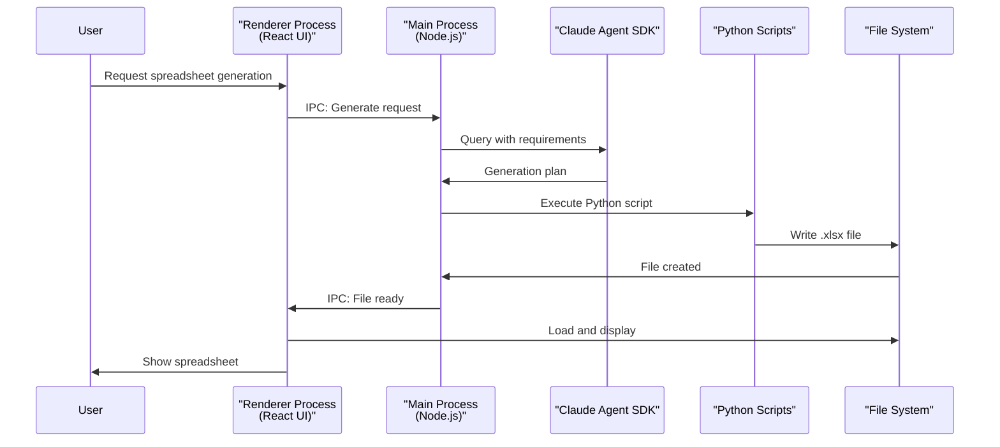
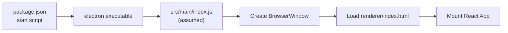
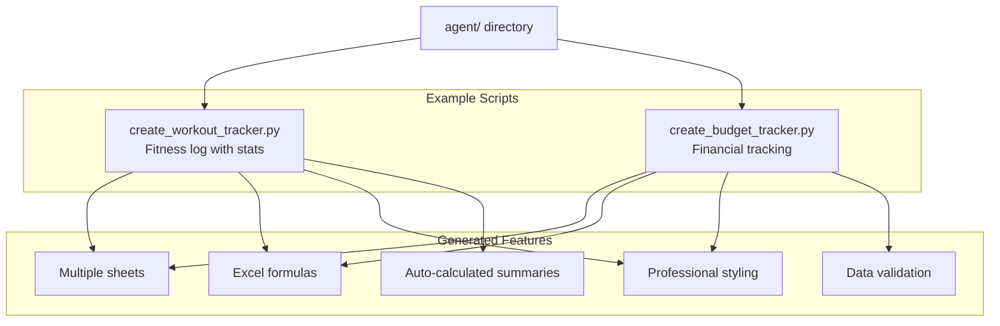
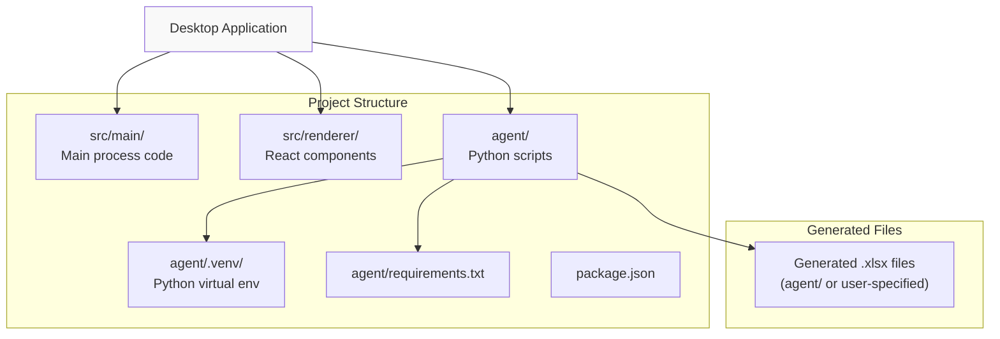

<!-- source: DeepWiki mcp.deepwiki.com · repo anthropics/claude-agent-sdk-demos · page 6.2 Desktop Application · fetched 2026-10-26 -->

# Desktop Application

Relevant source files

The following files were used as context for generating this wiki page:

- [README.md](README.md)
- [excel-demo/README.md](excel-demo/README.md)

## Purpose and Scope

This document covers the Electron-based desktop interface of the Excel Demo, including the main process architecture, renderer process with React UI components, and integration points with the Claude Agent SDK and Python agents. For information about the Python agents that generate spreadsheets using openpyxl, see [Python Agents](#6.3). For setup instructions and environment configuration, see [Configuration and Setup](#6.4).

## Application Architecture

The Excel Demo desktop application is built using Electron, which provides a native desktop experience using web technologies. The application follows Electron's standard two-process architecture with clear separation between the main process (Node.js backend) and the renderer process (React frontend).

### Process Architecture

**Sources:** [excel-demo/README.md:89-100]()

The desktop application is structured into two primary components:
- **Main Process** (`src/main/`): Handles backend operations, file system access, Python script execution, and SDK integration
- **Renderer Process** (`src/renderer/`): Provides the React-based user interface for spreadsheet interaction and AI assistance

### Application Lifecycle

**Sources:** [excel-demo/README.md:44-52]()

The application startup sequence includes automatic API key detection and prompting, ensuring users can begin working immediately after installation.

## Main Process

The main process (`src/main/`) serves as the Node.js backend for the Electron application. It is responsible for:

| Responsibility | Description |
|---------------|-------------|
| Window Management | Creating and managing the main application window |
| File System Access | Reading and writing Excel files (.xlsx) |
| Python Integration | Executing Python scripts from the `agent/` directory |
| SDK Communication | Interfacing with the Claude Agent SDK |
| API Key Management | Storing and validating the Anthropic API key |
| IPC Handling | Processing messages from the renderer process |

### Integration with Python Agents

**Sources:** [excel-demo/README.md:54-77](), [excel-demo/README.md:89-100]()

The main process coordinates with Python scripts in the `agent/` directory to generate complex spreadsheets. These scripts use the openpyxl library to create workbooks with:
- Multiple sheets
- Formulas and calculations
- Professional styling (colors, borders, fonts)
- Data validation
- Conditional formatting

### SDK Integration Points

The main process integrates with the Claude Agent SDK to provide AI-powered spreadsheet capabilities. This integration enables:

- **Spreadsheet Generation**: AI-driven creation of complex spreadsheets based on user requirements
- **Data Analysis**: Analyzing existing spreadsheet content and extracting insights
- **Formula Assistance**: Helping users create and debug Excel formulas
- **Design Recommendations**: Suggesting optimal spreadsheet structures and layouts

**Sources:** [excel-demo/README.md:9-15](), [excel-demo/README.md:79-86]()

## Renderer Process

The renderer process (`src/renderer/`) provides the React-based user interface. It displays the spreadsheet viewer, AI chat interface, and control panels for user interaction.

### UI Component Structure

**Sources:** [excel-demo/README.md:89-100]()

### Feature Capabilities

The renderer process provides the following user-facing features:

| Feature | Description |
|---------|-------------|
| Spreadsheet Display | Renders Excel files with formatting, formulas, and multiple sheets |
| AI Assistance | Chat interface for spreadsheet-related queries and generation |
| File Operations | Open, save, and create new spreadsheet files |
| Multi-Sheet Navigation | Tab-based interface for workbooks with multiple sheets |
| Formula Recalculation | Integration with LibreOffice for automatic formula updates |
| Python Script Access | UI for running pre-built Python examples |

**Sources:** [excel-demo/README.md:79-86](), [excel-demo/README.md:17-22]()

## Integration Architecture

The desktop application integrates multiple systems to provide a cohesive spreadsheet manipulation experience.

### System Integration Map

**Sources:** [excel-demo/README.md:1-122]()

### Communication Flow

**Sources:** [excel-demo/README.md:9-15]()

The communication flow demonstrates how user requests flow through the IPC boundary, coordinate with AI services and Python scripts, and return results to the user interface.

## Startup and Initialization

### Application Entry Point

The application starts through the standard Electron entry point pattern:

**Sources:** [excel-demo/README.md:48-52](), [excel-demo/README.md:89-100]()

The startup command `npm start` or `bun start` launches the Electron application, which initializes the main process, creates the application window, and loads the React-based renderer.

### Environment Configuration

The application checks for the `ANTHROPIC_API_KEY` environment variable during initialization:

| Configuration Method | Priority | Description |
|---------------------|----------|-------------|
| Environment Variable | 1 | `ANTHROPIC_API_KEY` set before launch |
| Interactive Prompt | 2 | Dialog shown on first run if key not found |
| Persistent Storage | 3 | Stored locally after first entry |

**Sources:** [excel-demo/README.md:44-46]()

## Example Workflows

### Pre-built Python Examples

The `agent/` directory contains example Python scripts that demonstrate spreadsheet generation capabilities:

**Sources:** [excel-demo/README.md:17-22](), [excel-demo/README.md:69-75]()

These examples showcase:
- **Workout Tracker**: Multi-sheet workbook with exercise logs and automatic summary statistics
- **Budget Tracker**: Financial tracking with formulas, data validation, and conditional formatting

## Technical Stack

The desktop application uses the following technology stack:

| Layer | Technology | Purpose |
|-------|-----------|---------|
| Desktop Framework | Electron | Native desktop application wrapper |
| Frontend Framework | React | UI component library |
| Backend Runtime | Node.js 18+ | Main process execution |
| Package Manager | npm/Bun | Dependency management |
| Python Runtime | Python 3.9+ | Spreadsheet generation scripts |
| Spreadsheet Library | openpyxl | Python Excel manipulation |
| Optional Tool | LibreOffice | Formula recalculation |

**Sources:** [excel-demo/README.md:23-28](), [excel-demo/README.md:104-106]()

## File System Integration

The application interacts with the local file system for spreadsheet storage and Python script execution:

**Sources:** [excel-demo/README.md:88-100]()

The application maintains a clean separation between code (`src/`), Python agents (`agent/`), and generated outputs, following standard project organization conventions.

---

