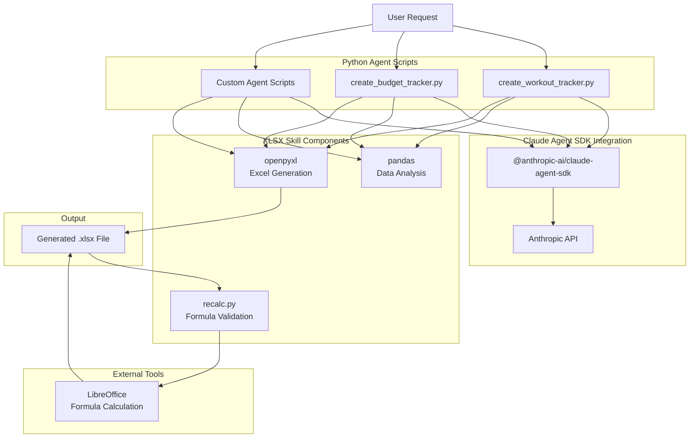
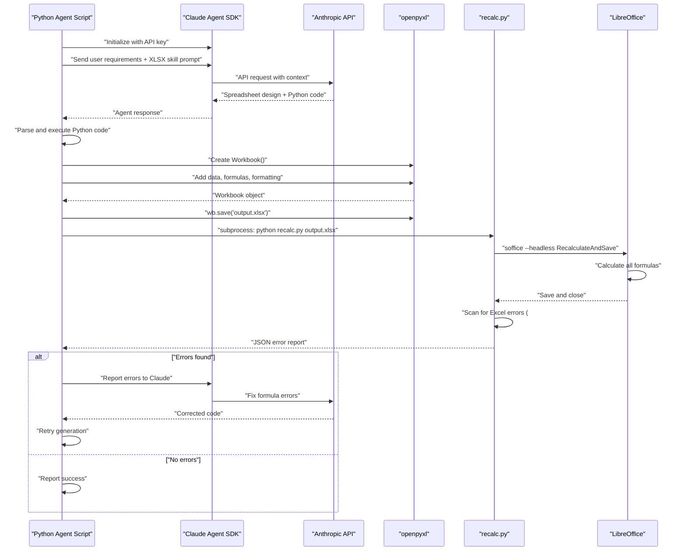
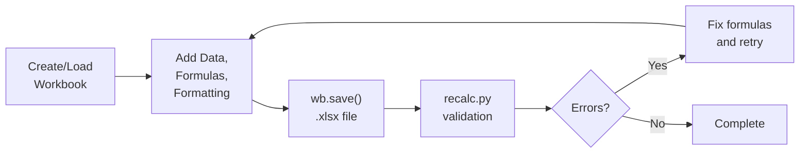
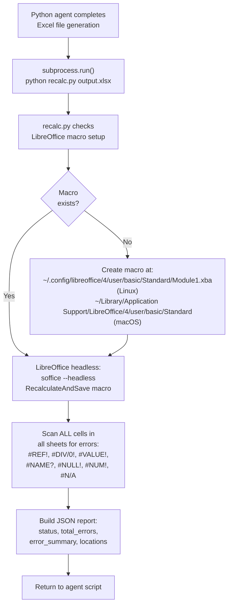
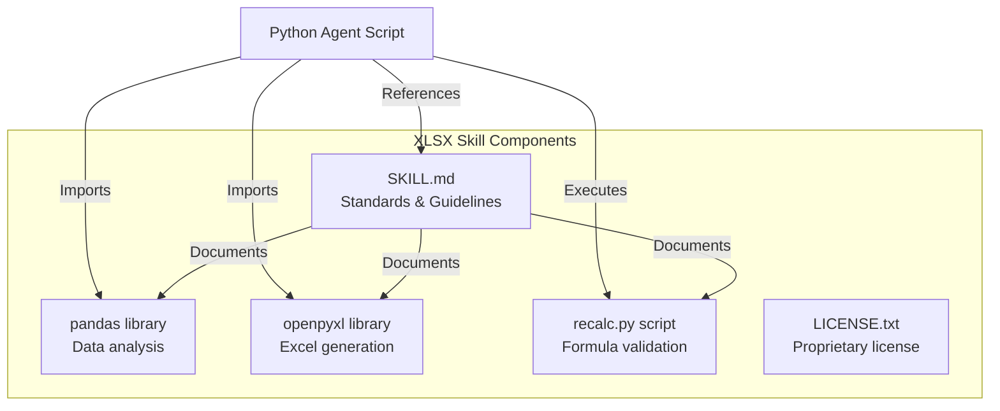

<!-- source: DeepWiki mcp.deepwiki.com · repo anthropics/claude-agent-sdk-demos · page 6.3 Python Agents · fetched 2026-10-26 -->

# Python Agents

<details>
<summary>Relevant source files</summary>

The following files were used as context for generating this wiki page:

- [README.md](README.md)
- [excel-demo/README.md](excel-demo/README.md)

</details>


## Purpose and Scope

This document describes the standalone Python agent scripts in the Excel Demo that generate and manipulate spreadsheets using the Claude Agent SDK and XLSX skill. These scripts can be executed independently from the command line or spawned by the Electron application for AI-powered spreadsheet creation.

For information about the XLSX skill components (openpyxl, pandas, recalc.py), see [XLSX Skill](#4.4). For desktop application integration, see [Desktop Application](#4.2).

## Architecture Overview

Python agents in the Excel Demo are self-contained scripts that combine Claude Agent SDK capabilities with spreadsheet manipulation libraries. Each agent script follows a standard pattern: receive user requirements, interact with Claude AI to design the spreadsheet structure, generate the Excel file using Python libraries, and validate formulas.



**Sources**: [excel-demo/agent/.claude/skills/xlsx/SKILL.md:1-289]()

## Agent Script Structure

Python agents follow a consistent structure:

| Component | Description |
|-----------|-------------|
| **Imports** | Claude Agent SDK, openpyxl, pandas, and supporting libraries |
| **Agent Configuration** | SDK initialization with API key and model selection |
| **Prompt Engineering** | System prompts that reference the XLSX skill documentation |
| **Spreadsheet Generation** | Code that creates workbooks, adds formulas, and applies formatting |
| **Formula Recalculation** | Execution of `recalc.py` to validate and calculate formulas |
| **Error Handling** | Detection and reporting of Excel formula errors |

### Typical Agent Workflow



**Sources**: [excel-demo/agent/.claude/skills/xlsx/SKILL.md:129-156](), [excel-demo/agent/.claude/skills/xlsx/recalc.py:53-156]()

## Claude Agent SDK Integration

Python agents use the Claude Agent SDK to access Claude's capabilities for understanding spreadsheet requirements and generating appropriate Excel structures. The SDK integration typically includes:

### SDK Initialization Pattern

```python
# Agent scripts initialize the SDK with environment variables
api_key = os.getenv('ANTHROPIC_API_KEY')
agent_sdk = ClaudeAgentSDK(api_key=api_key)
```

### XLSX Skill Prompting

Agents reference the XLSX skill documentation in their prompts to ensure Claude generates code that follows best practices:

- **Zero formula errors** requirement
- **Excel formulas over hardcoded values** for dynamic spreadsheets
- **Color coding standards** for financial models (blue=inputs, black=formulas, green=internal links)
- **Number formatting rules** (years as text, currency with units, zeros as "-")
- **Formula construction rules** (assumptions in separate cells, no hardcoded values)

**Sources**: [excel-demo/agent/.claude/skills/xlsx/SKILL.md:9-56]()

## XLSX Skill Usage

Python agents leverage the XLSX skill components for spreadsheet operations:

### Library Selection Matrix

| Operation Type | Library | Usage Pattern |
|---------------|---------|---------------|
| Data analysis | `pandas` | Read Excel, analyze data, compute statistics |
| Formula creation | `openpyxl` | Create workbooks, add formulas as strings |
| Formatting | `openpyxl` | Apply fonts, fills, alignment, column widths |
| Formula calculation | `recalc.py` | Validate and compute formula values via LibreOffice |

### openpyxl Usage Pattern



Key openpyxl operations used by agents:

- `Workbook()` - Create new workbook
- `wb.active` or `wb['SheetName']` - Access worksheets
- `sheet['A1'] = '=SUM(B2:B10)'` - Add formulas
- `Font(bold=True, color='0000FF')` - Apply blue color for inputs
- `PatternFill('solid', start_color='FFFF00')` - Yellow background for assumptions
- `column_dimensions['A'].width = 20` - Set column widths

**Sources**: [excel-demo/agent/.claude/skills/xlsx/SKILL.md:149-202]()

## Formula Validation with recalc.py

All Python agents must execute the `recalc.py` script after generating Excel files to calculate formula values and detect errors.

### recalc.py Execution Flow



### Error Report Format

The `recalc.py` script returns JSON with detailed error information:

```json
{
  "status": "errors_found",
  "total_errors": 3,
  "total_formulas": 42,
  "error_summary": {
    "#REF!": {
      "count": 2,
      "locations": ["Sheet1!B5", "Sheet1!C10"]
    },
    "#DIV/0!": {
      "count": 1,
      "locations": ["Sheet1!D15"]
    }
  }
}
```

**Sources**: [excel-demo/agent/.claude/skills/xlsx/recalc.py:1-178](), [excel-demo/agent/.claude/skills/xlsx/SKILL.md:204-260]()

## Execution Modes

Python agents support two execution modes:

### Standalone CLI Execution

```bash
cd excel-demo/agent
python create_workout_tracker.py --goal "Build muscle" --weeks 12
python create_budget_tracker.py --categories "Housing,Food,Transport"
```

Agents run independently, accepting command-line arguments and generating Excel files in the current directory.

### Electron-Spawned Execution


The Electron main process spawns Python agents as child processes, captures their output, and displays results in the UI. This enables seamless integration of Python-based spreadsheet generation within the desktop application.

**Sources**: Diagram 4 from high-level architecture

## Example Agents

### Workout Tracker Agent

The `create_workout_tracker.py` agent generates personalized workout tracking spreadsheets with:

- Exercise schedules organized by day and week
- Progress tracking formulas (e.g., `=SUM(B2:B8)` for weekly totals)
- Color-coded input cells (blue) vs. calculated cells (black)
- Conditional formatting for goal achievement
- Charts for visualizing progress over time

### Budget Tracker Agent

The `create_budget_tracker.py` agent creates financial tracking spreadsheets with:

- Income and expense categories
- Monthly budget vs. actual comparison formulas
- Percentage calculations (e.g., `=(Actual/Budget)-1` for variance)
- Year-to-date summaries with `=SUM()` functions
- Color-coded assumptions (yellow background) and external links (red text)
- Standard financial formatting (currency, percentages, zero as "-")

Both agents follow the financial model standards documented in the XLSX skill:

| Standard | Implementation |
|----------|----------------|
| Blue text (RGB: 0,0,255) | User inputs and scenario assumptions |
| Black text (RGB: 0,0,0) | All formulas and calculations |
| Yellow background (RGB: 255,255,0) | Key assumptions requiring attention |
| Currency format | `$#,##0` with units in headers ("Revenue ($mm)") |
| Zero display | `$#,##0;($#,##0);-` format to show "-" for zeros |

**Sources**: [excel-demo/agent/.claude/skills/xlsx/SKILL.md:20-40]()

## Creating Custom Agents

To create a new Python agent for spreadsheet generation:

### 1. Script Template Structure

```python
#!/usr/bin/env python3
import os
from openpyxl import Workbook
from openpyxl.styles import Font, PatternFill
import subprocess
import json

def create_custom_spreadsheet(requirements):
    """Generate custom spreadsheet based on requirements"""
    
    # Initialize workbook
    wb = Workbook()
    sheet = wb.active
    sheet.title = "CustomSheet"
    
    # Add data and formulas (not hardcoded values)
    sheet['A1'] = 'Item'
    sheet['B1'] = 'Value'
    sheet['B2'] = '=SUM(B3:B10)'  # Formula, not calculated value
    
    # Apply formatting per XLSX skill standards
    sheet['B2'].font = Font(color='0000FF')  # Blue for input
    
    # Save
    wb.save('custom_output.xlsx')
    
    # MANDATORY: Recalculate formulas
    result = subprocess.run(
        ['python', 'recalc.py', 'custom_output.xlsx'],
        capture_output=True,
        text=True
    )
    
    error_report = json.loads(result.stdout)
    
    if error_report['status'] == 'errors_found':
        print(f"Found {error_report['total_errors']} errors:")
        print(json.dumps(error_report['error_summary'], indent=2))
        return False
    
    return True
```

### 2. Key Requirements

| Requirement | Rationale |
|-------------|-----------|
| **Use formulas, not hardcoded values** | Spreadsheets must recalculate when inputs change |
| **Execute recalc.py** | Validates formulas and computes values via LibreOffice |
| **Handle errors** | Parse JSON error report and fix #REF!, #DIV/0!, etc. |
| **Follow color coding** | Blue=inputs, Black=formulas, Yellow=assumptions |
| **Document assumptions** | Add cell comments with data sources |

### 3. Formula Best Practices

```python
# ❌ WRONG - Hardcoding calculated values
total = df['Sales'].sum()
sheet['B10'] = total  # Hardcodes 5000

# ✅ CORRECT - Using Excel formulas
sheet['B10'] = '=SUM(B2:B9)'  # Recalculates automatically
```

**Critical**: All calculations must be performed by Excel formulas, not Python code, to maintain spreadsheet dynamism.

### 4. Error Handling Loop

```python
max_retries = 3
for attempt in range(max_retries):
    # Generate spreadsheet
    create_spreadsheet()
    
    # Validate
    result = recalc('output.xlsx')
    
    if result['status'] == 'success':
        break
    
    # Fix errors using Claude Agent SDK
    fix_formulas(result['error_summary'])
```

**Sources**: [excel-demo/agent/.claude/skills/xlsx/SKILL.md:96-156](), [excel-demo/agent/.claude/skills/xlsx/SKILL.md:224-260]()

## Integration with XLSX Skill

Python agents rely on the XLSX skill components documented in [excel-demo/agent/.claude/skills/xlsx/SKILL.md:1-289](). Key integration points:

### Skill Components Used



### Skill Standards Applied

Agents must adhere to requirements from `SKILL.md`:

1. **Zero Formula Errors** [excel-demo/agent/.claude/skills/xlsx/SKILL.md:11-12]() - Every Excel model must have zero #REF!, #DIV/0!, #VALUE!, #N/A, #NAME? errors
2. **Preserve Templates** [excel-demo/agent/.claude/skills/xlsx/SKILL.md:14-17]() - When modifying existing files, match existing format and conventions
3. **Color Coding** [excel-demo/agent/.claude/skills/xlsx/SKILL.md:20-29]() - Industry-standard colors for inputs, formulas, and links
4. **Number Formatting** [excel-demo/agent/.claude/skills/xlsx/SKILL.md:31-39]() - Consistent formatting for currency, years, percentages, zeros
5. **Formula Construction** [excel-demo/agent/.claude/skills/xlsx/SKILL.md:42-53]() - Assumptions in separate cells, no hardcoded values in formulas

**Sources**: [excel-demo/agent/.claude/skills/xlsx/SKILL.md:1-289](), [excel-demo/agent/.claude/skills/xlsx/LICENSE.txt:1-31]()

---

