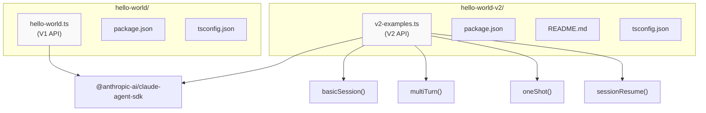
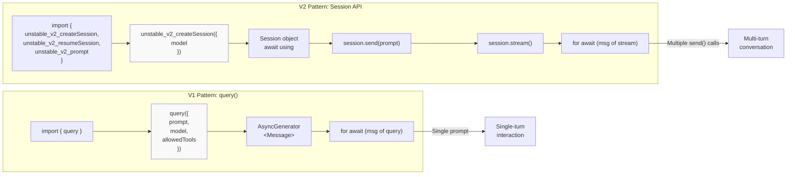
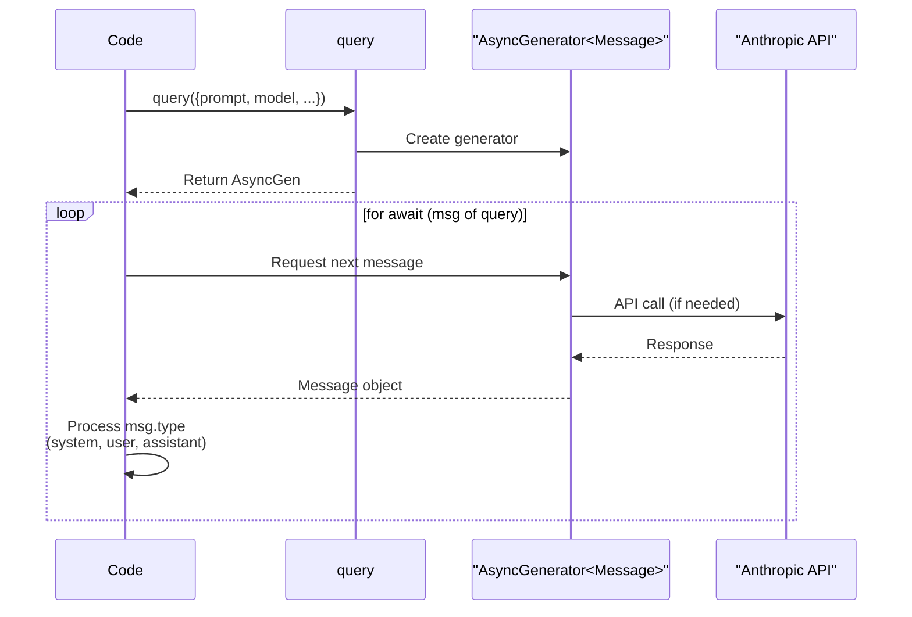
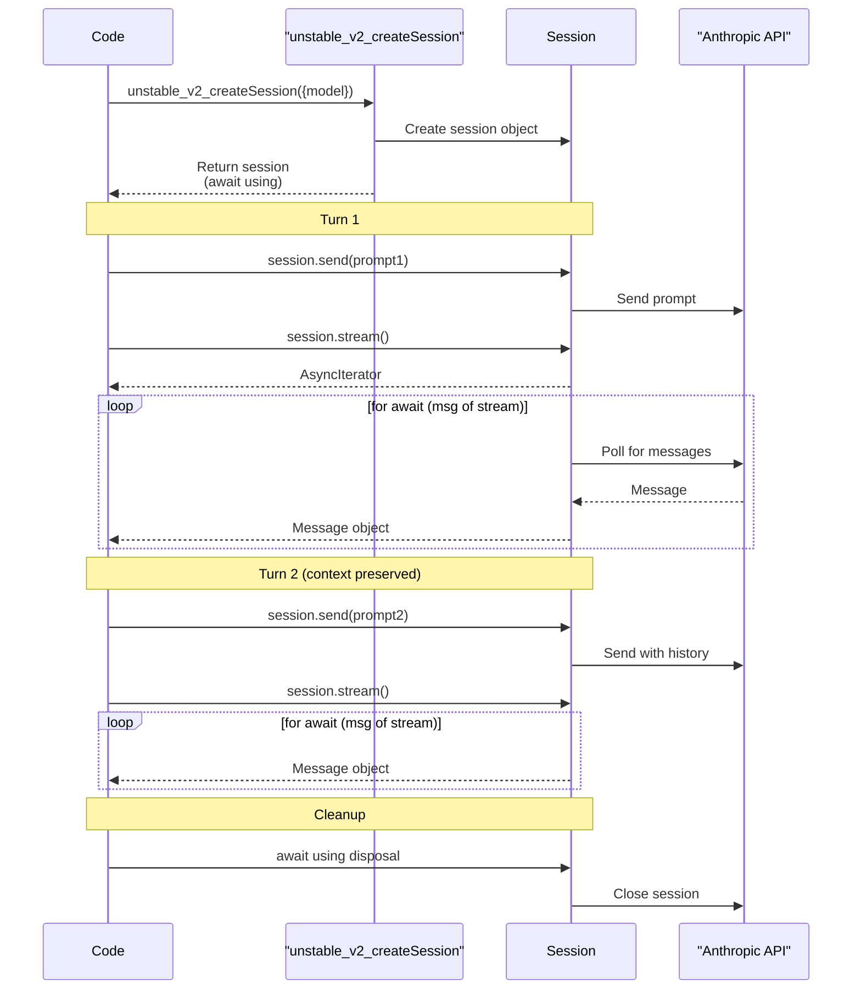
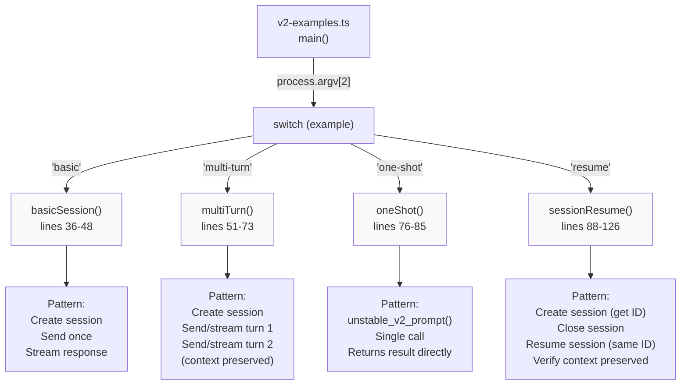
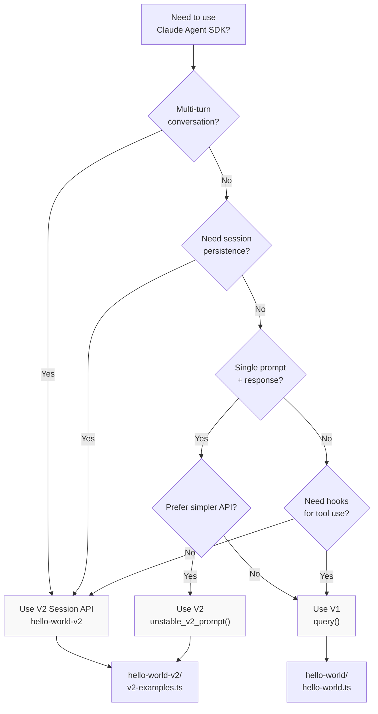

<!-- source: DeepWiki mcp.deepwiki.com · repo anthropics/claude-agent-sdk-demos · page 7 Hello World Demos · fetched 2026-10-26 -->

# Hello World Demos

<details>
<summary>Relevant source files</summary>

The following files were used as context for generating this wiki page:

- [README.md](README.md)
- [excel-demo/README.md](excel-demo/README.md)
- [hello-world-v2/README.md](hello-world-v2/README.md)
- [hello-world-v2/package.json](hello-world-v2/package.json)
- [hello-world-v2/tsconfig.json](hello-world-v2/tsconfig.json)
- [hello-world-v2/v2-examples.ts](hello-world-v2/v2-examples.ts)

</details>


The Hello World demos provide introductory examples for learning the Claude Agent SDK. These demonstrations illustrate two distinct API patterns: the V1 `query()` function pattern ([hello-world](#7.1)) and the V2 Session API pattern ([hello-world-v2](#7.2)). Both demos are minimal implementations designed to teach fundamental SDK concepts without the complexity of real-world application features.

For comprehensive SDK integration patterns used across all demos, see [Claude Agent SDK Integration](#8). For production-quality examples with advanced features, see [Resume Generator Demo](#3), [Email Agent Demo](#4), or [Research Agent Demo](#5).

## Demo Repository Structure

The repository contains two separate hello world implementations in distinct directories:



**Sources:** [README.md:18-19](), [hello-world-v2/v2-examples.ts:1-6]()

## Demo Comparison

| Aspect | hello-world (V1) | hello-world-v2 (V2) |
|--------|------------------|---------------------|
| **API Pattern** | `query()` function | Session API |
| **Primary Use Case** | Single-turn prompts | Multi-turn conversations |
| **Entry Point** | `hello-world.ts` | `v2-examples.ts` |
| **Examples Included** | Basic query, hooks | 4 examples (basic, multi-turn, one-shot, resume) |
| **Context Management** | Manual via prompt | Automatic via session |
| **Execution** | `npx tsx hello-world.ts` | `npx tsx v2-examples.ts [example]` |
| **Importance Score** | Basic introduction | 8.97 (from architecture analysis) |

**Sources:** [hello-world-v2/README.md:6-11](), [hello-world-v2/v2-examples.ts:15-32]()

## API Pattern Overview

The two demos illustrate fundamentally different approaches to agent interaction:



**Sources:** [hello-world-v2/README.md:6-11](), [hello-world-v2/v2-examples.ts:8-12]()

## V1 Example Flow

The V1 API uses a single `query()` function that returns an async generator:



**Sources:** [hello-world-v2/README.md:11]()

## V2 Example Flow

The V2 API separates session creation, sending, and streaming:



**Sources:** [hello-world-v2/v2-examples.ts:36-73](), [hello-world-v2/README.md:25-30]()

## V2 Example Categories

The `hello-world-v2` demo provides four distinct example patterns:



**Sources:** [hello-world-v2/v2-examples.ts:14-32]()

## Key API Differences

| Feature | V1 `query()` | V2 Session API |
|---------|--------------|----------------|
| **Import** | `import { query }` | `import { unstable_v2_createSession, unstable_v2_resumeSession, unstable_v2_prompt }` |
| **Initialization** | Direct function call | `unstable_v2_createSession({ model })` |
| **Resource Management** | Manual | `await using` pattern (automatic disposal) |
| **Sending Input** | Via `prompt` option | `session.send(prompt)` |
| **Receiving Output** | `for await (msg of query(...))` | `for await (msg of session.stream())` |
| **Multi-turn** | Manual history via prompt | Automatic context preservation |
| **Session Persistence** | Not supported | `unstable_v2_resumeSession(sessionId)` |
| **One-shot Helper** | N/A | `unstable_v2_prompt(prompt, options)` |
| **Message Stream** | Combined input/output | Output-only (input via `send()`) |

**Sources:** [hello-world-v2/README.md:6-11](), [hello-world-v2/v2-examples.ts:8-12]()

## Code Entity Mapping

### V1 API Functions
- `query()` - Main entry point for V1 API
- Options object properties: `prompt`, `model`, `cwd`, `maxTurns`, `allowedTools`, `settingSources`, `preToolUse`, `postToolUse`
- Message types: `system`, `user`, `assistant`

### V2 API Functions
- `unstable_v2_createSession(options)` - Creates new session [hello-world-v2/v2-examples.ts:39]()
- `unstable_v2_resumeSession(sessionId, options)` - Resumes existing session [hello-world-v2/v2-examples.ts:115]()
- `unstable_v2_prompt(prompt, options)` - One-shot convenience function [hello-world-v2/v2-examples.ts:79]()
- `session.send(prompt)` - Send user message [hello-world-v2/v2-examples.ts:40]()
- `session.stream()` - Stream responses [hello-world-v2/v2-examples.ts:42]()

**Sources:** [hello-world-v2/v2-examples.ts:8-12](), [hello-world-v2/README.md:25-36]()

## Choosing Between V1 and V2



**Sources:** [hello-world-v2/README.md:6-11]()

## Prerequisites

Both demos require:
- Node.js 18+ or Bun runtime
- Anthropic API key
- TypeScript execution environment (`tsx`)

Dependencies are minimal:
- `@anthropic-ai/claude-agent-sdk` - The core SDK package
- `typescript` and `tsx` - For TypeScript execution
- `@types/node` - Node.js type definitions

**Sources:** [README.md:35-36](), [hello-world-v2/package.json:7-14]()

## Running the Demos

### V1 Demo
```bash
cd hello-world
npx tsx hello-world.ts
```

### V2 Demo
```bash
cd hello-world-v2
npx tsx v2-examples.ts basic        # Basic send/stream pattern
npx tsx v2-examples.ts multi-turn   # Multi-turn conversation
npx tsx v2-examples.ts one-shot     # unstable_v2_prompt() helper
npx tsx v2-examples.ts resume       # Session persistence
```

**Sources:** [hello-world-v2/README.md:15-21](), [hello-world-v2/package.json:4-6]()

## Further Reading

- For detailed V1 API documentation, see [Hello World (V1 API)](#7.1)
- For detailed V2 API documentation, see [Hello World V2 (Session API)](#7.2)
- For comprehensive SDK concepts applicable to both APIs, see [SDK Core Concepts](#8.1)
- For V1 `query()` function details, see [V1 API: Query Function](#8.2)
- For V2 Session API details, see [V2 API: Session Management](#8.3)
- For production examples using V1, see [Resume Generator Demo](#3), [Email Agent Demo](#4), [Research Agent Demo](#5)

**Sources:** [README.md:1-69]()

---

